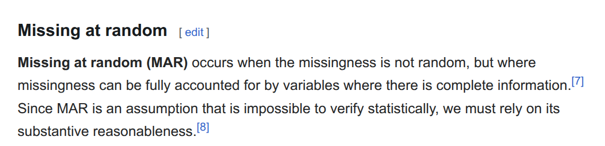

```{r}
#| label: setup
#| include: false
source("r/example.R")
source("r/slides.R")
source("r/advanced.R")
source("r/slides-advanced.R")
ex <- make_example()
export_example(ex)
adv <- make_advanced(ex)
export_advanced(adv)
sim <- read.csv("data/simulation-summary.csv")
stopifnot(all(sim$B == 3000))
nt <- notation_example()
knitr::opts_chunk$set(dev = "png", dpi = 150, fig.retina = 1,
                      fig.width = 7.4, fig.height = 4.9, out.width = "100%")
```

## Что такое пропущенные значения? {#intro-table .intro-visual}

```{=html}
<div class="intro-layout">
  <div class="sheet-window">
    <table class="intro-sheet" data-quarto-disable-processing="true" aria-label="Учебная таблица с разными обозначениями пропусков; отдельная иллюстрация, не выборка сквозного примера">
      <colgroup><col class="sheet-index"><col><col><col><col><col><col></colgroup>
      <thead>
        <tr class="sheet-letters" aria-hidden="true">
          <th class="sheet-corner"></th><th>A</th><th>B</th><th>C</th><th>D</th><th>E</th><th>F</th>
        </tr>
        <tr class="sheet-fields">
          <th class="sheet-row-number" aria-hidden="true">1</th>
          <th scope="col">Возраст</th><th scope="col">Пол</th><th scope="col">САД</th><th scope="col">ДАД</th><th scope="col">ИМТ</th><th scope="col">ХС</th>
        </tr>
      </thead>
      <tbody>
        <tr><th class="sheet-row-number" aria-hidden="true">2</th><td>54</td><td class="sheet-sex">М</td><td>138</td><td>86</td><td>29.1</td><td class="sheet-missing sheet-missing-label">нет данных</td></tr>
        <tr><th class="sheet-row-number" aria-hidden="true">3</th><td>61</td><td class="sheet-sex">Ж</td><td>149</td><td class="sheet-missing">NA</td><td class="sheet-missing">NULL</td><td>5.4</td></tr>
        <tr><th class="sheet-row-number" aria-hidden="true">4</th><td class="sheet-mascot"></td><td class="sheet-missing sheet-sex">999</td><td>136</td><td>92</td><td>27.4</td><td>5.8</td></tr>
        <tr><th class="sheet-row-number" aria-hidden="true">5</th><td>48</td><td class="sheet-sex">Ж</td><td>124</td><td>78</td><td>25.4</td><td class="sheet-missing" aria-label="Пустая ячейка"></td></tr>
        <tr><th class="sheet-row-number" aria-hidden="true">6</th><td>59</td><td class="sheet-sex">М</td><td>142</td><td class="sheet-missing">NA</td><td class="sheet-missing">NULL</td><td>6.1</td></tr>
        <tr><th class="sheet-row-number" aria-hidden="true">7</th><td>45</td><td class="sheet-sex">Ж</td><td class="sheet-missing">0</td><td>82</td><td>26.8</td><td>4.9</td></tr>
      </tbody>
    </table>
    <div class="sheet-tabs" aria-hidden="true"><span class="sheet-tab">Лист 1</span></div>
  </div>
  
</div>
```

::: {.notes}
- Анализ данных с пропущенными значениями – распространенная и технически сложная задача. Вокруг этой темы много мифов, а разнообразие рекомендаций может создавать впечатление, что подходы несогласованны и не имеют ясного теоретического обоснования.

- Разночтения начинаются уже с русскоязычной терминологии. Английское missing data переводят как «пропущенные данные», «пропущенные значения», «пропуски в данных» или «отсутствующие значения». В этом занятии будем говорить о пропущенных данных и пропущенных значениях.

- В таблицах пропуски обозначают по-разному: пустыми ячейками, NA, NULL, специальными числовыми кодами или текстом «нет данных». Как показывает пример на слайде, несколько способов обозначения могут одновременно встречаться в одном наборе данных.

- Однако различаются не только обозначения. За одинаково записанными пропусками могут стоять разные ситуации, имеющие разные последствия для анализа и статистического вывода. Поэтому важно понять, что именно означает отсутствие значения в конкретной задаче.

- Программное обеспечение часто обрабатывает пропуски автоматически. Корректность используемых методов зависит от допущений, которые могут быть весьма сильными. Эти условия легко остаются незамеченными, если полагаться на поведение программы по умолчанию.

- Метод, подходящий для одной ситуации, не обязательно оптимален для другой. В некоторых задачах необходимые для его применения допущения могут оказаться чрезмерно сильными. Поэтому при выборе способа работы с пропусками нужно обсуждать его предпосылки и оценивать, насколько они оправданны в конкретной ситуации.
:::

## Определение {#definition .center}

:::: {.definition-quote}
> Missing data are unobserved values that would be meaningful for analysis if observed; in other words, a missing value hides a meaningful value.

::: {.definition-translation lang="ru"}
> Пропущенные данные – это ненаблюдаемые значения, которые имели бы содержательный смысл для анализа, если бы наблюдались; иными словами, за пропуском скрывается осмысленное значение.
:::

::: {.definition-source}
Little, R. J. A., & Rubin, D. B. (2019).\
*Statistical Analysis with Missing Data*, 3rd ed.\
[Definition 1.1, p. 4](https://catalogimages.wiley.com/images/db/pdf/9780470526798.excerpt.pdf#page=4)
:::
::::

## Примеры пропущенных значений {#missing-examples .examples-slide}

::: {.incremental}
- Концентрация маркера не измерена: пробирка с биоматериалом потеряна в лаборатории.
- Лонгитудинальное исследование: оценка качества жизни на запланированном визите.
  - Живой участник не пришел на визит.
  - Участник умер до этого визита.
- Респондент оставил без ответа вопрос о своем доходе.
- Респондент не ответил на вопрос, поскольку не знает ответа или не имеет мнения.
- Концентрация вещества ниже предела обнаружения метода (LOD).
- В лонгитудинальном исследовании оценивают индекс Ki-67 и статус HER2 опухоли. На очередном визите опухоли нет.
:::

::: {.notes}
Смысл NA определяется целью анализа. Биомаркер в потерянной пробирке существует,
но не измерен. В опросе отсутствие позиции и отказ раскрыть позицию – разные случаи.
АД и качество жизни после смерти не определены; смерть – интеркуррентное событие,
для которого заранее выбирают стратегию в определении эстиманда. При LOD известна
верхняя граница концентрации, поэтому информация не отсутствует полностью.
При полном патологическом ответе нет опухолевой ткани: маркеры опухоли не следует
импутировать как обычные пропуски. «Не применимо» не тождественно численному нулю.
:::

## Цель статистического вывода при наличии пропущенных значений {#inference}

::: {.incremental}
- Субстантивная модель $f(Y\mid\theta)$ задает вектор параметров интереса $\theta$.
- При полных данных у нас есть метод оценки вектора параметров $\theta$ и неопределенности его оценки.
- При наличии пропусков оцениваем параметры по наблюдаемым значениям.
  - Восстановление каждой ячейки с пропуском не является самостоятельной целью анализа.
- Требования к методу оценки:
  - **Несмещенность:** [В среднем по повторным выборкам оценка равна истинному значению параметра ($\mathbb{E}[\hat{\theta}] = \theta$).]{.requirement-detail}
  - **Эффективность:** [Используем всю доступную информацию для уменьшения дисперсии оценок.]{.requirement-detail}
  - **Валидные оценки неопределенности:** [Корректные стандартные ошибки, доверительные интервалы и тестовые процедуры с учетом неопределенности из-за пропусков.]{.requirement-detail}
:::

::: {.notes}
Прогноз условного среднего минимизирует среднеквадратичную ошибку прогноза ячейки,
но детерминированная подстановка сокращает разброс и не учитывает неопределенность
импутации. Потеря информации должна отражаться в неопределенности вывода. Покрытие
95% – свойство процедуры при повторении выборок, а не отдельного интервала.
Сначала используем одну иллюстративную выборку. Позже отдельно оцениваем смещение
и покрытие на 3000 репликациях; близость одной оценки к истине не доказывает несмещенность.
:::

## Соглашение о нотации {#notation}

::::: {.notation-layout}
:::: {.notation-matrices}
::: {.notation-matrix}
```{r}
#| results: asis
notation_y <- nt$y[, 1:5, drop = FALSE]
notation_m <- nt$m[, 1:5, drop = FALSE]
notation_headers <- c('Возр', 'Пол', 'САД', 'ДАД', 'ИМТ')
notation_colors <- ifelse(notation_m == 1, course_colors[['missing']], course_colors[['observed']])
latex_matrix(notation_y, 'Y = ', notation_colors, notation_headers)
```
:::
::: {.notation-matrix}
```{r}
#| results: asis
shown <- notation_y
shown[notation_m == 1] <- '\\cdot'
latex_matrix(shown, '\\color{#006CC2}{Y_{\\mathrm{obs}}} = ', notation_colors, notation_headers)
```
:::
::: {.notation-matrix .indicator-observed .fragment data-fragment-index="0"}
```{r}
#| results: asis
latex_matrix(notation_m, 'M = ', headers = notation_headers)
```
:::
::::

::: {.notation-tuple}
$$
Y=(\color{#006CC2}{Y_{\mathrm{obs}}},\color{#B61A51}{Y_{\mathrm{mis}}})
$$
:::

::: {.notation-indicator}
$$
\color{#006CC2}{M}=(\color{#006CC2}{m_{ij}}),\qquad
\color{#006CC2}{m_{ij}}=\begin{cases}\color{#006CC2}{1},&\color{#B61A51}{Y_{ij}}\text{ пропущено},\\\color{#006CC2}{0},&\color{#006CC2}{Y_{ij}}\text{ наблюдается}.\end{cases}
$$
:::
:::::

::: {.notes}
- Строки $i$ соответствуют наблюдениям, столбцы $j$ – переменным. Пол закодирован как 1 – мужчина, 0 – женщина.
- $Y$ – полные данные. Синим показаны наблюдаемые значения, красным – пропущенные. Красные значения известны только в этой учебной иллюстрации.
- Средняя таблица показывает расположение наблюдаемых значений и пропусков. Это не прямоугольная матрица, состоящая только из наблюдаемых значений.
- Полные данные разбиваются на наблюдаемую часть $Y_{\mathrm{obs}}$ и пропущенную часть $Y_{\mathrm{mis}}$ с учетом матрицы индикаторов $M$.
- В реальном анализе нам доступны $Y_{\mathrm{obs}}$ и $M$. Значения $Y_{\mathrm{mis}}$ неизвестны.
- Значения матрицы $M$ сначала показаны серым, а при нажатии пробела становятся синими. Обычно предполагают, что M известна полностью: про каждую ячейку известно, пропущена ли она. Это допущение нарушается, если пропуск записан правдоподобным значением, например недокументированным 0 в САД на слайде 2; тогда неизвестна и сама M (Little и Rubin, 2019, с. 27; van Buuren, FIMD, разд. 2.2.3). Единица указывает на пропуск в $Y$, но сама не является пропущенным значением.
- Здесь $m_{ij}=1$ обозначает пропуск, а $m_{ij}=0$ – наблюдаемое значение. В литературе часто используют обратное соглашение: матрицу $R=1-M$, где 1 означает наблюдаемое значение, а 0 – пропуск.
:::

## Паттерны пропущенных значений (где находятся пропуски?) {#patterns}

::: {.pattern-grid}
```{r}
#| results: asis
pattern_masks <- pattern_examples()
for (name in names(pattern_masks)) pattern_panel(pattern_masks[[name]], name)
```
:::

::: {.notes}
Синяя ячейка – наблюдаемое значение, красная – пропуск. Паттерн показывает,
где находятся пропуски, но сам по себе не объясняет, почему они возникли.

Слово «паттерн» используют в двух смыслах. В широком смысле это расположение
пропусков во всей таблице – вся матрица индикаторов, как на рисунках этого слайда.
В другом смысле это конкретная конфигурация наблюдаемых и пропущенных переменных
у отдельного человека, то есть одна строка матрицы индикаторов. Один и тот же
паттерн может встречаться у целой группы наблюдений. Например, у одной группы
пропущены только Y1 и Y2, а у другой – только Y2 и Y3. Это два разных паттерна,
хотя число пропусков в каждой строке одинаково. Поэтому важно уточнять,
говорим ли мы о структуре всей таблицы или о конфигурации отдельного наблюдения.

Univariate: пропуски только в одной переменной. Monotone: после подходящего
упорядочивания столбцов пропуск означает пропуски во всех следующих столбцах;
пример – выбывание из лонгитудинального исследования. General: общий паттерн,
который нельзя привести к монотонному перестановкой столбцов.

Underidentified: на схеме показано небольшое перекрытие – последние две переменные
наблюдаются совместно только у одного участника. Здесь возникают ограничения
оценивания ковариации: по одной полной паре обычная выборочная ковариация
не определена. При малом числе полных пар ее оценка может быть крайне неточной;
при оценивании всей ковариационной матрицы также важны условия ее невырожденности.
Малое перекрытие само по себе не означает принципиальную неидентифицируемость.

Специальный крайний случай имеет название File Matching: две переменные
ни разу не наблюдаются совместно. Без дополнительных допущений их ковариацию
невозможно однозначно определить по наблюдаемым данным в принципе.
Это проблема идентифицируемости, а не только численная трудность или недостаток
точности: разные значения ковариации могут соответствовать одним и тем же
распределениям наблюдаемых данных. Общие переменные, как первые два столбца
на схеме, могут быть наблюдаемы у всех участников; сами по себе они не определяют
ковариацию двух переменных, которые никогда не наблюдаются совместно.

Аналогия – полное внешнее объединение двух таблиц (`full join`) по идентификатору
участника, когда наборы идентификаторов не пересекаются. Если в первой таблице
измерена Y3, а во второй Y4, объединение сохраняет всех участников; значения
переменной из другой таблицы заполняются NA. В результате нет ни одной строки,
где Y3 и Y4 наблюдаются совместно. В R это соответствует
[`dplyr::full_join(a, b, by = "id")`](https://dplyr.tidyverse.org/reference/mutate-joins.html)
при отсутствии совпадающих значений id. Это аналогия структуры данных:
само объединение таблиц не восстанавливает неизвестную связь между переменными.

Оформление сетки основано на Figure 4.1, раздел 4.1 книги Stef van Buuren,
Flexible Imputation of Missing Data: https://stefvanbuuren.name/fimd/missing-data-pattern.html.
Схемы построены для этой лекции; четвертая панель показывает небольшое перекрытие,
а File Matching обсуждается как крайний случай только в заметках.
Об идентифицируемости при File Matching: D’Orazio, Di Zio, Scanu,
[Old and new approaches in statistical matching](https://www.istat.it/wp-content/uploads/2013/12/Old-and-new-approaches-in-statistical-matching.pdf), раздел 1.
:::

## Монотонный паттерн {#patterns-widget .widget-slide}

::: {.widget-live}
<div id="w-patterns"></div>
:::

:::: {.widget-print}
::: {.pattern-grid .pattern-grid-print}
```{r}
#| results: asis
for (name in c('Monotone', 'General')) pattern_panel(pattern_masks[[name]], name)
```
:::
::::

::: {.notes}
В интерактиве два варианта: Monotone и General. В обоих вариантах строки
сначала перемешаны, а столбцы идут в исходном порядке Y1, Y2, …, Y8.
Номер Y обозначает переменную в исходной таблице, а не момент измерения.

В обоих вариантах есть строки с 3–5 пропущенными переменными. Вся сетка
показывает паттерн таблицы, а каждая ее строка – конкретную конфигурацию
пропусков у одного наблюдения. Совпадающие конфигурации образуют группу
наблюдений с одним паттерном; сортировка не меняет принадлежность к такой группе.

Монотонный паттерн не обязательно соответствует порядку наблюдений
в лонгитудинальном исследовании. В общем случае достаточно, чтобы существовал
порядок переменных, при котором за пропуском следуют только пропуски.
Этот порядок может отличаться от исходного порядка столбцов и от порядка визитов.

Для некоторых методов требование к расположению пропусков состоит только
в наличии монотонного паттерна после подходящего упорядочивания переменных.
Например, это позволяет выполнять последовательную регрессионную импутацию;
лонгитудинальная структура для нее не обязательна.

Есть и методы для лонгитудинальных исследований, которые моделируют монотонное
выбывание в хронологическом порядке визитов: после выбывания наблюдения
не возобновляются. Перемежающиеся пропуски – пропущенный визит с последующим
возвращением – такой процесс не описывает. В классических моделях выбывания
их обычно обрабатывают отдельно, например кодируют как у завершивших исследование
(Enders, 2022, с. 381, 390). Некоторые реализации, например взвешенные GEE в SAS,
требуют строгой монотонности и перемежающихся пропусков не допускают.
Перестановка столбцов сама по себе не делает такой метод применимым.
Допущения о механизме пропусков рассматриваются отдельно: монотонность
сама по себе ничего не говорит об информативности выбывания.

Выбрать вариант, затем отсортировать строки и столбцы, чтобы увидеть структуру.
У Monotone после сортировки
в каждой строке за первым пропуском следуют только пропуски. У General
перестановки не устраняют нарушения этого порядка.
В интерфейсе только выбор типа паттерна и две кнопки сортировки.
При переключении типа строки снова перемешаны, столбцы возвращаются к Y1–Y8.
При сортировке название переменной перемещается вместе с ее столбцом.
Цветные ячейки показывают наблюдаемость значений Y, а не численные значения
индикаторов M из предыдущего слайда. Используется та же плотная сетка,
что на статичном слайде по мотивам Figure 4.1 в книге ван Бюрена.
В R: mice::md.pattern(df), naniar::vis_miss(df, sort_miss = TRUE).

Примеры требований к паттерну: [последовательная импутация для монотонных данных](https://support.sas.com/documentation/cdl/en/statug/68162/HTML/default/statug_mi_details06.htm)
и [реализация взвешенных GEE для выбывания, без перемежающихся пропусков](https://support.sas.com/documentation/cdl/en/statug/67523/HTML/default/statug_gee_syntax05.htm).
:::

## Необходимый минимум из теории вероятностей {#prob-distributions .compact}

:::: {.formula-list}
::: {.formula-term}
**Обозначение**
:::
::: {.formula-body}
$f(y)$ – функция вероятности или плотность<br>
$f(y\mid\theta)$ – функция вероятности или плотность при заданных параметрах $\theta$<br>
для дискретных величин $\int$ заменяется на $\sum$
:::
::: {.formula-term}
**Маргинальное распределение**
:::
::: {.formula-body}
$f(y_1)=\displaystyle\int f(y_1,y_2)\,dy_2$
:::
::: {.formula-term}
**Условное распределение**
:::
::: {.formula-body}
$f(y_2\mid y_1)=\dfrac{f(y_1,y_2)}{f(y_1)},\qquad f(y_1)>0$
:::
::: {.formula-term}
**Цепное правило**
:::
::: {.formula-body}
$f(y_1,y_2)=f(y_1)\,f(y_2\mid y_1)$<br>
$f(y_1,\dots,y_p)=f(y_1)\,f(y_2\mid y_1)\cdots f(y_p\mid y_1,\dots,y_{p-1})$
:::
::: {.formula-term}
**Формула Байеса**
:::
::: {.formula-body}
$f(y_2\mid y_1)=\dfrac{f(y_1\mid y_2)\,f(y_2)}{f(y_1)}$
:::
::: {.formula-term}
**Независимость**
:::
::: {.formula-body}
$Y_1\perp Y_2\iff f(y_1,y_2)=f(y_1)\,f(y_2)$<br>
$f(\mathbf y_1,\dots,\mathbf y_n\mid\theta)=\prod_{i=1}^{n}f(\mathbf y_i\mid\theta)$
:::
::: {.formula-term}
**Условная независимость**
:::
::: {.formula-body}
$Y_1\perp Y_2\mid Y_3\iff f(y_1\mid y_2,y_3)=f(y_1\mid y_3)$
:::
::::

::: {.notes}
- Обозначение f(·). На слайде «Missingness mechanisms» механизм записан как Pr(M | …) и как f(M | …), на слайдах правдоподобия – как f(M | …). Для индикаторов пропусков это одна и та же функция вероятности.
- Маргинальное распределение. Наблюдаемое правдоподобие получается интегрированием по Y_mis: слайды «Полная модель и наблюдаемое правдоподобие» и «При MAR механизм выносится из интеграла».
- Условное распределение и цепное правило. Разложения f(Y, M) = f(Y) f(M | Y) (модель отбора) и f(Y | M) f(M) (смесь по паттернам) – слайд «Полная модель и наблюдаемое правдоподобие». Факторизация f(y₁) f(y₂ | y₁) – слайды «Параметризации двумерного нормального распределения», «Двумерная нормальная модель: факторизация», «ММП использует все значения ИМТ».
- Формула Байеса. Из нее при MAR следует f(Y_mis | Y_obs, M) = f(Y_mis | Y_obs): распределение пропущенных значений при данных наблюдаемых не зависит от паттерна пропусков. На этом основана импутация по наблюдаемым данным – слайд «От стохастической регрессии к MI» (Little и Rubin, 2019, с. 14).
- Независимость. Правдоподобие выборки – произведение по наблюдениям: слайды «Одномерная нормальная выборка: MCAR» и «ММП использует все значения ИМТ». Здесь 𝐲ᵢ – i-я строка данных, то есть одно наблюдение. MCAR означает независимость M и Y.
- Условная независимость. MAR – это M ⊥ Y_mis | Y_obs (слайд «Rubin's Typology» с определениями). Условие корректности анализа полных случаев M ⊥ Y | X – слайд «Complete Case Analysis».
:::

## Необходимый минимум из теории вероятностей {#prob-moments .compact}

:::: {.formula-list}
::: {.formula-term}
**Математическое ожидание**
:::
::: {.formula-body}
$\mathrm E\,g(Y)=\displaystyle\int g(y)\,f(y)\,dy$
:::
::: {.formula-term}
**Условное ожидание**
:::
::: {.formula-body}
$\mathrm E(Y_2\mid Y_1=y_1)=\displaystyle\int y_2\,f(y_2\mid y_1)\,dy_2$ – функция от $y_1$
:::
::: {.formula-term}
**Дисперсия**
:::
::: {.formula-body}
$\operatorname{Var}(Y)=\mathrm E(Y^2)-(\mathrm E\,Y)^2$<br>
$\mathrm E(Y_2^2\mid Y_1)=\operatorname{Var}(Y_2\mid Y_1)+\mathrm E(Y_2\mid Y_1)^2$
:::
::: {.formula-term}
**Закон повторного ожидания**
:::
::: {.formula-body}
$\mathrm E(Y_2)=\mathrm E\big[\mathrm E(Y_2\mid Y_1)\big]$
:::
::: {.formula-term}
**Разложение дисперсии**
:::
::: {.formula-body}
$\operatorname{Var}(Y_2)=\mathrm E\big[\operatorname{Var}(Y_2\mid Y_1)\big]+\operatorname{Var}\big[\mathrm E(Y_2\mid Y_1)\big]$
:::
::::

::: {.notes}
- Условное ожидание. Регрессия – это условное среднее E(Y | X): слайды «Параметризации двумерного нормального распределения» и «Сквозной пример: генеративный процесс». Q-функция EM – условное ожидание логарифма правдоподобия полных данных по Y_mis при данных Y_obs: слайд «EM: итеративный поиск оценки ММП».
- Дисперсия. Равенство E(Y² | X) = Var(Y | X) + E(Y | X)² используется на E-шаге для второго момента: слайд «EM учитывает условную дисперсию».
- Закон повторного ожидания. Обоснование IPW: если π(X) = Pr(M = 0 | X) и M ⊥ Y | X, то E[(1 − M) × Y / π(X)] = E[Y] – слайд «Взвешивание по обратной вероятности». Он же объясняет, почему подстановка условного среднего сохраняет среднее.
- Разложение дисперсии. Регрессионная импутация подставляет E(Y | X) и теряет слагаемое E[Var(Y | X)], поэтому разброс занижен – слайд «Одиночная импутация: регрессия». Стохастическая импутация возвращает остаточный разброс – слайд «Стохастическая регрессионная импутация». Правило Рубина T = W + (1 + 1/m)B по структуре повторяет это разложение: средняя дисперсия внутри импутаций плюс разброс между ними – слайд «От стохастической регрессии к MI».
:::

## Нормальное распределение {#mvn-density .compact}

:::: {.columns .mvn-layout}
::: {.column .mvn-formulas width="55%"}
**Одномерное**

$$Y\sim\mathcal N(\mu,\sigma^2)$$
$$f(y)=\frac{1}{\sqrt{2\pi}\,\sigma}\exp\!\left(-\frac{(y-\mu)^2}{2\sigma^2}\right)$$

**Многомерное**

$$Y=(Y_1,\dots,Y_p)^{\top}\sim\mathcal N_p(\mu,\Sigma)$$
$$f(y)=\frac{1}{(2\pi)^{p/2}\,|\Sigma|^{1/2}}\exp\!\left(-\frac12\,(y-\mu)^{\top}\Sigma^{-1}(y-\mu)\right)$$

**Двумерное**

$$p=2$$
$$\mu=\begin{pmatrix}\mu_1\\\mu_2\end{pmatrix},\qquad
\Sigma=\begin{pmatrix}\sigma_1^2&\rho\sigma_1\sigma_2\\\rho\sigma_1\sigma_2&\sigma_2^2\end{pmatrix}$$
:::
::: {.column width="45%"}
```{r}
#| label: plot-bivariate-density
#| fig-width: 5.4
#| fig-height: 5.4
#| out-width: "93%"
#| fig-alt: "Плотность двумерного нормального распределения: цвет от белого к синему, эллипсы равной плотности вытянуты вдоль положительной корреляции y1 и y2."
plot_bivariate_density(ex$config)
```
::: {.small .muted .mvn-caption}
$\mu_1=`r ex$config$mu[["BMI"]]`$, $\mu_2=`r ex$config$mu[["SBP"]]`$,
$\sigma_1=`r ex$config$sigma[["BMI"]]`$, $\sigma_2=`r ex$config$sigma[["SBP"]]`$,
$\rho=`r ex$config$rho`$
:::
:::
::::

::: {.notes}
- Одномерное нормальное распределение задается средним μ и дисперсией σ². Многомерное – вектором средних μ и ковариационной матрицей Σ; |Σ| – ее определитель.
- Выражение (y − μ)ᵀΣ⁻¹(y − μ) – квадрат расстояния Махаланобиса от точки y до центра μ. Линии постоянной плотности – эллипсы с центром μ.
- На рисунке μ₁ = 27, μ₂ = 135, σ₁ = 4, σ₂ = 15, ρ = 0.6. Чем темнее цвет, тем выше плотность. Линии – эллипсы с расстоянием Махаланобиса 1, 2 и 3, крестик – вектор средних. Наклон эллипсов отражает положительную корреляцию.
- Рисунок построен по формуле плотности с заданными параметрами, а не по выборке.
:::

## Параметризации двумерного нормального распределения {#bvn-parametrizations .compact}

::: {.param-joint}
$$\begin{pmatrix}Y_1\\Y_2\end{pmatrix}\sim\mathcal N_2\!\left(
\begin{pmatrix}\mu_1\\\mu_2\end{pmatrix},
\begin{pmatrix}\sigma_1^2&\rho\sigma_1\sigma_2\\\rho\sigma_1\sigma_2&\sigma_2^2\end{pmatrix}\right)$$

[Параметры ($\theta$): $(\mu_1,\mu_2,\sigma_1^2,\sigma_2^2,\rho)$]{.param-list}
:::

```{=html}
<svg class="param-arrows" viewBox="0 0 1448 104" aria-hidden="true">
  <defs>
    <marker id="param-arrowhead" viewBox="0 0 10 10" refX="9" refY="5" markerWidth="5" markerHeight="5" orient="auto-start-reverse">
      <path d="M0,0 L10,5 L0,10 z" fill="#B8C2CC"/>
    </marker>
  </defs>
  <line x1="452" y1="6" x2="358" y2="96" stroke="#B8C2CC" stroke-width="2" marker-end="url(#param-arrowhead)"/>
  <line x1="996" y1="6" x2="1090" y2="96" stroke="#B8C2CC" stroke-width="2" marker-end="url(#param-arrowhead)"/>
</svg>
```

:::: {.param-row}
::: {.param-box}
$$f(y_1,y_2)=f(y_1)\,f(y_2\mid y_1)$$

$$Y_1\sim\mathcal N(\mu_1,\sigma_1^2),\quad
Y_2\mid Y_1\sim\mathcal N(\beta_0+\beta_1Y_1,\ \sigma_{2\mid1}^2)$$
$$\mathrm E(Y_2\mid Y_1)=\beta_0+\beta_1Y_1=\mu_2+\rho\,\frac{\sigma_2}{\sigma_1}\,(Y_1-\mu_1)$$
$$\operatorname{Var}(Y_2\mid Y_1)=\sigma_{2\mid1}^2=\sigma_2^2\,(1-\rho^2)$$

[Параметры ($\theta$): $(\mu_1,\sigma_1^2,\beta_0,\beta_1,\sigma_{2\mid1}^2)$]{.param-list}
:::
::: {.param-box}
$$f(y_1,y_2)=f(y_2)\,f(y_1\mid y_2)$$

$$Y_2\sim\mathcal N(\mu_2,\sigma_2^2),\quad
Y_1\mid Y_2\sim\mathcal N(\gamma_0+\gamma_1Y_2,\ \sigma_{1\mid2}^2)$$
$$\mathrm E(Y_1\mid Y_2)=\gamma_0+\gamma_1Y_2=\mu_1+\rho\,\frac{\sigma_1}{\sigma_2}\,(Y_2-\mu_2)$$
$$\operatorname{Var}(Y_1\mid Y_2)=\sigma_{1\mid2}^2=\sigma_1^2\,(1-\rho^2)$$

[Параметры ($\theta$): $(\mu_2,\sigma_2^2,\gamma_0,\gamma_1,\sigma_{1\mid2}^2)$]{.param-list}
:::
::::

::: {.notes}
- Одно и то же двумерное нормальное распределение можно задать тремя наборами из пяти параметров. Сверху – моментная параметризация: средние, дисперсии и корреляция.
- Снизу – две регрессионные параметризации: маргинальное распределение одной переменной и линейная регрессия другой переменной на нее. Условное среднее линейно, условная дисперсия постоянна и не зависит от значения условной переменной.
- Наклоны связаны с моментами: β₁ = ρσ₂/σ₁, γ₁ = ρσ₁/σ₂; свободные члены β₀ = μ₂ − β₁μ₁, γ₀ = μ₁ − γ₁μ₂. При |ρ| < 1 и положительных дисперсиях переходы между параметризациями взаимно однозначны.
- Две регрессии не являются обратными друг другу: β₁γ₁ = ρ², поэтому γ₁ ≠ 1/β₁, если |ρ| < 1.
:::

## Данные для примера: генеративный процесс (DGP) {#dgp .compact .left-math}

$$
\begin{bmatrix}X_i\\Y_i\end{bmatrix}
=\begin{bmatrix}\mathrm{ИМТ}_i\\\mathrm{САД}_i\end{bmatrix}
\overset{\mathrm{iid}}{\sim}\mathcal N_2\!\left(
\begin{bmatrix}27\\135\end{bmatrix},
\begin{bmatrix}16&36\\36&225\end{bmatrix}\right),\qquad n=1000.
$$

[**Параметры**]{.dgp-params}

- $\mu_X=27$, $\sigma_X=4$ кг/м².
- $\mu_Y=135$, $\sigma_Y=15$ мм рт. ст.
- $\rho=0.60$.
- $\mathrm{E}(Y\mid X)=74.25+2.25X$, $\quad\beta_{Y\mid X}=\rho\,\sigma_Y/\sigma_X$.
- $\mathrm{E}(X\mid Y)=5.40+0.160Y$, $\quad\beta_{X\mid Y}=\rho\,\sigma_X/\sigma_Y$.

::: {.notes}
DGP – data-generating process, процесс порождения данных.
Данные генерируются через независимые Z1,Z2~N(0,1): X=27+4Z1,
Y=135+15(0.6Z1+0.8Z2). Это в точности указанное двумерное нормальное распределение.
Коэффициенты регрессий – параметры условных средних, а не детерминированные равенства
между ИМТ и САД. Остаточные SD равны 12 для Y|X и 3.2 для X|Y.
Одна выборка, один seed: `r ex$config$seed_data`. Те же люди и те же маски пропусков
используются при сравнении всех методов. Seed выбран заранее, без подбора результата.
RNGkind фиксирован; seed полной выборки, каждой маски и каждого стохастического
заполнения сохранены в data/metadata.R. Исходные числа PPTX заменены расчетом этой выборки.
:::

## Данные для примера (n = `r nrow(ex$complete)`) {#full-data .compact}

:::: {.columns}
::: {.column width="49%"}
```{r}
#| label: plot-full
#| fig-width: 5.6
#| fig-height: 5.6
#| out-width: "90%"
#| fig-alt: "1000 полных пар ИМТ–САД. Тонкие черные прямые – истинные регрессии из параметров DGP, толстые синие – оценки по полным данным; точки средних с пунктиром до осей."
plot_example(ex, square = TRUE, means = TRUE)
```
:::
::: {.column width="51%"}
```{r}
#| results: asis
truth_cd_table(ex)
```
:::
::::

::: {.notes}
График и таблица получены из одного объекта ex$complete. Тонкие черные прямые –
истинные регрессии E(САД | ИМТ) и E(ИМТ | САД), вычисленные из параметров DGP;
тонкая черная линия обозначает истину на всех графиках. Синие прямые и синий столбец θ̂_CD – оценки
по полным данным (complete data); коэффициенты, включая свободные члены, рассчитаны lm().
Вторая регрессия, E(ИМТ | САД), изображена на тех же осях; две прямые не обязаны совпадать.
SD рассчитано со знаменателем n − 1. Истинные параметры и оценки по конкретной выборке
различаются из-за случайности выборки.
:::

## Missingness mechanisms {#mechanisms .left-math}

Механизм пропусков – распределение индикаторов $M$:

$$\Pr(M\mid Y,\psi)=\Pr(M\mid Y_{\mathrm{obs}},Y_{\mathrm{mis}},\psi)$$

$$f(M\mid Y,\psi)=f(M\mid Y_{\mathrm{obs}},Y_{\mathrm{mis}},\psi)$$

::: {.notes}
- Механизм пропусков – условное распределение матрицы индикаторов M при полных данных Y = (Y_obs, Y_mis).
- Pr и f обозначают одну и ту же функцию вероятности для индикаторов M; запись через f используется дальше на слайдах правдоподобия.
- ψ – параметры механизма пропусков, в отличие от параметров модели данных θ. В исходном PPTX они обозначены phi; в проекте используется ψ.
:::

## Rubin's Typology {#rubin-bio .compact}

```{=html}
<div class="rubin-layout">
  <figure class="rubin-photo">
    
    <figcaption><strong>Donald B. Rubin</strong><br>Department of Statistics, Harvard University</figcaption>
  </figure>
  <div class="rubin-works" lang="en">
    <table class="rubin-table">
      <thead><tr><th scope="col">Selected works</th><th scope="col">Citations</th></tr></thead>
      <tbody>
        <tr class="rubin-group"><th colspan="2" scope="rowgroup">Missing data</th></tr>
        <tr><td><a href="https://doi.org/10.1093/biomet/63.3.581">Missingness mechanisms and ignorability</a> <span class="rubin-ref">– Rubin (1976), <em>Biometrika</em></span></td><td>16&#8239;954</td></tr>
        <tr><td><a href="https://doi.org/10.1111/j.2517-6161.1977.tb01600.x">EM algorithm</a> <span class="rubin-ref">– Dempster, Laird, Rubin (1977), <em>JRSS B</em></span></td><td>80&#8239;209</td></tr>
        <tr><td><a href="https://doi.org/10.1093/biomet/80.2.267">ECM algorithm</a> <span class="rubin-ref">– Meng, Rubin (1993), <em>Biometrika</em></span></td><td>2&#8239;734</td></tr>
        <tr><td><a href="https://doi.org/10.1080/01621459.1996.10476908">Multiple imputation after 18+ years</a> <span class="rubin-ref">– Rubin (1996), <em>JASA</em></span></td><td>5&#8239;915</td></tr>
        <tr><td><a href="https://doi.org/10.1002/9781119482260"><em>Statistical Analysis with Missing Data</em></a> <span class="rubin-ref">– Little, Rubin (1987; 3rd ed. 2019)</span></td><td>44&#8239;275</td></tr>
        <tr class="rubin-group"><th colspan="2" scope="rowgroup">Causal inference</th></tr>
        <tr><td><a href="https://doi.org/10.1037/h0037350">Potential outcomes</a> <span class="rubin-ref">– Rubin (1974), <em>J Educ Psychol</em></span></td><td>15&#8239;682</td></tr>
        <tr><td><a href="https://doi.org/10.1214/aos/1176344064">Bayesian inference for causal effects</a> <span class="rubin-ref">– Rubin (1978), <em>Ann Stat</em></span></td><td>4&#8239;010</td></tr>
        <tr><td><a href="https://doi.org/10.1093/biomet/70.1.41">Propensity score</a> <span class="rubin-ref">– Rosenbaum, Rubin (1983), <em>Biometrika</em></span></td><td>47&#8239;928</td></tr>
        <tr><td><a href="https://doi.org/10.1080/01621459.1996.10476902">Instrumental variables</a> <span class="rubin-ref">– Angrist, Imbens, Rubin (1996), <em>JASA</em></span></td><td>9&#8239;537</td></tr>
        <tr><td><a href="https://doi.org/10.1017/CBO9781139025751"><em>Causal Inference for Statistics, Social, and Biomedical Sciences</em></a> <span class="rubin-ref">– Imbens, Rubin (2015)</span></td><td>9&#8239;682</td></tr>
        <tr class="rubin-group"><th colspan="2" scope="rowgroup">Bayesian statistics</th></tr>
        <tr><td><a href="https://doi.org/10.1214/aos/1176345338">Bayesian bootstrap</a> <span class="rubin-ref">– Rubin (1981), <em>Ann Stat</em></span></td><td>2&#8239;165</td></tr>
        <tr><td><a href="https://doi.org/10.1214/aos/1176346785">Posterior predictive checks</a> <span class="rubin-ref">– Rubin (1984), <em>Ann Stat</em></span></td><td>2&#8239;150</td></tr>
        <tr><td><a href="https://doi.org/10.1214/ss/1177011136">R̂ convergence diagnostic</a> <span class="rubin-ref">– Gelman, Rubin (1992), <em>Stat Sci</em></span></td><td>23&#8239;787</td></tr>
        <tr><td><a href="https://doi.org/10.1201/b16018"><em>Bayesian Data Analysis</em></a> <span class="rubin-ref">– Gelman, Carlin, Stern, Rubin (1995; 3rd ed. 2013)</span></td><td>47&#8239;611</td></tr>
      </tbody>
    </table>
    <p class="rubin-note">Citations: Google Scholar, 26 Nov 2026.</p>
  </div>
</div>
<p class="rubin-interview" lang="en"><a href="https://www.youtube.com/watch?v=eF12bVsvq2Q&amp;t=117s">Trevor Hastie and Rob Tibshirani with Don Rubin</a> (2024)</p>
```

::: {.notes}
- Donald B. Rubin – автор типологии механизмов пропусков (Rubin, 1976), EM-алгоритма вместе с Dempster и Laird (1977) и множественной импутации (1987). Ему же принадлежат модель потенциальных исходов для причинного вывода (1974), propensity score вместе с Rosenbaum (1983) и диагностика сходимости MCMC вместе с Gelman (1992).
- Число цитирований взято со скриншотов поиска Google Scholar 26.11.2026 (страницы 1–6 выдачи по запросу «donald rubin»). Книга Rubin (1987) *Multiple Imputation for Nonresponse in Surveys* в таблицу не включена: основной записи в выдаче нет (ее цитирования, по-видимому, попали в запись «Multiple imputation», 35 391, связанную Scholar с книгой van Buuren 2018 года), а найденная запись-дубль «DB Rubio» с 79 цитированиями ошибочна. Для книг Scholar объединяет цитирования разных изданий.
- Подписи в таблице – краткие описания вклада, а не названия статей; книги даны полным названием курсивом. Каждая подпись – ссылка на работу по DOI (проверены через Crossref). Rubin (1984) обычно цитируют как работу, сформулировавшую апостериорные предсказательные проверки; Gelman и Rubin (1992) – как источник диагностики сходимости R̂.
- Интервью: Trevor Hastie и Rob Tibshirani беседуют с Don Rubin о propensity score (YouTube, канал Leda Liang, 11.04.2024); ссылка открывает запись с 1:57.
:::

## Rubin's Typology {#rubin-typology .compact .left-math}

::: {.typology-block}
[MCAR]{.typology-abbr}<br>[Missing Completely at Random]{.typology-full}

$$\Pr(M\mid Y_{\mathrm{obs}},Y_{\mathrm{mis}},\psi)=\Pr(M\mid\psi)$$
:::

::: {.typology-block}
[MAR]{.typology-abbr}<br>[Missing at Random]{.typology-full}

$$\Pr(M\mid Y_{\mathrm{obs}},Y_{\mathrm{mis}},\psi)=\Pr(M\mid Y_{\mathrm{obs}},\psi)$$
:::

::: {.typology-block}
[MNAR]{.typology-abbr} [(NMAR)]{.mechanism-alt}<br>[Missing Not at Random]{.typology-full}

$$\Pr(M\mid Y_{\mathrm{obs}},Y_{\mathrm{mis}},\psi)\neq\Pr(M\mid Y_{\mathrm{obs}},\psi)$$
:::

::: {.notes}
MCAR: пропуски не зависят от значений данных.
MAR: после учета наблюдаемого зависимость от скрытого исчезает.
MNAR: зависимость сохраняется после учета наблюдаемого. Неравенство в формуле MNAR означает, что равенство MAR нарушается хотя бы для некоторых значений Y_mis: вероятность пропуска зависит от ненаблюдаемых значений и после учета Y_obs.
MCAR – частный случай MAR. MAR и MNAR нельзя различить только по наблюдаемым данным
без дополнительных предположений. Типология Рубина (1976).
Потеря пробирки независимо от измеряемых характеристик иллюстрирует MCAR. Для MAR
важно условие «после учета Y_obs», а не отсутствие любой связи с пропущенной
переменной.
Вместо MNAR в литературе встречается обозначение NMAR; Little и Rubin
в третьем издании перешли от NMAR к MNAR (2019, примечание 1 к главе 1, с. 28).
:::

## О названиях {#naming .naming-slide}

::: {.naming-wiki}
{fig-alt="Фрагмент статьи Wikipedia «Missing data», раздел «Missing at random»: MAR occurs when the missingness is not random…"}

[Wikipedia, “Missing data”, section “Missing at random”, CC BY-SA 4.0.]{.naming-credit}
:::

::: {.naming-quote .fragment}
> As a field, statistics is really bad at naming things.

::: {.definition-source}
Heiss, A. (2022). *Marginal and conditional effects for GLMMs with {marginaleffects}*.
:::
:::

::: {.notes}
- Цитата – первая фраза записи Andrew Heiss в блоге (29.11.2022, DOI 10.59350/xwnfm-x1827). Дальше он разбирает путаницу с термином «fixed effects».
- Скриншот Википедии показывает ту же проблему на нашей теме: «missing at random» определяется как ситуация, когда «the missingness is not random». Название MAR не означает, что пропуски случайны в бытовом смысле.
- Фрагмент статьи «Missing data» английской Википедии (правка 1374926965), лицензия CC BY-SA 4.0; оставлены первые два предложения раздела.
:::

## Hand’s Typology {#hand-terms}

```{=html}
<div class="hand-layout">
  <div class="hand-main">
    <table class="hand-table" data-quarto-disable-processing="true" lang="en">
      <colgroup><col class="hand-col-rubin"><col class="hand-col-hand"><col class="hand-col-depends"></colgroup>
      <thead>
        <tr><th scope="col">Rubin</th><th scope="col">Hand</th><th scope="col">Probability of missingness depends on</th></tr>
      </thead>
      <tbody>
        <tr>
          <td><span class="hand-abbr">MCAR</span><span class="hand-full">Missing Completely at Random</span></td>
          <td><span class="hand-abbr">NDD</span><span class="hand-full">Not Data Dependent</span></td>
          <td class="hand-depends">neither observed nor unobserved values</td>
        </tr>
        <tr>
          <td><span class="hand-abbr">MAR</span><span class="hand-full">Missing at Random</span></td>
          <td><span class="hand-abbr">SDD</span><span class="hand-full"><span class="hand-seen">Seen</span> Data Dependent</span></td>
          <td class="hand-depends">observed values only</td>
        </tr>
        <tr>
          <td><span class="hand-abbr">MNAR</span><span class="hand-full">Missing Not at Random</span></td>
          <td><span class="hand-abbr">UDD</span><span class="hand-full"><span class="hand-unseen">Unseen</span> Data Dependent</span></td>
          <td class="hand-depends">unobserved values, even given observed ones</td>
        </tr>
      </tbody>
    </table>
    <p class="hand-source" lang="en">Hand, D. J. (2020).<br><em>Dark Data: Why What You Don’t Know Matters</em>.<br>Princeton University Press, ch. 8.</p>
  </div>
  <figure class="hand-figure">
    
    <figcaption lang="en"><a href="https://www.youtube.com/watch?v=0_pW_f_l8IA">Dark Data: Why What You Don’t Know Matters</a> (Royal Statistical Society, 2021)</figcaption>
  </figure>
</div>
```

::: {.notes}
- Хэнд предложил описательные названия для трех механизмов Рубина: по его словам, терминологию Рубина трудно запомнить людям, далеким от статистики. Новые названия прямо указывают, от каких данных зависит вероятность пропуска: ни от каких (NDD), от наблюдаемых – seen (SDD) или от ненаблюдаемых – unseen (UDD).

- Пример Хэнда – исследование диеты для снижения веса: ИМТ измеряли еженедельно в течение полугода, часть участников выбыла.
  - Кто не смог соблюдать программу питания и не вернулся, выбывал из-за высокого итогового ИМТ, который так и не измерили: UDD, MNAR.
  - Участники с небольшим избыточным весом худели медленно, теряли мотивацию и выбывали. Выбывание связано с наблюдаемым исходным ИМТ: SDD, MAR.
  - Кто переехал или был слишком занят, выбыл по причинам, не связанным с данными: NDD, MCAR.

- В одном исследовании одновременно встречаются причины выбывания всех трех типов.

- Хэнд описывает UDD как зависимость от еще неизвестных значений. В строгом смысле MNAR означает, что зависимость от ненаблюдаемых значений сохраняется и после учета наблюдаемых; так сформулирована третья строка таблицы.
:::

## MCAR: случайная потеря измерений САД {#mcar .compact}

$\Pr(M_{i,Y}=1)=0.35$.
Пропущено **`r fmt(100*mean(ex$masks$MCAR),1)`%**;
$n_{\mathrm{obs}}=\,$**`r sum(!ex$masks$MCAR)`** полных пар.

:::: {.columns}
::: {.column width="40%"}
```{r}
#| label: plot-mcar
#| fig-alt: "MCAR: полные случаи и скрытые значения исходной выборки."
plot_example(ex, "MCAR", square = TRUE, means = TRUE)
```
:::
::: {.column width="60%"}
```{r}
#| results: asis
theta_table(ex, list(cc_column(ex, 'MCAR')))
```
:::
::::

::: {.figure-note}
Синие точки – наблюдаемые пары; красные крестики – скрытые значения, известные только в симуляции.
:::
::: {.takeaway .small}
Отбор случаен: систематического сдвига распределения нет, но информации меньше.
Различия в таблице – результат одной реализации.
:::

::: {.notes}
Маска MCAR генерируется независимыми Bernoulli(0.35), поэтому фактическая доля не
обязана равняться ровно 35%. Средние и коэффициенты корректной линейной регрессии
сохраняют несмещенность; SD и корреляцию не объявляем строго несмещенными в конечной
выборке. CC означает отбор строк, в которых одновременно наблюдаются обе переменные.
:::

## MAR: пропуски САД зависят от ИМТ {#mar .compact}

$\operatorname{logit}\Pr(M_{i,Y}=1\mid X_i)=-13+0.45X_i$.
Пропущено **`r fmt(100*mean(ex$masks$MAR),1)`%**; $n_{\mathrm{obs}}=\,$**`r sum(!ex$masks$MAR)`**.

:::: {.columns}
::: {.column width="40%"}
```{r}
#| label: plot-mar
#| fig-alt: "MAR: вероятность пропуска САД повышается с ИМТ; отбор идет по горизонтальной оси."
plot_example(ex, "MAR", square = TRUE, means = TRUE)
```
:::
::: {.column width="60%"}
```{r}
#| results: asis
theta_table(ex, list(cc_column(ex, 'MAR')))
```
:::
::::

::: {.takeaway .small}
Для **E(САД | ИМТ)** отбор зависит только от предиктора: условная модель сохраняется.
Для **E(ИМТ | САД)** отбор зависит от отклика: модель меняется.
:::

::: {.notes}
ИМТ наблюдается у всех; высокая величина ИМТ повышает вероятность пропуска САД.
Среднее ИМТ в колонке CC относится только к полным парам: оно не заменяет доступное
среднее по всем 1000 ИМТ. Отбор меняет маргинальные распределения и корреляцию.
Несмещенность коэффициентов прямой регрессии следует из механизма и корректной
модели условного среднего, а не из близости единственного рассчитанного наклона к 2.25.
:::

## MNAR: пропуски зависят от самого САД {#mnar .compact}

$\operatorname{logit}\Pr(M_{i,Y}=1\mid Y_i)=-17.1+0.12Y_i$.
Пропущено **`r fmt(100*mean(ex$masks$MNAR),1)`%**; $n_{\mathrm{obs}}=\,$**`r sum(!ex$masks$MNAR)`**.

:::: {.columns}
::: {.column width="40%"}
```{r}
#| label: plot-mnar
#| fig-alt: "MNAR: высокие значения САД чаще скрыты; отбор идет по вертикальной оси."
plot_example(ex, "MNAR", square = TRUE, means = TRUE)
```
:::
::: {.column width="60%"}
```{r}
#| results: asis
theta_table(ex, list(cc_column(ex, 'MNAR')))
```
:::
::::

::: {.takeaway .small}
Для **E(САД | ИМТ)** отбор идет по отклику. Для **E(ИМТ | САД)** – только по предиктору:
в данном примере обратная регрессия остается корректной.
:::

::: {.notes}
Это специальный механизм: отбор зависит строго от САД и после его фиксации не
зависит от ИМТ. Поэтому модель ИМТ|САД в полных случаях сохраняется, хотя механизм
пропуска САД называется MNAR. Нельзя обобщать результат на любой MNAR.
Красные скрытые значения используют только для иллюстрации, никогда для подгонки
моделей на неполных данных или для импутации.
:::

## Что можно проверить по данным {#check-mechanism .compact}

- **MCAR можно опровергнуть:** сравнить наблюдаемые признаки у строк с пропуском
  и без него; регрессия $M$ на наблюдаемые признаки; тест Литтла.
- **Не отвергнуть MCAR – не значит доказать MCAR:** результат зависит от мощности
  проверки и ее модельных допущений.
- **MAR и MNAR в общем случае не различить по наблюдаемым данным:** нужны
  предметные основания, дополнительная информация и анализ чувствительности.

::: {.takeaway}
MAR зависит от того, какие переменные доступны. Предикторы пропуска и исхода
нужно учитывать в модели, обосновывающей анализ.
:::

::: {.small}
В нашей MAR-выборке средний ИМТ: **`r fmt(mean(ex$complete$BMI[ex$masks$MAR]),1)`**
при пропуске САД и **`r fmt(mean(ex$complete$BMI[!ex$masks$MAR]),1)`** при измеренном САД.
Это описание одной выборки, не доказательство MAR.
:::

::: {.notes}
Механизм задан в симуляции, поэтому его название известно. На реальных данных
зависимость M от наблюдаемого ИМТ может возникнуть и при MNAR по САД: признаки коррелируют.
Если отбросить ИМТ из модели данных, механизм, игнорируемый при учете ИМТ,
может перестать быть игнорируемым. MAR – не свойство выбора команды R.
Тест Литтла требует собственных допущений; не все мыслимые гипотезы MNAR непроверяемы,
но без дополнительных ограничений MAR и MNAR наблюдательно неразличимы.
Источник: Little (1988), Little & Rubin (2019).
:::

## Complete Case Analysis {#complete-cases .compact}

:::: {.columns}
::: {.column width="48%"}
### Принцип и ограничения

- Отбираем строки без NA **в переменных данного анализа**.
- При MCAR отбор не меняет распределение, но уменьшает информацию.
- При MAR/MNAR маргинальные характеристики полных случаев могут смещаться.
- С ростом числа переменных доля полных строк может резко уменьшиться.
:::
::: {.column width="52%"}
### Когда регрессия корректна

Для корректной модели $Y\sim X$ достаточно
$$M\perp Y\mid X.$$

- Полнота строки зависит только от предикторов, а не от отклика при фиксированном $X$.
- Если отсутствует только отклик и выполняется MAR, CC совпадает с ММП условной регрессии.
- Это эффективность **для имеющихся данных**, а не возврат потерянной информации.
:::
::::

::: {.takeaway .small}
В нашей выборке: MAR, E(САД | ИМТ) → **`r equation_named(estimate(ex,'MAR','CC'))`**;
MNAR, E(ИМТ | САД) → **`r equation_named(estimate(ex,'MNAR','CC'),'BMI')`**.
:::

::: {.notes}
Здесь M – индикатор неполноты строки (M = 1, если в переменных анализа есть пропуск). Условие M независимо от отклика при условии X – достаточное при корректной
спецификации модели и наличии достаточного числа полных наблюдений. Оно не
равнозначно требованию MCAR. Оценка дисперсии и SE требует также соответствующих
предположений об ошибках. Совпадение CC с ММП относится к условной модели Y|X без
дополнительных ограничений или вспомогательной информации. Результат не означает
ту же точность, как если бы все Y были измерены.
Источник: Carpenter & Smuk (2021), раздел 3, https://doi.org/10.1002/bimj.202000196.
:::

## Почему полных случаев становится мало {#cc-loss .compact}

:::: {.columns}
::: {.column width="45%"}
При **независимых** пропусках доли $q$ в каждой из $p$ переменных:
$$\Pr(M_{i1}=\dots=M_{ip}=0)=(1-q)^p.$$

- $p=20,\ q=10\%$: **`r fmt(100*.9^20,1)`%** полных строк.
- $p=10,\ q=5\%$: **`r fmt(100*.95^10,1)`%** полных строк.

Из-за одного NA исключаются остальные измерения человека.
:::
::: {.column width="55%"}
```{r}
#| fig-height: 4.4
#| fig-alt: "Доля полных строк убывает с числом независимо неполных переменных."
plot_cc_loss()
```
:::
::::

::: {.notes}
Независимость пропусков – условие формулы, а не худший возможный случай.
При неперекрывающихся пропусках полных строк может быть еще меньше.
При сильном совпадении масок их больше. В РКИ исключение участников может изменить
целевую популяцию анализа и требует согласования с estimand и стратегией ITT;
оно не обязательно разрушает баланс рандомизации при строго MCAR.
:::

## MAR: бинарный предиктор пропуска {#binary-mar .compact}

Ожирение определяется как ИМТ ≥ 30. Пропуск САД: **60%** при ожирении,
**25%** без него. Внутри группы пропуск не зависит от САД.

```{r}
#| results: asis
g <- adv$binary$groups
html_table(list('Группа'=g$group, '\\(n\\)'=g$n, '\\(n_{\\mathrm{obs}}\\)'=g$n_obs,
 'Наблюдено'=paste0(fmt(100*g$observed_fraction,1),'%'),
 '\\(\\boldsymbol{\\theta}\\)'=fmt(g$truth,1),
 '\\(\\boldsymbol{\\hat\\theta}_{\\mathbf{CD}}\\)'=fmt(g$full,1),
 '\\(\\boldsymbol{\\hat\\theta}_{\\mathbf{CC}}\\)'=fmt(g$CC,1)),
 col_class=c('','','','','truth','estimate-observed','estimate-observed'))
```

Доля людей с ожирением: **`r fmt(100*adv$binary$obese_full,1)`%** в полной выборке
и **`r fmt(100*adv$binary$obese_CC,1)`%** среди полных случаев.
Среднее САД по CC: **`r fmt(adv$binary$overall_CC,1)`** при истинном 135.

::: {.takeaway}
Условные средние внутри групп оцениваются корректно, но состав наблюдаемой
выборки меняется. Поэтому ее общее среднее может быть смещено.
:::

::: {.notes}
Это та же исходная выборка 1000 человек, но дополнительная бинарная MAR-маска
с seed 20261150. Популяционные средние в группах вычислены через усеченное
нормальное распределение ИМТ; разность равна `r fmt(diff(g$truth),1)`.
Наблюдаемая разность `r fmt(diff(g$CC),1)` не обязана точно совпадать с ней.
Для количественного предиктора аналог: при нашей MAR-маске условная модель
САД~ИМТ сохраняется, а маргинальные моменты и обратная регрессия меняются.
:::

## Взвешивание по обратной вероятности {#ipw .compact}

$$\widehat\pi_i=\Pr(M_{i,Y}=0\mid X_i),\qquad w_i=1/\widehat\pi_i,\qquad
\widehat\mu_{Y,\mathrm{IPW}}=\frac{\sum_{i:M_{i,Y}=0}w_iY_i}{\sum_{i:M_{i,Y}=0}w_i}.$$

В нашей MAR-маске оцениваем $\pi_i$ логистической регрессией наблюдаемости САД на ИМТ.

```{r}
#| fig-width: 13
#| fig-height: 3.8
#| fig-alt: "IPW увеличивает вклад наблюдений с редким измерением САД; веса растут с ИМТ."
plot_ipw(ex,adv)
```

::: {.small}
Веса: `r fmt(min(adv$ipw$w),1)`–`r fmt(max(adv$ipw$w),1)`;
эффективный размер $n_{\mathrm{eff}}=(\sum w_i)^2/\sum w_i^2$
≈ **`r round(adv$ipw$ess)`** из **`r length(adv$ipw$w)`** полных случаев.
:::

::: {.notes}
Показана нормированная оценка Хайека, а не ненормированная оценка Хорвица–Томпсона.
Требуются MAR относительно используемых предикторов, корректная модель вероятности
наблюдения и positivity. Оцененные вероятности и нормировка не дают гарантии точной
несмещенности в конечной выборке; основное свойство – состоятельность при условиях.
Модель весов не использует скрытые САД. Размер точек пропорционален корню из веса.
:::

## IPW: оценки и неопределенность {#ipw-estimates .comparison}

```{r}
#| results: asis
theta_table(ex, list(cc_column(ex, 'MAR'), theta_column(adv$ipw$parameters, 'IPW')), rows = 3:7)
```

- Большие веса увеличивают вариабельность оценок.
- Для SE: sandwich с подходящими оценочными уравнениями либо бутстреп
  **с повторной оценкой весов** в каждой выборке.
- Усечение весов меняет компромисс между смещением и дисперсией.

::: {.notes}
SD и корреляция IPW получены из нормированных взвешенных центральных моментов
(делитель – сумма весов). Коэффициенты – из этих же моментов.
Обычные SE функции lm с weights не являются автоматически корректными IPW SE:
веса там задают относительные точности, а не просто «число повторений».
В отдельной симуляции на 3000 репликаций при MAR эмпирическая SE среднего IPW
равна `r fmt(subset(sim,scenario=='MAR' & method=='IPW' & parameter=='mean_SBP')$empirical_se,2)`;
смещение `r fmt(subset(sim,scenario=='MAR' & method=='IPW' & parameter=='mean_SBP')$bias,3)`
с MCSE `r fmt(subset(sim,scenario=='MAR' & method=='IPW' & parameter=='mean_SBP')$mcse_mean,3)`.
Покрытие IPW здесь не рассчитывается. AIPW добавляет модель исхода; это следующая тема,
а не свойство базового IPW.
Источники: Seaman & White (2013), https://doi.org/10.1177/0962280210395740;
Li et al. (2013), https://pmc.ncbi.nlm.nih.gov/articles/PMC3998729/.
:::

## Available Case Analysis {#available-cases}

- Для среднего используем все значения нужной переменной.
- Для каждой ковариации или корреляции – все наблюдаемые пары.
- В R: `cor(df, use = "pairwise.complete.obs")`.
- При MCAR отдельные моменты оцениваются состоятельно; при MAR/MNAR гарантия теряется.

::: {.block title="Разные элементы – разные подвыборки"}
Число наблюдений $n_{jk}$ зависит от пары переменных.
Единого $n$ для всей матрицы нет; оценка SE требует отдельного обоснования.
:::

::: {.takeaway}
Матрица, собранная из разных пар, может не быть положительно полуопределенной (PSD).
:::

::: {.notes}
Для сквозного примера среднее и SD полностью наблюдаемого ИМТ можно считать по всем
1000 строкам, а связи с САД – только по полным парам. В отличие от CC это разные
наборы наблюдений. Предупреждение о не-PSD матрицах есть в официальной документации
R: https://stat.ethz.ch/R-manual/R-devel/library/stats/html/cor.html.
:::

## Ловушка попарных корреляций {#pairwise-matrix}

Конструктивный пример: 12 строк, по 4 наблюдения на каждую пару, без полной тройки.

:::: {.columns}
::: {.column width="48%"}
### Матрица корреляций
```{r}
#| results: asis
latex_matrix(ex$pairwise$correlation, '\\widehat{\\mathrm{Corr}} = ')
```
:::
::: {.column width="52%"}
### Число наблюдаемых пар
```{r}
#| results: asis
latex_matrix(ex$pairwise$n_pairs, '(n_{jk}) = ')
```
:::
::::

$r_{12}=1$ и $r_{13}=1$ требуют $r_{23}=1$ в одной общей выборке.
Здесь $r_{23}=-1$ получено на другой подвыборке.

::: {.warning-note}
Собственные значения: **`r paste(fmt(ex$pairwise$eigenvalues,0),collapse=', ')`**.
Матрица не PSD и не может служить корректной корреляционной матрицей для PCA, SEM
или стандартного анализа ковариаций.
:::

::: {.notes}
Данные воспроизводятся функцией pairwise_example() и сохранены в
 data/pairwise-example.csv. Это наша явная конструкция, а не заявление о точном
воспроизведении неизвестных исходных 12 строк из книги. Все попарные r остаются в
[-1,1]; проблема в их совместной несовместимости. Эта конкретная матрица обратима
(определитель −4), но наличие обратной матрицы не делает ее корректной ковариацией.
Уточнены два неверных утверждения PPTX: не-PSD не означает необратимость и не требует |r|>1.
:::

## Одиночная импутация: среднее {#mean-imputation .compact}

$$\widetilde Y_i=\overline Y_{\mathrm{obs}}\quad\text{для }M_{i,Y}=1.$$

```{r}
#| label: plot-mean
#| fig-width: 14
#| fig-height: 4.1
#| fig-alt: "Импутация средним при MCAR, MAR и MNAR: заполненные точки лежат на горизонтали."
plot_example(ex, method='mean', panels=TRUE, square=TRUE, means=TRUE)
```

::: {.figure-note}
Синие точки – наблюдения; красные крестики – скрытые значения (α = 50%),
красные треугольники – импутации (α = 100%).
:::

::: {.takeaway}
Среднее наблюдаемых САД сохраняется, но разброс сжимается и связи искажаются.
При MAR/MNAR наблюдаемое среднее само может быть смещено.
:::

::: {.notes}
При MCAR среднее наблюдаемых САД – несмещенная оценка популяционного среднего;
замена пропусков этим значением не изменяет саму оценку среднего. Но обычная SE,
вычисленная по заполненным 1000 строкам, не учитывает импутацию.
На рисунках каждую импутацию проводим по своей маске на тех же исходных данных.
ИМТ не изменяется ни при одном методе. Утверждение «смещены все оценки» к нему неприменимо.
:::

## Импутация средним: оценки {#mean-estimates .comparison}

```{r}
#| results: asis
theta_table(ex, imputation_columns(ex, 'mean'))
```

$$s^2_{Y,\mathrm{mean}}=\frac{n_{\mathrm{obs}}-1}{n-1}\,s^2_{Y,\mathrm{obs}}.$$

::: {.small}
В каждой заполненной таблице $n=1000$, но число реально наблюденных САД не увеличилось.
ИМТ остается неизменным.
:::

::: {.notes}
Это точное тождество выборочной дисперсии при замене всех пропусков одним наблюдаемым
средним. Числа – оценки именно по выгруженным данным, а не средние по многим симуляциям.
В простой регрессии с интерсептом наклон ИМТ~САД после импутации САД средним совпадает
с наклоном по полным случаям; свободный член может меняться. Поэтому даже описание
изменений обеих регрессий не должно утверждать, что обязательно меняются оба наклона.
:::

## Одиночная импутация: регрессия {#regression-imputation .compact}

$$\widetilde Y_i=\widehat\beta_0+\widehat\beta_1X_i\quad\text{для }M_{i,Y}=1.$$

```{r}
#| label: plot-regression
#| fig-width: 14
#| fig-height: 4.1
#| fig-alt: "Детерминированная регрессионная импутация: заполненные точки лежат точно на регрессионной прямой."
plot_example(ex, method='regression', panels=TRUE, square=TRUE, means=TRUE)
```

::: {.takeaway}
При корректной условной модели MCAR/MAR прогнозирует условное среднее.
Но у заполненных значений **нет остаточного разброса**: SD занижается, корреляция завышается.
:::

::: {.notes}
Модель lm(SBP~BMI) обучается только на наблюдаемых САД. Предсказания не используют
скрытые истинные значения. Подстановка условного среднего сохраняет коэффициенты
регрессии САД~ИМТ, оцененные по полным случаям, точно – но не обязана воспроизводить
коэффициенты на полной исходной выборке. Для MNAR модель по полным случаям в этом
примере неверна для скрытых САД, и подстановка не устраняет проблему.
:::

## Регрессионная импутация: оценки {#regression-estimates .comparison}

```{r}
#| results: asis
theta_table(ex, imputation_columns(ex, 'regression'))
```

::: {.takeaway}
Наклон **E(САД | ИМТ)** совпадает с CC для каждой маски.
Обратная регрессия и корреляция меняются из-за искусственного уменьшения остаточной дисперсии.
:::

::: {.small}
Числа одной реализации не доказывают несмещенность метода.
:::

::: {.notes}
Обучающие остатки ортогональны матрице дизайна, а у заполненных строк остатки
относительно предсказанной прямой равны нулю. Поэтому повторная OLS-подгонка возвращает
те же коэффициенты. Это алгебраическое тождество, проверяемое в tests/validate_example.R.
:::

## Стохастическая регрессионная импутация {#stochastic-imputation .compact}

$$\widetilde Y_i=\widehat\beta_0+\widehat\beta_1X_i+\varepsilon_i^*,\qquad
\varepsilon_i^*\sim\mathcal N(0,\widehat\sigma_{Y\mid X}^2).$$

```{r}
#| label: plot-stochastic
#| fig-width: 14
#| fig-height: 4.1
#| fig-alt: "Стохастическая регрессионная импутация: заполненные значения имеют остаточный разброс около прогнозной прямой."
plot_example(ex, method='stochastic', panels=TRUE, square=TRUE, means=TRUE)
```

::: {.takeaway}
Шум возвращает остаточный разброс. Но это **одно заполнение** с фиксированными
оценками параметров: обычный анализ не учитывает всю неопределенность импутации.
:::

::: {.notes}
Остаточный SD берем из sigma(lm(SBP~BMI)), то есть с n_obs−2 степенями свободы.
Для каждого механизма задан отдельный seed шума. При корректной модели MCAR/MAR
заполнение может воспроизводить распределение и связи в больших выборках, однако
оно не гарантирует точной несмещенности всех нелинейных статистик при конечном n.
Обычные SE после одиночной импутации могут быть слишком малы; покрытие оценено в отдельном Monte Carlo-эксперименте далее. При MNAR неверная модель для скрытых значений остается неверной.
:::

## Стохастическая импутация: оценки {#stochastic-estimates .comparison}

```{r}
#| results: asis
theta_table(ex, imputation_columns(ex, 'stochastic'))
```

::: {.takeaway}
Остаточный разброс восстановлен, но оценки дополнительно зависят от случайного заполнения.
При MNAR добавление шума не исправляет неверное условное распределение.
:::

::: {.small}
Это одно заполнение ($m=1$), не множественная импутация.
Данные, индикаторы и оценки доступны в [каталоге данных](data/estimates.csv).
:::

::: {.notes}
Значения таблицы вычислены по тем же заполненным данным, которые показаны на графиках.
Не нужно требовать равенства этим числам результатов другого seed или другой
реализации генератора. Воспроизводимость означает повторение указанного кода
с фиксированными параметрами и RNG, а не совпадение с неподтвержденными числами PPTX.
:::

## Третий критерий: покрытие 95% ДИ {#coverage .comparison}

```{r}
#| results: asis
coverage_table(sim)
```

::: {.small}
В ячейках: **покрытие ± MCSE, процентные пункты**. $n=1000$, **3000 репликаций**,
seed **20261153**. ДИ: обычные $t$-интервалы для среднего и наклона E(САД | ИМТ).
:::

::: {.takeaway}
После одиночной импутации обычный анализ не учитывает всю неопределенность заполнения.
При MAR провал покрытия среднего CC вызван также смещением.
:::

::: {.notes}
Каждая репликация заново порождает полные данные, маски и случайный шум импутации.
Методы сравниваются на общих данных внутри репликации. Истина: среднее 135, наклон 2.25.
SE среднего = sd/sqrt(n), SE наклона – обычная OLS; после заполнения n=1000.
Доля накрытий считается относительно истинного параметра, а не оценки полной выборки.
MCSE=sqrt(p_hat*(1-p_hat)/3000). При нуле накрытий эта подстановка дает нулевую MCSE,
но не означает, что истинное покрытие строго нулевое: односторонняя 95% верхняя
граница приблизительно 3/3000=0.1%. Полные результаты и эмпирические SE – в data/.
Числа PPTX заменены расчетом R; интервал ±MCSE не является 95% ДИ для покрытия.
:::

## Методы с донорами: hot deck и kNN {#donor-methods .compact}

:::: {.columns}
::: {.column width="48%"}
### Откуда взять значение

- **Hot deck:** выбрать донора внутри страты или среди похожих наблюдений.
- **kNN:** найти ближайших по признакам $X$; метрика и масштаб признаков важны.
- **Один донор:** сохраняет допустимые значения шкалы, но в хвостах подходящих
  доноров может не быть.
:::
::: {.column width="52%"}
### Что меняется при усреднении

- Среднее нескольких соседей сглаживает разброс; это уже не обязательно
  реально наблюдавшееся значение.
- **PMM:** сравнивать прогнозы $\widehat Y(X)$ и случайно выбирать донора
  среди близких кандидатов.
- Одно заполнение с обычными SE по полной таблице не учитывает неопределенность.
:::
::::

::: {.notes}
Донорские методы могут применяться в множественной импутации и с отдельными
методами оценки дисперсии: неверно объявлять любое применение hot deck некорректным.
PMM – один из подходов, а не универсальная замена kNN. Повторное использование
донора создает зависимость, которую нельзя игнорировать в оценке неопределенности.
Andridge & Little (2010), A review of hot deck imputation for survey non-response.
:::

## LOCF и BOCF: перенос наблюдения вперед {#locf .compact}

:::: {.columns}
::: {.column width="48%"}
### Как работает

После выбывания переносим последнее измеренное значение:
$$\widetilde Y_{it}=Y_{i,k_i},\qquad t>k_i,$$
где $k_i$ – последний наблюдавшийся визит.

**BOCF:** переносим исходное значение вместо последнего.

LOCF предполагает, что после выбывания состояние не меняется; BOCF – возврат к исходному уровню.
При динамике заболевания это часто неправдоподобно.
:::
::: {.column width="52%"}
### Почему это проблема

- При временном тренде LOCF может смещать оценки даже при MCAR.
- Метод не гарантирует «консервативный» результат: смещение эффекта может иметь любой знак.
- Однократные подстановки не учитывают неопределенность; обычные SE и тесты могут быть некорректны.
:::
::::

::: {.warning-note}
LOCF меняет данные на основании сильного предположения о траектории после выбывания.
Это предположение нужно обосновывать, а не считать нейтральным заполнением.
:::

::: {.notes}
В сквозной выборке нет повторных измерений. На следующем слайде – отдельная
аналитическая модель LOCF с продольными траекториями. Утверждения о знаке смещения и ошибке I рода зависят от траекторий,
механизма пропусков, эстиманда и модели анализа. Не утверждаем универсального
уменьшения дисперсии или обязательного увеличения ошибки I рода.
:::

## LOCF на примере {#locf-widget .widget-slide}

::: {.widget-live}
<div id="w-locf"></div>
:::

::: {.widget-print}
```{r}
#| fig-width: 13
#| fig-height: 4.3
#| fig-alt: "При случайном выбывании LOCF дает эффекты 3.0, 1.4 и 4.5 при истинном 4.0."
plot_locf_static()
```
Доли выбывших: лечение / контроль. Истинный эффект и ожидаемый CC – 4.0.
:::

::: {.notes}
Отдельная аналитическая модель: среднее 50+c_g*t, t=0,…,4; c_T=−1, c_C=−2.
При раннем выбывании последний визит равновероятно 0 или 1. Доли p_T,p_C задаются
ползунками, выбывание не зависит от исхода внутри рукава. При разных долях по рукавам
это MCAR внутри каждого рукава, а в общей таблице механизм зависит от наблюдаемого лечения.
Индивидуальные траектории – только иллюстрация, столбцы – точные ожидания, не их оценки.
Положительный эффект означает более высокий исход в лечении; клинический смысл шкалы
здесь не задан, поэтому слова «улучшение» и «ухудшение» не используются.
Сценарии: 2.95 → 3.0, 1.375 → 1.4, 4.525 → 4.5. Текстовая разность согласована
с округленными числами. Затем перейти к позднему выбыванию: модуль смещения уменьшается.
Толстые линии – средние; тонкие – пациенты. Синие значения наблюдаются,
красные с непрозрачностью 50% скрыты после выбывания, красные с непрозрачностью
100% подставлены методом LOCF.
Ось эффекта −16…+16 согласована пользователем.
:::

## Почему одного заполнения недостаточно {#single-uncertainty .compact}

::: {.block title="Неопределенность не исчезает после заполнения NA"}
Подставленное значение – одна из возможных реализаций. Обычный анализ
заполненной таблицы обращается с ней как с полностью измеренной.
:::

- Остаточный шум в стохастической импутации возвращает разброс отдельных значений.
- Но параметры модели импутации тоже оценены с ошибкой.
- Один набор не показывает, насколько меняется вывод при других правдоподобных заполнениях.

::: {.takeaway}
Два подхода: правдоподобие наблюдаемых данных (ММП) и
множественная импутация с объединением неопределенности.
:::

::: {.notes}
Здесь пересказ идеи Rubin (1987), а не непроверенная дословная цитата из PPTX.
При стохастической импутации шум действительно разыгран, но обычная SE итогового
анализа не учитывает, как получение заполнений зависит от наблюдаемой выборки.
Нельзя описывать потерю информации только заменой n на n_obs: она зависит от
параметра, предикторов и модели. Для разных параметров доля недостающей информации разная.
:::

## Missing Indicator Method {#missing-indicator .compact}

Для неполного предиктора $X_j$: заполняем NA константой и добавляем в модель
индикатор $M_j$. Для категориального признака иногда вводят категорию «missing».

:::: {.columns}
::: {.column width="48%"}
### Проблема для вывода

- В группе «missing» объединены разные истинные значения ковариаты.
- Контроль смешения может оказаться неполным.
- Коэффициенты экспозиции и ковариат **могут смещаться даже при MCAR**.
:::
::: {.column width="52%"}
### Особые применения

- **Исходные ковариаты в РКИ:** при подходящей модели метод может сохранять наблюдения
  и корректность оценки эффекта рандомизированного лечения.
- **Прогнозирование:** сам пропуск может быть предиктором; качество проверяют на
  данных с реалистичным процессом пропусков.
:::
::::

::: {.takeaway .small}
Корректный прогноз, оценка эффекта лечения и интерпретация коэффициента ковариаты –
разные цели. Успех для одной не гарантирует успеха для остальных.
:::

::: {.notes}
В наблюдательном исследовании заполнение ковариаты константой с индикатором пропуска
не гарантирует устранения смешения. Для РКИ исключение касается эффекта лечения,
а не всех коэффициентов и всех моделей. Работа White & Thompson (2005) рассматривает
нормальные исходы и исходные ковариаты; ее результат не следует безусловно переносить
на нелинейные модели. https://doi.org/10.1002/sim.1981.
В прогнозировании полезность индикатора проверяют внешней валидацией и учитывают
возможные изменения процесса измерения между обучением и применением.
:::

## Missing-category: смешение групп {#missing-category .compact}

Отдельный пример: $n=800$, 35% MCAR в переменной «Пол»;
$\mathrm{САД}=95+\mathrm{ИМТ}+12\,I(\text{мужчина})+\varepsilon$.

```{r}
#| fig-width: 13
#| fig-height: 4.2
#| fig-alt: "В категории Missing смешаны группы с разным распределением ИМТ и САД."
plot_category(adv)
```

::: {.takeaway}
Условный эффект ИМТ равен 1. В группе «Missing» пол не учтен,
а оцененный наклон равен **`r fmt(coef(adv$category$within)[2],2)`**.
:::

::: {.notes}
Согласованный DGP: пол Bernoulli(.5); ИМТ у женщин N(29,2²), у мужчин N(25,2²);
шум САД N(0,8²), независим; seed 20261151. Этот иллюстративный DGP не описывает
клиническую популяцию. Пропуски пола независимы от всех переменных.
Цвет скрытого пола справа показан только потому, что это симуляция.
Остаточное смешение возникает внутри Missing, даже если сама маска MCAR.
:::

## Missing-category: коэффициенты модели {#missing-category-estimates .compact}

```{r}
#| results: asis
html_table(list('Коэффициент'=c('Свободный член','ИМТ','Мужчины'),
  '\\(\\boldsymbol{\\theta}\\)'=fmt(adv$category$truth,3),
  '\\(\\boldsymbol{\\hat\\theta}_{\\mathbf{CD}}\\)'=fmt(coef(adv$category$full),3),
  'Missing-category'=fmt(coef(adv$category$missing)[1:3],3)),
  col_class=c('','truth','estimate-observed',''))
```

Модель с категориями «Женщины», «Мужчины», «Missing» задает общий наклон ИМТ.
Смешение внутри Missing влияет на этот общий коэффициент.

::: {.takeaway}
Отдельная категория сохраняет строки, но не восстанавливает контроль смешения.
:::

::: {.notes}
Референсная категория – женщины; дополнительный коэффициент Missing:
`r fmt(coef(adv$category$missing)[4],3)`. Он не является эффектом биологической категории.
Эта одна выборка иллюстрирует механизм; не объявляем ее разницу оценкой Monte Carlo смещения.
Greenland & Finkle (1995), Jones (1996). Точный исходный код примера PPTX отсутствовал:
новый DGP и новые числа согласованы, прежние числа не подгонялись.
:::

## Итог: какие параметры восстанавливаются {#simple-summary .compact}

| Метод | Среднее САД | Наклон E(САД \| ИМТ) | Наклон E(ИМТ \| САД) |
|---|:---:|:---:|:---:|
| CC | ✓ · ✗ · ✗ | ✓ · ✓ · ✗ | ✓ · ✗ · ✓ |
| IPW по ИМТ | ✓ · ✓ · ✗ | ✓ · ✓ · ✗ | ✓ · ✓ · ✗ |
| Среднее | ✓ · ✗ · ✗ | ✗ · ✗ · ✗ | ✓ · ✗ · ✓ |
| Регрессионная | ✓ · ✓ · ✗ | ✓ · ✓ · ✗ | ✗ · ✗ · ✗ |
| Стохастическая | ✓ · ✓ · ✗ | ✓ · ✓ · ✗ | ✓ · ✓ · ✗ |

::: {.small}
В каждой ячейке: **MCAR · MAR · MNAR** именно нашего DGP.
✓ – корректная предельная цель при указанных моделях; это не обещание точной
несмещенности при конечном $n$ и не оценка качества SE.
:::

::: {.notes}
Таблица описывает заданные механизмы: MAR зависит от ИМТ, MNAR – от САД.
Она не является классификацией всех возможных MAR/MNAR. При MNAR по САД
обратная регрессия ИМТ~САД сохраняется при CC; mean imputation сохраняет ее наклон
алгебраически, но не обязательно интерсепт. IPW по ИМТ при MNAR использует неверный
набор предикторов наблюдаемости. Корреляция и SD могут иметь конечновыборочное смещение
даже на полных данных, поэтому в таблице не используется универсальное слово «несмещен».
Численные средние и MCSE всех оценок на 3000 репликаций сохранены в data/simulation-summary.csv.
:::

## Итог: что происходит с неопределенностью {#uncertainty-summary .compact}

| Метод | Что требуется для вывода |
|---|---|
| CC | Корректная модель и условия отбора для целевого параметра; потеря информации |
| IPW | Корректные веса, positivity; подходящая sandwich SE или бутстреп |
| Одиночная импутация | Обычные SE по заполненной таблице не учитывают процедуру заполнения |
| Pairwise | Разные подвыборки; совместимость ковариационной матрицы не гарантирована |
| Индикатор / категория | Не устраняют смешение автоматически; специальные условия применения |

::: {.takeaway}
Нужны условия и для точечной оценки, и для ее неопределенности.
Далее – ММП и множественная импутация.
:::

## Метод максимального правдоподобия {#maximum-likelihood .compact}

$$L(\theta;Y)=f(Y\mid\theta),\qquad
\widehat\theta_{\mathrm{ML}}=\arg\max_\theta\log L(\theta;Y).$$

При корректной, идентифицируемой модели и условиях регулярности:

1. **Состоятельность:** $\widehat\theta_{\mathrm{ML}}\xrightarrow{p}\theta_0$.
2. **Асимптотическая нормальность:**
   $\sqrt n(\widehat\theta_{\mathrm{ML}}-\theta_0)\Rightarrow
   \mathcal N(0,I_1(\theta_0)^{-1})$.
3. **Асимптотическая эффективность** в регулярном параметрическом классе.
4. **Инвариантность:** $g(\widehat\theta_{\mathrm{ML}})$ – ММП-оценка $g(\theta)$.

::: {.notes}
I_1 – информация на одно наблюдение. ММП не гарантирует точной несмещенности
в конечной выборке: например, нормальная ML-дисперсия использует делитель n.
Регулярность включает локальную гладкость, идентифицируемость и невырожденную
информацию; на границе параметрического пространства стандартная асимптотика может
не работать. Не утверждаем, что любая конечновыборочная оценка достигает границы Крамера–Рао.
:::

## Полная модель и наблюдаемое правдоподобие {#observed-likelihood .compact}

Наблюдаем $(Y_{\mathrm{obs}},M)$, поэтому в общем случае:

$$L(\theta,\psi;Y_{\mathrm{obs}},M)=
\int f(Y_{\mathrm{obs}},Y_{\mathrm{mis}},M\mid\theta,\psi)\,dY_{\mathrm{mis}}.$$

**Модель отбора (selection model):**
$$f(Y,M\mid\theta,\psi)=f(Y\mid\theta)f(M\mid Y,\psi).$$

**Pattern-mixture model:**
$$f(Y,M\mid\xi,\omega)=f(Y\mid M,\xi)f(M\mid\omega).$$

::: {.takeaway .small}
Две факторизации одного совместного распределения.
При MNAR ненаблюдаемая часть требует дополнительных допущений.
:::

::: {.notes}
В selection model сначала задаем распределение полных данных, затем механизм.
В pattern-mixture задаем распределения внутри паттернов и их доли;
популяционный θ нужно выразить через эту смесь. Дельта-сдвиги – пример
дополнительных допущений для анализа чувствительности, а не идентификация из данных.
Интеграл ∫f(Y|θ)dY_mis далее обозначаем L_ign: такая запись не прячет вопрос о M.
Little (1993), Pattern-mixture models for multivariate incomplete data.
:::

## При MAR механизм выносится из интеграла {#mar-factorization .compact}

$$\begin{aligned}
L(\theta,\psi)&=\int f(M\mid Y_{\mathrm{obs}},Y_{\mathrm{mis}},\psi)
 f(Y_{\mathrm{obs}},Y_{\mathrm{mis}}\mid\theta)\,dY_{\mathrm{mis}}\\[.5em]
&\overset{\mathrm{MAR}}{=}f(M\mid Y_{\mathrm{obs}},\psi)
 \int f(Y_{\mathrm{obs}},Y_{\mathrm{mis}}\mid\theta)\,dY_{\mathrm{mis}}\\[.5em]
&=f(M\mid Y_{\mathrm{obs}},\psi)\,L_{\mathrm{ign}}(\theta;Y_{\mathrm{obs}}).
\end{aligned}$$

Если параметры $\theta$ и $\psi$ **разделимы**, для максимизации по $\theta$
можно использовать $L_{\mathrm{ign}}$.

::: {.takeaway}
Игнорируем механизм пропусков при выводе о $\theta$ – при выполнении условий.
Саму проблему неполных данных игнорировать нельзя.
:::

::: {.notes}
MAR позволяет вынести множитель из интеграла, distinctness позволяет оптимизировать
блоки параметров раздельно. Для интеграла по реализованным пропускам достаточно
соответствующего realized MAR; свойства повторных выборок требуют более сильной
формулировки и регулярности. Для байесовской игнорируемости также требуется
соответствующее разделение априорного распределения параметров.
Rubin (1976), Inference and missing data.
:::

## Игнорируемость: MAR и разделимость {#ignorability .compact}

$$\Omega_{\theta,\psi}=\Omega_\theta\times\Omega_\psi.$$

Знание параметра данных не ограничивает параметр механизма, и наоборот.

**Контрпример:** $Y_i\sim\mathrm{Bernoulli}(\theta)$,
$M_i\sim\mathrm{Bernoulli}(1-\theta)$ независимо от $Y_i$.
Механизм MCAR, но вероятность пропуска определяется тем же $\theta$.

Если $s=\sum_{i:M_i=0}Y_i$, то:
$$\widehat\theta_{\mathrm{obs}}=\frac{s}{n_{\mathrm{obs}}},\qquad
\widehat\theta_{\mathrm{joint}}=\frac{s+n_{\mathrm{obs}}}{n+n_{\mathrm{obs}}}.$$

::: {.takeaway}
В этом примере сам факт наблюдения несет дополнительную информацию о $\theta$.
:::

::: {.notes}
Наблюдаемое совместное правдоподобие пропорционально
θ^(s+n_obs)(1−θ)^(n−s). Оценка по Y_obs условно несмещенная при n_obs>0,
но отбрасывает информацию механизма. Это конкретный контрпример, а не теорема,
что distinctness во всех моделях влияет только на эффективность, но никогда на смещение.
:::

## Если параметры не разделимы: симуляция {#distinctness-example .compact}

:::: {.columns}
::: {.column width="62%"}
```{r}
#| fig-height: 4.4
#| fig-alt: "Совместное правдоподобие дает более узкое распределение оценки θ, чем анализ только наблюденных Y."
plot_distinctness(adv)
```
:::
::: {.column width="38%"}
$n=100$, $\theta=0.30$, 3000 репликаций.

```{r}
#| results: asis
d <- adv$distinct$draws
html_table(list('Оценка'=c('\\(\\hat\\theta_{\\mathrm{obs}}\\) (только \\(Y_{\\mathrm{obs}}\\))','\\(\\hat\\theta_{\\mathrm{joint}}\\) (учитывая \\(M\\))'),
 'Среднее'=fmt(colMeans(d),3),'SD'=fmt(apply(d,2,sd),3),
 'MCSE'=fmt(apply(d,2,sd)/sqrt(nrow(d)),4)))
```

Seed: 20261152.
:::
::::

::: {.notes}
Распределения оценок и их SD получены новым расчетом R, числа из PPTX не перенесены.
Плотности – сглаженная визуализация дискретных оценок. Сценарий n_obs=0 делает
оценку только по Y_obs неопределенной; в этой симуляции таких случаев нет, что проверяется.
:::

## Одномерная нормальная выборка: MCAR {#normal-mcar .compact}

$Y_i\sim\mathcal N(\mu,\sigma^2)$, независимо;
$M_i\sim\mathrm{Bernoulli}(\psi)$ независимо от данных, $\psi$ разделим с $(\mu,\sigma^2)$.

$$L(\mu,\sigma^2,\psi)=\psi^{n-n_{\mathrm{obs}}}(1-\psi)^{n_{\mathrm{obs}}}
\prod_{i:M_i=0}\frac{1}{\sqrt{2\pi\sigma^2}}
\exp\!\left[-\frac{(y_i-\mu)^2}{2\sigma^2}\right].$$

$$\log L=(n-n_{\mathrm{obs}})\log\psi+n_{\mathrm{obs}}\log(1-\psi)
+\log L_{\mathrm{ign}}(\mu,\sigma^2).$$

Слагаемые с $\psi$ исчезают при дифференцировании по $\mu$ и $\sigma^2$.

::: {.notes}
Здесь вероятность пропуска – ψ, вероятность наблюдения – 1−ψ.
Речь о вероятности конкретного вектора индикаторов: биномиальный коэффициент не нужен.
ММП: μ_hat=mean(y_obs), σ²_hat=mean((y_obs−μ_hat)²), с делителем n_obs.
В отличие от этого ML-примера, sd() в описательных таблицах использует n_obs−1.
:::

## Двумерная нормальная модель: факторизация {#normal-factorization .compact}

$X$ – ИМТ, $Y$ – САД. Совместную модель записываем как $f(X)f(Y\mid X)$:

$$X\sim\mathcal N(\mu_X,\sigma_X^2),\qquad
Y\mid X\sim\mathcal N(\beta_0+\beta_1X,\sigma_{Y\mid X}^2).$$

Параметры $\theta=(\mu_X,\sigma_X^2,\beta_0,\beta_1,\sigma_{Y\mid X}^2)$
взаимно однозначно связаны с моментными:

$$\mu_Y=\beta_0+\beta_1\mu_X,\qquad
\sigma_Y^2=\beta_1^2\sigma_X^2+\sigma_{Y\mid X}^2,$$
$$\sigma_{XY}=\beta_1\sigma_X^2,\qquad
\rho=\frac{\beta_1\sigma_X}{\sigma_Y}.$$

::: {.takeaway .small}
Если пропуски только в $Y$ и игнорируемы, два блока параметров оцениваются отдельно.
:::

::: {.notes}
Для положительно определенной ковариационной матрицы преобразование взаимно однозначно.
θ здесь – параметры модели данных в регрессионной параметризации, как на слайде «Параметризации двумерного нормального распределения»; параметры пропусков по-прежнему ψ.
Разделимость этих блоков – свойство выбранной нормальной модели, а не любых моделей.
Anderson (1957), Maximum likelihood estimates for a multivariate normal distribution
when some observations are missing.
:::

## ММП использует все значения ИМТ {#ml-example .compact}

$$L_{\mathrm{ign}}(\theta)=
\underbrace{\prod_{i=1}^n f_X(x_i\mid\mu_X,\sigma_X^2)}_{n=1000}\;
\underbrace{\prod_{i:M_{i,Y}=0}f_{Y\mid X}(y_i\mid x_i,\beta_0,\beta_1,\sigma_{Y\mid X}^2)}_{n_{\mathrm{obs}}=`r sum(!ex$masks$MAR)`}.$$

- $\widehat\mu_X,\widehat\sigma_X^2$ – по всем пациентам.
- $\widehat\beta_0,\widehat\beta_1$ – регрессия $\mathrm{E}(\text{САД}\mid\text{ИМТ})$ на полных парах, как в CC.
- $\widehat\sigma_{Y\mid X}^2$ – сумма квадратов остатков / $n_{\mathrm{obs}}$.

$$\widehat\mu_Y=\bar y_{\mathrm{obs}}+
\widehat\beta_1(\bar x_{\mathrm{all}}-\bar x_{\mathrm{obs}}).$$

::: {.takeaway}
Информация об ИМТ в неполных строках помогает оценивать маргинальное распределение САД.
:::

::: {.notes}
Для исходной MAR-маски используется корректная условная модель. Прямую САД~ИМТ
ММП не улучшает за счет строк, в которых нет САД: этот блок уже оценен по CC.
Улучшение относится к другим параметрам совместной модели. Вспомогательных переменных
здесь нет. При MNAR применение этого же игнорирующего правдоподобия не обосновано.
:::

## ММП: оценки сквозного примера {#ml-estimates .comparison}

```{r}
#| results: asis
theta_table(ex, list(cc_column(ex, 'MAR'), theta_column(adv$ml$parameters, 'ML')))
```

::: {.small}
ММП-дисперсии имеют делители $n$ и $n_{\mathrm{obs}}$;
описательные SD в столбцах $\hat\theta_{\mathrm{CD}}$ и $\hat\theta_{\mathrm{CC}}$ – с поправкой на степени свободы.
:::

::: {.notes}
ММП не обязан точно воспроизводить оценки полной выборки: часть исходов скрыта.
Результаты рассчитаны без заполнения пропусков. Совпадение оценок прямой САД~ИМТ с CC
и восстановление остальных моментов проверяются независимо от представления таблицы.
:::

## EM: итеративный поиск оценки ММП {#em-algorithm .compact}

**E-шаг:** условное ожидание полного log-правдоподобия:
$$Q(\theta\mid\theta^{(t)})=
\mathrm{E}_{Y_{\mathrm{mis}}\mid Y_{\mathrm{obs}},\theta^{(t)}}
[\log f(Y_{\mathrm{obs}},Y_{\mathrm{mis}}\mid\theta)].$$

**M-шаг:**
$$\theta^{(t+1)}=\arg\max_\theta Q(\theta\mid\theta^{(t)}).$$

::: {.takeaway}
При точных E- и M-шагах наблюдаемое log-правдоподобие не убывает.
EM – алгоритм оптимизации; это не самостоятельный механизм пропусков.
:::

::: {.notes}
Здесь используем игнорирующее правдоподобие при MAR и distinctness.
EM применим и к другим латентным переменным, не только пропускам.
Монотонность не гарантирует глобального максимума; важны начальные значения и критерий
сходимости. При сложных моделях E-шаг может требовать численного интегрирования.
Dempster, Laird & Rubin (1977), https://doi.org/10.1111/j.2517-6161.1977.tb01600.x.
:::

## EM на простейшем примере {#em-univariate .compact}

$Y_i\sim\mathcal N(\mu,\sigma^2)$, $\sigma^2$ известна, пропуски MCAR.

$$\mathrm{E}[Y_i\mid Y_{\mathrm{obs}},\mu^{(t)}]=\mu^{(t)}\quad\text{для пропусков},$$
$$\mu^{(t+1)}=\frac{\sum_{i:M_i=0}y_i+(n-n_{\mathrm{obs}})\mu^{(t)}}{n}.$$

В неподвижной точке: $\widehat\mu=\bar y_{\mathrm{obs}}$.

$$\mu^{(t+1)}-\bar y_{\mathrm{obs}}
=\frac{n-n_{\mathrm{obs}}}{n}(\mu^{(t)}-\bar y_{\mathrm{obs}}).$$

::: {.takeaway}
На каждом шаге ошибка умножается на долю пропусков:
чем она ближе к 1, тем медленнее сходимость.
:::

::: {.notes}
При известной σ² сумма y_i² также входит в полное log-правдоподобие,
но ее ожидание не зависит от оптимизируемого μ на M-шаге. Для поиска μ достаточно
ожидания суммы y_i. При неизвестной дисперсии нужно и ожидание квадратов.
:::

## EM учитывает условную дисперсию {#em-second-moment .compact}

При пропуске САД вычисляем **два** условных момента:

$$\mathrm{E}[Y_i\mid X_i,\theta^{(t)}]=\widehat y_i^{(t)},$$
$$\mathrm{E}[Y_i^2\mid X_i,\theta^{(t)}]
=(\widehat y_i^{(t)})^2+(\sigma_{Y\mid X}^2)^{(t)}.$$

::: {.takeaway}
Регрессионная подстановка оставляет только квадрат прогноза.
E-шаг добавляет остаточную дисперсию – поэтому EM не имеет этого искусственного сжатия.
:::

Для SE после нахождения $\widehat\theta$ нужны наблюдаемая информация,
Supplemented EM или бутстреп; обычный EM сам их не выдает.

::: {.notes}
Для совместного момента E[X_iY_i|X_i] = X_i E[Y_i|X_i], поскольку X_i наблюдается.
На M-шаге обновляются средние и ковариация с делителем n.
Не говорим, что «корреляция не сжимается»: детерминированная импутация часто ее завышает.
Правильнее: EM не теряет условную дисперсию.
Для SE при MAR используем кривизну наблюдаемого log-правдоподобия;
Kenward & Molenberghs (1998); Meng & Rubin (1991).
:::

## EM сходится к аналитическому ММП {#em-convergence .compact}

```{r}
#| fig-width: 13.5
#| fig-height: 4.1
#| fig-alt: "Среднее, корреляция и log-правдоподобие по итерациям EM; предел совпадает с аналитическим ММП."
plot_em(adv)
```

Среднее САД: **`r fmt(adv$em$parameters['mean_SBP'],2)`**;
SD: **`r fmt(adv$em$parameters['sd_SBP'],2)`**;
корреляция: **`r fmt(adv$em$parameters['correlation'],3)`**.

::: {.small}
Старт: корреляция 0. Итераций: `r max(adv$em$history$iteration)`;
остановка при максимальном изменении средних и ковариаций &lt; $10^{-9}$.
:::

::: {.notes}
Те же данные и та же MAR-маска. Пунктир – аналитическое ММП.
Число итераций зависит от точности остановки: «примерно 10» из исходного PPTX
не переносится. Проверяем неубывание log-правдоподобия с численной погрешностью
и совпадение конечного результата с независимой формулой факторизации.
:::

## Ограничения ММП и EM {#ml-limitations .compact}

1. **Нужна модель данных.** При смешанных шкалах и пропусках в предикторах
   корректную совместную модель может быть трудно задать.
2. **Поддержка зависит от задачи.** В `lavaan` есть FIML; `glm()` и `coxph()`
   не интегрируют автоматически по пропущенным ковариатам.
3. **EM может сходиться медленно.** Возможны локальные максимумы;
   SE требуют отдельного расчета.
4. **Вспомогательные переменные усложняют модель.** Их включение нужно продумать,
   чтобы обосновать MAR и использовать дополнительную информацию.

::: {.notes}
ММП не ограничен многомерной нормальностью. Это удобная рабочая модель, а не
определение метода. Для повторных исходов смешанные модели могут использовать
неполные траектории при соответствующем MAR; неполные ковариаты требуют отдельной работы.
Поведение удаления строк зависит от na.action и настроек функции.
Документация lavaan: https://lavaan.ugent.be/tutorial/est.html.
:::

## От стохастической регрессии к MI {#mi-bridge .compact}

1. **Impute:** создать $m$ правдоподобных заполнений, сохраняя $Y_{\mathrm{obs}}$.
2. **Analyze:** получить $\widehat\theta_\ell$ и $U_\ell=\mathrm{SE}_\ell^2$ в каждой копии.
3. **Pool:** объединить оценки и две составляющие дисперсии.

$$\bar\theta=\frac1m\sum_{\ell=1}^m\widehat\theta_\ell,\qquad
W=\frac1m\sum_{\ell=1}^m U_\ell,$$
$$B=\frac1{m-1}\sum_{\ell=1}^m(\widehat\theta_\ell-\bar\theta)^2,\qquad
T=W+(1+1/m)B.$$

::: {.takeaway .small}
В нормальной модели proper MI разыгрывает и параметры $(\beta^*,\sigma_{Y\mid X}^{2*})$,
и остаточный шум. Повторять заполнение с фиксированными параметрами недостаточно.
:::

::: {.notes}
Показаны скалярные правила Рубина. Для доверительных интервалов нужен также выбор
степеней свободы; он будет обсуждаться в следующем блоке. Proper MI требует
корректного учета неопределенности параметров, не только случайного остатка.
MI – более общий подход, чем повторение нормальной линейной регрессии.
Rubin (1987), van Buuren (2018).
:::

## Как связаны ММП, EM и MI {#mi-and-ml .compact}

- **ММП:** интегрировать скрытые данные в наблюдаемом правдоподобии,
  затем максимизировать его по параметрам.
- **EM:** использовать условные ожидания для поиска этого максимума.
- **Data Augmentation:** чередовать случайные розыгрыши скрытых данных и параметров.
- **MICE / FCS:** задавать условные модели по переменным и повторять заполнения.
  Их совместимость требует внимания.

::: {.takeaway}
MI переносит неопределенность в несколько заполненных наборов,
после чего позволяет применять выбранную модель анализа к каждому из них.
:::

::: {.notes}
Сходство итерационных схем не делает MICE автоматически «EM со случайным шумом».
FCS не всегда соответствует единому совместному распределению.
MI не является в общем случае Monte Carlo-вычислением максимума того же интеграла:
это подход к выводу с объединением оценок. При согласованных корректных моделях
и достаточном числе импутаций он может иметь ту же асимптотическую эффективность,
что и соответствующее ML-процедура. Congeniality и совместимость условных моделей –
связанные, но разные вопросы; их нельзя заменять одним формальным ярлыком.
:::

## Литература: книги {#references-books .references}
- Little R.J.A., Rubin D.B. Statistical Analysis with Missing Data, 3rd ed. Wiley, 2019.
- van Buuren S. Flexible Imputation of Missing Data, 2nd ed. CRC Press, 2018.
- Enders C.K. Applied Missing Data Analysis, 2nd ed. Guilford Press, 2022.
- Carpenter J.R., Bartlett J.W., Morris T.P., Wood A.M., Quartagno M., Kenward M.G. Multiple Imputation and its Application, 2nd ed. Wiley, 2023.
- Rubin D.B. Multiple Imputation for Nonresponse in Surveys. Wiley, 1987.
- Schafer J.L. Analysis of Incomplete Multivariate Data. Chapman & Hall, 1997.

## Литература: обзоры и руководства {#references-reviews .references}
- Seaman S.R., White I.R. (2013). Review of inverse probability weighting for dealing with missing data. Stat Methods Med Res 22: 278–295.
- Li L., Shen C., Li X., Robins J.M. (2013). On weighting approaches for missing data. Stat Methods Med Res 22: 14–30.
- Andridge R.R., Little R.J.A. (2010). A review of hot deck imputation for survey non-response. Int Stat Rev 78: 40–64.
- National Research Council. The Prevention and Treatment of Missing Data in Clinical Trials. 2010.
- EMA. Guideline on Missing Data in Confirmatory Clinical Trials. 2010.

## Литература: механизмы и простые методы {#references-methods .references}
- Rubin D.B. (1976). Inference and missing data. Biometrika 63: 581–592.
- Little R.J.A. (1988). A test of missing completely at random for multivariate data with missing values. JASA 83: 1198–1202.
- Little R.J.A. (1992). Regression with missing X’s: a review. JASA 87: 1227–1237.
- Bartlett J.W., Harel O., Carpenter J.R. (2015). Asymptotically unbiased estimation of exposure odds ratios in complete records logistic regression. Am J Epidemiol 182: 730–736.
- Molenberghs G. et al. (2004). Analyzing incomplete longitudinal clinical trial data. Biostatistics 5: 445–464.
- Kenward M.G., Molenberghs G. (2009). Last observation carried forward: a crystal ball? J Biopharm Stat 19: 872–888.
- Greenland S., Finkle W.D. (1995). A critical look at methods for handling missing covariates in epidemiologic regression analyses. Am J Epidemiol 142: 1255–1264.
- Jones M.P. (1996). Indicator and stratification methods for missing explanatory variables in multiple linear regression. JASA 91: 222–230.

## Литература: правдоподобие и EM {#references-likelihood .references}
- Anderson T.W. (1957). Maximum likelihood estimates for a multivariate normal distribution when some observations are missing. JASA 52: 200–203.
- Dempster A.P., Laird N.M., Rubin D.B. (1977). Maximum likelihood from incomplete data via the EM algorithm. JRSS B 39: 1–38.
- Meng X.-L., Rubin D.B. (1991). Using EM to obtain asymptotic variance–covariance matrices: the SEM algorithm. JASA 86: 899–909.
- Little R.J.A. (1993). Pattern-mixture models for multivariate incomplete data. JASA 88: 125–134.
- Kenward M.G., Molenberghs G. (1998). Likelihood based frequentist inference when data are missing at random. Stat Sci 13: 236–247.
- White I.R., Thompson S.G. (2005). Adjusting for partially missing baseline measurements in randomized trials. Stat Med 24: 993–1007.
- Sperrin M., Martin G.P., Sisk R., Peek N. (2020). Missing data should be handled differently for prediction than for description or causal explanation. J Clin Epidemiol 125: 183–187.
