# I. Природа пропусков и правдоподобие {#p1-title .course-slide .layer-core data-source="v2:1" data-layer="core" .course-title}

```{=html}
<div class="course-kicker">ЗАНЯТИЕ 1 · ОСНОВНАЯ ЛИНИЯ</div><div class="course-grid"><div class="course-card " style="grid-column:span 12"><p>Части I–III. От природы пропусков и ММП к MICE, правилам Рубина и границам применимости MI</p><p class="bullet">• Клинический фокус: рандомизированные клинические исследования (РКИ) и проспективные когорты</p><p class="bullet">• Пререквизиты: tidyverse, базовые регрессионные модели (lm / glm)</p><p class="bullet">• Формат рабочей версии: расширенный визуальный + аудиальный (Speaker Notes) сценарий для дальнейшей верстки в HTML</p></div></div>
```

::: {.notes}

```{=html}
<p>Добрый день! Сегодня мы открываем цикл из трёх занятий, посвящённый анализу неполных данных в медицинских исследованиях — прежде всего в РКИ и когортных проектах.</p><p>Вы уже уверенно владеете tidyverse и регрессионным анализом, поэтому мы не будем тратить время на базовый синтаксис, а сразу пойдём в глубину: как неполнота данных ломает наши оценки и как правильно с этим работать.</p><p>Сегодняшняя лекция построена вокруг одного сквозного двумерного примера — систолического артериального давления (САД) и индекса массы тела (ИМТ). Мы полностью разберём его генеративный процесс, выведем аналитические оценки и увидим, где именно ошибаются наивные методы.</p><p>Начнём с карты курса и небольшой загадки, к которой вернёмся в конце занятия.</p>
```

:::


## Три занятия курса и восемь шагов первого: от проблемы к решению {#p1-map .course-slide .layer-core data-source="v2:2" data-layer="core"}

```{=html}
<div class="course-kicker">ЗАНЯТИЕ 1 · ОСНОВНАЯ ЛИНИЯ</div><div class="course-grid"><div class="course-card " style="grid-column:span 12"><h3>Занятие 1 (сегодня). Часть I</h3><p>Природа пропусков, цель вывода, наивные методы и их цена, правдоподобие на двумерном примере.</p></div><div class="course-card " style="grid-column:span 12"><h3>Занятие 2. Часть II</h3><p>Множественная импутация: от EM к MICE, PMM, правила Рубина, диагностика.</p></div><div class="course-card " style="grid-column:span 12"><h3>Занятие 3. Часть III</h3><p>Когда MI не нужна; сложные модели анализа (smcfcs); выживаемость, лонгитудинальные исходы, бутстреп, взвешивание; MNAR.</p></div></div>
```

::: {.notes}

```{=html}
<p>Курс состоит из трёх занятий. Сегодня — фундамент: что такое пропуск, по каким критериям судить о методах и что происходит с оценками, когда данные неполны. На втором занятии — множественная импутация. На третьем — границы её применимости: когда она не нужна, как быть со сложными моделями анализа и что делать, если допущению MAR нельзя доверять.</p><p>Сегодняшнее занятие построено от проблемы к решению. Сначала договоримся о терминах и введём один сквозной пример. Затем посмотрим, что делает аналитик по умолчанию и что при этом ломается. После этого покажем принципиальное решение — правдоподобие — и разберём, когда простое удаление строк всё-таки корректно.</p><p>Слайды с пометкой «Углублённо» содержат выводы формул; при нехватке времени их можно пропустить без потери основной линии.</p>
```

:::


## Три занятия курса и восемь шагов первого: от проблемы к решению · продолжение {#p1-map-cont-2 .course-slide .layer-core data-source="v2:2" data-layer="core"}

```{=html}
<div class="course-kicker">ЗАНЯТИЕ 1 · ОСНОВНАЯ ЛИНИЯ</div><div class="course-grid"><div class="course-card " style="grid-column:span 12"><table><thead><tr><th>№</th><th>Шаг занятия 1</th><th>Главный вопрос</th><th>Слайды</th></tr></thead><tbody><tr><td>1</td><td>Определение и цель</td><td>Что считать пропуском и что значит «хорошо» его обработать?</td><td>4–5</td></tr><tr><td>2</td><td>Сквозной пример САД–ИМТ</td><td>Как устроены данные и какие пять чисел мы хотим оценить?</td><td>6–10</td></tr><tr><td>3</td><td>Паттерны и механизмы</td><td>Где находятся пропуски и почему они там? MCAR / MAR / MNAR, игнорируемость</td><td>11–19</td></tr><tr><td>4</td><td>Наивные методы</td><td>Что именно ломают удаление строк, одиночная импутация и LOCF?</td><td>20–28</td></tr><tr><td>5</td><td>Правдоподобие (ММП)</td><td>Как строки без ИМТ помогают оценить ИМТ — без единой подстановки?</td><td>29–33</td></tr><tr><td>6</td><td>Когда CCA корректен</td><td>От чего на самом деле зависит смещение анализа полных случаев?</td><td>34–38</td></tr><tr><td>7</td><td>Сводная симуляция</td><td>Какой метод проходит все три критерия сразу?</td><td>39–40</td></tr><tr><td>8</td><td>Практикум в R и итоги</td><td>naniar, воспроизведение симуляции, четыре вывода</td><td>41–42</td></tr></tbody></table></div></div>
```

::: {.notes}

```{=html}
<p>Курс состоит из трёх занятий. Сегодня — фундамент: что такое пропуск, по каким критериям судить о методах и что происходит с оценками, когда данные неполны. На втором занятии — множественная импутация. На третьем — границы её применимости: когда она не нужна, как быть со сложными моделями анализа и что делать, если допущению MAR нельзя доверять.</p><p>Сегодняшнее занятие построено от проблемы к решению. Сначала договоримся о терминах и введём один сквозной пример. Затем посмотрим, что делает аналитик по умолчанию и что при этом ломается. После этого покажем принципиальное решение — правдоподобие — и разберём, когда простое удаление строк всё-таки корректно.</p><p>Слайды с пометкой «Углублённо» содержат выводы формул; при нехватке времени их можно пропустить без потери основной линии.</p>
```

:::


## Один файл данных, пять аналитиков, пять разных ответов — кто из них прав? {#p1-riddle .course-slide .layer-core data-source="v2:3" data-layer="core"}

```{=html}
<div class="course-kicker">ЗАНЯТИЕ 1 · ОСНОВНАЯ ЛИНИЯ</div><div class="course-grid"><div class="course-card " style="grid-column:span 12"><p>Одна выборка: n = 500, ИМТ пропущен у 165 пациентов. Все методы работают с одними и теми же наблюдаемыми значениями.</p></div><div class="course-card " style="grid-column:span 12"><table><thead><tr><th>Метод</th><th>Средний ИМТ</th><th>95% ДИ</th><th>Корреляция</th><th>САД ~ ИМТ</th></tr></thead><tbody><tr><td>Полные случаи</td><td>27.15</td><td>26.62–27.67</td><td>0.59</td><td>1.68</td></tr><tr><td>Среднее</td><td>27.15</td><td>26.79–27.50</td><td>0.44</td><td>1.68</td></tr><tr><td>Регрессия</td><td>28.05</td><td>27.66–28.45</td><td>0.69</td><td>2.34</td></tr><tr><td>Регрессия + шум</td><td>28.14</td><td>27.70–28.58</td><td>0.63</td><td>1.89</td></tr><tr><td>ММП</td><td>28.05</td><td>27.53–28.58</td><td>0.62</td><td>1.87</td></tr></tbody></table></div><div class="course-card " style="grid-column:span 12"><p>Сначала прогноз: чей центр интервала верен? Какой интервал учитывает потерю информации? Почему похожие точечные оценки ещё не означают одинаковый вывод?</p></div></div>
```

::: {.notes}

```{=html}
<p><strong>Редакция HTML:</strong> основной слайд обновлён по расчётам R или проверенному API. Числа исходного сценария ниже относятся к PPTX.</p><p>Начнём с загадки. Пять аналитиков получили один и тот же файл: 500 пациентов, систолическое давление есть у всех, индекс массы тела — только у 339. Задача простая: средний ИМТ, корреляция с давлением и наклон регрессии давления на ИМТ.</p><p>Каждый обработал пропуски по-своему — и ответы разошлись. Средний ИМТ — от 27.1 до 28.0, корреляция — от 0.42 до 0.67, наклон — от 1.6 до 2.3. А ширина доверительного интервала различается в полтора раза.</p><p>Спросите аудиторию, кому они верят, и запишите голоса на доске. Истину сейчас не раскрывайте (для лектора: данные сгенерированы с μ₂ = 28.0, ρ = 0.60, наклоном 1.80; честный интервал — только у пятого аналитика). К этой таблице мы вернёмся на <a class="slide-ref" href="#/p1-sim">связанный разбор</a>, когда сможем объяснить каждую строку.</p><p>Это одна типичная симулированная выборка из генеративного процесса, который мы разберём через несколько слайдов.</p><p>Чтобы разобраться, начнём с самого первого вопроса: что вообще мы имеем право называть пропуском?</p>
```

:::


## Статус пропуска определяется целью анализа (эстимандом), а не пустой ячейкой NA {#p1-definition .course-slide .layer-core data-source="v2:4" data-layer="core"}

```{=html}
<div class="course-kicker">ЗАНЯТИЕ 1 · ОСНОВНАЯ ЛИНИЯ</div><div class="course-grid"><div class="course-card " style="grid-column:1 / span 12"><h3>Определение (Little &amp; Rubin, 2019, Def. 1.1)</h3><p>Пропущенные данные (missing data) — это ненаблюдаемые значения, которые имели бы содержательный смысл для анализа, если бы они были измерены («a missing value hides a meaningful value»).</p><p>Эстиманд — точно сформулированная целевая величина анализа: что, в какой популяции и при каких условиях мы оцениваем (ICH E9(R1)).</p></div><div class="course-card " style="grid-column:1 / span 5"><h3>Пример 1. Продольное РКИ и смерть пациента</h3><p class="bullet">• Пропуск (NA скрывает смысл): живой пациент не пришёл на визит в 6 месяцев — его истинное САД объективно существовало в этот момент, но не попало в базу.</p><p class="bullet">• НЕ пропуск (intercurrent event): пациент умер на 3-м месяце. На 6-м месяце его САД физически не существует (исключение — контрфактический эстиманд «если бы выжил»).</p></div><div class="course-card " style="grid-column:7 / span 5"><h3>Пример 2. Опросники и лабораторные пороги</h3><p class="bullet">• «Затрудняюсь ответить»: если изучаем долю неопределившихся — это валидная категория; если оцениваем истинную приверженность терапии — это пропуск.</p><p class="bullet">• Значение ниже предела детекции (LOD): строго говоря, это цензурирование (известно, что X &lt; LOD), а не классический пропуск, хотя методы обработки близки.</p></div></div>
```

::: {.notes}

```{=html}
<p>Прежде чем писать первую строчку кода, нужно договориться о терминах. Очень часто аналитик открывает датафрейм, видит там пустые ячейки NA и автоматически считает, что перед ним пропущенные данные. Это ошибка.</p><p>По классическому определению Литтла и Рубина, пропуск — это только такое ненаблюдаемое значение, которое имело бы реальный физический или клинический смысл, если бы его удалось измерить.</p><p>Посмотрите на два примера. Первый — самый важный для клинических испытаний (ICH E9(R1)): если живой пациент просто уехал в отпуск и пропустил 6-месячный визит, у него в этот день было какое-то артериальное давление. Это настоящий пропуск. Но если пациент скончался на 3-м месяце, то спрашивать «какое у него было бы давление на 6-м месяце» бессмысленно — давления больше не существует. Механическая импутация показателей умершим пациентам — грубая методологическая ошибка.</p><p>Второй пример — опросники качества жизни или приверженности: ответ «затрудняюсь ответить» может быть либо отдельной категорией, либо пропуском в зависимости от того, как сформулирован наш исследовательский вопрос (эстиманд).</p><p>Главный вывод: статус NA задаётся не базой данных, а нашей научной задачей.</p><p>Слово «эстиманд» в заголовке — это просто точная формулировка того, что именно мы хотим оценить: какая величина, в какой популяции, при каких условиях. От неё и зависит, считать ли пустую ячейку пропуском.</p>
```

:::


## Цель работы с пропусками — не угадать ячейку, а получить несмещённые и валидные оценки {#p1-goal .course-slide .layer-core data-source="v2:5" data-layer="core"}

```{=html}
<div class="course-kicker">ЗАНЯТИЕ 1 · ОСНОВНАЯ ЛИНИЯ</div><div class="course-grid"><div class="course-card " style="grid-column:1 / span 5"><h3>Распространённый миф (Prediction mindset)</h3><p>Задача состоит в том, чтобы максимально точно предсказать или восстановить конкретное недостающее число у отдельного пациента (как в машинном обучении на тесте).</p></div><div class="course-card " style="grid-column:7 / span 5"><h3>Истинная цель (Rubin, 1996; Carpenter &amp; Kenward, 2023)</h3><p>Получить статистически валидные выводы о параметрах популяции θ (средних, эффектах лечения, наклонах регрессии) и корректно оценить их неопределённость.</p></div><div class="course-card " style="grid-column:1 / span 3"><h3>1. Несмещённость</h3><p>Unbiasedness / Consistency</p><p>Точечная оценка θ̂ не отклоняется систематически от истинного популяционного параметра θ (при росте выборки сходится к θ).</p></div><div class="course-card " style="grid-column:5 / span 3"><h3>2. Эффективность</h3><p>Efficiency</p><p>Сохранение максимальной статистической мощности и минимальной дисперсии оценки за счёт использования всей информации из неполных строк.</p></div><div class="course-card " style="grid-column:9 / span 3"><h3>3. Доверительная валидность</h3><p>Confidence Validity</p><p>Стандартные ошибки (SE) отражают и выборочную изменчивость, и потерю информации из-за пропусков: номинальный 95% ДИ даёт ≥95% реального покрытия.</p></div></div>
```

::: {.notes}

```{=html}
<p>Это, пожалуй, самый важный концептуальный слайд всей лекции. Когда студенты впервые сталкиваются с пропусками, они думают так: «Давайте подставим в пустую клетку самое вероятное число — например, среднее или прогноз регрессии — и тогда всё будет отлично».</p><p>Но статистическая задача — это не конкурс по угадыванию скрытых ячеек. Нам нужно оценить популяционный параметр θ — например, средний эффект препарата в РКИ или связь ИМТ с давлением в когорте.</p><p>Как мы узнаем, что метод работы с пропусками хороший? По трём строгим критериям Рубина:</p><p>Первое — несмещённость: в среднем по повторным выборкам мы должны попадать в истину.</p><p>Второе — эффективность: мы не хотим выбрасывать 30–40% собранных данных, увеличивая стандартные ошибки.</p><p>Третье — и здесь проваливается большинство простых методов — доверительная валидность (confidence validity). Если мы строим 95%-й доверительный интервал, он действительно должен накрывать истинный параметр в 95% случаев! Как только вы подставляете «самое точное» условное среднее в пустую ячейку, вы занижаете шум, стандартная ошибка сжимается, и 95% ДИ начинает покрывать истину только в 75–85% случаев. Вы получаете ложноположительные p-value.</p>
```

:::


## Когорта САД и ИМТ: САД (Y₁) измерено у всех n пациентов, ИМТ (Y₂) — только у n_obs < n {#p1-cohort .course-slide .layer-core data-source="v2:6" data-layer="core"}

```{=html}
<div class="course-kicker">ЗАНЯТИЕ 1 · ОСНОВНАЯ ЛИНИЯ</div><div class="course-grid"><div class="course-card " style="grid-column:span 5"><h3>Клинический сюжет</h3><p>САД измерено у всех пациентов. При высоком давлении человека раньше направляют к врачу, а антропометрию пропускают.</p><p>В учебной выборке 500 строк; ИМТ наблюдается у 335.</p><p>Могут ли значения САД у пациентов без ИМТ помочь оценить средний ИМТ?</p></div><div class="course-card image" style="grid-column:span 7"><figure>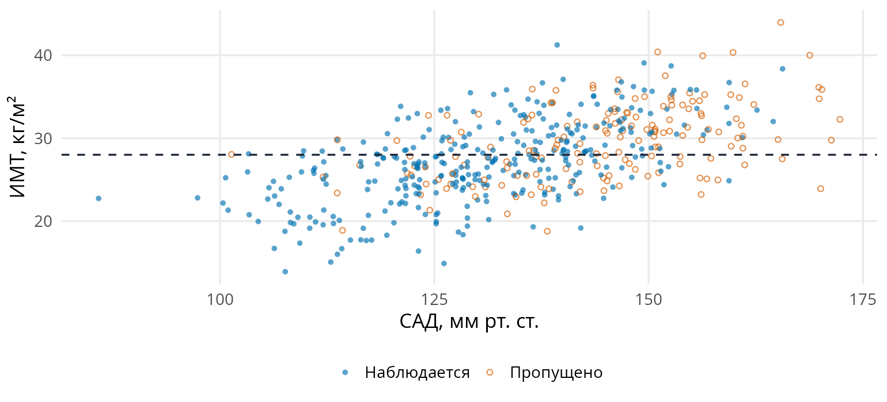<figcaption>Одна воспроизводимая выборка; пустые кружки — скрытые от аналитика значения.</figcaption></figure></div></div>
```

::: {.notes}

```{=html}
<p><strong>Редакция HTML:</strong> основной слайд обновлён по расчётам R или проверенному API. Числа исходного сценария ниже относятся к PPTX.</p><p>Чтобы не говорить абстрактно, введём сквозной пример, с которым пройдём до конца сегодняшнего занятия.</p><p>Пусть у нас есть простая кардиологическая когорта из 500 пациентов. На старте у всех измерено офисное систолическое АД (Y₁) — это дёшево и быстро. А вот индекс массы тела (Y₂) измерен не у всех: примерно у трети пациентов в карте нет роста или веса.</p><p>Почему мы выбрали именно пару «САД и ИМТ», а не «визит 1 и визит 2»? Потому что между САД и ИМТ на одном базовом визите нет жёсткой временной стрелы. Обе переменные клинически равноправны: нам может быть интересно как влияние ИМТ на давление, так и распределение ИМТ при заданном давлении.</p><p>Посмотрите на график справа. Синие точки — это полные пары, оранжевые пустые кружки — пациенты, у которых ИМТ не внесён. Заметьте: оранжевые кружки сгущаются справа, в зоне высокого САД. Клинически это понятно: пациента с высоким давлением сразу ведут к врачу, и до весов дело не доходит. Формальное название такого сценария введём через несколько слайдов.</p><p>А теперь вопрос к вам, прежде чем мы перейдём к формулам: если у этих оранжевых точек нет ИМТ, можно ли с помощью их систолического давления улучшить нашу оценку среднего ИМТ по всей когорте? (Пауза 5–10 секунд, ждём интуитивного ответа: «Да, потому что давление и ИМТ коррелируют».)</p>
```

:::


## Генеративный процесс примера: двумерная нормальная модель и логит-механизмы пропуска {#p1-dgp .course-slide .layer-core data-source="v2:7" data-layer="core"}

```{=html}
<div class="course-kicker">ЗАНЯТИЕ 1 · ОСНОВНАЯ ЛИНИЯ</div><div class="course-grid"><div class="course-card " style="grid-column:1 / span 5"><h3>Этап 1. Популяционная модель полных данных</h3><p>Для i = 1, ..., n (в симуляции n = 500):</p><p>(Yᵢ₁, Yᵢ₂)ᵀ ~ N₂( μ, Σ ),  где</p><p>μ = (135, 28)ᵀ,</p><p>Σ = [ 15²        0.60·15·5 ] = [ 225  45 ]</p><p>[ 0.60·15·5  5²        ]   [  45  25 ]</p><p class="bullet">• САД (Y₁): μ₁ = 135 мм рт. ст., σ₁ = 15</p><p class="bullet">• ИМТ (Y₂): μ₂ = 28 кг/м²,       σ₂ = 5</p><p class="bullet">• Корреляция: ρ = 0.60, ковариация σ₁₂ = 45</p><p>Важно: на этапе 1 оба значения (Yᵢ₁, Yᵢ₂)</p><p>реально существуют у каждого пациента.</p><p>Оговорка: ρ = 0.60 взята завышенной для наглядности. В реальных когортах корреляция САД и ИМТ заметно ниже (порядка 0.2–0.3); как от ρ зависят выводы — см. раздел 5.</p></div><div class="course-card " style="grid-column:7 / span 6"><h3>Этап 2. Механизм выпадения ИМТ (Mᵢ ∈ {0, 1})</h3><p>Mᵢ = 1, если ИМТ пропущен;  Mᵢ | Yᵢ₁, Yᵢ₂ ~ Bernoulli(pᵢ)</p><p>Во всех 3 сценариях доля пропусков π ≈ 30–32%:</p><p>1) MCAR:  pᵢ = 0.30  (не зависит ни от Y₁, ни от Y₂: сломались весы)</p><p>2) MAR (зависит от наблюдаемого САД: при высоком давлении пациента сразу ведут к врачу):</p><p>logit(pᵢ) = −0.95 + 0.08·(Yᵢ₁ − 135)</p><p>При САД=135: p ≈ 28%; +10 мм рт. ст. ⇒ ОШ = e⁰·⁸ ≈ 2.23</p><p>3) MNAR (зависит от ненаблюдаемого ИМТ: пациенты с высоким ИМТ отказываются взвешиваться):</p><p>logit(pᵢ) = −0.95 + 0.24·(Yᵢ₂ − 28)</p><p>При ИМТ=28: p ≈ 28%; +5 кг/м² ⇒ ОШ = e¹·² ≈ 3.32</p><p>Наблюдаемые данные: Yᵢ₂ᵒᵇˢ = Yᵢ₂ (Mᵢ=0) или NA (Mᵢ=1).</p><p>Пока это три сценария симуляции; строгие определения MCAR / MAR / MNAR — в разделе 3.</p></div></div>
```

::: {.notes}

```{=html}
<p>Разберём генеративный процесс (DGP) максимально прозрачно, чтобы в конце занятия вы могли воспроизвести его в R с точностью до формулы.</p><p>Модель всегда состоит из двух этапов.</p><p>На первом этапе природа генерирует полные данные: для каждого из 500 пациентов пара (САД, ИМТ) берётся из двумерного нормального распределения со средними 135 и 28, стандартными отклонениями 15 и 5, и корреляцией ρ = 0.60 (ковариация 45).</p><p>На втором этапе включается механизм «вытирания» ИМТ. Мы вводим бинарный индикатор Mᵢ: единица — если ИМТ стёрт, ноль — если остался. Вероятность пропуска pᵢ моделируется через логистическую регрессию, откалиброванную так, чтобы во всех сценариях терялось около 30–32% данных.</p><p>Посмотрите на коэффициенты:</p><p>- В MCAR вероятность просто равна 0.30.</p><p>- В MAR наклон при САД равен 0.08: каждые +10 мм рт. ст. давления повышают шансы пропуска ИМТ в exp(0.8) ≈ 2.23 раза. Почему это MAR? Потому что САД полностью измерено!</p><p>- В MNAR наклон 0.24 стоит уже при самом ИМТ: пациенты с высоким ИМТ (на 5 единиц выше среднего) пропускают взвешивание в 3.32 раза чаще. А самого ИМТ у выбывших мы не видим.</p><p>Две оговорки. Во-первых, ярлыки MCAR, MAR и MNAR пока просто названия трёх сценариев симуляции; строгие определения дадим в разделе 3. Во-вторых, корреляция 0.60 между САД и ИМТ выбрана завышенной ради наглядности: в реальных когортах она порядка 0.2–0.3. Позже покажем, как выводы зависят от ρ.</p><p>Прежде чем двигаться дальше, вспомним три математических инструмента, на которых держится всё занятие.</p>
```

:::


## Три инструмента, на которых держится всё занятие: условная нормаль, plim и дельта-метод {#p1-math-min .course-slide .layer-core data-source="v2:8" data-layer="core"}

```{=html}
<div class="course-kicker">ЗАНЯТИЕ 1 · ОСНОВНАЯ ЛИНИЯ</div><div class="course-grid"><div class="course-card " style="grid-column:span 12"><h3>1. Условное распределение двумерной нормали</h3><p>Если (Y₁, Y₂) ~ N₂(μ, Σ), то</p><div class="equation"><span class="katex-display"><span class="katex"><span class="katex-mathml"><math xmlns="http://www.w3.org/1998/Math/MathML" display="block"><semantics><mrow><msub><mi>Y</mi><mn>2</mn></msub><mo>∣</mo><msub><mi>Y</mi><mn>1</mn></msub><mo>=</mo><msub><mi>y</mi><mn>1</mn></msub><mo>∼</mo><mi>N</mi><mtext> ⁣</mtext><mrow><mo fence="true">(</mo><msub><mi>μ</mi><mn>2</mn></msub><mo>+</mo><mi>ρ</mi><mfrac><msub><mi>σ</mi><mn>2</mn></msub><msub><mi>σ</mi><mn>1</mn></msub></mfrac><mo stretchy="false">(</mo><msub><mi>y</mi><mn>1</mn></msub><mo>−</mo><msub><mi>μ</mi><mn>1</mn></msub><mo stretchy="false">)</mo><mo separator="true">,</mo><mtext> </mtext><msubsup><mi>σ</mi><mn>2</mn><mn>2</mn></msubsup><mo stretchy="false">(</mo><mn>1</mn><mo>−</mo><msup><mi>ρ</mi><mn>2</mn></msup><mo stretchy="false">)</mo><mo fence="true">)</mo></mrow></mrow><annotation encoding="application/x-tex">Y_2\mid Y_1=y_1\sim N\!\left(\mu_2+\rho\frac{\sigma_2}{\sigma_1}(y_1-\mu_1),\ \sigma_2^2(1-\rho^2)\right)</annotation></semantics></math></span><span class="katex-html" aria-hidden="true"><span class="katex-base"><span class="katex-strut" style="height:1em;vertical-align:-0.25em;"></span><span class="mord"><span class="mord mathnormal" style="margin-right:0.2222em;">Y</span><span class="msupsub"><span class="vlist-t vlist-t2"><span class="vlist-r"><span class="vlist" style="height:0.3011em;"><span style="top:-2.55em;margin-left:-0.2222em;margin-right:0.05em;"><span class="pstrut" style="height:2.7em;"></span><span class="katex-sizing reset-size6 size3 mtight"><span class="mord mtight">2</span></span></span></span><span class="vlist-s">​</span></span><span class="vlist-r"><span class="vlist" style="height:0.15em;"><span></span></span></span></span></span></span><span class="mspace" style="margin-right:0.2778em;"></span><span class="mrel">∣</span><span class="mspace" style="margin-right:0.2778em;"></span></span><span class="katex-base"><span class="katex-strut" style="height:0.8333em;vertical-align:-0.15em;"></span><span class="mord"><span class="mord mathnormal" style="margin-right:0.2222em;">Y</span><span class="msupsub"><span class="vlist-t vlist-t2"><span class="vlist-r"><span class="vlist" style="height:0.3011em;"><span style="top:-2.55em;margin-left:-0.2222em;margin-right:0.05em;"><span class="pstrut" style="height:2.7em;"></span><span class="katex-sizing reset-size6 size3 mtight"><span class="mord mtight">1</span></span></span></span><span class="vlist-s">​</span></span><span class="vlist-r"><span class="vlist" style="height:0.15em;"><span></span></span></span></span></span></span><span class="mspace" style="margin-right:0.2778em;"></span><span class="mrel">=</span><span class="mspace" style="margin-right:0.2778em;"></span></span><span class="katex-base"><span class="katex-strut" style="height:0.625em;vertical-align:-0.1944em;"></span><span class="mord"><span class="mord mathnormal" style="margin-right:0.0359em;">y</span><span class="msupsub"><span class="vlist-t vlist-t2"><span class="vlist-r"><span class="vlist" style="height:0.3011em;"><span style="top:-2.55em;margin-left:-0.0359em;margin-right:0.05em;"><span class="pstrut" style="height:2.7em;"></span><span class="katex-sizing reset-size6 size3 mtight"><span class="mord mtight">1</span></span></span></span><span class="vlist-s">​</span></span><span class="vlist-r"><span class="vlist" style="height:0.15em;"><span></span></span></span></span></span></span><span class="mspace" style="margin-right:0.2778em;"></span><span class="mrel">∼</span><span class="mspace" style="margin-right:0.2778em;"></span></span><span class="katex-base"><span class="katex-strut" style="height:2.4em;vertical-align:-0.95em;"></span><span class="mord mathnormal" style="margin-right:0.109em;">N</span><span class="mspace" style="margin-right:-0.1667em;"></span><span class="mspace" style="margin-right:0.1667em;"></span><span class="minner"><span class="mopen delimcenter" style="top:0em;"><span class="delimsizing size3">(</span></span><span class="mord"><span class="mord mathnormal">μ</span><span class="msupsub"><span class="vlist-t vlist-t2"><span class="vlist-r"><span class="vlist" style="height:0.3011em;"><span style="top:-2.55em;margin-left:0em;margin-right:0.05em;"><span class="pstrut" style="height:2.7em;"></span><span class="katex-sizing reset-size6 size3 mtight"><span class="mord mtight">2</span></span></span></span><span class="vlist-s">​</span></span><span class="vlist-r"><span class="vlist" style="height:0.15em;"><span></span></span></span></span></span></span><span class="mspace" style="margin-right:0.2222em;"></span><span class="mbin">+</span><span class="mspace" style="margin-right:0.2222em;"></span><span class="mord mathnormal">ρ</span><span class="mord"><span class="mopen nulldelimiter"></span><span class="mfrac"><span class="vlist-t vlist-t2"><span class="vlist-r"><span class="vlist" style="height:1.1076em;"><span style="top:-2.314em;"><span class="pstrut" style="height:3em;"></span><span class="mord"><span class="mord"><span class="mord mathnormal" style="margin-right:0.0359em;">σ</span><span class="msupsub"><span class="vlist-t vlist-t2"><span class="vlist-r"><span class="vlist" style="height:0.3011em;"><span style="top:-2.55em;margin-left:-0.0359em;margin-right:0.05em;"><span class="pstrut" style="height:2.7em;"></span><span class="katex-sizing reset-size6 size3 mtight"><span class="mord mtight">1</span></span></span></span><span class="vlist-s">​</span></span><span class="vlist-r"><span class="vlist" style="height:0.15em;"><span></span></span></span></span></span></span></span></span><span style="top:-3.23em;"><span class="pstrut" style="height:3em;"></span><span class="frac-line" style="border-bottom-width:0.04em;"></span></span><span style="top:-3.677em;"><span class="pstrut" style="height:3em;"></span><span class="mord"><span class="mord"><span class="mord mathnormal" style="margin-right:0.0359em;">σ</span><span class="msupsub"><span class="vlist-t vlist-t2"><span class="vlist-r"><span class="vlist" style="height:0.3011em;"><span style="top:-2.55em;margin-left:-0.0359em;margin-right:0.05em;"><span class="pstrut" style="height:2.7em;"></span><span class="katex-sizing reset-size6 size3 mtight"><span class="mord mtight">2</span></span></span></span><span class="vlist-s">​</span></span><span class="vlist-r"><span class="vlist" style="height:0.15em;"><span></span></span></span></span></span></span></span></span></span><span class="vlist-s">​</span></span><span class="vlist-r"><span class="vlist" style="height:0.836em;"><span></span></span></span></span></span><span class="mclose nulldelimiter"></span></span><span class="mopen">(</span><span class="mord"><span class="mord mathnormal" style="margin-right:0.0359em;">y</span><span class="msupsub"><span class="vlist-t vlist-t2"><span class="vlist-r"><span class="vlist" style="height:0.3011em;"><span style="top:-2.55em;margin-left:-0.0359em;margin-right:0.05em;"><span class="pstrut" style="height:2.7em;"></span><span class="katex-sizing reset-size6 size3 mtight"><span class="mord mtight">1</span></span></span></span><span class="vlist-s">​</span></span><span class="vlist-r"><span class="vlist" style="height:0.15em;"><span></span></span></span></span></span></span><span class="mspace" style="margin-right:0.2222em;"></span><span class="mbin">−</span><span class="mspace" style="margin-right:0.2222em;"></span><span class="mord"><span class="mord mathnormal">μ</span><span class="msupsub"><span class="vlist-t vlist-t2"><span class="vlist-r"><span class="vlist" style="height:0.3011em;"><span style="top:-2.55em;margin-left:0em;margin-right:0.05em;"><span class="pstrut" style="height:2.7em;"></span><span class="katex-sizing reset-size6 size3 mtight"><span class="mord mtight">1</span></span></span></span><span class="vlist-s">​</span></span><span class="vlist-r"><span class="vlist" style="height:0.15em;"><span></span></span></span></span></span></span><span class="mclose">)</span><span class="mpunct">,</span><span class="mspace"> </span><span class="mspace" style="margin-right:0.1667em;"></span><span class="mord"><span class="mord mathnormal" style="margin-right:0.0359em;">σ</span><span class="msupsub"><span class="vlist-t vlist-t2"><span class="vlist-r"><span class="vlist" style="height:0.8641em;"><span style="top:-2.453em;margin-left:-0.0359em;margin-right:0.05em;"><span class="pstrut" style="height:2.7em;"></span><span class="katex-sizing reset-size6 size3 mtight"><span class="mord mtight">2</span></span></span><span style="top:-3.113em;margin-right:0.05em;"><span class="pstrut" style="height:2.7em;"></span><span class="katex-sizing reset-size6 size3 mtight"><span class="mord mtight">2</span></span></span></span><span class="vlist-s">​</span></span><span class="vlist-r"><span class="vlist" style="height:0.247em;"><span></span></span></span></span></span></span><span class="mopen">(</span><span class="mord">1</span><span class="mspace" style="margin-right:0.2222em;"></span><span class="mbin">−</span><span class="mspace" style="margin-right:0.2222em;"></span><span class="mord"><span class="mord mathnormal">ρ</span><span class="msupsub"><span class="vlist-t"><span class="vlist-r"><span class="vlist" style="height:0.8641em;"><span style="top:-3.113em;margin-right:0.05em;"><span class="pstrut" style="height:2.7em;"></span><span class="katex-sizing reset-size6 size3 mtight"><span class="mord mtight">2</span></span></span></span></span></span></span></span><span class="mclose">)</span><span class="mclose delimcenter" style="top:0em;"><span class="delimsizing size3">)</span></span></span></span></span></span></span></div><p>Условное среднее — прямая (это и есть регрессия), условная дисперсия от y₁ не зависит.</p><p>В нашем примере: E[ИМТ | САД] = 1.0 + 0.20·САД, остаточное SD = 4.0.</p></div><div class="course-card " style="grid-column:span 12"><h3>2. Предел по вероятности (plim)</h3><p>plim θ̂ₙ = c: при n → ∞ оценка сколь угодно близко подходит к c.</p><p>Оценка состоятельна, если plim θ̂ = θ.</p><p>Асимптотическое смещение метода = plim θ̂ − θ. Оно не исчезает с ростом выборки — больше данных не помогает.</p><p>Удобное свойство: plim отношения = отношение plim. Поэтому пределы наклонов и корреляций считаем по частям.</p></div></div>
```

::: {.notes}

```{=html}
<p>Короткая остановка. Сегодня нам понадобятся три инструмента, которые выходят чуть за рамки курса регрессии. Каждый — в одну формулу.</p><p>Первый: условное распределение двумерной нормали. Если пара нормальна, то распределение одной переменной при заданной другой тоже нормально, его среднее — прямая линия, а дисперсия постоянна. Это ровно линейная регрессия; в нашем примере прямая 1.0 + 0.20·САД и остаточное стандартное отклонение 4.0.</p><p>Второй: предел по вероятности. Это число, к которому оценка сходится при росте выборки. Если оно не равно истинному параметру, метод асимптотически смещён, и никакой объём данных его не спасёт.</p><p>Третий: дельта-метод — способ получить стандартную ошибку для функции от оценок.</p><p>Теперь к параметрам, которые мы будем оценивать.</p>
```

:::


## Три инструмента, на которых держится всё занятие: условная нормаль, plim и дельта-метод · продолжение {#p1-math-min-cont-2 .course-slide .layer-core data-source="v2:8" data-layer="core"}

```{=html}
<div class="course-kicker">ЗАНЯТИЕ 1 · ОСНОВНАЯ ЛИНИЯ</div><div class="course-grid"><div class="course-card " style="grid-column:span 12"><h3>3. Дельта-метод</h3><p>Если θ̂ ≈ N(θ, V/n), а g — гладкая функция, то</p><div class="equation"><span class="katex-display"><span class="katex"><span class="katex-mathml"><math xmlns="http://www.w3.org/1998/Math/MathML" display="block"><semantics><mrow><mi>g</mi><mo stretchy="false">(</mo><mover accent="true"><mi>θ</mi><mo>^</mo></mover><mo stretchy="false">)</mo><mtext> </mtext><mover accent="true"><mo>∼</mo><mo>˙</mo></mover><mtext> </mtext><mi>N</mi><mtext> ⁣</mtext><mrow><mo fence="true">(</mo><mi>g</mi><mo stretchy="false">(</mo><mi>θ</mi><mo stretchy="false">)</mo><mo separator="true">,</mo><mtext> </mtext><mfrac><mrow><msup><mi>g</mi><mo mathvariant="normal" lspace="0em" rspace="0em">′</mo></msup><mo stretchy="false">(</mo><mi>θ</mi><msup><mo stretchy="false">)</mo><mi mathvariant="normal">⊤</mi></msup><mi>V</mi><msup><mi>g</mi><mo mathvariant="normal" lspace="0em" rspace="0em">′</mo></msup><mo stretchy="false">(</mo><mi>θ</mi><mo stretchy="false">)</mo></mrow><mi>n</mi></mfrac><mo fence="true">)</mo></mrow></mrow><annotation encoding="application/x-tex">g(\hat\theta)\ \dot\sim\ N\!\left(g(\theta),\ \frac{g&#x27;(\theta)^\top Vg&#x27;(\theta)}{n}\right)</annotation></semantics></math></span><span class="katex-html" aria-hidden="true"><span class="katex-base"><span class="katex-strut" style="height:2.4761em;vertical-align:-0.95em;"></span><span class="mord mathnormal" style="margin-right:0.0359em;">g</span><span class="mopen">(</span><span class="mord katex-accent"><span class="vlist-t"><span class="vlist-r"><span class="vlist" style="height:0.9579em;"><span style="top:-3em;"><span class="pstrut" style="height:3em;"></span><span class="mord mathnormal" style="margin-right:0.0278em;">θ</span></span><span style="top:-3.2634em;"><span class="pstrut" style="height:3em;"></span><span class="accent-body" style="left:-0.1667em;"><span class="mord">^</span></span></span></span></span></span></span><span class="mclose">)</span><span class="mspace"> </span><span class="mord katex-accent"><span class="vlist-t"><span class="vlist-r"><span class="vlist" style="height:0.6679em;"><span style="top:-3em;"><span class="pstrut" style="height:3em;"></span><span class="mrel">∼</span></span><span style="top:-3em;"><span class="pstrut" style="height:3em;"></span><span class="accent-body" style="left:-0.1389em;"><span class="mord">˙</span></span></span></span></span></span></span><span class="mspace"> </span><span class="mord mathnormal" style="margin-right:0.109em;">N</span><span class="mspace" style="margin-right:-0.1667em;"></span><span class="mspace" style="margin-right:0.1667em;"></span><span class="minner"><span class="mopen delimcenter" style="top:0em;"><span class="delimsizing size3">(</span></span><span class="mord mathnormal" style="margin-right:0.0359em;">g</span><span class="mopen">(</span><span class="mord mathnormal" style="margin-right:0.0278em;">θ</span><span class="mclose">)</span><span class="mpunct">,</span><span class="mspace"> </span><span class="mspace" style="margin-right:0.1667em;"></span><span class="mord"><span class="mopen nulldelimiter"></span><span class="mfrac"><span class="vlist-t vlist-t2"><span class="vlist-r"><span class="vlist" style="height:1.5261em;"><span style="top:-2.314em;"><span class="pstrut" style="height:3em;"></span><span class="mord"><span class="mord mathnormal">n</span></span></span><span style="top:-3.23em;"><span class="pstrut" style="height:3em;"></span><span class="frac-line" style="border-bottom-width:0.04em;"></span></span><span style="top:-3.677em;"><span class="pstrut" style="height:3em;"></span><span class="mord"><span class="mord"><span class="mord mathnormal" style="margin-right:0.0359em;">g</span><span class="msupsub"><span class="vlist-t"><span class="vlist-r"><span class="vlist" style="height:0.7519em;"><span style="top:-3.063em;margin-right:0.05em;"><span class="pstrut" style="height:2.7em;"></span><span class="katex-sizing reset-size6 size3 mtight"><span class="mord mtight"><span class="mord mtight">′</span></span></span></span></span></span></span></span></span><span class="mopen">(</span><span class="mord mathnormal" style="margin-right:0.0278em;">θ</span><span class="mclose"><span class="mclose">)</span><span class="msupsub"><span class="vlist-t"><span class="vlist-r"><span class="vlist" style="height:0.8491em;"><span style="top:-3.063em;margin-right:0.05em;"><span class="pstrut" style="height:2.7em;"></span><span class="katex-sizing reset-size6 size3 mtight"><span class="mord mtight">⊤</span></span></span></span></span></span></span></span><span class="mord mathnormal" style="margin-right:0.2222em;">V</span><span class="mord"><span class="mord mathnormal" style="margin-right:0.0359em;">g</span><span class="msupsub"><span class="vlist-t"><span class="vlist-r"><span class="vlist" style="height:0.7519em;"><span style="top:-3.063em;margin-right:0.05em;"><span class="pstrut" style="height:2.7em;"></span><span class="katex-sizing reset-size6 size3 mtight"><span class="mord mtight"><span class="mord mtight">′</span></span></span></span></span></span></span></span></span><span class="mopen">(</span><span class="mord mathnormal" style="margin-right:0.0278em;">θ</span><span class="mclose">)</span></span></span></span><span class="vlist-s">​</span></span><span class="vlist-r"><span class="vlist" style="height:0.686em;"><span></span></span></span></span></span><span class="mclose nulldelimiter"></span></span><span class="mclose delimcenter" style="top:0em;"><span class="delimsizing size3">)</span></span></span></span></span></span></span></div><p>Так получают SE для функций от оценок.</p><p>У нас: μ̂₂ = β̂₀ + β̂₁·μ̂₁ — функция трёх оценок, и её дисперсия складывается из трёх слагаемых.</p></div><div class="course-card " style="grid-column:span 12"><p>Где это понадобится: условная нормаль — в двух факторизациях (<a class="slide-ref" href="#/p1-two-factorizations">связанный разбор</a>) и в регрессионной импутации; plim — в разборе наивных методов (слайды 23–26); дельта-метод — в дисперсии оценки ММП (<a class="slide-ref" href="#/p1-mle">связанный разбор</a>). Больше ничего сверх курса регрессии и GLM сегодня не потребуется.</p></div></div>
```

::: {.notes}

```{=html}
<p>Короткая остановка. Сегодня нам понадобятся три инструмента, которые выходят чуть за рамки курса регрессии. Каждый — в одну формулу.</p><p>Первый: условное распределение двумерной нормали. Если пара нормальна, то распределение одной переменной при заданной другой тоже нормально, его среднее — прямая линия, а дисперсия постоянна. Это ровно линейная регрессия; в нашем примере прямая 1.0 + 0.20·САД и остаточное стандартное отклонение 4.0.</p><p>Второй: предел по вероятности. Это число, к которому оценка сходится при росте выборки. Если оно не равно истинному параметру, метод асимптотически смещён, и никакой объём данных его не спасёт.</p><p>Третий: дельта-метод — способ получить стандартную ошибку для функции от оценок.</p><p>Теперь к параметрам, которые мы будем оценивать.</p>
```

:::


## Пять целевых параметров: по ним будем сравнивать все методы {#p1-targets .course-slide .layer-core data-source="v2:9" data-layer="core"}

```{=html}
<div class="course-kicker">ЗАНЯТИЕ 1 · ОСНОВНАЯ ЛИНИЯ</div><div class="course-grid"><div class="course-card " style="grid-column:1 / span 12"><table><thead><tr><th>Параметр</th><th>Аналитическое определение</th><th>Истина</th><th>Клинический / статистический смысл</th></tr></thead><tbody><tr><td>μ₂</td><td>E[Y₂]</td><td>28.0</td><td>Популяционное среднее ИМТ в когорте (кг/м²)</td></tr><tr><td>σ₂</td><td>√Var(Y₂)</td><td>5.0</td><td>Стандартное отклонение (разброс) ИМТ в когорте</td></tr><tr><td>ρ</td><td>Cov(Y₁, Y₂) / (σ₁·σ₂)</td><td>0.60</td><td>Линейная корреляция Пирсона между САД и ИМТ</td></tr><tr><td>β₁ (ИМТ ~ САД)</td><td>Cov(Y₁,Y₂)/Var(Y₁) = ρ·(σ₂/σ₁)</td><td>0.20</td><td>Наклон Факторизации А: сдвиг ИМТ на +1 мм рт. ст. САД</td></tr><tr><td>γ₁ (САД ~ ИМТ)</td><td>Cov(Y₁,Y₂)/Var(Y₂) = ρ·(σ₁/σ₂)</td><td>1.80</td><td>Наклон Факторизации Б: сдвиг САД на +1 кг/м² ИМТ</td></tr></tbody></table></div><div class="course-card " style="grid-column:1 / span 12"><h3>Зачем сразу два наклона?</h3><p class="bullet">• β₁ и γ₁ описывают одну и ту же связь САД и ИМТ с двух сторон (это ассоциация, а не причинность).</p><p class="bullet">• Пропуски стоят в ИМТ: в модели ИМТ ~ САД это исход, в модели САД ~ ИМТ — предиктор.</p><p class="bullet">• Один и тот же метод обработки пропусков ведёт себя по-разному для β₁ и γ₁ — «зеркальный эффект» (раздел 6).</p><p class="bullet">• Каждый метод будем оценивать по этим пяти числам: смещение, разброс и покрытие 95% ДИ.</p></div></div>
```

::: {.notes}

```{=html}
<p>Теперь строго определим те пять величин, оценки которых мы будем сравнивать в симуляции:</p><p>1) Маргинальное среднее ИМТ μ₂ = 28.0;</p><p>2) Стандартное отклонение ИМТ σ₂ = 5.0;</p><p>3) Корреляция Пирсона ρ = 0.60;</p><p>4) И сразу ДВА регрессионных наклона: β₁ = ρ(σ₂/σ₁) = 0.20 (регрессия ИМТ на САД) и обратный наклон γ₁ = ρ(σ₁/σ₂) = 1.80 (регрессия САД на ИМТ). Зачем нам оба наклона? Чуть позже вы увидите поразительный «зеркальный эффект», который зависит от того, где стоят пропуски — в исходе или в предикторе.</p><p>Обратите внимание: оба наклона — это ассоциации в поперечном срезе, а не причинные эффекты. С этими пятью числами мы и пройдём всё занятие.</p>
```

:::


## Обе условные параметризации (САД, ИМТ) взаимно-однозначны и клинически осмыслены {#p1-two-factorizations .course-slide .layer-core data-source="v2:10" data-layer="core"}

```{=html}
<div class="course-kicker">ЗАНЯТИЕ 1 · ОСНОВНАЯ ЛИНИЯ</div><div class="course-grid"><div class="course-card " style="grid-column:1 / span 5"><h3>Факторизация А: f(САД) · f(ИМТ | САД)</h3><p>1. Маргинально:  Y₁ ~ N(μ₁, σ₁²)  [μ₁=135, σ₁²=225]</p><p>2. Условно:      Y₂ | Y₁ ~ N(β₀ + β₁·Y₁, σ₂|₁²)</p><p>Точные формулы 1-to-1 перехода:</p><p class="bullet">• β₁ = ρ·(σ₂ / σ₁) = 0.60 · (5/15) = 0.20</p><p class="bullet">• β₀ = μ₂ − β₁·μ₁ = 28 − 0.20·135 = 1.00</p><p class="bullet">• σ₂|₁² = σ₂²·(1 − ρ²) = 25·(1 − 0.36) = 16  (σ₂|₁ = 4.0)</p><p>Смысл: прогноз/импутация ИМТ по офисному САД</p><p>(+10 мм рт. ст. САД ⇒ +2.0 кг/м² ИМТ).</p></div><div class="course-card " style="grid-column:7 / span 6"><h3>Факторизация Б: f(ИМТ) · f(САД | ИМТ)</h3><p>1. Маргинально:  Y₂ ~ N(μ₂, σ₂²)  [μ₂=28, σ₂²=25]</p><p>2. Условно:      Y₁ | Y₂ ~ N(γ₀ + γ₁·Y₂, σ₁|₂²)</p><p>Точные формулы 1-to-1 перехода:</p><p class="bullet">• γ₁ = ρ·(σ₁ / σ₂) = 0.60 · (15/5) = 1.80</p><p class="bullet">• γ₀ = μ₁ − γ₁·μ₂ = 135 − 1.80·28 = 84.60</p><p class="bullet">• σ₁|₂² = σ₁²·(1 − ρ²) = 225·(1 − 0.36) = 144  (σ₁|₂ = 12.0)</p><p>Смысл: классическая модель связи САД с ИМТ</p><p>(+1 кг/м² ИМТ ⇒ +1.8 мм рт. ст. САД).</p></div><div class="course-card " style="grid-column:1 / span 12"><p>Ключевое свойство полной модели: Обе факторизации имеют ровно 5 параметров и связаны взаимно-однозначно (1-to-1) с моментной параметризацией θ. В полных данных они абсолютно равноправны.</p></div></div>
```

::: {.notes}

```{=html}
<p>Любую совместную плотность f(y₁, y₂) можно разложить на маргинальную и условную двумя способами. И именно в нашем примере САД и ИМТ оба разложения несут ясный биологический смысл:</p><p>Слева — Факторизация А: сначала распределение САД, а затем линейная регрессия ИМТ на САД. Мы получаем β₁ = 0.20, свободный член β₀ = 1.00 и остаточное стандартное отклонение 4.0 кг/м². Это модель, которая позволяет восстанавливать ИМТ по давлению.</p><p>Справа — Факторизация Б: сначала распределение ИМТ, затем классическая клиническая модель влияния ИМТ на артериальное давление: γ₁ = 1.80 мм рт. ст. на каждую единицу ИМТ, γ₀ = 84.60, остаточное СКО 12.0 мм рт. ст.</p><p>Обратите внимание на инвариантность: в обоих случаях у нас ровно 5 параметров, и зная одну пятёрку, мы однозначно пересчитываем другую. В полных данных разницы нет. Но всё меняется, когда появляются пропуски, — к этому вернёмся в разделе 5. Сначала разберёмся, какими пропуски бывают.</p>
```

:::


## Дональд Рубин превратил «грязные данные» в строгую теорию статистического вывода {#p1-rubin .course-slide .layer-appendix data-source="v2:11" data-layer="appendix"}

```{=html}
<div class="course-kicker">ЗАНЯТИЕ 1 · СПРАВКА</div><div class="course-grid"><div class="course-card " style="grid-column:span 12"><p>Дональд Б. Рубин (Donald B. Rubin) — Professor Emeritus Гарвардского университета, соавтор фундаментального учебника Little &amp; Rubin «Statistical Analysis with Missing Data» (1987, 2002, 2019). Создатель современной теории анализа неполных данных и каузального вывода.</p></div><div class="course-card " style="grid-column:span 12"><h3>1. Теория пропусков (Biometrika, 1976)</h3><p class="bullet">• Разделил паттерн («где») и механизм («почему»).</p><p class="bullet">• Ввёл классы MCAR, MAR, MNAR и теорему об игнорируемости.</p><p class="bullet">• Фундамент всех современных методов работы с пропусками.</p></div><div class="course-card " style="grid-column:span 12"><h3>2. EM-алгоритм (Dempster, Laird &amp; Rubin, 1977)</h3><p class="bullet">• Формализовал универсальный итеративный E- и M-шаг для ММП.</p><p class="bullet">• Работает как с реальными пропусками, так и со скрытыми переменными.</p><p class="bullet">• Одна из самых цитируемых работ в статистике.</p></div></div>
```

::: {.notes}

```{=html}
<p>Прежде чем мы перейдём к классификации механизмов выпадения, стоит познакомиться с человеком, чьё имя будет звучать на каждой нашей лекции. Дональд Б. Рубин — почётный профессор Гарвардского университета и соавтор классического учебника Литтла и Рубина «Statistical Analysis with Missing Data». До середины 1970-х годов пропуски в данных считались сугубо вычислительной помехой: в экспериментах искали трюки, как заполнить пустую ячейку, чтобы не сломалась сбалансированная ANOVA. Рубин перевернул область и превратил работу с пропусками в строгую теорию статистического вывода.</p><p>Обратите внимание на шесть ключевых достижений на слайде:</p><p>1. В статье 1976 года в Biometrika он отделил паттерн пропусков от механизма, ввёл таксономию MCAR, MAR, MNAR и доказал теорему об игнорируемости.</p><p>2. В 1977 году вместе с Демпстером и Лэрд формализовал EM-алгоритм.</p><p>3. В 1977–1996 годах изобрёл множественную импутацию (изначально по задаче Бюро переписи населения США) и вывел знаменитые «правила Рубина» для честного учёта дисперсии.</p><p>4. В каузальном выводе сформулировал модель потенциальных исходов как задачу о пропущенных данных, а позже с Франгакисом предложил главную стратификацию для анализа РКИ с интеркуррентными событиями.</p><p>5. С Полом Розенбаумом ввёл propensity score (оценку склонности) — фундамент наблюдательных исследований и донорских групп.</p><p>6. В байесовском анализе стал соавтором статистики сходимости R-hat (Гельмана–Рубина), которой проверяют сходимость в том числе в MICE.</p><p>А теперь разберём первое из этих открытий — таксономию паттернов и механизмов MCAR, MAR и MNAR.</p>
```

:::


## Дональд Рубин превратил «грязные данные» в строгую теорию статистического вывода · продолжение {#p1-rubin-cont-2 .course-slide .layer-appendix data-source="v2:11" data-layer="appendix"}

```{=html}
<div class="course-kicker">ЗАНЯТИЕ 1 · СПРАВКА</div><div class="course-grid"><div class="course-card " style="grid-column:span 12"><h3>3. Множественная импутация (1977–1996)</h3><p class="bullet">• Создал MI (задача Бюро переписи США по пропускам доходов).</p><p class="bullet">• Сформулировал правила Рубина (within + between дисперсия).</p><p class="bullet">• Ввёл критерии proper imputation и доверительной валидности.</p></div><div class="course-card " style="grid-column:span 12"><h3>4. Каузальный вывод (1974, 2002)</h3><p class="bullet">• Описал модель потенциальных исходов как задачу о пропусках.</p><p class="bullet">• В РКИ альтернативный исход при другом лечении «пропущен».</p><p class="bullet">• С К. Франгакисом предложил главную стратификацию (2002).</p></div><div class="course-card " style="grid-column:span 12"><h3>5. Propensity Score (Rosenbaum &amp; Rubin, 1983)</h3><p class="bullet">• Ввёл оценку склонности для контроля конфаундинга в когортах.</p><p class="bullet">• Используется и при импутации: формирование донорских групп по вероятности пропуска.</p></div></div>
```

::: {.notes}

```{=html}
<p>Прежде чем мы перейдём к классификации механизмов выпадения, стоит познакомиться с человеком, чьё имя будет звучать на каждой нашей лекции. Дональд Б. Рубин — почётный профессор Гарвардского университета и соавтор классического учебника Литтла и Рубина «Statistical Analysis with Missing Data». До середины 1970-х годов пропуски в данных считались сугубо вычислительной помехой: в экспериментах искали трюки, как заполнить пустую ячейку, чтобы не сломалась сбалансированная ANOVA. Рубин перевернул область и превратил работу с пропусками в строгую теорию статистического вывода.</p><p>Обратите внимание на шесть ключевых достижений на слайде:</p><p>1. В статье 1976 года в Biometrika он отделил паттерн пропусков от механизма, ввёл таксономию MCAR, MAR, MNAR и доказал теорему об игнорируемости.</p><p>2. В 1977 году вместе с Демпстером и Лэрд формализовал EM-алгоритм.</p><p>3. В 1977–1996 годах изобрёл множественную импутацию (изначально по задаче Бюро переписи населения США) и вывел знаменитые «правила Рубина» для честного учёта дисперсии.</p><p>4. В каузальном выводе сформулировал модель потенциальных исходов как задачу о пропущенных данных, а позже с Франгакисом предложил главную стратификацию для анализа РКИ с интеркуррентными событиями.</p><p>5. С Полом Розенбаумом ввёл propensity score (оценку склонности) — фундамент наблюдательных исследований и донорских групп.</p><p>6. В байесовском анализе стал соавтором статистики сходимости R-hat (Гельмана–Рубина), которой проверяют сходимость в том числе в MICE.</p><p>А теперь разберём первое из этих открытий — таксономию паттернов и механизмов MCAR, MAR и MNAR.</p>
```

:::


## Дональд Рубин превратил «грязные данные» в строгую теорию статистического вывода · продолжение {#p1-rubin-cont-3 .course-slide .layer-appendix data-source="v2:11" data-layer="appendix"}

```{=html}
<div class="course-kicker">ЗАНЯТИЕ 1 · СПРАВКА</div><div class="course-grid"><div class="course-card " style="grid-column:span 12"><h3>6. Байесовский анализ и MCMC (1992, 1995)</h3><p class="bullet">• Соавтор критерия сходимости R̂ (Gelman &amp; Rubin, 1992).</p><p class="bullet">• Соавтор классического учебника Bayesian Data Analysis (1995).</p><p class="bullet">• Диагностика R̂ применяется для проверки цепей MICE.</p></div></div>
```

::: {.notes}

```{=html}
<p>Прежде чем мы перейдём к классификации механизмов выпадения, стоит познакомиться с человеком, чьё имя будет звучать на каждой нашей лекции. Дональд Б. Рубин — почётный профессор Гарвардского университета и соавтор классического учебника Литтла и Рубина «Statistical Analysis with Missing Data». До середины 1970-х годов пропуски в данных считались сугубо вычислительной помехой: в экспериментах искали трюки, как заполнить пустую ячейку, чтобы не сломалась сбалансированная ANOVA. Рубин перевернул область и превратил работу с пропусками в строгую теорию статистического вывода.</p><p>Обратите внимание на шесть ключевых достижений на слайде:</p><p>1. В статье 1976 года в Biometrika он отделил паттерн пропусков от механизма, ввёл таксономию MCAR, MAR, MNAR и доказал теорему об игнорируемости.</p><p>2. В 1977 году вместе с Демпстером и Лэрд формализовал EM-алгоритм.</p><p>3. В 1977–1996 годах изобрёл множественную импутацию (изначально по задаче Бюро переписи населения США) и вывел знаменитые «правила Рубина» для честного учёта дисперсии.</p><p>4. В каузальном выводе сформулировал модель потенциальных исходов как задачу о пропущенных данных, а позже с Франгакисом предложил главную стратификацию для анализа РКИ с интеркуррентными событиями.</p><p>5. С Полом Розенбаумом ввёл propensity score (оценку склонности) — фундамент наблюдательных исследований и донорских групп.</p><p>6. В байесовском анализе стал соавтором статистики сходимости R-hat (Гельмана–Рубина), которой проверяют сходимость в том числе в MICE.</p><p>А теперь разберём первое из этих открытий — таксономию паттернов и механизмов MCAR, MAR и MNAR.</p>
```

:::


## Четыре паттерна пропусков: «где находятся дыры» не отвечает на вопрос «почему они там» {#p1-patterns .course-slide .layer-core data-source="v2:12" data-layer="core"}

```{=html}
<div class="course-kicker">ЗАНЯТИЕ 1 · ОСНОВНАЯ ЛИНИЯ</div><div class="course-grid"><div class="course-card " style="grid-column:span 12"><h3>1. Одномерный (Univariate)</h3><p>Пропуски строго в одной переменной (наш пример: САД у всех, ИМТ с NA). Допускает прямое расщепление правдоподобия.</p></div><div class="course-card " style="grid-column:span 12"><h3>2. Монотонный (Monotone)</h3><p>Типично для выбывания (dropout) в РКИ: если пропущен визит k, все визиты &gt; k тоже пропущены.</p></div><div class="course-card " style="grid-column:span 12"><table><thead><tr><th>✓</th><th>✓</th></tr></thead><tbody><tr><td>✓</td><td>✓</td></tr><tr><td>✓</td><td>NA</td></tr><tr><td>✓</td><td>NA</td></tr></tbody></table></div></div>
```

::: {.notes}

```{=html}
<p>Переходим к разделению двух понятий, которые постоянно путают: паттерн (где находятся пропуски) и механизм (почему они возникли).</p><p>На слайде — четыре классических паттерна по Литтлу и Рубину:</p><p>1. Одномерный: пропуски только в одном столбце, как у нас с ИМТ. Здесь работает аналитика Андерсона (раздел 5).</p><p>2. Монотонный: классика продольных РКИ. Пациент ходил на визиты 1 и 2, а на 3-й не пришёл и выбыл из исследования до конца. Паттерн похож на лесенку. Для монотонных данных факторизация Андерсона обобщается в цепочку условных моделей.</p><p>3. Общий паттерн (или «швейцарский сыр»): самый частый случай в реальных когортах и опросниках, когда один пациент не сдал глюкозу, второй не пришёл на УЗИ, третий пропустил анкету. Здесь уже нужны итеративные алгоритмы вроде MICE (Занятие 2) или EM.</p><p>4. Несвязанный паттерн: когда переменные измерены в разных подвыборках и никогда не пересекаются — их совместную корреляцию оценить невозможно.</p>
```

:::


## Четыре паттерна пропусков: «где находятся дыры» не отвечает на вопрос «почему они там» · продолжение {#p1-patterns-cont-2 .course-slide .layer-core data-source="v2:12" data-layer="core"}

```{=html}
<div class="course-kicker">ЗАНЯТИЕ 1 · ОСНОВНАЯ ЛИНИЯ</div><div class="course-grid"><div class="course-card " style="grid-column:span 12"><table><thead><tr><th>✓</th><th>✓</th><th>✓</th></tr></thead><tbody><tr><td>✓</td><td>✓</td><td>NA</td></tr><tr><td>✓</td><td>NA</td><td>NA</td></tr><tr><td>✓</td><td>NA</td><td>NA</td></tr></tbody></table></div><div class="course-card " style="grid-column:span 12"><h3>3. Общий (General)</h3><p>Хаотичные пропуски в разных столбцах и визитах («швейцарский сыр»). Типично для когорт и регистров; требует MICE или EM (раздел 8, Занятие 2).</p></div><div class="course-card " style="grid-column:span 12"><h3>4. Несвязанный (File matching)</h3><p>Две переменные никогда не наблюдаются вместе — корреляция ρ₁₂ неидентифицируема без внешних допущений.</p></div></div>
```

::: {.notes}

```{=html}
<p>Переходим к разделению двух понятий, которые постоянно путают: паттерн (где находятся пропуски) и механизм (почему они возникли).</p><p>На слайде — четыре классических паттерна по Литтлу и Рубину:</p><p>1. Одномерный: пропуски только в одном столбце, как у нас с ИМТ. Здесь работает аналитика Андерсона (раздел 5).</p><p>2. Монотонный: классика продольных РКИ. Пациент ходил на визиты 1 и 2, а на 3-й не пришёл и выбыл из исследования до конца. Паттерн похож на лесенку. Для монотонных данных факторизация Андерсона обобщается в цепочку условных моделей.</p><p>3. Общий паттерн (или «швейцарский сыр»): самый частый случай в реальных когортах и опросниках, когда один пациент не сдал глюкозу, второй не пришёл на УЗИ, третий пропустил анкету. Здесь уже нужны итеративные алгоритмы вроде MICE (Занятие 2) или EM.</p><p>4. Несвязанный паттерн: когда переменные измерены в разных подвыборках и никогда не пересекаются — их совместную корреляцию оценить невозможно.</p>
```

:::


## Четыре паттерна пропусков: «где находятся дыры» не отвечает на вопрос «почему они там» · продолжение {#p1-patterns-cont-3 .course-slide .layer-core data-source="v2:12" data-layer="core"}

```{=html}
<div class="course-kicker">ЗАНЯТИЕ 1 · ОСНОВНАЯ ЛИНИЯ</div><div class="course-grid"><div class="course-card " style="grid-column:span 12"><table><thead><tr><th>✓</th><th>NA</th><th>✓</th></tr></thead><tbody><tr><td>NA</td><td>✓</td><td>✓</td></tr><tr><td>✓</td><td>✓</td><td>NA</td></tr><tr><td>✓</td><td>NA</td><td>NA</td></tr></tbody></table></div><div class="course-card " style="grid-column:span 12"><table><thead><tr><th>✓</th><th>✓</th><th>NA</th></tr></thead><tbody><tr><td>✓</td><td>✓</td><td>NA</td></tr><tr><td>✓</td><td>NA</td><td>✓</td></tr><tr><td>✓</td><td>NA</td><td>✓</td></tr></tbody></table></div></div>
```

::: {.notes}

```{=html}
<p>Переходим к разделению двух понятий, которые постоянно путают: паттерн (где находятся пропуски) и механизм (почему они возникли).</p><p>На слайде — четыре классических паттерна по Литтлу и Рубину:</p><p>1. Одномерный: пропуски только в одном столбце, как у нас с ИМТ. Здесь работает аналитика Андерсона (раздел 5).</p><p>2. Монотонный: классика продольных РКИ. Пациент ходил на визиты 1 и 2, а на 3-й не пришёл и выбыл из исследования до конца. Паттерн похож на лесенку. Для монотонных данных факторизация Андерсона обобщается в цепочку условных моделей.</p><p>3. Общий паттерн (или «швейцарский сыр»): самый частый случай в реальных когортах и опросниках, когда один пациент не сдал глюкозу, второй не пришёл на УЗИ, третий пропустил анкету. Здесь уже нужны итеративные алгоритмы вроде MICE (Занятие 2) или EM.</p><p>4. Несвязанный паттерн: когда переменные измерены в разных подвыборках и никогда не пересекаются — их совместную корреляцию оценить невозможно.</p>
```

:::


## Матрица индикаторов M формализует вероятностный механизм выпадения данных {#p1-notation .course-slide .layer-core data-source="v2:13" data-layer="core"}

```{=html}
<div class="course-kicker">ЗАНЯТИЕ 1 · ОСНОВНАЯ ЛИНИЯ</div><div class="course-grid"><div class="course-card " style="grid-column:1 / span 12"><h3>Разбиение данных и матрица индикаторов (Little &amp; Rubin, 2019)</h3><p class="bullet">• Полная (гипотетическая) матрица данных размера n × p:   Y = (Y_obs, Y_mis)</p><p class="bullet">• Матрица индикаторов пропусков M = (mᵢⱼ) размера n × p:</p><p>mᵢⱼ = 1, если yᵢⱼ пропущено (NA);    mᵢⱼ = 0, если yᵢⱼ измерено.</p><p>(Примечание: в лекциях В. Инасио и в ряде пакетов R используется индикатор отклика Rᵢⱼ = 1 − mᵢⱼ; у нас индикатор полной строки — C = 1 − M).</p><p class="bullet">• Механизм пропусков — это условное распределение вероятностей индикатора M:</p><p>Pr(M | Y_obs, Y_mis, ψ),   где ψ — вектор параметров процесса выпадения.</p></div><div class="course-card " style="grid-column:1 / span 5"><h3>Selection Model (модель отбора)</h3><div class="equation"><span class="katex-display"><span class="katex"><span class="katex-mathml"><math xmlns="http://www.w3.org/1998/Math/MathML" display="block"><semantics><mrow><mi>f</mi><mo stretchy="false">(</mo><mi>Y</mi><mo separator="true">,</mo><mi>M</mi><mo>∣</mo><mi>θ</mi><mo separator="true">,</mo><mi>ψ</mi><mo stretchy="false">)</mo><mo>=</mo><mi>f</mi><mo stretchy="false">(</mo><mi>Y</mi><mo>∣</mo><mi>θ</mi><mo stretchy="false">)</mo><mi>Pr</mi><mo>⁡</mo><mo stretchy="false">(</mo><mi>M</mi><mo>∣</mo><mi>Y</mi><mo separator="true">,</mo><mi>ψ</mi><mo stretchy="false">)</mo></mrow><annotation encoding="application/x-tex">f(Y,M\mid\theta,\psi)=f(Y\mid\theta)\Pr(M\mid Y,\psi)</annotation></semantics></math></span><span class="katex-html" aria-hidden="true"><span class="katex-base"><span class="katex-strut" style="height:1em;vertical-align:-0.25em;"></span><span class="mord mathnormal" style="margin-right:0.1076em;">f</span><span class="mopen">(</span><span class="mord mathnormal" style="margin-right:0.2222em;">Y</span><span class="mpunct">,</span><span class="mspace" style="margin-right:0.1667em;"></span><span class="mord mathnormal" style="margin-right:0.109em;">M</span><span class="mspace" style="margin-right:0.2778em;"></span><span class="mrel">∣</span><span class="mspace" style="margin-right:0.2778em;"></span></span><span class="katex-base"><span class="katex-strut" style="height:1em;vertical-align:-0.25em;"></span><span class="mord mathnormal" style="margin-right:0.0278em;">θ</span><span class="mpunct">,</span><span class="mspace" style="margin-right:0.1667em;"></span><span class="mord mathnormal" style="margin-right:0.0359em;">ψ</span><span class="mclose">)</span><span class="mspace" style="margin-right:0.2778em;"></span><span class="mrel">=</span><span class="mspace" style="margin-right:0.2778em;"></span></span><span class="katex-base"><span class="katex-strut" style="height:1em;vertical-align:-0.25em;"></span><span class="mord mathnormal" style="margin-right:0.1076em;">f</span><span class="mopen">(</span><span class="mord mathnormal" style="margin-right:0.2222em;">Y</span><span class="mspace" style="margin-right:0.2778em;"></span><span class="mrel">∣</span><span class="mspace" style="margin-right:0.2778em;"></span></span><span class="katex-base"><span class="katex-strut" style="height:1em;vertical-align:-0.25em;"></span><span class="mord mathnormal" style="margin-right:0.0278em;">θ</span><span class="mclose">)</span><span class="mspace" style="margin-right:0.1667em;"></span><span class="mop">Pr</span><span class="mopen">(</span><span class="mord mathnormal" style="margin-right:0.109em;">M</span><span class="mspace" style="margin-right:0.2778em;"></span><span class="mrel">∣</span><span class="mspace" style="margin-right:0.2778em;"></span></span><span class="katex-base"><span class="katex-strut" style="height:1em;vertical-align:-0.25em;"></span><span class="mord mathnormal" style="margin-right:0.2222em;">Y</span><span class="mpunct">,</span><span class="mspace" style="margin-right:0.1667em;"></span><span class="mord mathnormal" style="margin-right:0.0359em;">ψ</span><span class="mclose">)</span></span></span></span></span></div><p>Сначала природа генерирует клинические показатели Y, а затем «фильтр» M решает, какие значения мы увидим. Используется в нашем DGP (логит-модель).</p></div><div class="course-card " style="grid-column:7 / span 5"><h3>Pattern-Mixture Model (смесь паттернов)</h3><div class="equation"><span class="katex-display"><span class="katex"><span class="katex-mathml"><math xmlns="http://www.w3.org/1998/Math/MathML" display="block"><semantics><mrow><mi>f</mi><mo stretchy="false">(</mo><mi>Y</mi><mo separator="true">,</mo><mi>M</mi><mo>∣</mo><msup><mi>θ</mi><mo>∗</mo></msup><mo separator="true">,</mo><msup><mi>ψ</mi><mo>∗</mo></msup><mo stretchy="false">)</mo><mo>=</mo><mi>f</mi><mo stretchy="false">(</mo><mi>Y</mi><mo>∣</mo><mi>M</mi><mo separator="true">,</mo><msup><mi>θ</mi><mo>∗</mo></msup><mo stretchy="false">)</mo><mi>Pr</mi><mo>⁡</mo><mo stretchy="false">(</mo><mi>M</mi><mo>∣</mo><msup><mi>ψ</mi><mo>∗</mo></msup><mo stretchy="false">)</mo></mrow><annotation encoding="application/x-tex">f(Y,M\mid\theta^*,\psi^*)=f(Y\mid M,\theta^*)\Pr(M\mid\psi^*)</annotation></semantics></math></span><span class="katex-html" aria-hidden="true"><span class="katex-base"><span class="katex-strut" style="height:1em;vertical-align:-0.25em;"></span><span class="mord mathnormal" style="margin-right:0.1076em;">f</span><span class="mopen">(</span><span class="mord mathnormal" style="margin-right:0.2222em;">Y</span><span class="mpunct">,</span><span class="mspace" style="margin-right:0.1667em;"></span><span class="mord mathnormal" style="margin-right:0.109em;">M</span><span class="mspace" style="margin-right:0.2778em;"></span><span class="mrel">∣</span><span class="mspace" style="margin-right:0.2778em;"></span></span><span class="katex-base"><span class="katex-strut" style="height:1em;vertical-align:-0.25em;"></span><span class="mord"><span class="mord mathnormal" style="margin-right:0.0278em;">θ</span><span class="msupsub"><span class="vlist-t"><span class="vlist-r"><span class="vlist" style="height:0.7387em;"><span style="top:-3.113em;margin-right:0.05em;"><span class="pstrut" style="height:2.7em;"></span><span class="katex-sizing reset-size6 size3 mtight"><span class="mbin mtight">∗</span></span></span></span></span></span></span></span><span class="mpunct">,</span><span class="mspace" style="margin-right:0.1667em;"></span><span class="mord"><span class="mord mathnormal" style="margin-right:0.0359em;">ψ</span><span class="msupsub"><span class="vlist-t"><span class="vlist-r"><span class="vlist" style="height:0.7387em;"><span style="top:-3.113em;margin-right:0.05em;"><span class="pstrut" style="height:2.7em;"></span><span class="katex-sizing reset-size6 size3 mtight"><span class="mbin mtight">∗</span></span></span></span></span></span></span></span><span class="mclose">)</span><span class="mspace" style="margin-right:0.2778em;"></span><span class="mrel">=</span><span class="mspace" style="margin-right:0.2778em;"></span></span><span class="katex-base"><span class="katex-strut" style="height:1em;vertical-align:-0.25em;"></span><span class="mord mathnormal" style="margin-right:0.1076em;">f</span><span class="mopen">(</span><span class="mord mathnormal" style="margin-right:0.2222em;">Y</span><span class="mspace" style="margin-right:0.2778em;"></span><span class="mrel">∣</span><span class="mspace" style="margin-right:0.2778em;"></span></span><span class="katex-base"><span class="katex-strut" style="height:1em;vertical-align:-0.25em;"></span><span class="mord mathnormal" style="margin-right:0.109em;">M</span><span class="mpunct">,</span><span class="mspace" style="margin-right:0.1667em;"></span><span class="mord"><span class="mord mathnormal" style="margin-right:0.0278em;">θ</span><span class="msupsub"><span class="vlist-t"><span class="vlist-r"><span class="vlist" style="height:0.7387em;"><span style="top:-3.113em;margin-right:0.05em;"><span class="pstrut" style="height:2.7em;"></span><span class="katex-sizing reset-size6 size3 mtight"><span class="mbin mtight">∗</span></span></span></span></span></span></span></span><span class="mclose">)</span><span class="mspace" style="margin-right:0.1667em;"></span><span class="mop">Pr</span><span class="mopen">(</span><span class="mord mathnormal" style="margin-right:0.109em;">M</span><span class="mspace" style="margin-right:0.2778em;"></span><span class="mrel">∣</span><span class="mspace" style="margin-right:0.2778em;"></span></span><span class="katex-base"><span class="katex-strut" style="height:1em;vertical-align:-0.25em;"></span><span class="mord"><span class="mord mathnormal" style="margin-right:0.0359em;">ψ</span><span class="msupsub"><span class="vlist-t"><span class="vlist-r"><span class="vlist" style="height:0.7387em;"><span style="top:-3.113em;margin-right:0.05em;"><span class="pstrut" style="height:2.7em;"></span><span class="katex-sizing reset-size6 size3 mtight"><span class="mbin mtight">∗</span></span></span></span></span></span></span></span><span class="mclose">)</span></span></span></span></span></div><p>Популяция состоит из подгрупп с разными паттернами M (например, завершившие РКИ vs выбывшие), со своими распределениями Y. Основа для MNAR-анализа (Занятие 3).</p></div></div>
```

::: {.notes}

```{=html}
<p>Чтобы строго определить MCAR, MAR и MNAR, нам нужна матрица индикаторов M. Это бинарная таблица того же размера, что и наши данные: ноль — значение есть, единица — пропуск. (Оговорка для литературы: в лекциях Ванды Инасио часто используется обратный индикатор отклика R = 1 − M, где единица означает «наблюдается» — не путайтесь при чтении. Букву R мы оставим за языком и числом репликаций, а индикатор полной строки будем обозначать C = 1 − M).</p><p>Тогда механизм выпадения — это просто вероятностная модель Pr(M | Y_obs, Y_mis, ψ).</p><p>Заодно посмотрите на две фундаментальные факторизации совместного распределения (Y, M):</p><p>1) Selection Model — сначала данные Y, потом вероятность пропуска M при данных Y. Именно так мы задавали наш DGP на <a class="slide-ref" href="#/p1-dgp">связанный разбор</a>.</p><p>2) Pattern-Mixture Model — наоборот: сначала паттерны M, а внутри каждого паттерна своё распределение Y. Это главный инструмент для анализа чувствительности при MNAR, к которому мы вернёмся на 3-м занятии.</p>
```

:::


## MCAR, MAR и MNAR по-разному искажают наблюдаемую выборку и среднее ИМТ {#p1-taxonomy .course-slide .layer-core data-source="v2:14" data-layer="core"}

```{=html}
<div class="course-kicker">ЗАНЯТИЕ 1 · ОСНОВНАЯ ЛИНИЯ</div><div class="course-grid"><div class="course-card image" style="grid-column:span 12"><figure>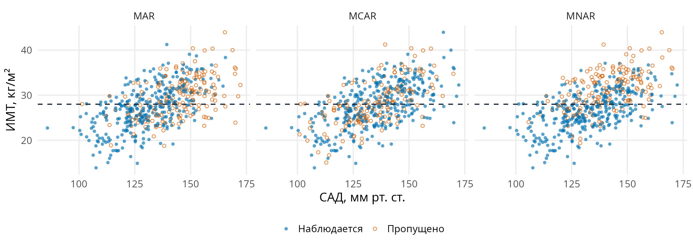<figcaption>Одинаковые полные данные, три механизма пропусков. Пунктир — популяционное среднее ИМТ.</figcaption></figure></div><div class="course-card " style="grid-column:span 12"><p>MCAR: вероятность пропуска постоянна. MAR: зависит только от наблюдаемого САД. MNAR: зависит от самого ИМТ, в том числе там, где он не наблюдается.</p></div></div>
```

::: {.notes}

```{=html}
<p><strong>Редакция HTML:</strong> основной слайд обновлён по расчётам R или проверенному API. Числа исходного сценария ниже относятся к PPTX.</p><p>На этом слайде вся таксономия Рубина (1976) видна сразу в формулах и на живом примере.</p><p>1) MCAR — «подбрасывание монетки». Оранжевые кружки равномерно разбросаны по всему облаку, поэтому среднее по полным случаям — то, что получит аналитик, просто удалив строки с NA (этот приём называется CCA, пунктирная линия), — практически совпадает с истинным средним 28.0.</p><p>2) MAR — условная случайность. Здесь оранжевые кружки сгущаются справа (высокое САД). Из-за положительной корреляции (ρ = 0.60) вместе с высоким САД пропадают и высокие значения ИМТ! Поэтому наблюдаемое среднее по полным случаям падает вниз (до ~27.1). Но ключевой момент: если мы зафиксируем уровень САД (проведём вертикальную полосу), внутри этой полосы пропуск уже случаен.</p><p>3) MNAR — пропуск зависит от самого ненаблюдаемого ИМТ. Оранжевые кружки срезают верхнюю шапку облака. Среднее ИМТ проваливается ещё сильнее (~26.5), и главное — даже при фиксированном САД верхние точки выпадают чаще нижних.</p>
```

:::


## Игнорируемость требует MAR и разделимости; упущение предикторов превращает MAR в MNAR {#p1-ignorability .course-slide .layer-core data-source="v2:15" data-layer="core"}

```{=html}
<div class="course-kicker">ЗАНЯТИЕ 1 · ОСНОВНАЯ ЛИНИЯ</div><div class="course-grid"><div class="course-card " style="grid-column:1 / span 6"><h3>Теорема об игнорируемости (Rubin, 1976)</h3><p>Совместное правдоподобие (Y_obs, M):</p><div class="equation"><span class="katex-display"><span class="katex"><span class="katex-mathml"><math xmlns="http://www.w3.org/1998/Math/MathML" display="block"><semantics><mtable rowspacing="0.25em" columnalign="right left" columnspacing="0em"><mtr><mtd><mstyle scriptlevel="0" displaystyle="true"><mrow><mi>L</mi><mo stretchy="false">(</mo><mi>θ</mi><mo separator="true">,</mo><mi>ψ</mi><mo>∣</mo><msub><mi>Y</mi><mrow><mi mathvariant="normal">o</mi><mi mathvariant="normal">b</mi><mi mathvariant="normal">s</mi></mrow></msub><mo separator="true">,</mo><mi>M</mi><mo stretchy="false">)</mo></mrow></mstyle></mtd><mtd><mstyle scriptlevel="0" displaystyle="true"><mrow><mrow></mrow><mo>=</mo><mo>∫</mo><mi>f</mi><mo stretchy="false">(</mo><msub><mi>Y</mi><mrow><mi mathvariant="normal">o</mi><mi mathvariant="normal">b</mi><mi mathvariant="normal">s</mi></mrow></msub><mo separator="true">,</mo><msub><mi>Y</mi><mrow><mi mathvariant="normal">m</mi><mi mathvariant="normal">i</mi><mi mathvariant="normal">s</mi></mrow></msub><mo>∣</mo><mi>θ</mi><mo stretchy="false">)</mo></mrow></mstyle></mtd></mtr><mtr><mtd><mstyle scriptlevel="0" displaystyle="true"><mrow></mrow></mstyle></mtd><mtd><mstyle scriptlevel="0" displaystyle="true"><mrow><mrow></mrow><mspace width="1em"/><mo>⋅</mo><mi>Pr</mi><mo>⁡</mo><mo stretchy="false">(</mo><mi>M</mi><mo>∣</mo><msub><mi>Y</mi><mrow><mi mathvariant="normal">o</mi><mi mathvariant="normal">b</mi><mi mathvariant="normal">s</mi></mrow></msub><mo separator="true">,</mo><msub><mi>Y</mi><mrow><mi mathvariant="normal">m</mi><mi mathvariant="normal">i</mi><mi mathvariant="normal">s</mi></mrow></msub><mo separator="true">,</mo><mi>ψ</mi><mo stretchy="false">)</mo><mtext> </mtext><mi>d</mi><msub><mi>Y</mi><mrow><mi mathvariant="normal">m</mi><mi mathvariant="normal">i</mi><mi mathvariant="normal">s</mi></mrow></msub></mrow></mstyle></mtd></mtr></mtable><annotation encoding="application/x-tex">\begin{aligned} L(\theta,\psi\mid Y_{\rm obs},M)&amp;=\int f(Y_{\rm obs},Y_{\rm mis}\mid\theta)\\&amp;\quad\cdot\Pr(M\mid Y_{\rm obs},Y_{\rm mis},\psi)\,dY_{\rm mis}\end{aligned}</annotation></semantics></math></span><span class="katex-html" aria-hidden="true"><span class="katex-base"><span class="katex-strut" style="height:3.7223em;vertical-align:-1.6111em;"></span><span class="mord"><span class="mtable"><span class="col-align-r"><span class="vlist-t vlist-t2"><span class="vlist-r"><span class="vlist" style="height:2.1111em;"><span style="top:-4.1111em;"><span class="pstrut" style="height:3.36em;"></span><span class="mord"><span class="mord mathnormal">L</span><span class="mopen">(</span><span class="mord mathnormal" style="margin-right:0.0278em;">θ</span><span class="mpunct">,</span><span class="mspace" style="margin-right:0.1667em;"></span><span class="mord mathnormal" style="margin-right:0.0359em;">ψ</span><span class="mspace" style="margin-right:0.2778em;"></span><span class="mrel">∣</span><span class="mspace" style="margin-right:0.2778em;"></span><span class="mord"><span class="mord mathnormal" style="margin-right:0.2222em;">Y</span><span class="msupsub"><span class="vlist-t vlist-t2"><span class="vlist-r"><span class="vlist" style="height:0.3361em;"><span style="top:-2.55em;margin-left:-0.2222em;margin-right:0.05em;"><span class="pstrut" style="height:2.7em;"></span><span class="katex-sizing reset-size6 size3 mtight"><span class="mord mtight"><span class="mord mtight"><span class="mord mathrm mtight">obs</span></span></span></span></span></span><span class="vlist-s">​</span></span><span class="vlist-r"><span class="vlist" style="height:0.15em;"><span></span></span></span></span></span></span><span class="mpunct">,</span><span class="mspace" style="margin-right:0.1667em;"></span><span class="mord mathnormal" style="margin-right:0.109em;">M</span><span class="mclose">)</span></span></span><span style="top:-2.1089em;"><span class="pstrut" style="height:3.36em;"></span><span class="mord"></span></span></span><span class="vlist-s">​</span></span><span class="vlist-r"><span class="vlist" style="height:1.6111em;"><span></span></span></span></span></span><span class="col-align-l"><span class="vlist-t vlist-t2"><span class="vlist-r"><span class="vlist" style="height:2.1111em;"><span style="top:-4.1111em;"><span class="pstrut" style="height:3.36em;"></span><span class="mord"><span class="mord"></span><span class="mspace" style="margin-right:0.2778em;"></span><span class="mrel">=</span><span class="mspace" style="margin-right:0.2778em;"></span><span class="mop op-symbol large-op" style="margin-right:0.4445em;position:relative;top:-0.0011em;">∫</span><span class="mspace" style="margin-right:0.1667em;"></span><span class="mord mathnormal" style="margin-right:0.1076em;">f</span><span class="mopen">(</span><span class="mord"><span class="mord mathnormal" style="margin-right:0.2222em;">Y</span><span class="msupsub"><span class="vlist-t vlist-t2"><span class="vlist-r"><span class="vlist" style="height:0.3361em;"><span style="top:-2.55em;margin-left:-0.2222em;margin-right:0.05em;"><span class="pstrut" style="height:2.7em;"></span><span class="katex-sizing reset-size6 size3 mtight"><span class="mord mtight"><span class="mord mtight"><span class="mord mathrm mtight">obs</span></span></span></span></span></span><span class="vlist-s">​</span></span><span class="vlist-r"><span class="vlist" style="height:0.15em;"><span></span></span></span></span></span></span><span class="mpunct">,</span><span class="mspace" style="margin-right:0.1667em;"></span><span class="mord"><span class="mord mathnormal" style="margin-right:0.2222em;">Y</span><span class="msupsub"><span class="vlist-t vlist-t2"><span class="vlist-r"><span class="vlist" style="height:0.3175em;"><span style="top:-2.55em;margin-left:-0.2222em;margin-right:0.05em;"><span class="pstrut" style="height:2.7em;"></span><span class="katex-sizing reset-size6 size3 mtight"><span class="mord mtight"><span class="mord mtight"><span class="mord mathrm mtight">mis</span></span></span></span></span></span><span class="vlist-s">​</span></span><span class="vlist-r"><span class="vlist" style="height:0.15em;"><span></span></span></span></span></span></span><span class="mspace" style="margin-right:0.2778em;"></span><span class="mrel">∣</span><span class="mspace" style="margin-right:0.2778em;"></span><span class="mord mathnormal" style="margin-right:0.0278em;">θ</span><span class="mclose">)</span></span></span><span style="top:-2.1089em;"><span class="pstrut" style="height:3.36em;"></span><span class="mord"><span class="mord"></span><span class="mspace" style="margin-right:1em;"></span><span class="mspace" style="margin-right:0.2222em;"></span><span class="mbin">⋅</span><span class="mspace" style="margin-right:0.2222em;"></span><span class="mop">Pr</span><span class="mopen">(</span><span class="mord mathnormal" style="margin-right:0.109em;">M</span><span class="mspace" style="margin-right:0.2778em;"></span><span class="mrel">∣</span><span class="mspace" style="margin-right:0.2778em;"></span><span class="mord"><span class="mord mathnormal" style="margin-right:0.2222em;">Y</span><span class="msupsub"><span class="vlist-t vlist-t2"><span class="vlist-r"><span class="vlist" style="height:0.3361em;"><span style="top:-2.55em;margin-left:-0.2222em;margin-right:0.05em;"><span class="pstrut" style="height:2.7em;"></span><span class="katex-sizing reset-size6 size3 mtight"><span class="mord mtight"><span class="mord mtight"><span class="mord mathrm mtight">obs</span></span></span></span></span></span><span class="vlist-s">​</span></span><span class="vlist-r"><span class="vlist" style="height:0.15em;"><span></span></span></span></span></span></span><span class="mpunct">,</span><span class="mspace" style="margin-right:0.1667em;"></span><span class="mord"><span class="mord mathnormal" style="margin-right:0.2222em;">Y</span><span class="msupsub"><span class="vlist-t vlist-t2"><span class="vlist-r"><span class="vlist" style="height:0.3175em;"><span style="top:-2.55em;margin-left:-0.2222em;margin-right:0.05em;"><span class="pstrut" style="height:2.7em;"></span><span class="katex-sizing reset-size6 size3 mtight"><span class="mord mtight"><span class="mord mtight"><span class="mord mathrm mtight">mis</span></span></span></span></span></span><span class="vlist-s">​</span></span><span class="vlist-r"><span class="vlist" style="height:0.15em;"><span></span></span></span></span></span></span><span class="mpunct">,</span><span class="mspace" style="margin-right:0.1667em;"></span><span class="mord mathnormal" style="margin-right:0.0359em;">ψ</span><span class="mclose">)</span><span class="mspace" style="margin-right:0.1667em;"></span><span class="mord mathnormal">d</span><span class="mord"><span class="mord mathnormal" style="margin-right:0.2222em;">Y</span><span class="msupsub"><span class="vlist-t vlist-t2"><span class="vlist-r"><span class="vlist" style="height:0.3175em;"><span style="top:-2.55em;margin-left:-0.2222em;margin-right:0.05em;"><span class="pstrut" style="height:2.7em;"></span><span class="katex-sizing reset-size6 size3 mtight"><span class="mord mtight"><span class="mord mtight"><span class="mord mathrm mtight">mis</span></span></span></span></span></span><span class="vlist-s">​</span></span><span class="vlist-r"><span class="vlist" style="height:0.15em;"><span></span></span></span></span></span></span></span></span></span><span class="vlist-s">​</span></span><span class="vlist-r"><span class="vlist" style="height:1.6111em;"><span></span></span></span></span></span></span></span></span></span></span></span></div><p>Если выполнены ДВА условия:</p><p>1. MAR (или MCAR):  Pr(M | Y_obs, Y_mis, ψ) = Pr(M | Y_obs, ψ)</p><p>⇒ Pr(M | Y_obs, ψ) выносится за знак интеграла!</p><p>2. Разделимость параметров (Distinctness): θ и ψ не связаны.</p><p>Тогда правдоподобие распадается:</p><div class="equation"><span class="katex-display"><span class="katex"><span class="katex-mathml"><math xmlns="http://www.w3.org/1998/Math/MathML" display="block"><semantics><mrow><mi>L</mi><mo stretchy="false">(</mo><mi>θ</mi><mo separator="true">,</mo><mi>ψ</mi><mo>∣</mo><msub><mi>Y</mi><mrow><mi mathvariant="normal">o</mi><mi mathvariant="normal">b</mi><mi mathvariant="normal">s</mi></mrow></msub><mo separator="true">,</mo><mi>M</mi><mo stretchy="false">)</mo><mo>=</mo><mi>Pr</mi><mo>⁡</mo><mo stretchy="false">(</mo><mi>M</mi><mo>∣</mo><msub><mi>Y</mi><mrow><mi mathvariant="normal">o</mi><mi mathvariant="normal">b</mi><mi mathvariant="normal">s</mi></mrow></msub><mo separator="true">,</mo><mi>ψ</mi><mo stretchy="false">)</mo><msub><mi>L</mi><mrow><mi mathvariant="normal">i</mi><mi mathvariant="normal">g</mi><mi mathvariant="normal">n</mi></mrow></msub><mo stretchy="false">(</mo><mi>θ</mi><mo>∣</mo><msub><mi>Y</mi><mrow><mi mathvariant="normal">o</mi><mi mathvariant="normal">b</mi><mi mathvariant="normal">s</mi></mrow></msub><mo stretchy="false">)</mo></mrow><annotation encoding="application/x-tex">L(\theta,\psi\mid Y_{\rm obs},M)=\Pr(M\mid Y_{\rm obs},\psi)L_{\rm ign}(\theta\mid Y_{\rm obs})</annotation></semantics></math></span><span class="katex-html" aria-hidden="true"><span class="katex-base"><span class="katex-strut" style="height:1em;vertical-align:-0.25em;"></span><span class="mord mathnormal">L</span><span class="mopen">(</span><span class="mord mathnormal" style="margin-right:0.0278em;">θ</span><span class="mpunct">,</span><span class="mspace" style="margin-right:0.1667em;"></span><span class="mord mathnormal" style="margin-right:0.0359em;">ψ</span><span class="mspace" style="margin-right:0.2778em;"></span><span class="mrel">∣</span><span class="mspace" style="margin-right:0.2778em;"></span></span><span class="katex-base"><span class="katex-strut" style="height:1em;vertical-align:-0.25em;"></span><span class="mord"><span class="mord mathnormal" style="margin-right:0.2222em;">Y</span><span class="msupsub"><span class="vlist-t vlist-t2"><span class="vlist-r"><span class="vlist" style="height:0.3361em;"><span style="top:-2.55em;margin-left:-0.2222em;margin-right:0.05em;"><span class="pstrut" style="height:2.7em;"></span><span class="katex-sizing reset-size6 size3 mtight"><span class="mord mtight"><span class="mord mtight"><span class="mord mathrm mtight">obs</span></span></span></span></span></span><span class="vlist-s">​</span></span><span class="vlist-r"><span class="vlist" style="height:0.15em;"><span></span></span></span></span></span></span><span class="mpunct">,</span><span class="mspace" style="margin-right:0.1667em;"></span><span class="mord mathnormal" style="margin-right:0.109em;">M</span><span class="mclose">)</span><span class="mspace" style="margin-right:0.2778em;"></span><span class="mrel">=</span><span class="mspace" style="margin-right:0.2778em;"></span></span><span class="katex-base"><span class="katex-strut" style="height:1em;vertical-align:-0.25em;"></span><span class="mop">Pr</span><span class="mopen">(</span><span class="mord mathnormal" style="margin-right:0.109em;">M</span><span class="mspace" style="margin-right:0.2778em;"></span><span class="mrel">∣</span><span class="mspace" style="margin-right:0.2778em;"></span></span><span class="katex-base"><span class="katex-strut" style="height:1.0361em;vertical-align:-0.2861em;"></span><span class="mord"><span class="mord mathnormal" style="margin-right:0.2222em;">Y</span><span class="msupsub"><span class="vlist-t vlist-t2"><span class="vlist-r"><span class="vlist" style="height:0.3361em;"><span style="top:-2.55em;margin-left:-0.2222em;margin-right:0.05em;"><span class="pstrut" style="height:2.7em;"></span><span class="katex-sizing reset-size6 size3 mtight"><span class="mord mtight"><span class="mord mtight"><span class="mord mathrm mtight">obs</span></span></span></span></span></span><span class="vlist-s">​</span></span><span class="vlist-r"><span class="vlist" style="height:0.15em;"><span></span></span></span></span></span></span><span class="mpunct">,</span><span class="mspace" style="margin-right:0.1667em;"></span><span class="mord mathnormal" style="margin-right:0.0359em;">ψ</span><span class="mclose">)</span><span class="mord"><span class="mord mathnormal">L</span><span class="msupsub"><span class="vlist-t vlist-t2"><span class="vlist-r"><span class="vlist" style="height:0.3175em;"><span style="top:-2.55em;margin-left:0em;margin-right:0.05em;"><span class="pstrut" style="height:2.7em;"></span><span class="katex-sizing reset-size6 size3 mtight"><span class="mord mtight"><span class="mord mtight"><span class="mord mathrm mtight">ign</span></span></span></span></span></span><span class="vlist-s">​</span></span><span class="vlist-r"><span class="vlist" style="height:0.2861em;"><span></span></span></span></span></span></span><span class="mopen">(</span><span class="mord mathnormal" style="margin-right:0.0278em;">θ</span><span class="mspace" style="margin-right:0.2778em;"></span><span class="mrel">∣</span><span class="mspace" style="margin-right:0.2778em;"></span></span><span class="katex-base"><span class="katex-strut" style="height:1em;vertical-align:-0.25em;"></span><span class="mord"><span class="mord mathnormal" style="margin-right:0.2222em;">Y</span><span class="msupsub"><span class="vlist-t vlist-t2"><span class="vlist-r"><span class="vlist" style="height:0.3361em;"><span style="top:-2.55em;margin-left:-0.2222em;margin-right:0.05em;"><span class="pstrut" style="height:2.7em;"></span><span class="katex-sizing reset-size6 size3 mtight"><span class="mord mtight"><span class="mord mtight"><span class="mord mathrm mtight">obs</span></span></span></span></span></span><span class="vlist-s">​</span></span><span class="vlist-r"><span class="vlist" style="height:0.15em;"><span></span></span></span></span></span></span><span class="mclose">)</span></span></span></span></span></div><p>Вывод: для оценки θ методом ММП или байесовским методом</p><p>модель механизма выпадения можно полностью ИГНОРИРОВАТЬ!</p></div><div class="course-card " style="grid-column:7 / span 5"><h3>Ловушка «MNAR по упущению» (MNAR by omission)</h3><p class="bullet">• MAR — это свойство не только данных, но и конкретной модели анализа!</p><p class="bullet">• Пример: пропуск ИМТ зависит от возраста и уровня глюкозы. Если мы включим возраст и глюкозу в модель (в качестве вспомогательных переменных, auxiliary variables), механизм — MAR.</p><p class="bullet">• Если мы их выбросим из модели: их эффект уйдёт в ненаблюдаемый остаток, и механизм станет MNAR — если эти переменные связаны и с пропуском, и с самим ИМТ.</p><p class="bullet">• Практическое правило: всегда собирайте и включайте в модель импутации переменные, которые предсказывают либо сам пропуск, либо пропущенную величину.</p></div></div>
```

::: {.notes}

```{=html}
<p>Термин «игнорируемый механизм» (ignorable missingness) часто понимают неправильно — думают, что сами пропуски можно игнорировать и удалить строки. Нет! Игнорируемость означает, что мы можем игнорировать МОДЕЛЬ МЕХАНИЗМА Pr(M | Y_obs, ψ) при максимизации правдоподобия.</p><p>Смотрите на интеграл: если выполнено MAR, то Pr(M | Y_obs, ψ) вообще не зависит от переменной интегрирования Y_mis и спокойно выносится за интеграл! А если ещё и параметры θ и ψ разделимы (в частотной статистике — пространство параметров является декартовым произведением), то для оценки θ нам достаточно максимизировать только L_ign(θ | Y_obs).</p><p>Нарушение разделимости бывает редко, поэтому главное условие — MAR.</p><p>И справа — важнейший практический урок для когортных исследований: MAR зависит от того, что вы положили в Y_obs! Если в клинике пожилым пациентам реже измеряют ИМТ, а вы не включили возраст в анализ, вы сами превратили MAR в MNAR. Вспомогательные переменные — ваш главный способ сделать гипотезу MAR правдоподобной.</p><p>Важное уточнение: упущенная переменная превращает MAR в MNAR только тогда, когда она связана и с вероятностью пропуска, и с пропущенной величиной. На следующем слайде покажем это на нашем собственном примере, без возраста и глюкозы.</p>
```

:::


## При MAR и разделимости параметров модель пропусков выносится из-под интеграла {#p1-ignorability-proof .course-slide .layer-deep data-source="v2:16" data-layer="deep"}

```{=html}
<div class="course-kicker">ЗАНЯТИЕ 1 · УГЛУБЛЁННО</div><div class="course-grid"><div class="course-card " style="grid-column:span 12"><p>Шаг 1. Полная модель (Selection factorization)   —   Y = (Y_obs, Y_mis),  индикатор пропуска M;  θ — параметры данных, ψ — параметры механизма пропусков:</p><div class="equation"><span class="katex-display"><span class="katex"><span class="katex-mathml"><math xmlns="http://www.w3.org/1998/Math/MathML" display="block"><semantics><mrow><mi>f</mi><mo stretchy="false">(</mo><mi>Y</mi><mo separator="true">,</mo><mi>M</mi><mo>∣</mo><mi>θ</mi><mo separator="true">,</mo><mi>ψ</mi><mo stretchy="false">)</mo><mo>=</mo><mi>f</mi><mo stretchy="false">(</mo><mi>M</mi><mo>∣</mo><msub><mi>Y</mi><mrow><mi mathvariant="normal">o</mi><mi mathvariant="normal">b</mi><mi mathvariant="normal">s</mi></mrow></msub><mo separator="true">,</mo><msub><mi>Y</mi><mrow><mi mathvariant="normal">m</mi><mi mathvariant="normal">i</mi><mi mathvariant="normal">s</mi></mrow></msub><mo separator="true">,</mo><mi>ψ</mi><mo stretchy="false">)</mo><mi>f</mi><mo stretchy="false">(</mo><msub><mi>Y</mi><mrow><mi mathvariant="normal">o</mi><mi mathvariant="normal">b</mi><mi mathvariant="normal">s</mi></mrow></msub><mo separator="true">,</mo><msub><mi>Y</mi><mrow><mi mathvariant="normal">m</mi><mi mathvariant="normal">i</mi><mi mathvariant="normal">s</mi></mrow></msub><mo>∣</mo><mi>θ</mi><mo stretchy="false">)</mo></mrow><annotation encoding="application/x-tex">f(Y,M\mid\theta,\psi)=f(M\mid Y_{\rm obs},Y_{\rm mis},\psi)f(Y_{\rm obs},Y_{\rm mis}\mid\theta)</annotation></semantics></math></span><span class="katex-html" aria-hidden="true"><span class="katex-base"><span class="katex-strut" style="height:1em;vertical-align:-0.25em;"></span><span class="mord mathnormal" style="margin-right:0.1076em;">f</span><span class="mopen">(</span><span class="mord mathnormal" style="margin-right:0.2222em;">Y</span><span class="mpunct">,</span><span class="mspace" style="margin-right:0.1667em;"></span><span class="mord mathnormal" style="margin-right:0.109em;">M</span><span class="mspace" style="margin-right:0.2778em;"></span><span class="mrel">∣</span><span class="mspace" style="margin-right:0.2778em;"></span></span><span class="katex-base"><span class="katex-strut" style="height:1em;vertical-align:-0.25em;"></span><span class="mord mathnormal" style="margin-right:0.0278em;">θ</span><span class="mpunct">,</span><span class="mspace" style="margin-right:0.1667em;"></span><span class="mord mathnormal" style="margin-right:0.0359em;">ψ</span><span class="mclose">)</span><span class="mspace" style="margin-right:0.2778em;"></span><span class="mrel">=</span><span class="mspace" style="margin-right:0.2778em;"></span></span><span class="katex-base"><span class="katex-strut" style="height:1em;vertical-align:-0.25em;"></span><span class="mord mathnormal" style="margin-right:0.1076em;">f</span><span class="mopen">(</span><span class="mord mathnormal" style="margin-right:0.109em;">M</span><span class="mspace" style="margin-right:0.2778em;"></span><span class="mrel">∣</span><span class="mspace" style="margin-right:0.2778em;"></span></span><span class="katex-base"><span class="katex-strut" style="height:1em;vertical-align:-0.25em;"></span><span class="mord"><span class="mord mathnormal" style="margin-right:0.2222em;">Y</span><span class="msupsub"><span class="vlist-t vlist-t2"><span class="vlist-r"><span class="vlist" style="height:0.3361em;"><span style="top:-2.55em;margin-left:-0.2222em;margin-right:0.05em;"><span class="pstrut" style="height:2.7em;"></span><span class="katex-sizing reset-size6 size3 mtight"><span class="mord mtight"><span class="mord mtight"><span class="mord mathrm mtight">obs</span></span></span></span></span></span><span class="vlist-s">​</span></span><span class="vlist-r"><span class="vlist" style="height:0.15em;"><span></span></span></span></span></span></span><span class="mpunct">,</span><span class="mspace" style="margin-right:0.1667em;"></span><span class="mord"><span class="mord mathnormal" style="margin-right:0.2222em;">Y</span><span class="msupsub"><span class="vlist-t vlist-t2"><span class="vlist-r"><span class="vlist" style="height:0.3175em;"><span style="top:-2.55em;margin-left:-0.2222em;margin-right:0.05em;"><span class="pstrut" style="height:2.7em;"></span><span class="katex-sizing reset-size6 size3 mtight"><span class="mord mtight"><span class="mord mtight"><span class="mord mathrm mtight">mis</span></span></span></span></span></span><span class="vlist-s">​</span></span><span class="vlist-r"><span class="vlist" style="height:0.15em;"><span></span></span></span></span></span></span><span class="mpunct">,</span><span class="mspace" style="margin-right:0.1667em;"></span><span class="mord mathnormal" style="margin-right:0.0359em;">ψ</span><span class="mclose">)</span><span class="mord mathnormal" style="margin-right:0.1076em;">f</span><span class="mopen">(</span><span class="mord"><span class="mord mathnormal" style="margin-right:0.2222em;">Y</span><span class="msupsub"><span class="vlist-t vlist-t2"><span class="vlist-r"><span class="vlist" style="height:0.3361em;"><span style="top:-2.55em;margin-left:-0.2222em;margin-right:0.05em;"><span class="pstrut" style="height:2.7em;"></span><span class="katex-sizing reset-size6 size3 mtight"><span class="mord mtight"><span class="mord mtight"><span class="mord mathrm mtight">obs</span></span></span></span></span></span><span class="vlist-s">​</span></span><span class="vlist-r"><span class="vlist" style="height:0.15em;"><span></span></span></span></span></span></span><span class="mpunct">,</span><span class="mspace" style="margin-right:0.1667em;"></span><span class="mord"><span class="mord mathnormal" style="margin-right:0.2222em;">Y</span><span class="msupsub"><span class="vlist-t vlist-t2"><span class="vlist-r"><span class="vlist" style="height:0.3175em;"><span style="top:-2.55em;margin-left:-0.2222em;margin-right:0.05em;"><span class="pstrut" style="height:2.7em;"></span><span class="katex-sizing reset-size6 size3 mtight"><span class="mord mtight"><span class="mord mtight"><span class="mord mathrm mtight">mis</span></span></span></span></span></span><span class="vlist-s">​</span></span><span class="vlist-r"><span class="vlist" style="height:0.15em;"><span></span></span></span></span></span></span><span class="mspace" style="margin-right:0.2778em;"></span><span class="mrel">∣</span><span class="mspace" style="margin-right:0.2778em;"></span></span><span class="katex-base"><span class="katex-strut" style="height:1em;vertical-align:-0.25em;"></span><span class="mord mathnormal" style="margin-right:0.0278em;">θ</span><span class="mclose">)</span></span></span></span></span></div></div><div class="course-card " style="grid-column:span 12"><p>Шаг 2. Маргинализация (интегрирование по ненаблюдаемым Y_mis)   —   Так как Y_mis неизвестны, плотность наблюдаемых величин (Y_obs, M) получается интегрированием по Y_mis:</p><div class="equation"><span class="katex-display"><span class="katex"><span class="katex-mathml"><math xmlns="http://www.w3.org/1998/Math/MathML" display="block"><semantics><mrow><mi>f</mi><mo stretchy="false">(</mo><msub><mi>Y</mi><mrow><mi mathvariant="normal">o</mi><mi mathvariant="normal">b</mi><mi mathvariant="normal">s</mi></mrow></msub><mo separator="true">,</mo><mi>M</mi><mo>∣</mo><mi>θ</mi><mo separator="true">,</mo><mi>ψ</mi><mo stretchy="false">)</mo><mo>=</mo><mo>∫</mo><mi>f</mi><mo stretchy="false">(</mo><mi>M</mi><mo>∣</mo><msub><mi>Y</mi><mrow><mi mathvariant="normal">o</mi><mi mathvariant="normal">b</mi><mi mathvariant="normal">s</mi></mrow></msub><mo separator="true">,</mo><msub><mi>Y</mi><mrow><mi mathvariant="normal">m</mi><mi mathvariant="normal">i</mi><mi mathvariant="normal">s</mi></mrow></msub><mo separator="true">,</mo><mi>ψ</mi><mo stretchy="false">)</mo><mi>f</mi><mo stretchy="false">(</mo><msub><mi>Y</mi><mrow><mi mathvariant="normal">o</mi><mi mathvariant="normal">b</mi><mi mathvariant="normal">s</mi></mrow></msub><mo separator="true">,</mo><msub><mi>Y</mi><mrow><mi mathvariant="normal">m</mi><mi mathvariant="normal">i</mi><mi mathvariant="normal">s</mi></mrow></msub><mo>∣</mo><mi>θ</mi><mo stretchy="false">)</mo><mtext> </mtext><mi>d</mi><msub><mi>Y</mi><mrow><mi mathvariant="normal">m</mi><mi mathvariant="normal">i</mi><mi mathvariant="normal">s</mi></mrow></msub></mrow><annotation encoding="application/x-tex">f(Y_{\rm obs},M\mid\theta,\psi)=\int f(M\mid Y_{\rm obs},Y_{\rm mis},\psi)f(Y_{\rm obs},Y_{\rm mis}\mid\theta)\,dY_{\rm mis}</annotation></semantics></math></span><span class="katex-html" aria-hidden="true"><span class="katex-base"><span class="katex-strut" style="height:1em;vertical-align:-0.25em;"></span><span class="mord mathnormal" style="margin-right:0.1076em;">f</span><span class="mopen">(</span><span class="mord"><span class="mord mathnormal" style="margin-right:0.2222em;">Y</span><span class="msupsub"><span class="vlist-t vlist-t2"><span class="vlist-r"><span class="vlist" style="height:0.3361em;"><span style="top:-2.55em;margin-left:-0.2222em;margin-right:0.05em;"><span class="pstrut" style="height:2.7em;"></span><span class="katex-sizing reset-size6 size3 mtight"><span class="mord mtight"><span class="mord mtight"><span class="mord mathrm mtight">obs</span></span></span></span></span></span><span class="vlist-s">​</span></span><span class="vlist-r"><span class="vlist" style="height:0.15em;"><span></span></span></span></span></span></span><span class="mpunct">,</span><span class="mspace" style="margin-right:0.1667em;"></span><span class="mord mathnormal" style="margin-right:0.109em;">M</span><span class="mspace" style="margin-right:0.2778em;"></span><span class="mrel">∣</span><span class="mspace" style="margin-right:0.2778em;"></span></span><span class="katex-base"><span class="katex-strut" style="height:1em;vertical-align:-0.25em;"></span><span class="mord mathnormal" style="margin-right:0.0278em;">θ</span><span class="mpunct">,</span><span class="mspace" style="margin-right:0.1667em;"></span><span class="mord mathnormal" style="margin-right:0.0359em;">ψ</span><span class="mclose">)</span><span class="mspace" style="margin-right:0.2778em;"></span><span class="mrel">=</span><span class="mspace" style="margin-right:0.2778em;"></span></span><span class="katex-base"><span class="katex-strut" style="height:2.2222em;vertical-align:-0.8622em;"></span><span class="mop op-symbol large-op" style="margin-right:0.4445em;position:relative;top:-0.0011em;">∫</span><span class="mspace" style="margin-right:0.1667em;"></span><span class="mord mathnormal" style="margin-right:0.1076em;">f</span><span class="mopen">(</span><span class="mord mathnormal" style="margin-right:0.109em;">M</span><span class="mspace" style="margin-right:0.2778em;"></span><span class="mrel">∣</span><span class="mspace" style="margin-right:0.2778em;"></span></span><span class="katex-base"><span class="katex-strut" style="height:1em;vertical-align:-0.25em;"></span><span class="mord"><span class="mord mathnormal" style="margin-right:0.2222em;">Y</span><span class="msupsub"><span class="vlist-t vlist-t2"><span class="vlist-r"><span class="vlist" style="height:0.3361em;"><span style="top:-2.55em;margin-left:-0.2222em;margin-right:0.05em;"><span class="pstrut" style="height:2.7em;"></span><span class="katex-sizing reset-size6 size3 mtight"><span class="mord mtight"><span class="mord mtight"><span class="mord mathrm mtight">obs</span></span></span></span></span></span><span class="vlist-s">​</span></span><span class="vlist-r"><span class="vlist" style="height:0.15em;"><span></span></span></span></span></span></span><span class="mpunct">,</span><span class="mspace" style="margin-right:0.1667em;"></span><span class="mord"><span class="mord mathnormal" style="margin-right:0.2222em;">Y</span><span class="msupsub"><span class="vlist-t vlist-t2"><span class="vlist-r"><span class="vlist" style="height:0.3175em;"><span style="top:-2.55em;margin-left:-0.2222em;margin-right:0.05em;"><span class="pstrut" style="height:2.7em;"></span><span class="katex-sizing reset-size6 size3 mtight"><span class="mord mtight"><span class="mord mtight"><span class="mord mathrm mtight">mis</span></span></span></span></span></span><span class="vlist-s">​</span></span><span class="vlist-r"><span class="vlist" style="height:0.15em;"><span></span></span></span></span></span></span><span class="mpunct">,</span><span class="mspace" style="margin-right:0.1667em;"></span><span class="mord mathnormal" style="margin-right:0.0359em;">ψ</span><span class="mclose">)</span><span class="mord mathnormal" style="margin-right:0.1076em;">f</span><span class="mopen">(</span><span class="mord"><span class="mord mathnormal" style="margin-right:0.2222em;">Y</span><span class="msupsub"><span class="vlist-t vlist-t2"><span class="vlist-r"><span class="vlist" style="height:0.3361em;"><span style="top:-2.55em;margin-left:-0.2222em;margin-right:0.05em;"><span class="pstrut" style="height:2.7em;"></span><span class="katex-sizing reset-size6 size3 mtight"><span class="mord mtight"><span class="mord mtight"><span class="mord mathrm mtight">obs</span></span></span></span></span></span><span class="vlist-s">​</span></span><span class="vlist-r"><span class="vlist" style="height:0.15em;"><span></span></span></span></span></span></span><span class="mpunct">,</span><span class="mspace" style="margin-right:0.1667em;"></span><span class="mord"><span class="mord mathnormal" style="margin-right:0.2222em;">Y</span><span class="msupsub"><span class="vlist-t vlist-t2"><span class="vlist-r"><span class="vlist" style="height:0.3175em;"><span style="top:-2.55em;margin-left:-0.2222em;margin-right:0.05em;"><span class="pstrut" style="height:2.7em;"></span><span class="katex-sizing reset-size6 size3 mtight"><span class="mord mtight"><span class="mord mtight"><span class="mord mathrm mtight">mis</span></span></span></span></span></span><span class="vlist-s">​</span></span><span class="vlist-r"><span class="vlist" style="height:0.15em;"><span></span></span></span></span></span></span><span class="mspace" style="margin-right:0.2778em;"></span><span class="mrel">∣</span><span class="mspace" style="margin-right:0.2778em;"></span></span><span class="katex-base"><span class="katex-strut" style="height:1em;vertical-align:-0.25em;"></span><span class="mord mathnormal" style="margin-right:0.0278em;">θ</span><span class="mclose">)</span><span class="mspace" style="margin-right:0.1667em;"></span><span class="mord mathnormal">d</span><span class="mord"><span class="mord mathnormal" style="margin-right:0.2222em;">Y</span><span class="msupsub"><span class="vlist-t vlist-t2"><span class="vlist-r"><span class="vlist" style="height:0.3175em;"><span style="top:-2.55em;margin-left:-0.2222em;margin-right:0.05em;"><span class="pstrut" style="height:2.7em;"></span><span class="katex-sizing reset-size6 size3 mtight"><span class="mord mtight"><span class="mord mtight"><span class="mord mathrm mtight">mis</span></span></span></span></span></span><span class="vlist-s">​</span></span><span class="vlist-r"><span class="vlist" style="height:0.15em;"><span></span></span></span></span></span></span></span></span></span></span></div></div><div class="course-card " style="grid-column:span 12"><p>Шаг 3. Условие MAR ⇒ вынос модели пропусков за знак интеграла   —   При MAR f(M | Y_obs, Y_mis, ψ) = f(M | Y_obs, ψ) не зависит от Y_mis и действует как константа по Y_mis:</p><div class="equation"><span class="katex-display"><span class="katex"><span class="katex-mathml"><math xmlns="http://www.w3.org/1998/Math/MathML" display="block"><semantics><mrow><mi>f</mi><mo stretchy="false">(</mo><msub><mi>Y</mi><mrow><mi mathvariant="normal">o</mi><mi mathvariant="normal">b</mi><mi mathvariant="normal">s</mi></mrow></msub><mo separator="true">,</mo><mi>M</mi><mo>∣</mo><mi>θ</mi><mo separator="true">,</mo><mi>ψ</mi><mo stretchy="false">)</mo><mo>=</mo><mi>f</mi><mo stretchy="false">(</mo><mi>M</mi><mo>∣</mo><msub><mi>Y</mi><mrow><mi mathvariant="normal">o</mi><mi mathvariant="normal">b</mi><mi mathvariant="normal">s</mi></mrow></msub><mo separator="true">,</mo><mi>ψ</mi><mo stretchy="false">)</mo><mo>∫</mo><mi>f</mi><mo stretchy="false">(</mo><msub><mi>Y</mi><mrow><mi mathvariant="normal">o</mi><mi mathvariant="normal">b</mi><mi mathvariant="normal">s</mi></mrow></msub><mo separator="true">,</mo><msub><mi>Y</mi><mrow><mi mathvariant="normal">m</mi><mi mathvariant="normal">i</mi><mi mathvariant="normal">s</mi></mrow></msub><mo>∣</mo><mi>θ</mi><mo stretchy="false">)</mo><mtext> </mtext><mi>d</mi><msub><mi>Y</mi><mrow><mi mathvariant="normal">m</mi><mi mathvariant="normal">i</mi><mi mathvariant="normal">s</mi></mrow></msub></mrow><annotation encoding="application/x-tex">f(Y_{\rm obs},M\mid\theta,\psi)=f(M\mid Y_{\rm obs},\psi)\int f(Y_{\rm obs},Y_{\rm mis}\mid\theta)\,dY_{\rm mis}</annotation></semantics></math></span><span class="katex-html" aria-hidden="true"><span class="katex-base"><span class="katex-strut" style="height:1em;vertical-align:-0.25em;"></span><span class="mord mathnormal" style="margin-right:0.1076em;">f</span><span class="mopen">(</span><span class="mord"><span class="mord mathnormal" style="margin-right:0.2222em;">Y</span><span class="msupsub"><span class="vlist-t vlist-t2"><span class="vlist-r"><span class="vlist" style="height:0.3361em;"><span style="top:-2.55em;margin-left:-0.2222em;margin-right:0.05em;"><span class="pstrut" style="height:2.7em;"></span><span class="katex-sizing reset-size6 size3 mtight"><span class="mord mtight"><span class="mord mtight"><span class="mord mathrm mtight">obs</span></span></span></span></span></span><span class="vlist-s">​</span></span><span class="vlist-r"><span class="vlist" style="height:0.15em;"><span></span></span></span></span></span></span><span class="mpunct">,</span><span class="mspace" style="margin-right:0.1667em;"></span><span class="mord mathnormal" style="margin-right:0.109em;">M</span><span class="mspace" style="margin-right:0.2778em;"></span><span class="mrel">∣</span><span class="mspace" style="margin-right:0.2778em;"></span></span><span class="katex-base"><span class="katex-strut" style="height:1em;vertical-align:-0.25em;"></span><span class="mord mathnormal" style="margin-right:0.0278em;">θ</span><span class="mpunct">,</span><span class="mspace" style="margin-right:0.1667em;"></span><span class="mord mathnormal" style="margin-right:0.0359em;">ψ</span><span class="mclose">)</span><span class="mspace" style="margin-right:0.2778em;"></span><span class="mrel">=</span><span class="mspace" style="margin-right:0.2778em;"></span></span><span class="katex-base"><span class="katex-strut" style="height:1em;vertical-align:-0.25em;"></span><span class="mord mathnormal" style="margin-right:0.1076em;">f</span><span class="mopen">(</span><span class="mord mathnormal" style="margin-right:0.109em;">M</span><span class="mspace" style="margin-right:0.2778em;"></span><span class="mrel">∣</span><span class="mspace" style="margin-right:0.2778em;"></span></span><span class="katex-base"><span class="katex-strut" style="height:2.2222em;vertical-align:-0.8622em;"></span><span class="mord"><span class="mord mathnormal" style="margin-right:0.2222em;">Y</span><span class="msupsub"><span class="vlist-t vlist-t2"><span class="vlist-r"><span class="vlist" style="height:0.3361em;"><span style="top:-2.55em;margin-left:-0.2222em;margin-right:0.05em;"><span class="pstrut" style="height:2.7em;"></span><span class="katex-sizing reset-size6 size3 mtight"><span class="mord mtight"><span class="mord mtight"><span class="mord mathrm mtight">obs</span></span></span></span></span></span><span class="vlist-s">​</span></span><span class="vlist-r"><span class="vlist" style="height:0.15em;"><span></span></span></span></span></span></span><span class="mpunct">,</span><span class="mspace" style="margin-right:0.1667em;"></span><span class="mord mathnormal" style="margin-right:0.0359em;">ψ</span><span class="mclose">)</span><span class="mspace" style="margin-right:0.1667em;"></span><span class="mop op-symbol large-op" style="margin-right:0.4445em;position:relative;top:-0.0011em;">∫</span><span class="mspace" style="margin-right:0.1667em;"></span><span class="mord mathnormal" style="margin-right:0.1076em;">f</span><span class="mopen">(</span><span class="mord"><span class="mord mathnormal" style="margin-right:0.2222em;">Y</span><span class="msupsub"><span class="vlist-t vlist-t2"><span class="vlist-r"><span class="vlist" style="height:0.3361em;"><span style="top:-2.55em;margin-left:-0.2222em;margin-right:0.05em;"><span class="pstrut" style="height:2.7em;"></span><span class="katex-sizing reset-size6 size3 mtight"><span class="mord mtight"><span class="mord mtight"><span class="mord mathrm mtight">obs</span></span></span></span></span></span><span class="vlist-s">​</span></span><span class="vlist-r"><span class="vlist" style="height:0.15em;"><span></span></span></span></span></span></span><span class="mpunct">,</span><span class="mspace" style="margin-right:0.1667em;"></span><span class="mord"><span class="mord mathnormal" style="margin-right:0.2222em;">Y</span><span class="msupsub"><span class="vlist-t vlist-t2"><span class="vlist-r"><span class="vlist" style="height:0.3175em;"><span style="top:-2.55em;margin-left:-0.2222em;margin-right:0.05em;"><span class="pstrut" style="height:2.7em;"></span><span class="katex-sizing reset-size6 size3 mtight"><span class="mord mtight"><span class="mord mtight"><span class="mord mathrm mtight">mis</span></span></span></span></span></span><span class="vlist-s">​</span></span><span class="vlist-r"><span class="vlist" style="height:0.15em;"><span></span></span></span></span></span></span><span class="mspace" style="margin-right:0.2778em;"></span><span class="mrel">∣</span><span class="mspace" style="margin-right:0.2778em;"></span></span><span class="katex-base"><span class="katex-strut" style="height:1em;vertical-align:-0.25em;"></span><span class="mord mathnormal" style="margin-right:0.0278em;">θ</span><span class="mclose">)</span><span class="mspace" style="margin-right:0.1667em;"></span><span class="mord mathnormal">d</span><span class="mord"><span class="mord mathnormal" style="margin-right:0.2222em;">Y</span><span class="msupsub"><span class="vlist-t vlist-t2"><span class="vlist-r"><span class="vlist" style="height:0.3175em;"><span style="top:-2.55em;margin-left:-0.2222em;margin-right:0.05em;"><span class="pstrut" style="height:2.7em;"></span><span class="katex-sizing reset-size6 size3 mtight"><span class="mord mtight"><span class="mord mtight"><span class="mord mathrm mtight">mis</span></span></span></span></span></span><span class="vlist-s">​</span></span><span class="vlist-r"><span class="vlist" style="height:0.15em;"><span></span></span></span></span></span></span></span></span></span></span></div></div></div>
```

::: {.notes}

```{=html}
<p>Теорему об игнорируемости мы только что сформулировали. Для тех, кто хочет увидеть вывод, — четыре шага.</p><p>Шаг 1. Обозначим полную матрицу данных Y = (Y_obs, Y_mis) и индикатор пропуска M (M = 1 — значение пропущено, M = 0 — измерено). Полная совместная плотность моделируется через selection-факторизацию: плотность механизма пропусков f(M | Y, ψ) умножается на плотность модели данных f(Y | θ).</p><p>Шаг 2. Поскольку Y_mis мы не видим, плотность фактически наблюдаемых величин (Y_obs, M) получается интегрированием (маргинализацией) по всем возможным значениям Y_mis.</p><p>Шаг 3. Здесь срабатывает первое условие — MAR. При MAR вероятность пропуска не зависит от Y_mis, а зависит только от Y_obs и параметров ψ. Раз сомножитель f(M | Y_obs, ψ) не зависит от переменной интегрирования Y_mis, мы выносим его за знак интеграла! А под интегралом остаётся просто маргинальная плотность наблюдаемых данных f(Y_obs | θ).</p><p>Шаг 4. Теперь второе условие — разделимость параметров (distinctness). Если параметры θ и ψ не связаны (пространство параметров — декартово произведение, знание θ ничего не говорит о ψ), то при максимизации по θ первый множитель f(M | Y_obs, ψ) ведёт себя как константа. Поэтому точка максимума полного правдоподобия по θ в точности совпадает с максимумом игнорируемого правдоподобия L_ign(θ | Y_obs).</p><p>Важная оговорка (её подчёркивает В. Инасио): «игнорируемость» не означает, что мы забываем про пропуски! Напротив, мы накладываем жёсткие допущения (MAR + разделимость), благодаря которым не обязаны параметрически моделировать сам механизм M.</p>
```

:::


## При MAR и разделимости параметров модель пропусков выносится из-под интеграла · продолжение {#p1-ignorability-proof-cont-2 .course-slide .layer-deep data-source="v2:16" data-layer="deep"}

```{=html}
<div class="course-kicker">ЗАНЯТИЕ 1 · УГЛУБЛЁННО</div><div class="course-grid"><div class="course-card " style="grid-column:span 12"><p>Шаг 4. Разделимость (θ, ψ) ⇒ игнорируемое правдоподобие L_ign(θ | Y_obs)   —   Если θ и ψ вариационно независимы (Θ × Ψ), при максимизации по θ множитель f(M | Y_obs, ψ) — константа:</p><p>arg max_θ L_full(θ, ψ | Y_obs, M)  ≡  arg max_θ L_ign(θ | Y_obs),    где  L_ign(θ | Y_obs) = f(Y_obs | θ)</p></div><div class="course-card " style="grid-column:span 12"><p>Важная оговорка: «игнорируемость» не означает, что мы игнорируем проблему пропусков. Она означает, что при допущении MAR и разделимости (θ, ψ) нам не нужно задавать параметрическую модель для механизма M. Главная часть условия — MAR; при нарушении одной лишь разделимости оценки θ̂ остаются несмещёнными, но теряют эффективность.</p></div></div>
```

::: {.notes}

```{=html}
<p>Теорему об игнорируемости мы только что сформулировали. Для тех, кто хочет увидеть вывод, — четыре шага.</p><p>Шаг 1. Обозначим полную матрицу данных Y = (Y_obs, Y_mis) и индикатор пропуска M (M = 1 — значение пропущено, M = 0 — измерено). Полная совместная плотность моделируется через selection-факторизацию: плотность механизма пропусков f(M | Y, ψ) умножается на плотность модели данных f(Y | θ).</p><p>Шаг 2. Поскольку Y_mis мы не видим, плотность фактически наблюдаемых величин (Y_obs, M) получается интегрированием (маргинализацией) по всем возможным значениям Y_mis.</p><p>Шаг 3. Здесь срабатывает первое условие — MAR. При MAR вероятность пропуска не зависит от Y_mis, а зависит только от Y_obs и параметров ψ. Раз сомножитель f(M | Y_obs, ψ) не зависит от переменной интегрирования Y_mis, мы выносим его за знак интеграла! А под интегралом остаётся просто маргинальная плотность наблюдаемых данных f(Y_obs | θ).</p><p>Шаг 4. Теперь второе условие — разделимость параметров (distinctness). Если параметры θ и ψ не связаны (пространство параметров — декартово произведение, знание θ ничего не говорит о ψ), то при максимизации по θ первый множитель f(M | Y_obs, ψ) ведёт себя как константа. Поэтому точка максимума полного правдоподобия по θ в точности совпадает с максимумом игнорируемого правдоподобия L_ign(θ | Y_obs).</p><p>Важная оговорка (её подчёркивает В. Инасио): «игнорируемость» не означает, что мы забываем про пропуски! Напротив, мы накладываем жёсткие допущения (MAR + разделимость), благодаря которым не обязаны параметрически моделировать сам механизм M.</p>
```

:::


## Разделимость (θ, ψ) означает независимость пространств параметров — и работает в двух местах {#p1-distinctness .course-slide .layer-deep data-source="v2:17" data-layer="deep"}

```{=html}
<div class="course-kicker">ЗАНЯТИЕ 1 · УГЛУБЛЁННО</div><div class="review-banner">TODO · Утверждения и ссылки этого слайда требуют подтверждения автора. Это рабочий материал.</div><div class="course-grid"><div class="course-card " style="grid-column:span 12"><p>Формально (Rubin, 1976): параметры модели данных θ и механизма пропусков ψ разделимы, если их совместное пространство является декартовым произведением: Ω(θ, ψ) = Ω(θ) × Ω(ψ)</p><p>Интуиция (Schafer, 1997): знание θ не накладывает ограничений на ψ (и наоборот) ⇒ в L(θ, ψ | Y_obs, M) = Pr(M | Y_obs, ψ) · L_ign(θ | Y_obs) первый множитель — константа по θ.</p><p>Практика: главное условие игнорируемости — MAR. Если MAR выполнено, а разделимость нарушена, ММП по L_ign остаётся состоятельным, но теряет эффективность.</p></div><div class="course-card " style="grid-column:span 12"><p>Пример 1. САД и ИМТ (выполнена)</p></div><div class="course-card " style="grid-column:span 12"><p>Пример 2. Общий параметр (нарушена)</p></div><div class="course-card " style="grid-column:span 12"><p>Пример 3. Внутри факторизации</p></div></div>
```

::: {.notes}

```{=html}
<p>Мы сказали, что для игнорируемости нужны два условия: MAR и разделимость параметров (distinctness). Обычно второе условие проскакивают вскользь, но оно важно в двух местах. Во-первых, между моделью данных θ и моделью пропусков ψ: в нашем примере с САД и ИМТ они полностью разделимы — наклон логит-модели 0.08 описывает спешку в клинике, а не средний ИМТ 28. Но если бы, скажем, в модели Бернулли вероятность пропуска совпадала с самой долей исхода θ (классический пример из лекций В. Инасио), то сам факт пропуска нёс бы информацию о θ: оценки ММП без учёта механизма останутся состоятельными при MCAR/MAR, но потеряют эффективность (вырастет дисперсия). Во-вторых, разделимость нужна внутри самой факторизации Андерсона: в паре САД–ИМТ параметры (μ₁, σ₁²) и (β₀, β₁, σ₂|₁²) независимы, а вот если бы мы моделировали повторные измерения САД₀ и САД₆ с общей дисперсией σ², то условная дисперсия σ₂|₁² = σ²(1 − ρ²) была бы связана с σ², и независимая максимизация двух блоков уже не работала бы (задача 7.8 из Little &amp; Rubin, 2019).</p>
```

:::


## Разделимость (θ, ψ) означает независимость пространств параметров — и работает в двух местах · продолжение {#p1-distinctness-cont-2 .course-slide .layer-deep data-source="v2:17" data-layer="deep"}

```{=html}
<div class="course-kicker">ЗАНЯТИЕ 1 · УГЛУБЛЁННО</div><div class="review-banner">TODO · Утверждения и ссылки этого слайда требуют подтверждения автора. Это рабочий материал.</div><div class="course-grid"><div class="course-card " style="grid-column:span 12"><h3>Данные: θ = (μ₁, μ₂, σ₁², σ₂², ρ) = (135, 28, 15², 5², 0.60)</h3><p>Механизм MAR: logit(pᵢ) = −0.95 + 0.08·(САДᵢ − 135)</p><p>Почему разделимы: параметры ψ = (−0.95, 0.08) задаются регламентом клиники (при высоком САД пропускают антропометрию) и никак не связаны с популяционным средним ИМТ μ₂ = 28 или σ₂² = 25.</p><p>Итог: Pr(M | САД, ψ) свободно отбрасывается при оценке θ.</p></div><div class="course-card " style="grid-column:span 12"><p>Классика (Инасио): Yᵢ ~ Bern(θ), и индикатор пропуска Mᵢ ~ Bern(θ) имеет тот же параметр θ (хотя механизм MCAR!).</p><p>Аналог в САД–ИМТ: допустим, по протоколу доля пропусков ИМТ жёстко равна доле ожирения или функции от μ₂ (например, α₀ = −μ₂/30).</p><p>Что ломается: сам факт наличия пропуска M несёт информацию о θ (или μ₂).</p><p>Итог: ММП без учёта Pr(M | θ) остаётся состоятельным при MCAR/MAR, но проигрывает в дисперсии (теряет эффективность).</p></div></div>
```

::: {.notes}

```{=html}
<p>Мы сказали, что для игнорируемости нужны два условия: MAR и разделимость параметров (distinctness). Обычно второе условие проскакивают вскользь, но оно важно в двух местах. Во-первых, между моделью данных θ и моделью пропусков ψ: в нашем примере с САД и ИМТ они полностью разделимы — наклон логит-модели 0.08 описывает спешку в клинике, а не средний ИМТ 28. Но если бы, скажем, в модели Бернулли вероятность пропуска совпадала с самой долей исхода θ (классический пример из лекций В. Инасио), то сам факт пропуска нёс бы информацию о θ: оценки ММП без учёта механизма останутся состоятельными при MCAR/MAR, но потеряют эффективность (вырастет дисперсия). Во-вторых, разделимость нужна внутри самой факторизации Андерсона: в паре САД–ИМТ параметры (μ₁, σ₁²) и (β₀, β₁, σ₂|₁²) независимы, а вот если бы мы моделировали повторные измерения САД₀ и САД₆ с общей дисперсией σ², то условная дисперсия σ₂|₁² = σ²(1 − ρ²) была бы связана с σ², и независимая максимизация двух блоков уже не работала бы (задача 7.8 из Little &amp; Rubin, 2019).</p>
```

:::


## Разделимость (θ, ψ) означает независимость пространств параметров — и работает в двух местах · продолжение {#p1-distinctness-cont-3 .course-slide .layer-deep data-source="v2:17" data-layer="deep"}

```{=html}
<div class="course-kicker">ЗАНЯТИЕ 1 · УГЛУБЛЁННО</div><div class="review-banner">TODO · Утверждения и ссылки этого слайда требуют подтверждения автора. Это рабочий материал.</div><div class="course-grid"><div class="course-card " style="grid-column:span 12"><p>САД и ИМТ (работает): блоки Андерсона (μ₁, σ₁²) и (β₀, β₁, σ₂|₁²) разделимы — поэтому Блок 1 (n) и Блок 2 (n_obs) максимизируются независимо.</p><p>Повторное САД (ломается): если взять САД₀ и САД₆ с общей дисперсией σ₁² = σ₂² = σ² (Little &amp; Rubin, 7.8), то β₁ = ρ и σ₂|₁² = σ²(1 − β₁²).</p><p>Что ломается: остаточная дисперсия Блока 2 выражается через параметры обоих блоков: пять параметров превращаются в четыре.</p><p>Итог: раздельная максимизация блоков не даёт точного ММП при общей дисперсии.</p></div></div>
```

::: {.notes}

```{=html}
<p>Мы сказали, что для игнорируемости нужны два условия: MAR и разделимость параметров (distinctness). Обычно второе условие проскакивают вскользь, но оно важно в двух местах. Во-первых, между моделью данных θ и моделью пропусков ψ: в нашем примере с САД и ИМТ они полностью разделимы — наклон логит-модели 0.08 описывает спешку в клинике, а не средний ИМТ 28. Но если бы, скажем, в модели Бернулли вероятность пропуска совпадала с самой долей исхода θ (классический пример из лекций В. Инасио), то сам факт пропуска нёс бы информацию о θ: оценки ММП без учёта механизма останутся состоятельными при MCAR/MAR, но потеряют эффективность (вырастет дисперсия). Во-вторых, разделимость нужна внутри самой факторизации Андерсона: в паре САД–ИМТ параметры (μ₁, σ₁²) и (β₀, β₁, σ₂|₁²) независимы, а вот если бы мы моделировали повторные измерения САД₀ и САД₆ с общей дисперсией σ², то условная дисперсия σ₂|₁² = σ²(1 − ρ²) была бы связана с σ², и независимая максимизация двух блоков уже не работала бы (задача 7.8 из Little &amp; Rubin, 2019).</p>
```

:::


## Один и тот же механизм: MAR, если САД участвует в анализе, и MNAR, если его выбросить {#p1-mnar-by-omission .course-slide .layer-core data-source="v2:18" data-layer="core"}

```{=html}
<div class="course-kicker">ЗАНЯТИЕ 1 · ОСНОВНАЯ ЛИНИЯ</div><div class="course-grid"><div class="course-card " style="grid-column:1 / span 5"><h3>Анализ вместе с САД: механизм MAR</h3><p class="bullet">• Пропуск ИМТ зависит только от САД, а САД измерен у всех 500 пациентов.</p><p class="bullet">• Внутри страты с одинаковым САД пропуск случаен:</p><p>Pr(M | САД, ИМТ) = Pr(M | САД)</p><p class="bullet">• Методы, которые используют САД (ММП, импутация по САД), возвращают μ̂₂ ≈ 28.0.</p></div><div class="course-card " style="grid-column:7 / span 6"><h3>Анализ одного ИМТ, САД выброшен: механизм MNAR</h3><p class="bullet">• Теперь наблюдаемые данные — только измеренные ИМТ. Через корреляцию ρ = 0.60 вероятность пропуска связана с самим ИМТ:</p><p>доля пропусков 19% при ИМТ = 23, 31% при ИМТ = 28, 45% при ИМТ = 33</p><p class="bullet">• Относительно такого анализа механизм — MNAR, хотя данные те же самые.</p><p class="bullet">• Среднее по наблюдаемым ИМТ: 27.08 вместо 28.0.</p></div><div class="course-card " style="grid-column:1 / span 12"><p>Вывод. MAR — свойство пары «данные + набор переменных в анализе», а не данных самих по себе. Упущенная переменная превращает MAR в MNAR, только если она связана и с пропуском, и с пропущенной величиной: при ρ = 0 выбрасывание САД ничего бы не испортило (<a class="slide-ref" href="#/p1-rho">связанный разбор</a>).</p></div></div>
```

::: {.notes}

```{=html}
<p>Ловушку «MNAR по упущению» удобно увидеть на нашем собственном примере, без возраста и глюкозы.</p><p>В сценарии MAR пропуск ИМТ зависит только от давления. Пока давление участвует в анализе, всё в порядке: внутри группы пациентов с одинаковым САД пропуски случайны.</p><p>А теперь представьте аналитика, которому нужен только средний ИМТ и который открыл один столбец — ИМТ. Давления в его анализе нет. Для него вероятность пропуска зависит от самого ИМТ: у пациентов с ИМТ 33 пропусков вдвое с лишним больше, чем у пациентов с ИМТ 23. Это определение MNAR. Данные не изменились — изменился набор переменных в анализе. И результат мы уже видели: 27.08 вместо 28.0.</p><p>Отсюда практическое правило: вспомогательные переменные нужны не «для точности», а чтобы допущение MAR вообще было правдоподобным. И уточнение: переменная опасна, только если связана и с пропуском, и с пропущенной величиной.</p>
```

:::


## Гипотезу MCAR можно опровергнуть по данным, но MAR и MNAR принципиально неразличимы {#p1-testability .course-slide .layer-core data-source="v2:19" data-layer="core"}

```{=html}
<div class="course-kicker">ЗАНЯТИЕ 1 · ОСНОВНАЯ ЛИНИЯ</div><div class="course-grid"><div class="course-card " style="grid-column:1 / span 12"><table><thead><tr><th>Сравнение гипотез</th><th>Проверяемо по данным?</th><th>Инструменты в R</th><th>Ограничения</th></tr></thead><tbody><tr><td>MCAR vs MAR</td><td>ДА (можно опровергнуть MCAR)</td><td>t-тест / χ² по shadow-переменным, логистическая регрессия M ~ Y_obs, тест Литтла (mcar_test)</td><td>p &gt; 0.05 НЕ доказывает MCAR (может не хватать мощности или данные MNAR!)</td></tr><tr><td>MCAR vs MNAR</td><td>Частично (если дисперсии/распределения искажены)</td><td>Сравнение распределений при наличии внешних норм</td><td>Нельзя отличить от MAR без внешних данных</td></tr><tr><td>MAR vs MNAR</td><td>НЕТ (принципиально непроверяемо!)</td><td>Тестов не существует</td><td>Любая MNAR-модель имеет MAR-двойника с идентичной подгонкой к Y_obs (Molenberghs et al., 2008)</td></tr></tbody></table></div><div class="course-card " style="grid-column:1 / span 12"><h3>Сложившаяся практика для РКИ и когорт (NRC 2010; EMA 2010; ICH E9(R1))</h3><p>1. Первичный анализ строится на явно сформулированном и обоснованном допущении о пропусках — чаще всего MAR с максимальным набором вспомогательных переменных.</p><p>2. Поскольку MAR нельзя доказать тестом, обязателен анализ чувствительности к MNAR: этого требуют и NRC, и EMA, и ICH E9(R1) (Занятие 3).</p></div></div>
```

::: {.notes}

```{=html}
<p>В статьях до сих пор можно встретить фразу: «Мы провели тест Литтла, получили p = 0.24, доказали, что данные MCAR, и удалили строки с пропусками». Это двойная ошибка!</p><p>Во-первых, тест Литтла проверяет только однородность средних по паттернам. Если p &lt; 0.05 — мы точно знаем, что это НЕ MCAR. Но если p &gt; 0.05, мы ничего не доказали: возможно, выборка мала, либо пропуск зависит от дисперсии, либо вообще действует MNAR.</p><p>Во-вторых — и это фундаментальная теорема (Molenberghs et al., 2008) — MAR и MNAR принципиально неразличимы по наблюдаемым данным! Почему? Потому что различие между ними сидит в условном распределении Y_mis | Y_obs, а самих значений Y_mis у нас физически нет. Любую MNAR-модель можно заменить на MAR-модель, которая даст абсолютно такое же правдоподобие на наблюдаемой части выборки.</p><p>Поэтому MAR — это содержательное клиническое допущение, которое мы защищаем дизайном исследования и вспомогательными переменными, а затем проверяем на устойчивость через анализ чувствительности.</p><p>Аккуратность в ссылках: ни один из этих документов не «назначает» MAR стандартом. NRC (2010) требует, чтобы первичный анализ опирался на явно сформулированные допущения, а анализ чувствительности был обязательной частью отчёта; руководство EMA (2010) прямо предупреждает, что нельзя просто принять MAR и считать вопрос закрытым.</p>
```

:::


## Удаление строк теряет до 40% выборки, а попарное удаление ломает ковариационную матрицу {#p1-deletion .course-slide .layer-core data-source="v2:20" data-layer="core"}

```{=html}
<div class="course-kicker">ЗАНЯТИЕ 1 · ОСНОВНАЯ ЛИНИЯ</div><div class="course-grid"><div class="course-card " style="grid-column:1 / span 5"><h3>Complete Case Analysis (Listwise Deletion)</h3><p class="bullet">• Удаляются все пациенты с хотя бы одним NA (na.omit()) — так по умолчанию поступают lm() и glm().</p><p class="bullet">• Потеря мощности в когортах: если в модели 10 ковариат с 5% независимых пропусков в каждой, доля полных строк составляет лишь 0.95¹⁰ ≈ 60% (теряется 40% выборки!).</p><p class="bullet">• В РКИ: удаление выбывших нарушает принцип Intention-to-Treat (ITT), разрушая рандомизационный баланс групп.</p></div><div class="course-card " style="grid-column:7 / span 5"><h3>Available Case Analysis (Pairwise Deletion)</h3><p class="bullet">• Каждый элемент матрицы ковариаций Σ̂ считается по доступным парам (cor(df, use = &quot;pairwise.complete.obs&quot;)).</p><p class="bullet">• Главная ловушка: разные элементы матрицы оцениваются по разным подвыборкам (разные n_obs). В результате матрица ковариаций может перестать быть положительно определённой (отрицательные собственные значения / R² &gt; 1).</p><p class="bullet">• Непонятно, какое n подставлять в расчёт стандартных ошибок.</p></div></div>
```

::: {.notes}

```{=html}
<p>Формальный аппарат готов. Начнём с того, что аналитик делает по умолчанию, — с обзора наивных (ad-hoc) методов и подробно разберём их математические пороки.</p><p>Первый — удаление полных случаев (listwise deletion). Помимо возможного смещения (когда именно оно возникает, а когда нет — разберём в разделе 6), в многомерных когортных моделях он катастрофически теряет размер выборки: всего по 5% пропусков в 10 ковариатах выбрасывают 40% ваших пациентов! А в РКИ это ещё и прямой удар по принципу Intention-to-Treat.</p><p>Второй — попарное удаление (available case), когда в R пишут use = &quot;pairwise.complete.obs&quot;. Кажется, что мы спасаем максимум данных. Но в многомерной матрице разные корреляции считаются по разным людям. Это может привести к математическому абсурду: ковариационная матрица перестаёт быть положительно определённой, и любая регрессия или факторный анализ на её основе просто падает.</p>
```

:::


## Восемь пациентов: замена средним, регрессионная импутация и поправка Андерсона на бумаге {#p1-by-hand .course-slide .layer-core data-source="v2:21" data-layer="core"}

```{=html}
<div class="course-kicker">ЗАНЯТИЕ 1 · ОСНОВНАЯ ЛИНИЯ</div><div class="course-grid"><div class="course-card " style="grid-column:span 12"><table><thead><tr><th>Пациент</th><th>САД</th><th>ИМТ</th><th>Замена средним</th><th>Регрессия
ŷ = 1.0 + 0.20·САД</th></tr></thead><tbody><tr><td>1</td><td>110</td><td>24</td><td>24</td><td>24</td></tr><tr><td>2</td><td>120</td><td>24</td><td>24</td><td>24</td></tr><tr><td>3</td><td>130</td><td>27</td><td>27</td><td>27</td></tr><tr><td>4</td><td>140</td><td>28</td><td>28</td><td>28</td></tr><tr><td>5</td><td>150</td><td>32</td><td>32</td><td>32</td></tr><tr><td>6</td><td>140</td><td>NA</td><td>27.0</td><td>29.0</td></tr><tr><td>7</td><td>160</td><td>NA</td><td>27.0</td><td>33.0</td></tr><tr><td>8</td><td>170</td><td>NA</td><td>27.0</td><td>35.0</td></tr><tr><td>Среднее</td><td>140 (полные: 130)</td><td>27.0</td><td>27.0</td><td>29.0</td></tr><tr><td>SD</td><td>—</td><td>3.32</td><td>2.51</td><td>4.07</td></tr></tbody></table></div></div>
```

::: {.notes}

```{=html}
<p>Прежде чем смотреть на 500 пациентов и формулы, посчитаем всё руками на восьми. У пятерых есть и давление, и ИМТ; у троих с самым высоким давлением ИМТ нет.</p><p>Замена средним: подставляем 27.0 трижды. Среднее не изменилось, а стандартное отклонение упало с 3.32 до 2.51 — мы добавили три точки, у которых нет разброса.</p><p>Регрессионная импутация: по пяти полным парам наклон 200/1000 = 0.20, свободный член 1.0. Прогнозы — 29, 33 и 35. Среднее выросло до 29.0, потому что у пациентов без ИМТ давление выше. Но на графике видно, что все три подставленные точки лежат строго на прямой.</p><p>И третья строка — самая важная: то же число 29.0 получается без единой подстановки. Берём среднее ИМТ у полных случаев и сдвигаем его на наклон, умноженный на разницу среднего давления во всей группе и у полных случаев. Это формула Андерсона, к которой мы строго придём в разделе 5.</p><p>Запомните вопрос, который пока остаётся открытым: если среднее у регрессии и у формулы Андерсона одинаковое, чем они различаются?</p>
```

:::


## Восемь пациентов: замена средним, регрессионная импутация и поправка Андерсона на бумаге · продолжение {#p1-by-hand-cont-2 .course-slide .layer-core data-source="v2:21" data-layer="core"}

```{=html}
<div class="course-kicker">ЗАНЯТИЕ 1 · ОСНОВНАЯ ЛИНИЯ</div><div class="course-grid"><div class="course-card image" style="grid-column:span 12">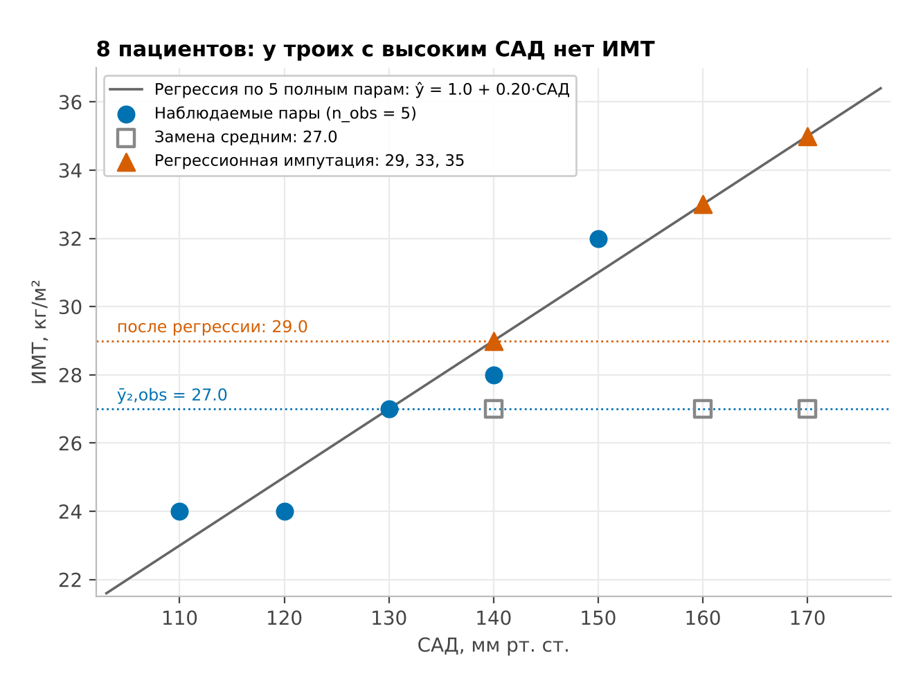</div></div>
```

::: {.notes}

```{=html}
<p>Прежде чем смотреть на 500 пациентов и формулы, посчитаем всё руками на восьми. У пятерых есть и давление, и ИМТ; у троих с самым высоким давлением ИМТ нет.</p><p>Замена средним: подставляем 27.0 трижды. Среднее не изменилось, а стандартное отклонение упало с 3.32 до 2.51 — мы добавили три точки, у которых нет разброса.</p><p>Регрессионная импутация: по пяти полным парам наклон 200/1000 = 0.20, свободный член 1.0. Прогнозы — 29, 33 и 35. Среднее выросло до 29.0, потому что у пациентов без ИМТ давление выше. Но на графике видно, что все три подставленные точки лежат строго на прямой.</p><p>И третья строка — самая важная: то же число 29.0 получается без единой подстановки. Берём среднее ИМТ у полных случаев и сдвигаем его на наклон, умноженный на разницу среднего давления во всей группе и у полных случаев. Это формула Андерсона, к которой мы строго придём в разделе 5.</p><p>Запомните вопрос, который пока остаётся открытым: если среднее у регрессии и у формулы Андерсона одинаковое, чем они различаются?</p>
```

:::


## Восемь пациентов: замена средним, регрессионная импутация и поправка Андерсона на бумаге · продолжение {#p1-by-hand-cont-3 .course-slide .layer-core data-source="v2:21" data-layer="core"}

```{=html}
<div class="course-kicker">ЗАНЯТИЕ 1 · ОСНОВНАЯ ЛИНИЯ</div><div class="course-grid"><div class="course-card " style="grid-column:span 12"><p class="bullet">• Замена средним: среднее осталось 27.0, а SD упало с 3.32 до 2.51 — три точки добавлены без разброса.</p><p class="bullet">• Регрессия: β̂₁ = Sxy / Sxx = 200 / 1000 = 0.20,  β̂₀ = 27 − 0.20·130 = 1.0. Среднее поднялось до 29.0, но импутации лежат строго на прямой.</p><p class="bullet">• Поправка Андерсона даёт то же среднее вообще без подстановок: ȳ₂,obs + β̂₁·(ȳ₁ − ȳ₁,obs) = 27 + 0.20·(140 − 130) = 29.0.</p></div></div>
```

::: {.notes}

```{=html}
<p>Прежде чем смотреть на 500 пациентов и формулы, посчитаем всё руками на восьми. У пятерых есть и давление, и ИМТ; у троих с самым высоким давлением ИМТ нет.</p><p>Замена средним: подставляем 27.0 трижды. Среднее не изменилось, а стандартное отклонение упало с 3.32 до 2.51 — мы добавили три точки, у которых нет разброса.</p><p>Регрессионная импутация: по пяти полным парам наклон 200/1000 = 0.20, свободный член 1.0. Прогнозы — 29, 33 и 35. Среднее выросло до 29.0, потому что у пациентов без ИМТ давление выше. Но на графике видно, что все три подставленные точки лежат строго на прямой.</p><p>И третья строка — самая важная: то же число 29.0 получается без единой подстановки. Берём среднее ИМТ у полных случаев и сдвигаем его на наклон, умноженный на разницу среднего давления во всей группе и у полных случаев. Это формула Андерсона, к которой мы строго придём в разделе 5.</p><p>Запомните вопрос, который пока остаётся открытым: если среднее у регрессии и у формулы Андерсона одинаковое, чем они различаются?</p>
```

:::


## Замена средним и регрессия искажают σ₂ и ρ при MAR, но стохастика восстанавливает форму {#p1-single-imputation .course-slide .layer-core data-source="v2:22" data-layer="core"}

```{=html}
<div class="course-kicker">ЗАНЯТИЕ 1 · ОСНОВНАЯ ЛИНИЯ</div><div class="course-grid"><div class="course-card image" style="grid-column:span 12"><figure>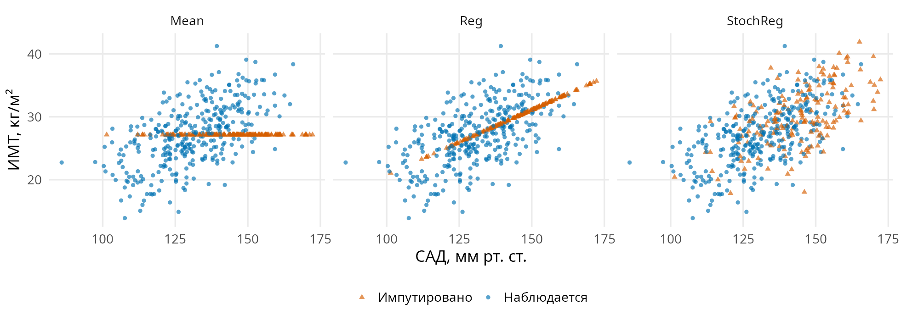<figcaption>Треугольники — импутации. Восстановление формы облака само по себе не гарантирует корректную SE.</figcaption></figure></div><div class="course-card " style="grid-column:span 12"><p>Среднее сжимает разброс; регрессия размещает значения на прямой; остаточный шум возвращает разброс. Сравниваем также среднее, оба наклона и доверительные интервалы.</p></div></div>
```

::: {.notes}

```{=html}
<p><strong>Редакция HTML:</strong> основной слайд обновлён по расчётам R или проверенному API. Числа исходного сценария ниже относятся к PPTX.</p><p>Теперь то же самое, что мы делали руками на <a class="slide-ref" href="#/p1-by-hand">связанный разбор</a>, — на всей когорте из 500 пациентов. Посмотрим на три классических способа одиночной импутации глазами нашего примера САД–ИМТ при MAR.</p><p>1) Слева — замена безусловным средним. Все оранжевые треугольники выстроились в горизонтальную шеренгу на уровне 27.1. Дисперсия рухнула, корреляция упала с 0.60 до 0.42.</p><p>2) В центре — регрессионная импутация (метод Бака). Мы предсказали ИМТ по САД и подставили ŷ = β̂₀ + β̂₁·САД. Среднее восстановилось до 28.0! Но все оранжевые треугольники легли строго на прямую линию без разброса — корреляция искусственно подскочила до 0.67!</p><p>3) Справа — стохастическая регрессионная импутация. К предсказанию ŷ мы добавили случайный нормальный шум с остаточным стандартным отклонением σ̂₂|₁. Облако стало неотличимым от истинного: и SD = 5.00, и r = 0.60.</p><p>На следующих слайдах выведем точные аналитические формулы этих искажений.</p>
```

:::


## Точные формулы смещения σ₂, ρ и β₁ при замене средним (и почему γ₁ не смещён при MCAR) {#p1-mean-formulas .course-slide .layer-core data-source="v2:23" data-layer="core"}

```{=html}
<div class="course-kicker">ЗАНЯТИЕ 1 · ОСНОВНАЯ ЛИНИЯ</div><div class="course-grid"><div class="course-card " style="grid-column:1 / span 12"><h3>Аналитические пределы (plim) при доле пропусков π (проиллюстрируем при MCAR, π = 0.30)</h3><p>Импутированный вектор:  ỹᵢ₂ = (1 − Mᵢ)·yᵢ₂ + Mᵢ·ȳ₂,obs</p><p>1. Среднее:  μ̂₂,Mean = ȳ₂,obs   ⇒   несмещено при MCAR (28.0), но смещено при MAR (27.08).</p><p>2. Дисперсия и СКО (импутированные точки дают нулевой вклад в сумму квадратов):</p><p>plim σ̂₂,Mean² = (1 − π)·σ₂²   ⇒   plim σ̂₂,Mean = √(1 − 0.30) · 5.0 = 4.18  (занижено!)</p><p>3. Ковариация и корреляция (ковариация сжимается в (1 − π) раз):</p><p>plim Cov(Y₁, Ỹ₂) = (1 − π)·σ₁₂   ⇒   plim ρ̂_Mean = (1 − π)σ₁₂ / (σ₁·√(1−π)σ₂) = √(1 − π)·ρ = 0.502</p><p>4. Наклон ИМТ ~ САД (β₁):  plim β̂₁,Mean = Cov(Y₁, Ỹ₂) / σ₁² = (1 − π)·β₁ = 0.70 · 0.20 = 0.140  (смещён к нулю!)</p><p>5. Обратный наклон САД ~ ИМТ (γ₁):  plim γ̂₁,Mean = [(1 − π)σ₁₂] / [(1 − π)σ₂²] = σ₁₂ / σ₂² = 1.80  (несмещён при MCAR!)</p><p>6. Факт для запоминания: γ̂₁,Mean в точности равен γ̂₁ по полным случаям (CCA) — точки на уровне среднего не дают вклада ни в числитель, ни в знаменатель.</p><p>7. При MAR те же формулы работают с моментами полных случаев (σ₂ → σ₂,cc, σ₁₂ → σ₁₂,cc) и π ≈ 0.32: σ̂₂ → 3.98, ρ̂ → 0.417, β̂₁ → 0.111, γ̂₁ → 1.57. Сверка с симуляцией — <a class="slide-ref" href="#/p1-formula-check">связанный разбор</a>.</p></div></div>
```

::: {.notes}

```{=html}
<p>Давайте выведем аналитически, откуда берутся эти искажения. Формулы запишем для самого простого случая — MCAR с долей пропусков 30%. При MAR логика та же, но в формулы входят моменты полных случаев, поэтому числа другие; оба случая сверим с симуляцией на <a class="slide-ref" href="#/p1-formula-check">связанный разбор</a>. Помните правило: замена средним — возможно, худший метод обработки пропусков, и вот точная математика этого.</p><p>Пусть доля пропусков π = 0.30, механизм MCAR.</p><p>1) Среднее остаётся 28.0, но стандартная ошибка делится на √n вместо √n_obs, сжимая ДИ.</p><p>2) Поскольку у 30% пациентов значение (ỹᵢ₂ − ȳ₂) ровно равно нулю, дисперсия сжимается ровно в (1 − π) = 0.70 раз, а СКО падает до √0.70 · 5 = 4.18.</p><p>3) Ковариация с САД тоже сжимается в 0.70 раз, поэтому корреляция умножается на √0.70 ≈ 0.837 и падает с 0.60 до 0.502.</p><p>4) В регрессии ИМТ ~ САД знаменатель σ₁² не изменился, а числитель сжался на 30% — поэтому наклон β₁ падает ровно до 0.140!</p><p>5) А вот забавный математический парадокс для обратной регрессии САД ~ ИМТ: при MCAR и числитель Cov, и знаменатель Var(Ỹ₂) сжимаются ровно на (1 − π). Множители сокращаются, и γ̂₁ остаётся равным 1.80! Правда, при MAR он всё равно сместится до 1.58.</p>
```

:::


## Стохастическая регрессия возвращает все пять точечных оценок — что ещё может пойти не так? {#p1-quiz-coverage .course-slide .layer-core data-source="v2:24" data-layer="core"}

```{=html}
<div class="course-kicker">ЗАНЯТИЕ 1 · ОСНОВНАЯ ЛИНИЯ</div><div class="course-grid"><div class="course-card " style="grid-column:1 / span 5"><h3>Что мы уже знаем</h3><p class="bullet">• Замена средним сжимает σ₂ и ρ.</p><p class="bullet">• Регрессионная импутация восстанавливает среднее, но кладёт точки на прямую и раздувает ρ.</p><p class="bullet">• Добавим к прогнозу случайный остаток εᵢ ~ N(0, σ̂₂|₁²). Облако выглядит как настоящее, и все пять точечных оценок попадают в истину.</p></div><div class="course-card " style="grid-column:7 / span 6"><h3>Вопрос (1 минута, обсудите с соседом)</h3><p>После такой импутации аналитик считает 95% ДИ для среднего ИМТ как обычно: μ̂₂ ± 1.96·σ̂₂/√n, где n = 500. Как часто такой интервал накрывает истину?</p><p>A.  ≈ 95%: оценка несмещена, значит, и интервал честный</p><p>B.  Заметно реже 95%: интервал слишком узкий</p><p>C.  Чаще 95%: добавленный шум расширяет интервал</p></div><div class="course-card " style="grid-column:1 / span 12"><p>Подсказка: сколько значений ИМТ было измерено на самом деле — и сколько стоит в знаменателе формулы SE?</p></div></div>
```

::: {.notes}

```{=html}
<p>Остановимся на минуту. Стохастическая регрессия выглядит как идеальное решение: облако точек естественное, все пять оценок на месте. Что ещё может быть не так?</p><p>Дайте аудитории минуту и проголосуйте. Правильный ответ — B. Точечная оценка действительно несмещена, но формула σ̂₂/√n считает все 500 значений измеренными, хотя 160 из них мы придумали сами. Покрытие — около 88% вместо 95%.</p><p>Типичная ошибка — вариант A: «несмещённая оценка — значит, честный интервал». Это и есть третий критерий Рубина, доверительная валидность: он проверяется отдельно от несмещённости. Формулы — на следующем слайде.</p>
```

:::


## Регрессионная импутация раздувает ρ и γ₁, а стохастическая — проваливает 95% ДИ {#p1-reg-stoch .course-slide .layer-core data-source="v2:25" data-layer="core"}

```{=html}
<div class="course-kicker">ЗАНЯТИЕ 1 · ОСНОВНАЯ ЛИНИЯ</div><div class="course-grid"><div class="course-card " style="grid-column:1 / span 6"><h3>Регрессионная импутация (при MCAR и MAR)</h3><p>ỹᵢ₂ = (1 − Mᵢ)·yᵢ₂ + Mᵢ·(β̂₀ + β̂₁·yᵢ₁)</p><p class="bullet">• μ̂₂,Reg → μ₂ (28.0)  и  β̂₁,Reg → β₁ (0.20)  (состоятельны при MAR!)</p><p class="bullet">• Дисперсия теряет остаточный шум σ₂|₁² в доле π:</p><p>plim σ̂₂,Reg² = σ₂² · [1 − π(1 − ρ²)]</p><p>При π=0.30, ρ=0.60:  σ̂₂,Reg → 5.0·√0.808 = 4.49</p><p class="bullet">• Ковариация восстанавливается полностью (σ₁₂),</p><p>но из-за сжатия знаменателя ρ и γ₁ РАЗДУВАЮТСЯ:</p><p>plim ρ̂_Reg  = ρ / √[1 − π(1 − ρ²)] = 0.60 / √0.808 = 0.667</p><p>plim γ̂₁,Reg = γ₁ / [1 − π(1 − ρ²)] = 1.80 / 0.808 = 2.23!</p></div><div class="course-card " style="grid-column:7 / span 6"><h3>Стохастическая регрессия и её главный порок</h3><p>ỹᵢ₂ = (1 − Mᵢ)·yᵢ₂ + Mᵢ·(β̂₀ + β̂₁·yᵢ₁ + εᵢ),</p><p>где εᵢ ~ N(0, σ̂₂|₁²).</p><p class="bullet">• Добавление шума возвращает потерянную долю π·σ₂|₁²:</p><p>все 5 точечных оценок (μ₂, σ₂, ρ, β₁, γ₁) становятся</p><p>СОСТОЯТЕЛЬНЫМИ при MCAR и MAR!</p><p class="bullet">• Почему падает покрытие 95% ДИ (до ~80–88%)?</p><p>Обычный расчёт SE(μ̂₂) = σ̂₂ / √n притворяется,</p><p>что все n значений были реально измерены.</p><p>Остаточный шум σ₂|₁² делится на n, а не на n_obs;</p><p>не учтены шум самих импутаций и неопределённость (β̂₀, β̂₁).</p><p>В примере (MAR): формула даёт Var(μ̂₂) ≈ 0.050, реальный разброс оценок ≈ 0.08.</p></div></div>
```

::: {.notes}

```{=html}
<p>Теперь посмотрим на формулы для регрессионной и стохастической импутации.</p><p>В регрессионной импутации при MAR среднее 28.0 и наклон β₁ = 0.20 оцениваются несмещённо. Но у 30% пациентов полностью отсутствует остаточный шум σ₂|₁². Поэтому дисперсия ИМТ сжимается с множителем [1 − π(1 − ρ²)] = 0.808, и СКО падает до 4.49.</p><p>Зато ковариация с САД восстанавливается на 100%! И что происходит, когда числитель полный, а знаменатель сжат на 19.2%? Корреляция подпрыгивает до 0.667, а обратный наклон γ₁ (в модели САД ~ ИМТ) раздувается с 1.80 до 2.23! То есть, восстанавливая предиктор ИМТ детерминированной регрессией, мы сильно завышаем его эффект на давление.</p><p>Стохастическая регрессия возвращает шум εᵢ и делает все 5 точечных оценок несмещёнными. Но поскольку это ОДИНОЧНАЯ импутация, стандартная ошибка считается по формуле σ̂₂/√n, как будто все 500 значений ИМТ измерены. На самом деле остаточный шум надо делить на n_obs = 340 реальных измерений, а не на n = 500; сверх того есть случайность самих подставленных остатков и неопределённость коэффициентов регрессии. В нашем примере формула даёт дисперсию оценки 0.050, а реальный разброс оценок по симуляции — около 0.08. Поэтому ДИ слишком узкий, и покрытие падает до 87–88%.</p>
```

:::


## Формулы и симуляция сходятся: при MCAR — напрямую, при MAR — с моментами полных случаев {#p1-formula-check .course-slide .layer-core data-source="v2:26" data-layer="core"}

```{=html}
<div class="course-kicker">ЗАНЯТИЕ 1 · ОСНОВНАЯ ЛИНИЯ</div><div class="review-banner">Числа перенесены из PPTX; этот расчёт ещё не воспроизведён в R.</div><div class="course-grid"><div class="course-card " style="grid-column:span 12"><table><thead><tr><th>Метод и величина</th><th>Формула предела (plim)</th><th>MCAR, π = 0.30
формула</th><th>MCAR
симуляция</th><th>MAR, π ≈ 0.32
формула</th><th>MAR
симуляция</th></tr></thead><tbody><tr><td>Среднее: σ̂₂</td><td>√(1 − π) · σ₂,cc</td><td>4.18</td><td>4.18</td><td>3.98</td><td>3.97</td></tr><tr><td>Среднее: ρ̂</td><td>√(1 − π) · σ₁₂,cc / (σ₁ · σ₂,cc)</td><td>0.502</td><td>0.501</td><td>0.417</td><td>0.417</td></tr><tr><td>Среднее: β̂₁ [ИМТ ~ САД]</td><td>(1 − π) · σ₁₂,cc / σ₁²</td><td>0.140</td><td>0.140</td><td>0.111</td><td>0.111</td></tr><tr><td>Среднее: γ̂₁ [САД ~ ИМТ]</td><td>σ₁₂,cc / σ₂,cc²  (то же, что CCA)</td><td>1.80</td><td>1.80</td><td>1.57</td><td>1.57</td></tr><tr><td>Регрессия: σ̂₂</td><td>σ₂ · √[1 − π(1 − ρ²)]</td><td>4.49</td><td>4.49</td><td>4.45</td><td>4.45</td></tr><tr><td>Регрессия: ρ̂</td><td>ρ / √[1 − π(1 − ρ²)]</td><td>0.667</td><td>0.667</td><td>0.674</td><td>0.672</td></tr><tr><td>Регрессия: γ̂₁ [САД ~ ИМТ]</td><td>γ₁ / [1 − π(1 − ρ²)]</td><td>2.23</td><td>2.23</td><td>2.27</td><td>2.26</td></tr></tbody></table></div></div>
```

::: {.notes}

```{=html}
<p>Сверим формулы с симуляцией — отдельно для MCAR и для MAR.</p><p>Слева — MCAR с долей пропусков 30%: именно этот случай мы выводили на предыдущих слайдах. Совпадение до третьего знака.</p><p>Справа — MAR, наш основной сценарий. Формулы для замены средним остаются теми же по форме, но вместо популяционных дисперсии и ковариации в них стоят моменты полных случаев: полные случаи — это пациенты с более низким давлением, и у них меньше и разброс ИМТ, и ковариация. Поэтому искажения при MAR сильнее, чем при MCAR: σ̂₂ = 3.97 против 4.18, ρ̂ = 0.42 против 0.50.</p><p>Для регрессионной импутации формула одна и та же при обоих механизмах — в неё входит только доля пропусков.</p><p>Обратите внимание на строку γ̂₁ при замене средним: она в точности равна оценке по полным случаям.</p>
```

:::


## Формулы и симуляция сходятся: при MCAR — напрямую, при MAR — с моментами полных случаев · продолжение {#p1-formula-check-cont-2 .course-slide .layer-core data-source="v2:26" data-layer="core"}

```{=html}
<div class="course-kicker">ЗАНЯТИЕ 1 · ОСНОВНАЯ ЛИНИЯ</div><div class="review-banner">Числа перенесены из PPTX; этот расчёт ещё не воспроизведён в R.</div><div class="course-grid"><div class="course-card " style="grid-column:span 12"><p>Обозначение «cc» — моменты в подвыборке полных случаев (complete cases). При MCAR они совпадают с популяционными: σ₂,cc = σ₂ = 5.0, σ₁₂,cc = σ₁₂ = 45 — получаем формулы <a class="slide-ref" href="#/p1-mean-formulas">связанный разбор</a>.</p><p>При MAR в нашем DGP полные случаи сдвинуты в сторону низкого САД: σ₂,cc = 4.83, σ₁₂,cc = 36.7, π = 0.323. Формулы регрессионной импутации одинаковы при MCAR и MAR, меняется только π.</p><p>Симуляция: 4000 репликаций, n = 500 (независимое воспроизведение DGP); расхождения в третьем знаке — эффект конечной выборки.</p></div></div>
```

::: {.notes}

```{=html}
<p>Сверим формулы с симуляцией — отдельно для MCAR и для MAR.</p><p>Слева — MCAR с долей пропусков 30%: именно этот случай мы выводили на предыдущих слайдах. Совпадение до третьего знака.</p><p>Справа — MAR, наш основной сценарий. Формулы для замены средним остаются теми же по форме, но вместо популяционных дисперсии и ковариации в них стоят моменты полных случаев: полные случаи — это пациенты с более низким давлением, и у них меньше и разброс ИМТ, и ковариация. Поэтому искажения при MAR сильнее, чем при MCAR: σ̂₂ = 3.97 против 4.18, ρ̂ = 0.42 против 0.50.</p><p>Для регрессионной импутации формула одна и та же при обоих механизмах — в неё входит только доля пропусков.</p><p>Обратите внимание на строку γ̂₁ при замене средним: она в точности равна оценке по полным случаям.</p>
```

:::


## LOCF даёт непредсказуемое смещение и не рекомендован как первичный анализ без обоснования {#p1-locf .course-slide .layer-core data-source="v2:27" data-layer="core"}

```{=html}
<div class="course-kicker">ЗАНЯТИЕ 1 · ОСНОВНАЯ ЛИНИЯ</div><div class="course-grid"><div class="course-card " style="grid-column:1 / span 5"><h3>Что такое LOCF / BOCF?</h3><p class="bullet">• LOCF (Last Observation Carried Forward): если пациент выбыл после 2-го визита, его значение на 2-м визите принудительно копируется на все последующие визиты (вплоть до финального).</p><p class="bullet">• BOCF (Baseline Observation Carried Forward): копируется исходное значение до начала терапии.</p><p class="bullet">• Биологический нонсенс: метод неявно предполагает, что после отмены препарата состояние пациента навечно «замораживается» в точке выбывания (например, в дегенеративных или хронических болезнях).</p></div><div class="course-card " style="grid-column:7 / span 5"><h3>Почему миф о «консервативности» LOCF опасен?</h3><p class="bullet">• Смещён даже при MCAR! Если в группе контроля состояние ухудшается со временем, а пациенты выбывают на ранних визитах, LOCF замораживает их на «хорошем» уровне (или наоборот).</p><p class="bullet">• Сжатие дисперсии: повторяющиеся копии искусственно уменьшают стандартные ошибки и резко завышают частоту ошибок I рода (ложноположительный вывод об эффективности препарата).</p><p class="bullet">• Регуляторная позиция (NRC 2010; EMA 2010): LOCF и BOCF не должны быть первичным анализом, если их допущения научно не обоснованы; EMA допускает их в отдельных ситуациях (например, BOCF при хронической боли).</p></div></div>
```

::: {.notes}

```{=html}
<p>Нельзя завершить разговор о наивных методах без упоминания LOCF (Last Observation Carried Forward) — метода, который десятилетиями доминировал в фармацевтических РКИ.</p><p>Долгое время считалось, что LOCF «консервативен»: мол, если пациент бросил терапию и мы перенесём его старое значение, мы якобы не преувеличим эффект. Отчёт Национального исследовательского совета США (NRC, 2010) и руководство EMA (2010) этот миф не поддерживают. Формально LOCF не запрещён: NRC пишет, что одиночные методы вроде LOCF и BOCF не должны быть первичным подходом, если их допущения научно не обоснованы, а EMA отмечает, что при прогрессирующих заболеваниях LOCF скорее слишком оптимистичен.</p><p>Направление смещения LOCF абсолютно непредсказуемо и зависит от траектории болезни и момента выбывания в группах. Более того, LOCF смещён даже при полностью случайном выпадении MCAR! А копирование одних и тех же чисел сжимает дисперсию и завышает вероятность ложноположительного результата. Сегодня в подтверждающих РКИ вместо LOCF чаще используют смешанные модели (MMRM) или множественную импутацию.</p>
```

:::


## LOCF «останавливает болезнь» в момент выбывания — и смещает эффект даже при случайном выбывании {#p1-locf-chart .course-slide .layer-core data-source="v2:28" data-layer="core"}

```{=html}
<div class="course-kicker">ЗАНЯТИЕ 1 · ОСНОВНАЯ ЛИНИЯ</div><div class="review-banner">Числа перенесены из PPTX; этот расчёт ещё не воспроизведён в R.</div><div class="course-grid"><div class="course-card image" style="grid-column:span 12">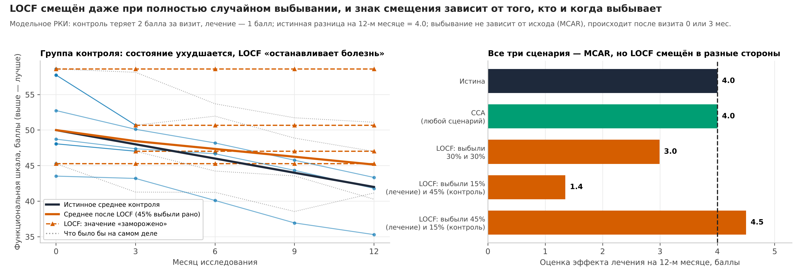</div></div>
```

::: {.notes}

```{=html}
<p>То же самое на картинке. Модельное исследование прогрессирующего заболевания: в контроле пациенты теряют два балла функциональной шкалы за визит, на лечении — один. Истинная разница через год — четыре балла.</p><p>Слева — группа контроля. Синие линии — наблюдаемые траектории. У тех, кто выбыл, LOCF рисует горизонтальную оранжевую линию: болезнь как будто остановилась. Серым пунктиром показано, что происходило на самом деле. В результате среднее группы после LOCF оказывается выше истинного.</p><p>Справа — оценка эффекта лечения. Во всех трёх сценариях выбывание полностью случайно, то есть MCAR, и обычный анализ завершивших исследование даёт верные 4.0. А LOCF даёт 3.0, если выбывают одинаково; 1.4, если чаще выбывают из контроля; и 4.5, если чаще выбывают с лечения. В последнем случае LOCF завышает эффект препарата.</p><p>Вывод: «консервативность» LOCF — не свойство метода, а совпадение траектории болезни и структуры выбывания в конкретном исследовании.</p>
```

:::


## LOCF «останавливает болезнь» в момент выбывания — и смещает эффект даже при случайном выбывании · продолжение {#p1-locf-chart-cont-2 .course-slide .layer-core data-source="v2:28" data-layer="core"}

```{=html}
<div class="course-kicker">ЗАНЯТИЕ 1 · ОСНОВНАЯ ЛИНИЯ</div><div class="review-banner">Числа перенесены из PPTX; этот расчёт ещё не воспроизведён в R.</div><div class="course-grid"><div class="course-card " style="grid-column:span 12"><p>Как читать. Слева: у выбывших пациентов значение «заморожено» на уровне последнего визита, хотя болезнь прогрессирует, — среднее группы после LOCF выше истинного. Справа: при одном и том же случайном (MCAR) выбывании LOCF даёт 3.0, 1.4 или 4.5 при истине 4.0 — знак смещения зависит от того, в какой группе выбывают чаще. CCA при MCAR несмещён.</p></div></div>
```

::: {.notes}

```{=html}
<p>То же самое на картинке. Модельное исследование прогрессирующего заболевания: в контроле пациенты теряют два балла функциональной шкалы за визит, на лечении — один. Истинная разница через год — четыре балла.</p><p>Слева — группа контроля. Синие линии — наблюдаемые траектории. У тех, кто выбыл, LOCF рисует горизонтальную оранжевую линию: болезнь как будто остановилась. Серым пунктиром показано, что происходило на самом деле. В результате среднее группы после LOCF оказывается выше истинного.</p><p>Справа — оценка эффекта лечения. Во всех трёх сценариях выбывание полностью случайно, то есть MCAR, и обычный анализ завершивших исследование даёт верные 4.0. А LOCF даёт 3.0, если выбывают одинаково; 1.4, если чаще выбывают из контроля; и 4.5, если чаще выбывают с лечения. В последнем случае LOCF завышает эффект препарата.</p><p>Вывод: «консервативность» LOCF — не свойство метода, а совпадение траектории болезни и структуры выбывания в конкретном исследовании.</p>
```

:::


## «Узкое место» совместного правдоподобия: параметры САД входят в оба множителя {#p1-likelihood-bottleneck .course-slide .layer-core data-source="v2:29" data-layer="core"}

```{=html}
<div class="course-kicker">ЗАНЯТИЕ 1 · ОСНОВНАЯ ЛИНИЯ</div><div class="course-grid"><div class="course-card " style="grid-column:1 / span 12"><h3>Совместная (моментная) параметризация θ = (μ₁, μ₂, σ₁², σ₂², ρ) и проблема правдоподобия</h3><p>L(θ | Y_obs) = ∏_{i=1..n_obs} f(yᵢ₁, yᵢ₂ | θ)  ×  ∏_{i=n_obs+1..n} f(yᵢ₁ | μ₁, σ₁²)</p><p class="bullet">• Плюс: напрямую содержит интересующие нас маргинальные величины (μ₂, σ₂², ρ).</p><p class="bullet">• Проблема: параметры (μ₁, σ₁²) входят в ОБЕ части произведения, поэтому аналитически максимизировать правдоподобие в этой параметризации неудобно.</p></div><div class="course-card " style="grid-column:1 / span 5"><h3>Напоминание: Факторизация А (<a class="slide-ref" href="#/p1-two-factorizations">связанный разбор</a>)</h3><p>f(САД, ИМТ) = f(САД) · f(ИМТ | САД)</p><p class="bullet">• Маргинально:  Y₁ ~ N(μ₁, σ₁²)</p><p class="bullet">• Условно:  Y₂ | Y₁ ~ N(β₀ + β₁·Y₁, σ₂|₁²)</p><p class="bullet">• Пять параметров φ = (μ₁, σ₁², β₀, β₁, σ₂|₁²) взаимно-однозначно связаны с θ.</p></div><div class="course-card " style="grid-column:7 / span 6"><h3>Идея следующего слайда</h3><p class="bullet">• Правдоподобие записано без модели пропусков. Это законно при MAR и разделимости параметров — теорема об игнорируемости (<a class="slide-ref" href="#/p1-ignorability">связанный разбор</a>).</p><p class="bullet">• Вопрос: можно ли выбрать параметры так, чтобы каждый множитель зависел от своего набора?</p><p class="bullet">• Ответ Андерсона (1957): да. Раскладываем плотность в порядке убывания наблюдаемости: сначала САД (есть у всех), затем ИМТ | САД.</p></div></div>
```

::: {.notes}

```{=html}
<p>Наивные методы мы разобрали: каждый из них что-то ломает — среднее, дисперсию, корреляцию или стандартные ошибки. Можно ли лучше? Да, и для этого не нужно ничего подставлять в пустые ячейки.</p><p>Вернёмся к пяти параметрам и посмотрим на совместную (моментную) параметризацию θ = (μ₁, μ₂, σ₁², σ₂², ρ). Если мы выпишем функцию правдоподобия наблюдаемых данных, первые n_obs полных пар дадут двумерную нормальную плотность, а оставшиеся n−n_obs пациентов — одномерную плотность только для САД. Беда в том, что μ₁ и σ₁² зашиты в оба множителя. Дифференцировать это в лоб — мучительно.</p><p>Заметьте: мы пишем правдоподобие без модели механизма пропусков. Право на это даёт теорема об игнорируемости из раздела 3: при MAR и разделимости параметров множитель с механизмом выносится за скобки.</p><p>Есть изящный трюк с перепараметризацией: вспомним Факторизацию А — сначала САД, затем ИМТ при заданном САД.</p>
```

:::


## Паттерн пропусков в ИМТ диктует выбор Факторизации А и расщепляет правдоподобие {#p1-anderson .course-slide .layer-core data-source="v2:30" data-layer="core"}

```{=html}
<div class="course-kicker">ЗАНЯТИЕ 1 · ОСНОВНАЯ ЛИНИЯ</div><div class="course-grid"><div class="course-card " style="grid-column:span 12"><h3>Расщепление правдоподобия наблюдаемых данных (при пропусках только в Y₂ и MAR)</h3><div class="equation"><span class="katex-display"><span class="katex"><span class="katex-mathml"><math xmlns="http://www.w3.org/1998/Math/MathML" display="block"><semantics><mrow><mi>L</mi><mo stretchy="false">(</mo><mi>ϕ</mi><mo>∣</mo><msub><mi>Y</mi><mrow><mi mathvariant="normal">o</mi><mi mathvariant="normal">b</mi><mi mathvariant="normal">s</mi></mrow></msub><mo stretchy="false">)</mo><mo>=</mo><munderover><mo>∏</mo><mrow><mi>i</mi><mo>=</mo><mn>1</mn></mrow><msub><mi>n</mi><mrow><mi mathvariant="normal">o</mi><mi mathvariant="normal">b</mi><mi mathvariant="normal">s</mi></mrow></msub></munderover><msub><mi>f</mi><mn>1</mn></msub><mo stretchy="false">(</mo><msub><mi>y</mi><mrow><mi>i</mi><mn>1</mn></mrow></msub><mo stretchy="false">)</mo><msub><mi>f</mi><mn>2</mn></msub><mo stretchy="false">(</mo><msub><mi>y</mi><mrow><mi>i</mi><mn>2</mn></mrow></msub><mo>∣</mo><msub><mi>y</mi><mrow><mi>i</mi><mn>1</mn></mrow></msub><mo stretchy="false">)</mo><munderover><mo>∏</mo><mrow><mi>i</mi><mo>=</mo><msub><mi>n</mi><mrow><mi mathvariant="normal">o</mi><mi mathvariant="normal">b</mi><mi mathvariant="normal">s</mi></mrow></msub><mo>+</mo><mn>1</mn></mrow><mi>n</mi></munderover><msub><mi>f</mi><mn>1</mn></msub><mo stretchy="false">(</mo><msub><mi>y</mi><mrow><mi>i</mi><mn>1</mn></mrow></msub><mo stretchy="false">)</mo></mrow><annotation encoding="application/x-tex">L(\phi\mid Y_{\rm obs})=\prod_{i=1}^{n_{\rm obs}}f_1(y_{i1})f_2(y_{i2}\mid y_{i1})\prod_{i=n_{\rm obs}+1}^{n}f_1(y_{i1})</annotation></semantics></math></span><span class="katex-html" aria-hidden="true"><span class="katex-base"><span class="katex-strut" style="height:1em;vertical-align:-0.25em;"></span><span class="mord mathnormal">L</span><span class="mopen">(</span><span class="mord mathnormal">ϕ</span><span class="mspace" style="margin-right:0.2778em;"></span><span class="mrel">∣</span><span class="mspace" style="margin-right:0.2778em;"></span></span><span class="katex-base"><span class="katex-strut" style="height:1em;vertical-align:-0.25em;"></span><span class="mord"><span class="mord mathnormal" style="margin-right:0.2222em;">Y</span><span class="msupsub"><span class="vlist-t vlist-t2"><span class="vlist-r"><span class="vlist" style="height:0.3361em;"><span style="top:-2.55em;margin-left:-0.2222em;margin-right:0.05em;"><span class="pstrut" style="height:2.7em;"></span><span class="katex-sizing reset-size6 size3 mtight"><span class="mord mtight"><span class="mord mtight"><span class="mord mathrm mtight">obs</span></span></span></span></span></span><span class="vlist-s">​</span></span><span class="vlist-r"><span class="vlist" style="height:0.15em;"><span></span></span></span></span></span></span><span class="mclose">)</span><span class="mspace" style="margin-right:0.2778em;"></span><span class="mrel">=</span><span class="mspace" style="margin-right:0.2778em;"></span></span><span class="katex-base"><span class="katex-strut" style="height:2.9459em;vertical-align:-1.2777em;"></span><span class="mop op-limits"><span class="vlist-t vlist-t2"><span class="vlist-r"><span class="vlist" style="height:1.6683em;"><span style="top:-1.8723em;margin-left:0em;"><span class="pstrut" style="height:3.05em;"></span><span class="katex-sizing reset-size6 size3 mtight"><span class="mord mtight"><span class="mord mathnormal mtight">i</span><span class="mrel mtight">=</span><span class="mord mtight">1</span></span></span></span><span style="top:-3.05em;"><span class="pstrut" style="height:3.05em;"></span><span><span class="mop op-symbol large-op">∏</span></span></span><span style="top:-4.3169em;margin-left:0em;"><span class="pstrut" style="height:3.05em;"></span><span class="katex-sizing reset-size6 size3 mtight"><span class="mord mtight"><span class="mord mtight"><span class="mord mathnormal mtight">n</span><span class="msupsub"><span class="vlist-t vlist-t2"><span class="vlist-r"><span class="vlist" style="height:0.3448em;"><span style="top:-2.3488em;margin-left:0em;margin-right:0.0714em;"><span class="pstrut" style="height:2.5em;"></span><span class="katex-sizing reset-size3 size1 mtight"><span class="mord mtight"><span class="mord mtight"><span class="mord mathrm mtight">obs</span></span></span></span></span></span><span class="vlist-s">​</span></span><span class="vlist-r"><span class="vlist" style="height:0.1512em;"><span></span></span></span></span></span></span></span></span></span></span><span class="vlist-s">​</span></span><span class="vlist-r"><span class="vlist" style="height:1.2777em;"><span></span></span></span></span></span><span class="mspace" style="margin-right:0.1667em;"></span><span class="mord"><span class="mord mathnormal" style="margin-right:0.1076em;">f</span><span class="msupsub"><span class="vlist-t vlist-t2"><span class="vlist-r"><span class="vlist" style="height:0.3011em;"><span style="top:-2.55em;margin-left:-0.1076em;margin-right:0.05em;"><span class="pstrut" style="height:2.7em;"></span><span class="katex-sizing reset-size6 size3 mtight"><span class="mord mtight">1</span></span></span></span><span class="vlist-s">​</span></span><span class="vlist-r"><span class="vlist" style="height:0.15em;"><span></span></span></span></span></span></span><span class="mopen">(</span><span class="mord"><span class="mord mathnormal" style="margin-right:0.0359em;">y</span><span class="msupsub"><span class="vlist-t vlist-t2"><span class="vlist-r"><span class="vlist" style="height:0.3117em;"><span style="top:-2.55em;margin-left:-0.0359em;margin-right:0.05em;"><span class="pstrut" style="height:2.7em;"></span><span class="katex-sizing reset-size6 size3 mtight"><span class="mord mtight"><span class="mord mathnormal mtight">i</span><span class="mord mtight">1</span></span></span></span></span><span class="vlist-s">​</span></span><span class="vlist-r"><span class="vlist" style="height:0.15em;"><span></span></span></span></span></span></span><span class="mclose">)</span><span class="mord"><span class="mord mathnormal" style="margin-right:0.1076em;">f</span><span class="msupsub"><span class="vlist-t vlist-t2"><span class="vlist-r"><span class="vlist" style="height:0.3011em;"><span style="top:-2.55em;margin-left:-0.1076em;margin-right:0.05em;"><span class="pstrut" style="height:2.7em;"></span><span class="katex-sizing reset-size6 size3 mtight"><span class="mord mtight">2</span></span></span></span><span class="vlist-s">​</span></span><span class="vlist-r"><span class="vlist" style="height:0.15em;"><span></span></span></span></span></span></span><span class="mopen">(</span><span class="mord"><span class="mord mathnormal" style="margin-right:0.0359em;">y</span><span class="msupsub"><span class="vlist-t vlist-t2"><span class="vlist-r"><span class="vlist" style="height:0.3117em;"><span style="top:-2.55em;margin-left:-0.0359em;margin-right:0.05em;"><span class="pstrut" style="height:2.7em;"></span><span class="katex-sizing reset-size6 size3 mtight"><span class="mord mtight"><span class="mord mathnormal mtight">i</span><span class="mord mtight">2</span></span></span></span></span><span class="vlist-s">​</span></span><span class="vlist-r"><span class="vlist" style="height:0.15em;"><span></span></span></span></span></span></span><span class="mspace" style="margin-right:0.2778em;"></span><span class="mrel">∣</span><span class="mspace" style="margin-right:0.2778em;"></span></span><span class="katex-base"><span class="katex-strut" style="height:3.0349em;vertical-align:-1.3835em;"></span><span class="mord"><span class="mord mathnormal" style="margin-right:0.0359em;">y</span><span class="msupsub"><span class="vlist-t vlist-t2"><span class="vlist-r"><span class="vlist" style="height:0.3117em;"><span style="top:-2.55em;margin-left:-0.0359em;margin-right:0.05em;"><span class="pstrut" style="height:2.7em;"></span><span class="katex-sizing reset-size6 size3 mtight"><span class="mord mtight"><span class="mord mathnormal mtight">i</span><span class="mord mtight">1</span></span></span></span></span><span class="vlist-s">​</span></span><span class="vlist-r"><span class="vlist" style="height:0.15em;"><span></span></span></span></span></span></span><span class="mclose">)</span><span class="mspace" style="margin-right:0.1667em;"></span><span class="mop op-limits"><span class="vlist-t vlist-t2"><span class="vlist-r"><span class="vlist" style="height:1.6514em;"><span style="top:-1.8723em;margin-left:0em;"><span class="pstrut" style="height:3.05em;"></span><span class="katex-sizing reset-size6 size3 mtight"><span class="mord mtight"><span class="mord mathnormal mtight">i</span><span class="mrel mtight">=</span><span class="mord mtight"><span class="mord mathnormal mtight">n</span><span class="msupsub"><span class="vlist-t vlist-t2"><span class="vlist-r"><span class="vlist" style="height:0.3448em;"><span style="top:-2.3488em;margin-left:0em;margin-right:0.0714em;"><span class="pstrut" style="height:2.5em;"></span><span class="katex-sizing reset-size3 size1 mtight"><span class="mord mtight"><span class="mord mtight"><span class="mord mathrm mtight">obs</span></span></span></span></span></span><span class="vlist-s">​</span></span><span class="vlist-r"><span class="vlist" style="height:0.1512em;"><span></span></span></span></span></span></span><span class="mbin mtight">+</span><span class="mord mtight">1</span></span></span></span><span style="top:-3.05em;"><span class="pstrut" style="height:3.05em;"></span><span><span class="mop op-symbol large-op">∏</span></span></span><span style="top:-4.3em;margin-left:0em;"><span class="pstrut" style="height:3.05em;"></span><span class="katex-sizing reset-size6 size3 mtight"><span class="mord mtight"><span class="mord mathnormal mtight">n</span></span></span></span></span><span class="vlist-s">​</span></span><span class="vlist-r"><span class="vlist" style="height:1.3835em;"><span></span></span></span></span></span><span class="mspace" style="margin-right:0.1667em;"></span><span class="mord"><span class="mord mathnormal" style="margin-right:0.1076em;">f</span><span class="msupsub"><span class="vlist-t vlist-t2"><span class="vlist-r"><span class="vlist" style="height:0.3011em;"><span style="top:-2.55em;margin-left:-0.1076em;margin-right:0.05em;"><span class="pstrut" style="height:2.7em;"></span><span class="katex-sizing reset-size6 size3 mtight"><span class="mord mtight">1</span></span></span></span><span class="vlist-s">​</span></span><span class="vlist-r"><span class="vlist" style="height:0.15em;"><span></span></span></span></span></span></span><span class="mopen">(</span><span class="mord"><span class="mord mathnormal" style="margin-right:0.0359em;">y</span><span class="msupsub"><span class="vlist-t vlist-t2"><span class="vlist-r"><span class="vlist" style="height:0.3117em;"><span style="top:-2.55em;margin-left:-0.0359em;margin-right:0.05em;"><span class="pstrut" style="height:2.7em;"></span><span class="katex-sizing reset-size6 size3 mtight"><span class="mord mtight"><span class="mord mathnormal mtight">i</span><span class="mord mtight">1</span></span></span></span></span><span class="vlist-s">​</span></span><span class="vlist-r"><span class="vlist" style="height:0.15em;"><span></span></span></span></span></span></span><span class="mclose">)</span></span></span></span></span></div><div class="equation"><span class="katex-display"><span class="katex"><span class="katex-mathml"><math xmlns="http://www.w3.org/1998/Math/MathML" display="block"><semantics><mrow><mo>=</mo><munder><munder><mrow><munderover><mo>∏</mo><mrow><mi>i</mi><mo>=</mo><mn>1</mn></mrow><mi>n</mi></munderover><msub><mi>f</mi><mn>1</mn></msub><mo stretchy="false">(</mo><msub><mi>y</mi><mrow><mi>i</mi><mn>1</mn></mrow></msub><mo>∣</mo><msub><mi>μ</mi><mn>1</mn></msub><mo separator="true">,</mo><msubsup><mi>σ</mi><mn>1</mn><mn>2</mn></msubsup><mo stretchy="false">)</mo></mrow><mo stretchy="true">⏟</mo></munder><mtext>all observations</mtext></munder><mtext> </mtext><munder><munder><mrow><munder><mo>∏</mo><mrow><mi>i</mi><mo>∈</mo><mi mathvariant="script">O</mi></mrow></munder><msub><mi>f</mi><mn>2</mn></msub><mo stretchy="false">(</mo><msub><mi>y</mi><mrow><mi>i</mi><mn>2</mn></mrow></msub><mo>∣</mo><msub><mi>y</mi><mrow><mi>i</mi><mn>1</mn></mrow></msub><mo separator="true">,</mo><msub><mi>β</mi><mn>0</mn></msub><mo separator="true">,</mo><msub><mi>β</mi><mn>1</mn></msub><mo separator="true">,</mo><msubsup><mi>σ</mi><mrow><mn>2</mn><mo>∣</mo><mn>1</mn></mrow><mn>2</mn></msubsup><mo stretchy="false">)</mo></mrow><mo stretchy="true">⏟</mo></munder><mtext>observed pairs</mtext></munder></mrow><annotation encoding="application/x-tex">=\underbrace{\prod_{i=1}^{n}f_1(y_{i1}\mid\mu_1,\sigma_1^2)}_{\text{all observations}}\ \underbrace{\prod_{i\in\mathcal O}f_2(y_{i2}\mid y_{i1},\beta_0,\beta_1,\sigma^2_{2\mid1})}_{\text{observed pairs}}</annotation></semantics></math></span><span class="katex-html" aria-hidden="true"><span class="katex-base"><span class="katex-strut" style="height:0.3669em;"></span><span class="mrel">=</span><span class="mspace" style="margin-right:0.2778em;"></span></span><span class="katex-base"><span class="katex-strut" style="height:4.4433em;vertical-align:-2.7919em;"></span><span class="minner munder"><span class="vlist-t vlist-t2"><span class="vlist-r"><span class="vlist" style="height:1.6514em;"><span style="top:-1.0396em;"><span class="pstrut" style="height:3.6514em;"></span><span class="katex-sizing reset-size6 size3 mtight"><span class="mord mtight"><span class="mord text mtight"><span class="mord mtight">all observations</span></span></span></span></span><span style="top:-3.6514em;"><span class="pstrut" style="height:3.6514em;"></span><span class="minner munder"><span class="vlist-t vlist-t2"><span class="vlist-r"><span class="vlist" style="height:1.6514em;"><span class="svg-align" style="top:-1.7257em;"><span class="pstrut" style="height:3.6514em;"></span><span class="katex-stretchy" style="height:0.548em;min-width:1.6em;"><span class="brace-left" style="height:0.548em;"><svg xmlns="http://www.w3.org/2000/svg" width="400em" height="0.548em" viewBox="0 0 400000 548" preserveAspectRatio="xMinYMin slice"><path d="M0 6l6-6h17c12.688 0 19.313.3 20 1 4 4 7.313 8.3 10 13
 35.313 51.3 80.813 93.8 136.5 127.5 55.688 33.7 117.188 55.8 184.5 66.5.688
 0 2 .3 4 1 18.688 2.7 76 4.3 172 5h399450v120H429l-6-1c-124.688-8-235-61.7
-331-161C60.687 138.7 32.312 99.3 7 54L0 41V6z"/></svg></span><span class="brace-center" style="height:0.548em;"><svg xmlns="http://www.w3.org/2000/svg" width="400em" height="0.548em" viewBox="0 0 400000 548" preserveAspectRatio="xMidYMin slice"><path d="M199572 214
c100.7 8.3 195.3 44 280 108 55.3 42 101.7 93 139 153l9 14c2.7-4 5.7-8.7 9-14
 53.3-86.7 123.7-153 211-199 66.7-36 137.3-56.3 212-62h199568v120H200432c-178.3
 11.7-311.7 78.3-403 201-6 8-9.7 12-11 12-.7.7-6.7 1-18 1s-17.3-.3-18-1c-1.3 0
-5-4-11-12-44.7-59.3-101.3-106.3-170-141s-145.3-54.3-229-60H0V214z"/></svg></span><span class="brace-right" style="height:0.548em;"><svg xmlns="http://www.w3.org/2000/svg" width="400em" height="0.548em" viewBox="0 0 400000 548" preserveAspectRatio="xMaxYMin slice"><path d="M399994 0l6 6v35l-6 11c-56 104-135.3 181.3-238 232-57.3
 28.7-117 45-179 50H-300V214h399897c43.3-7 81-15 113-26 100.7-33 179.7-91 237
-174 2.7-5 6-9 10-13 .7-1 7.3-1 20-1h17z"/></svg></span></span></span><span style="top:-3.6514em;"><span class="pstrut" style="height:3.6514em;"></span><span class="mord"><span class="mop op-limits"><span class="vlist-t vlist-t2"><span class="vlist-r"><span class="vlist" style="height:1.6514em;"><span style="top:-1.8723em;margin-left:0em;"><span class="pstrut" style="height:3.05em;"></span><span class="katex-sizing reset-size6 size3 mtight"><span class="mord mtight"><span class="mord mathnormal mtight">i</span><span class="mrel mtight">=</span><span class="mord mtight">1</span></span></span></span><span style="top:-3.05em;"><span class="pstrut" style="height:3.05em;"></span><span><span class="mop op-symbol large-op">∏</span></span></span><span style="top:-4.3em;margin-left:0em;"><span class="pstrut" style="height:3.05em;"></span><span class="katex-sizing reset-size6 size3 mtight"><span class="mord mtight"><span class="mord mathnormal mtight">n</span></span></span></span></span><span class="vlist-s">​</span></span><span class="vlist-r"><span class="vlist" style="height:1.2777em;"><span></span></span></span></span></span><span class="mspace" style="margin-right:0.1667em;"></span><span class="mord"><span class="mord mathnormal" style="margin-right:0.1076em;">f</span><span class="msupsub"><span class="vlist-t vlist-t2"><span class="vlist-r"><span class="vlist" style="height:0.3011em;"><span style="top:-2.55em;margin-left:-0.1076em;margin-right:0.05em;"><span class="pstrut" style="height:2.7em;"></span><span class="katex-sizing reset-size6 size3 mtight"><span class="mord mtight">1</span></span></span></span><span class="vlist-s">​</span></span><span class="vlist-r"><span class="vlist" style="height:0.15em;"><span></span></span></span></span></span></span><span class="mopen">(</span><span class="mord"><span class="mord mathnormal" style="margin-right:0.0359em;">y</span><span class="msupsub"><span class="vlist-t vlist-t2"><span class="vlist-r"><span class="vlist" style="height:0.3117em;"><span style="top:-2.55em;margin-left:-0.0359em;margin-right:0.05em;"><span class="pstrut" style="height:2.7em;"></span><span class="katex-sizing reset-size6 size3 mtight"><span class="mord mtight"><span class="mord mathnormal mtight">i</span><span class="mord mtight">1</span></span></span></span></span><span class="vlist-s">​</span></span><span class="vlist-r"><span class="vlist" style="height:0.15em;"><span></span></span></span></span></span></span><span class="mspace" style="margin-right:0.2778em;"></span><span class="mrel">∣</span><span class="mspace" style="margin-right:0.2778em;"></span><span class="mord"><span class="mord mathnormal">μ</span><span class="msupsub"><span class="vlist-t vlist-t2"><span class="vlist-r"><span class="vlist" style="height:0.3011em;"><span style="top:-2.55em;margin-left:0em;margin-right:0.05em;"><span class="pstrut" style="height:2.7em;"></span><span class="katex-sizing reset-size6 size3 mtight"><span class="mord mtight">1</span></span></span></span><span class="vlist-s">​</span></span><span class="vlist-r"><span class="vlist" style="height:0.15em;"><span></span></span></span></span></span></span><span class="mpunct">,</span><span class="mspace" style="margin-right:0.1667em;"></span><span class="mord"><span class="mord mathnormal" style="margin-right:0.0359em;">σ</span><span class="msupsub"><span class="vlist-t vlist-t2"><span class="vlist-r"><span class="vlist" style="height:0.8641em;"><span style="top:-2.453em;margin-left:-0.0359em;margin-right:0.05em;"><span class="pstrut" style="height:2.7em;"></span><span class="katex-sizing reset-size6 size3 mtight"><span class="mord mtight">1</span></span></span><span style="top:-3.113em;margin-right:0.05em;"><span class="pstrut" style="height:2.7em;"></span><span class="katex-sizing reset-size6 size3 mtight"><span class="mord mtight">2</span></span></span></span><span class="vlist-s">​</span></span><span class="vlist-r"><span class="vlist" style="height:0.247em;"><span></span></span></span></span></span></span><span class="mclose">)</span></span></span></span><span class="vlist-s">​</span></span><span class="vlist-r"><span class="vlist" style="height:1.9257em;"><span></span></span></span></span></span></span></span><span class="vlist-s">​</span></span><span class="vlist-r"><span class="vlist" style="height:2.6118em;"><span></span></span></span></span></span><span class="mspace"> </span><span class="mspace" style="margin-right:0.1667em;"></span><span class="minner munder"><span class="vlist-t vlist-t2"><span class="vlist-r"><span class="vlist" style="height:1.05em;"><span style="top:-0.3942em;"><span class="pstrut" style="height:3.05em;"></span><span class="katex-sizing reset-size6 size3 mtight"><span class="mord mtight"><span class="mord text mtight"><span class="mord mtight">observed pairs</span></span></span></span></span><span style="top:-3.05em;"><span class="pstrut" style="height:3.05em;"></span><span class="minner munder"><span class="vlist-t vlist-t2"><span class="vlist-r"><span class="vlist" style="height:1.05em;"><span class="svg-align" style="top:-1.0803em;"><span class="pstrut" style="height:3.05em;"></span><span class="katex-stretchy" style="height:0.548em;min-width:1.6em;"><span class="brace-left" style="height:0.548em;"><svg xmlns="http://www.w3.org/2000/svg" width="400em" height="0.548em" viewBox="0 0 400000 548" preserveAspectRatio="xMinYMin slice"><path d="M0 6l6-6h17c12.688 0 19.313.3 20 1 4 4 7.313 8.3 10 13
 35.313 51.3 80.813 93.8 136.5 127.5 55.688 33.7 117.188 55.8 184.5 66.5.688
 0 2 .3 4 1 18.688 2.7 76 4.3 172 5h399450v120H429l-6-1c-124.688-8-235-61.7
-331-161C60.687 138.7 32.312 99.3 7 54L0 41V6z"/></svg></span><span class="brace-center" style="height:0.548em;"><svg xmlns="http://www.w3.org/2000/svg" width="400em" height="0.548em" viewBox="0 0 400000 548" preserveAspectRatio="xMidYMin slice"><path d="M199572 214
c100.7 8.3 195.3 44 280 108 55.3 42 101.7 93 139 153l9 14c2.7-4 5.7-8.7 9-14
 53.3-86.7 123.7-153 211-199 66.7-36 137.3-56.3 212-62h199568v120H200432c-178.3
 11.7-311.7 78.3-403 201-6 8-9.7 12-11 12-.7.7-6.7 1-18 1s-17.3-.3-18-1c-1.3 0
-5-4-11-12-44.7-59.3-101.3-106.3-170-141s-145.3-54.3-229-60H0V214z"/></svg></span><span class="brace-right" style="height:0.548em;"><svg xmlns="http://www.w3.org/2000/svg" width="400em" height="0.548em" viewBox="0 0 400000 548" preserveAspectRatio="xMaxYMin slice"><path d="M399994 0l6 6v35l-6 11c-56 104-135.3 181.3-238 232-57.3
 28.7-117 45-179 50H-300V214h399897c43.3-7 81-15 113-26 100.7-33 179.7-91 237
-174 2.7-5 6-9 10-13 .7-1 7.3-1 20-1h17z"/></svg></span></span></span><span style="top:-3.05em;"><span class="pstrut" style="height:3.05em;"></span><span class="mord"><span class="mop op-limits"><span class="vlist-t vlist-t2"><span class="vlist-r"><span class="vlist" style="height:1.05em;"><span style="top:-1.8557em;margin-left:0em;"><span class="pstrut" style="height:3.05em;"></span><span class="katex-sizing reset-size6 size3 mtight"><span class="mord mtight"><span class="mord mathnormal mtight">i</span><span class="mrel mtight">∈</span><span class="mord mathcal mtight" style="margin-right:0.0278em;">O</span></span></span></span><span style="top:-3.05em;"><span class="pstrut" style="height:3.05em;"></span><span><span class="mop op-symbol large-op">∏</span></span></span></span><span class="vlist-s">​</span></span><span class="vlist-r"><span class="vlist" style="height:1.3217em;"><span></span></span></span></span></span><span class="mspace" style="margin-right:0.1667em;"></span><span class="mord"><span class="mord mathnormal" style="margin-right:0.1076em;">f</span><span class="msupsub"><span class="vlist-t vlist-t2"><span class="vlist-r"><span class="vlist" style="height:0.3011em;"><span style="top:-2.55em;margin-left:-0.1076em;margin-right:0.05em;"><span class="pstrut" style="height:2.7em;"></span><span class="katex-sizing reset-size6 size3 mtight"><span class="mord mtight">2</span></span></span></span><span class="vlist-s">​</span></span><span class="vlist-r"><span class="vlist" style="height:0.15em;"><span></span></span></span></span></span></span><span class="mopen">(</span><span class="mord"><span class="mord mathnormal" style="margin-right:0.0359em;">y</span><span class="msupsub"><span class="vlist-t vlist-t2"><span class="vlist-r"><span class="vlist" style="height:0.3117em;"><span style="top:-2.55em;margin-left:-0.0359em;margin-right:0.05em;"><span class="pstrut" style="height:2.7em;"></span><span class="katex-sizing reset-size6 size3 mtight"><span class="mord mtight"><span class="mord mathnormal mtight">i</span><span class="mord mtight">2</span></span></span></span></span><span class="vlist-s">​</span></span><span class="vlist-r"><span class="vlist" style="height:0.15em;"><span></span></span></span></span></span></span><span class="mspace" style="margin-right:0.2778em;"></span><span class="mrel">∣</span><span class="mspace" style="margin-right:0.2778em;"></span><span class="mord"><span class="mord mathnormal" style="margin-right:0.0359em;">y</span><span class="msupsub"><span class="vlist-t vlist-t2"><span class="vlist-r"><span class="vlist" style="height:0.3117em;"><span style="top:-2.55em;margin-left:-0.0359em;margin-right:0.05em;"><span class="pstrut" style="height:2.7em;"></span><span class="katex-sizing reset-size6 size3 mtight"><span class="mord mtight"><span class="mord mathnormal mtight">i</span><span class="mord mtight">1</span></span></span></span></span><span class="vlist-s">​</span></span><span class="vlist-r"><span class="vlist" style="height:0.15em;"><span></span></span></span></span></span></span><span class="mpunct">,</span><span class="mspace" style="margin-right:0.1667em;"></span><span class="mord"><span class="mord mathnormal" style="margin-right:0.0528em;">β</span><span class="msupsub"><span class="vlist-t vlist-t2"><span class="vlist-r"><span class="vlist" style="height:0.3011em;"><span style="top:-2.55em;margin-left:-0.0528em;margin-right:0.05em;"><span class="pstrut" style="height:2.7em;"></span><span class="katex-sizing reset-size6 size3 mtight"><span class="mord mtight">0</span></span></span></span><span class="vlist-s">​</span></span><span class="vlist-r"><span class="vlist" style="height:0.15em;"><span></span></span></span></span></span></span><span class="mpunct">,</span><span class="mspace" style="margin-right:0.1667em;"></span><span class="mord"><span class="mord mathnormal" style="margin-right:0.0528em;">β</span><span class="msupsub"><span class="vlist-t vlist-t2"><span class="vlist-r"><span class="vlist" style="height:0.3011em;"><span style="top:-2.55em;margin-left:-0.0528em;margin-right:0.05em;"><span class="pstrut" style="height:2.7em;"></span><span class="katex-sizing reset-size6 size3 mtight"><span class="mord mtight">1</span></span></span></span><span class="vlist-s">​</span></span><span class="vlist-r"><span class="vlist" style="height:0.15em;"><span></span></span></span></span></span></span><span class="mpunct">,</span><span class="mspace" style="margin-right:0.1667em;"></span><span class="mord"><span class="mord mathnormal" style="margin-right:0.0359em;">σ</span><span class="msupsub"><span class="vlist-t vlist-t2"><span class="vlist-r"><span class="vlist" style="height:0.8641em;"><span style="top:-2.428em;margin-left:-0.0359em;margin-right:0.05em;"><span class="pstrut" style="height:2.7em;"></span><span class="katex-sizing reset-size6 size3 mtight"><span class="mord mtight"><span class="mord mtight">2</span><span class="mrel mtight">∣</span><span class="mord mtight">1</span></span></span></span><span style="top:-3.113em;margin-right:0.05em;"><span class="pstrut" style="height:2.7em;"></span><span class="katex-sizing reset-size6 size3 mtight"><span class="mord mtight">2</span></span></span></span><span class="vlist-s">​</span></span><span class="vlist-r"><span class="vlist" style="height:0.447em;"><span></span></span></span></span></span></span><span class="mclose">)</span></span></span></span><span class="vlist-s">​</span></span><span class="vlist-r"><span class="vlist" style="height:1.9697em;"><span></span></span></span></span></span></span></span><span class="vlist-s">​</span></span><span class="vlist-r"><span class="vlist" style="height:2.7919em;"><span></span></span></span></span></span></span></span></span></span></div><p>φ = (μ₁, σ₁², β₀, β₁, σ₂|₁²) — параметры Факторизации А. Модель пропусков в правдоподобие не входит: при MAR её можно игнорировать (теорема об игнорируемости).</p></div><div class="course-card " style="grid-column:span 12"><h3>Обратный пересчёт к параметрам ИМТ:</h3><p class="bullet">• μ₂ = β₀ + β₁ · μ₁</p><p class="bullet">• σ₂² = β₁² · σ₁² + σ₂|₁²</p><p class="bullet">• σ₁₂ = β₁ · σ₁²  ⇒  ρ = β₁·σ₁ / σ₂</p><p class="bullet">• γ₁ = σ₁₂ / σ₂² = (β₁·σ₁²) / (β₁²·σ₁² + σ₂|₁²)</p></div></div>
```

::: {.notes}

```{=html}
<p>Посмотрите, какая красота происходит, если мы подставим Факторизацию А в функцию правдоподобия.</p><p>У первых n_obs пациентов плотность распадается на произведение f(y₁) и f(y₂ | y₁). У оставшихся n−n_obs пациентов есть только f(y₁). Теперь сгруппируем множители!</p><p>Все факторы f(y₁) собираются в один блок по ВСЕМ n пациентам — и он зависит только от (μ₁, σ₁²). А все условные факторы собираются во второй блок по n_obs полным парам — и он зависит только от (β₀, β₁, σ₂|₁²).</p><p>Множества параметров в двух блоках не пересекаются! Это знаменитый результат Т. В. Андерсона (1957).</p><p>И вот наш точный ответ на вопрос со <a class="slide-ref" href="#/p1-cohort">связанный разбор</a>: да, строки без ИМТ улучшают оценку среднего и дисперсии ИМТ! Их САД уточняет μ₁ и σ₁² по всей когорте из n человек, а дальше по формуле обратного пересчёта μ₂ = β₀ + β₁μ₁ эта информация переносится на ИМТ.</p><p>Заметьте: хотя Факторизация Б (САД ~ ИМТ) для кардиолога привычнее, математически для расщепления правдоподобия при пропусках в ИМТ работает только Факторизация А.</p>
```

:::


## Паттерн пропусков в ИМТ диктует выбор Факторизации А и расщепляет правдоподобие · продолжение {#p1-anderson-cont-2 .course-slide .layer-core data-source="v2:30" data-layer="core"}

```{=html}
<div class="course-kicker">ЗАНЯТИЕ 1 · ОСНОВНАЯ ЛИНИЯ</div><div class="course-grid"><div class="course-card " style="grid-column:span 12"><h3>Ответ на вопрос со <a class="slide-ref" href="#/p1-cohort">связанный разбор</a>:</h3><p>САД пациентов без ИМТ (строки i = n_obs+1..n) напрямую участвует в Блоке 1 (оценка μ₁ и σ₁² по всем n строкам) и через формулу μ₂ = β₀ + β₁·μ₁ уточняет среднее и дисперсию ИМТ!</p><p>Почему не Факторизация Б? При пропусках в ИМТ интеграл по пропущенному Y₂ не позволяет разделить параметры (μ₂, σ₂²) и (γ₀, γ₁, σ₁|₂²) на два независимых блока.</p></div></div>
```

::: {.notes}

```{=html}
<p>Посмотрите, какая красота происходит, если мы подставим Факторизацию А в функцию правдоподобия.</p><p>У первых n_obs пациентов плотность распадается на произведение f(y₁) и f(y₂ | y₁). У оставшихся n−n_obs пациентов есть только f(y₁). Теперь сгруппируем множители!</p><p>Все факторы f(y₁) собираются в один блок по ВСЕМ n пациентам — и он зависит только от (μ₁, σ₁²). А все условные факторы собираются во второй блок по n_obs полным парам — и он зависит только от (β₀, β₁, σ₂|₁²).</p><p>Множества параметров в двух блоках не пересекаются! Это знаменитый результат Т. В. Андерсона (1957).</p><p>И вот наш точный ответ на вопрос со <a class="slide-ref" href="#/p1-cohort">связанный разбор</a>: да, строки без ИМТ улучшают оценку среднего и дисперсии ИМТ! Их САД уточняет μ₁ и σ₁² по всей когорте из n человек, а дальше по формуле обратного пересчёта μ₂ = β₀ + β₁μ₁ эта информация переносится на ИМТ.</p><p>Заметьте: хотя Факторизация Б (САД ~ ИМТ) для кардиолога привычнее, математически для расщепления правдоподобия при пропусках в ИМТ работает только Факторизация А.</p>
```

:::


## Факторизация Андерсона переписывает правдоподобие (САД, ИМТ) в два независимых блока {#p1-anderson-proof .course-slide .layer-deep data-source="v2:31" data-layer="deep"}

```{=html}
<div class="course-kicker">ЗАНЯТИЕ 1 · УГЛУБЛЁННО</div><div class="course-grid"><div class="course-card " style="grid-column:span 12"><h3>1. Перепараметризация правдоподобия (i = 1..n_obs полные, n_obs+1..n только САД)</h3><p>Прямая запись L_ign(μ, Σ | Y_obs):</p><p>L(μ, Σ | Y_obs) = ∏_{i=1..n_obs} f_Y(yᵢ₁, yᵢ₂ | μ, Σ) × ∏_{i=n_obs+1..n} f₁(yᵢ₁ | μ₁, σ₁²)</p><p>Параметры (μ₁, σ₁²) зашиты в обе части — явного решения нет.</p><p>Разложение двумерной нормальной плотности (Anderson, 1957):</p><p>f_Y(yᵢ₁, yᵢ₂ | μ, Σ) = f₁(yᵢ₁ | μ₁, σ₁²) · f₂(yᵢ₂ | yᵢ₁, β₀, β₁, σ₂|₁²)</p><p>где β₁ = σ₁₂/σ₁²,  β₀ = μ₂ − β₁·μ₁,  σ₂|₁² = σ₂² − σ₁₂²/σ₁²</p><p>Группировка произведений по всем n и по n_obs полным парам:</p><div class="equation"><span class="katex-display"><span class="katex"><span class="katex-mathml"><math xmlns="http://www.w3.org/1998/Math/MathML" display="block"><semantics><mrow><mi>L</mi><mo stretchy="false">(</mo><mi>ϕ</mi><mo>∣</mo><msub><mi>Y</mi><mrow><mi mathvariant="normal">o</mi><mi mathvariant="normal">b</mi><mi mathvariant="normal">s</mi></mrow></msub><mo stretchy="false">)</mo><mo>=</mo><mrow><mo fence="true">[</mo><munderover><mo>∏</mo><mrow><mi>i</mi><mo>=</mo><mn>1</mn></mrow><mi>n</mi></munderover><msub><mi>f</mi><mn>1</mn></msub><mo stretchy="false">(</mo><msub><mi>y</mi><mrow><mi>i</mi><mn>1</mn></mrow></msub><mo>∣</mo><msub><mi>μ</mi><mn>1</mn></msub><mo separator="true">,</mo><msubsup><mi>σ</mi><mn>1</mn><mn>2</mn></msubsup><mo stretchy="false">)</mo><mo fence="true">]</mo></mrow><mrow><mo fence="true">[</mo><munder><mo>∏</mo><mrow><mi>i</mi><mo>∈</mo><mi mathvariant="script">O</mi></mrow></munder><msub><mi>f</mi><mn>2</mn></msub><mo stretchy="false">(</mo><msub><mi>y</mi><mrow><mi>i</mi><mn>2</mn></mrow></msub><mo>∣</mo><msub><mi>y</mi><mrow><mi>i</mi><mn>1</mn></mrow></msub><mo separator="true">,</mo><msub><mi>β</mi><mn>0</mn></msub><mo separator="true">,</mo><msub><mi>β</mi><mn>1</mn></msub><mo separator="true">,</mo><msubsup><mi>σ</mi><mrow><mn>2</mn><mo>∣</mo><mn>1</mn></mrow><mn>2</mn></msubsup><mo stretchy="false">)</mo><mo fence="true">]</mo></mrow></mrow><annotation encoding="application/x-tex">L(\phi\mid Y_{\rm obs})=\left[\prod_{i=1}^{n} f_1(y_{i1}\mid\mu_1,\sigma_1^2)\right]\left[\prod_{i\in\mathcal O}f_2(y_{i2}\mid y_{i1},\beta_0,\beta_1,\sigma^2_{2\mid1})\right]</annotation></semantics></math></span><span class="katex-html" aria-hidden="true"><span class="katex-base"><span class="katex-strut" style="height:1em;vertical-align:-0.25em;"></span><span class="mord mathnormal">L</span><span class="mopen">(</span><span class="mord mathnormal">ϕ</span><span class="mspace" style="margin-right:0.2778em;"></span><span class="mrel">∣</span><span class="mspace" style="margin-right:0.2778em;"></span></span><span class="katex-base"><span class="katex-strut" style="height:1em;vertical-align:-0.25em;"></span><span class="mord"><span class="mord mathnormal" style="margin-right:0.2222em;">Y</span><span class="msupsub"><span class="vlist-t vlist-t2"><span class="vlist-r"><span class="vlist" style="height:0.3361em;"><span style="top:-2.55em;margin-left:-0.2222em;margin-right:0.05em;"><span class="pstrut" style="height:2.7em;"></span><span class="katex-sizing reset-size6 size3 mtight"><span class="mord mtight"><span class="mord mtight"><span class="mord mathrm mtight">obs</span></span></span></span></span></span><span class="vlist-s">​</span></span><span class="vlist-r"><span class="vlist" style="height:0.15em;"><span></span></span></span></span></span></span><span class="mclose">)</span><span class="mspace" style="margin-right:0.2778em;"></span><span class="mrel">=</span><span class="mspace" style="margin-right:0.2778em;"></span></span><span class="katex-base"><span class="katex-strut" style="height:3.0717em;vertical-align:-1.3217em;"></span><span class="minner"><span class="mopen delimcenter" style="top:0em;"><span class="delimsizing size4">[</span></span><span class="mop op-limits"><span class="vlist-t vlist-t2"><span class="vlist-r"><span class="vlist" style="height:1.6514em;"><span style="top:-1.8723em;margin-left:0em;"><span class="pstrut" style="height:3.05em;"></span><span class="katex-sizing reset-size6 size3 mtight"><span class="mord mtight"><span class="mord mathnormal mtight">i</span><span class="mrel mtight">=</span><span class="mord mtight">1</span></span></span></span><span style="top:-3.05em;"><span class="pstrut" style="height:3.05em;"></span><span><span class="mop op-symbol large-op">∏</span></span></span><span style="top:-4.3em;margin-left:0em;"><span class="pstrut" style="height:3.05em;"></span><span class="katex-sizing reset-size6 size3 mtight"><span class="mord mtight"><span class="mord mathnormal mtight">n</span></span></span></span></span><span class="vlist-s">​</span></span><span class="vlist-r"><span class="vlist" style="height:1.2777em;"><span></span></span></span></span></span><span class="mspace" style="margin-right:0.1667em;"></span><span class="mord"><span class="mord mathnormal" style="margin-right:0.1076em;">f</span><span class="msupsub"><span class="vlist-t vlist-t2"><span class="vlist-r"><span class="vlist" style="height:0.3011em;"><span style="top:-2.55em;margin-left:-0.1076em;margin-right:0.05em;"><span class="pstrut" style="height:2.7em;"></span><span class="katex-sizing reset-size6 size3 mtight"><span class="mord mtight">1</span></span></span></span><span class="vlist-s">​</span></span><span class="vlist-r"><span class="vlist" style="height:0.15em;"><span></span></span></span></span></span></span><span class="mopen">(</span><span class="mord"><span class="mord mathnormal" style="margin-right:0.0359em;">y</span><span class="msupsub"><span class="vlist-t vlist-t2"><span class="vlist-r"><span class="vlist" style="height:0.3117em;"><span style="top:-2.55em;margin-left:-0.0359em;margin-right:0.05em;"><span class="pstrut" style="height:2.7em;"></span><span class="katex-sizing reset-size6 size3 mtight"><span class="mord mtight"><span class="mord mathnormal mtight">i</span><span class="mord mtight">1</span></span></span></span></span><span class="vlist-s">​</span></span><span class="vlist-r"><span class="vlist" style="height:0.15em;"><span></span></span></span></span></span></span><span class="mspace" style="margin-right:0.2778em;"></span><span class="mrel">∣</span><span class="mspace" style="margin-right:0.2778em;"></span><span class="mord"><span class="mord mathnormal">μ</span><span class="msupsub"><span class="vlist-t vlist-t2"><span class="vlist-r"><span class="vlist" style="height:0.3011em;"><span style="top:-2.55em;margin-left:0em;margin-right:0.05em;"><span class="pstrut" style="height:2.7em;"></span><span class="katex-sizing reset-size6 size3 mtight"><span class="mord mtight">1</span></span></span></span><span class="vlist-s">​</span></span><span class="vlist-r"><span class="vlist" style="height:0.15em;"><span></span></span></span></span></span></span><span class="mpunct">,</span><span class="mspace" style="margin-right:0.1667em;"></span><span class="mord"><span class="mord mathnormal" style="margin-right:0.0359em;">σ</span><span class="msupsub"><span class="vlist-t vlist-t2"><span class="vlist-r"><span class="vlist" style="height:0.8641em;"><span style="top:-2.453em;margin-left:-0.0359em;margin-right:0.05em;"><span class="pstrut" style="height:2.7em;"></span><span class="katex-sizing reset-size6 size3 mtight"><span class="mord mtight">1</span></span></span><span style="top:-3.113em;margin-right:0.05em;"><span class="pstrut" style="height:2.7em;"></span><span class="katex-sizing reset-size6 size3 mtight"><span class="mord mtight">2</span></span></span></span><span class="vlist-s">​</span></span><span class="vlist-r"><span class="vlist" style="height:0.247em;"><span></span></span></span></span></span></span><span class="mclose">)</span><span class="mclose delimcenter" style="top:0em;"><span class="delimsizing size4">]</span></span></span><span class="mspace" style="margin-right:0.1667em;"></span><span class="minner"><span class="mopen delimcenter" style="top:0em;"><span class="delimsizing size4">[</span></span><span class="mop op-limits"><span class="vlist-t vlist-t2"><span class="vlist-r"><span class="vlist" style="height:1.05em;"><span style="top:-1.8557em;margin-left:0em;"><span class="pstrut" style="height:3.05em;"></span><span class="katex-sizing reset-size6 size3 mtight"><span class="mord mtight"><span class="mord mathnormal mtight">i</span><span class="mrel mtight">∈</span><span class="mord mathcal mtight" style="margin-right:0.0278em;">O</span></span></span></span><span style="top:-3.05em;"><span class="pstrut" style="height:3.05em;"></span><span><span class="mop op-symbol large-op">∏</span></span></span></span><span class="vlist-s">​</span></span><span class="vlist-r"><span class="vlist" style="height:1.3217em;"><span></span></span></span></span></span><span class="mspace" style="margin-right:0.1667em;"></span><span class="mord"><span class="mord mathnormal" style="margin-right:0.1076em;">f</span><span class="msupsub"><span class="vlist-t vlist-t2"><span class="vlist-r"><span class="vlist" style="height:0.3011em;"><span style="top:-2.55em;margin-left:-0.1076em;margin-right:0.05em;"><span class="pstrut" style="height:2.7em;"></span><span class="katex-sizing reset-size6 size3 mtight"><span class="mord mtight">2</span></span></span></span><span class="vlist-s">​</span></span><span class="vlist-r"><span class="vlist" style="height:0.15em;"><span></span></span></span></span></span></span><span class="mopen">(</span><span class="mord"><span class="mord mathnormal" style="margin-right:0.0359em;">y</span><span class="msupsub"><span class="vlist-t vlist-t2"><span class="vlist-r"><span class="vlist" style="height:0.3117em;"><span style="top:-2.55em;margin-left:-0.0359em;margin-right:0.05em;"><span class="pstrut" style="height:2.7em;"></span><span class="katex-sizing reset-size6 size3 mtight"><span class="mord mtight"><span class="mord mathnormal mtight">i</span><span class="mord mtight">2</span></span></span></span></span><span class="vlist-s">​</span></span><span class="vlist-r"><span class="vlist" style="height:0.15em;"><span></span></span></span></span></span></span><span class="mspace" style="margin-right:0.2778em;"></span><span class="mrel">∣</span><span class="mspace" style="margin-right:0.2778em;"></span><span class="mord"><span class="mord mathnormal" style="margin-right:0.0359em;">y</span><span class="msupsub"><span class="vlist-t vlist-t2"><span class="vlist-r"><span class="vlist" style="height:0.3117em;"><span style="top:-2.55em;margin-left:-0.0359em;margin-right:0.05em;"><span class="pstrut" style="height:2.7em;"></span><span class="katex-sizing reset-size6 size3 mtight"><span class="mord mtight"><span class="mord mathnormal mtight">i</span><span class="mord mtight">1</span></span></span></span></span><span class="vlist-s">​</span></span><span class="vlist-r"><span class="vlist" style="height:0.15em;"><span></span></span></span></span></span></span><span class="mpunct">,</span><span class="mspace" style="margin-right:0.1667em;"></span><span class="mord"><span class="mord mathnormal" style="margin-right:0.0528em;">β</span><span class="msupsub"><span class="vlist-t vlist-t2"><span class="vlist-r"><span class="vlist" style="height:0.3011em;"><span style="top:-2.55em;margin-left:-0.0528em;margin-right:0.05em;"><span class="pstrut" style="height:2.7em;"></span><span class="katex-sizing reset-size6 size3 mtight"><span class="mord mtight">0</span></span></span></span><span class="vlist-s">​</span></span><span class="vlist-r"><span class="vlist" style="height:0.15em;"><span></span></span></span></span></span></span><span class="mpunct">,</span><span class="mspace" style="margin-right:0.1667em;"></span><span class="mord"><span class="mord mathnormal" style="margin-right:0.0528em;">β</span><span class="msupsub"><span class="vlist-t vlist-t2"><span class="vlist-r"><span class="vlist" style="height:0.3011em;"><span style="top:-2.55em;margin-left:-0.0528em;margin-right:0.05em;"><span class="pstrut" style="height:2.7em;"></span><span class="katex-sizing reset-size6 size3 mtight"><span class="mord mtight">1</span></span></span></span><span class="vlist-s">​</span></span><span class="vlist-r"><span class="vlist" style="height:0.15em;"><span></span></span></span></span></span></span><span class="mpunct">,</span><span class="mspace" style="margin-right:0.1667em;"></span><span class="mord"><span class="mord mathnormal" style="margin-right:0.0359em;">σ</span><span class="msupsub"><span class="vlist-t vlist-t2"><span class="vlist-r"><span class="vlist" style="height:0.8641em;"><span style="top:-2.428em;margin-left:-0.0359em;margin-right:0.05em;"><span class="pstrut" style="height:2.7em;"></span><span class="katex-sizing reset-size6 size3 mtight"><span class="mord mtight"><span class="mord mtight">2</span><span class="mrel mtight">∣</span><span class="mord mtight">1</span></span></span></span><span style="top:-3.113em;margin-right:0.05em;"><span class="pstrut" style="height:2.7em;"></span><span class="katex-sizing reset-size6 size3 mtight"><span class="mord mtight">2</span></span></span></span><span class="vlist-s">​</span></span><span class="vlist-r"><span class="vlist" style="height:0.447em;"><span></span></span></span></span></span></span><span class="mclose">)</span><span class="mclose delimcenter" style="top:0em;"><span class="delimsizing size4">]</span></span></span></span></span></span></span></div><p>Теперь два блока зависят от непересекающихся наборов параметров!</p></div></div>
```

::: {.notes}

```{=html}
<p>Идею расщепления мы только что видели. Теперь то же самое аккуратно, шаг за шагом. Применим игнорируемое правдоподобие к нашему сквозному примеру: САД (Y₁) измерено у всех n пациентов, ИМТ (Y₂) — у первых n_obs пациентов, а у n − n_obs пациентов отсутствует.</p><p>Смотрим на левую колонку. Прямая запись L(μ, Σ | Y_obs) перемножает n_obs двумерных плотностей и (n − n_obs) одномерных плотностей для САД. Проблема в том, что параметры (μ₁, σ₁²) присутствуют в обоих сомножителях, и уравнения правдоподобия в лоб не решаются.</p><p>Поэтому Андерсон в 1957 году применил перепараметризацию: разложил двумерную нормальную плотность на маргинальную плотность Y₁ и условную регрессию Y₂ | Y₁. Когда мы подставляем это разложение в произведение и группируем все множители f₁(yᵢ₁), они объединяются в одно произведение по всем n пациентам! А во втором произведении остаются только условные плотности по n_obs полным парам.</p><p>Теперь смотрим направо. Поскольку параметры Блока 1 (μ₁, σ₁²) и Блока 2 (β₀, β₁, σ₂|₁²) полностью разделимы (находятся в непересекающихся пространствах), максимум всего правдоподобия достигается независимой максимизацией каждого блока!</p><p>В Блоке 1 мы получаем обычные выборочные среднее и ММП-дисперсию САД по всем n пациентам. В Блоке 2 — обычные коэффициенты МНК/ММП линейной регрессии ИМТ ~ САД по n_obs полным парам.</p><p>И финальный шаг — в силу инвариантности оценок ММП при взаимно-однозначном преобразовании (1-to-1) мы просто пересчитываем оценки обратно в (μ̂₂, σ̂₂², σ̂₁₂). Отсюда и рождается знаменитая поправка: μ̂₂ = ȳ₂ + β̂₁(μ̂₁ − ȳ₁). Обратите внимание на предельный случай из лекций В. Инасио: если корреляция ρ = 0, то наклон β̂₁ = 0, и ММП-оценка среднего ИМТ схлопывается к обычному среднему по полным случаям ȳ₂.</p>
```

:::


## Факторизация Андерсона переписывает правдоподобие (САД, ИМТ) в два независимых блока · продолжение {#p1-anderson-proof-cont-2 .course-slide .layer-deep data-source="v2:31" data-layer="deep"}

```{=html}
<div class="course-kicker">ЗАНЯТИЕ 1 · УГЛУБЛЁННО</div><div class="course-grid"><div class="course-card " style="grid-column:span 12"><h3>2. Раздельная максимизация и инвариантность ММП</h3><p>Блок 1 (все n наблюдений САД):</p><div class="equation"><span class="katex-display"><span class="katex"><span class="katex-mathml"><math xmlns="http://www.w3.org/1998/Math/MathML" display="block"><semantics><mrow><msub><mover accent="true"><mi>μ</mi><mo>^</mo></mover><mn>1</mn></msub><mo>=</mo><mfrac><mn>1</mn><mi>n</mi></mfrac><munderover><mo>∑</mo><mrow><mi>i</mi><mo>=</mo><mn>1</mn></mrow><mi>n</mi></munderover><msub><mi>y</mi><mrow><mi>i</mi><mn>1</mn></mrow></msub><mo separator="true">,</mo><mspace width="2em"/><msubsup><mover accent="true"><mi>σ</mi><mo>^</mo></mover><mn>1</mn><mn>2</mn></msubsup><mo>=</mo><mfrac><mn>1</mn><mi>n</mi></mfrac><munderover><mo>∑</mo><mrow><mi>i</mi><mo>=</mo><mn>1</mn></mrow><mi>n</mi></munderover><mo stretchy="false">(</mo><msub><mi>y</mi><mrow><mi>i</mi><mn>1</mn></mrow></msub><mo>−</mo><msub><mover accent="true"><mi>μ</mi><mo>^</mo></mover><mn>1</mn></msub><msup><mo stretchy="false">)</mo><mn>2</mn></msup></mrow><annotation encoding="application/x-tex">\hat\mu_1=\frac1n\sum_{i=1}^{n}y_{i1},\qquad\hat\sigma_1^2=\frac1n\sum_{i=1}^{n}(y_{i1}-\hat\mu_1)^2</annotation></semantics></math></span><span class="katex-html" aria-hidden="true"><span class="katex-base"><span class="katex-strut" style="height:0.8889em;vertical-align:-0.1944em;"></span><span class="mord"><span class="mord katex-accent"><span class="vlist-t vlist-t2"><span class="vlist-r"><span class="vlist" style="height:0.6944em;"><span style="top:-3em;"><span class="pstrut" style="height:3em;"></span><span class="mord mathnormal">μ</span></span><span style="top:-3em;"><span class="pstrut" style="height:3em;"></span><span class="accent-body" style="left:-0.2222em;"><span class="mord">^</span></span></span></span><span class="vlist-s">​</span></span><span class="vlist-r"><span class="vlist" style="height:0.1944em;"><span></span></span></span></span></span><span class="msupsub"><span class="vlist-t vlist-t2"><span class="vlist-r"><span class="vlist" style="height:0.3011em;"><span style="top:-2.55em;margin-left:0em;margin-right:0.05em;"><span class="pstrut" style="height:2.7em;"></span><span class="katex-sizing reset-size6 size3 mtight"><span class="mord mtight">1</span></span></span></span><span class="vlist-s">​</span></span><span class="vlist-r"><span class="vlist" style="height:0.15em;"><span></span></span></span></span></span></span><span class="mspace" style="margin-right:0.2778em;"></span><span class="mrel">=</span><span class="mspace" style="margin-right:0.2778em;"></span></span><span class="katex-base"><span class="katex-strut" style="height:2.9291em;vertical-align:-1.2777em;"></span><span class="mord"><span class="mopen nulldelimiter"></span><span class="mfrac"><span class="vlist-t vlist-t2"><span class="vlist-r"><span class="vlist" style="height:1.3214em;"><span style="top:-2.314em;"><span class="pstrut" style="height:3em;"></span><span class="mord"><span class="mord mathnormal">n</span></span></span><span style="top:-3.23em;"><span class="pstrut" style="height:3em;"></span><span class="frac-line" style="border-bottom-width:0.04em;"></span></span><span style="top:-3.677em;"><span class="pstrut" style="height:3em;"></span><span class="mord"><span class="mord">1</span></span></span></span><span class="vlist-s">​</span></span><span class="vlist-r"><span class="vlist" style="height:0.686em;"><span></span></span></span></span></span><span class="mclose nulldelimiter"></span></span><span class="mspace" style="margin-right:0.1667em;"></span><span class="mop op-limits"><span class="vlist-t vlist-t2"><span class="vlist-r"><span class="vlist" style="height:1.6514em;"><span style="top:-1.8723em;margin-left:0em;"><span class="pstrut" style="height:3.05em;"></span><span class="katex-sizing reset-size6 size3 mtight"><span class="mord mtight"><span class="mord mathnormal mtight">i</span><span class="mrel mtight">=</span><span class="mord mtight">1</span></span></span></span><span style="top:-3.05em;"><span class="pstrut" style="height:3.05em;"></span><span><span class="mop op-symbol large-op">∑</span></span></span><span style="top:-4.3em;margin-left:0em;"><span class="pstrut" style="height:3.05em;"></span><span class="katex-sizing reset-size6 size3 mtight"><span class="mord mtight"><span class="mord mathnormal mtight">n</span></span></span></span></span><span class="vlist-s">​</span></span><span class="vlist-r"><span class="vlist" style="height:1.2777em;"><span></span></span></span></span></span><span class="mspace" style="margin-right:0.1667em;"></span><span class="mord"><span class="mord mathnormal" style="margin-right:0.0359em;">y</span><span class="msupsub"><span class="vlist-t vlist-t2"><span class="vlist-r"><span class="vlist" style="height:0.3117em;"><span style="top:-2.55em;margin-left:-0.0359em;margin-right:0.05em;"><span class="pstrut" style="height:2.7em;"></span><span class="katex-sizing reset-size6 size3 mtight"><span class="mord mtight"><span class="mord mathnormal mtight">i</span><span class="mord mtight">1</span></span></span></span></span><span class="vlist-s">​</span></span><span class="vlist-r"><span class="vlist" style="height:0.15em;"><span></span></span></span></span></span></span><span class="mpunct">,</span><span class="mspace" style="margin-right:2em;"></span><span class="mspace" style="margin-right:0.1667em;"></span><span class="mord"><span class="mord katex-accent"><span class="vlist-t"><span class="vlist-r"><span class="vlist" style="height:0.6944em;"><span style="top:-3em;"><span class="pstrut" style="height:3em;"></span><span class="mord mathnormal" style="margin-right:0.0359em;">σ</span></span><span style="top:-3em;"><span class="pstrut" style="height:3em;"></span><span class="accent-body" style="left:-0.25em;"><span class="mord">^</span></span></span></span></span></span></span><span class="msupsub"><span class="vlist-t vlist-t2"><span class="vlist-r"><span class="vlist" style="height:0.8641em;"><span style="top:-2.453em;margin-left:-0.0359em;margin-right:0.05em;"><span class="pstrut" style="height:2.7em;"></span><span class="katex-sizing reset-size6 size3 mtight"><span class="mord mtight">1</span></span></span><span style="top:-3.113em;margin-right:0.05em;"><span class="pstrut" style="height:2.7em;"></span><span class="katex-sizing reset-size6 size3 mtight"><span class="mord mtight">2</span></span></span></span><span class="vlist-s">​</span></span><span class="vlist-r"><span class="vlist" style="height:0.247em;"><span></span></span></span></span></span></span><span class="mspace" style="margin-right:0.2778em;"></span><span class="mrel">=</span><span class="mspace" style="margin-right:0.2778em;"></span></span><span class="katex-base"><span class="katex-strut" style="height:2.9291em;vertical-align:-1.2777em;"></span><span class="mord"><span class="mopen nulldelimiter"></span><span class="mfrac"><span class="vlist-t vlist-t2"><span class="vlist-r"><span class="vlist" style="height:1.3214em;"><span style="top:-2.314em;"><span class="pstrut" style="height:3em;"></span><span class="mord"><span class="mord mathnormal">n</span></span></span><span style="top:-3.23em;"><span class="pstrut" style="height:3em;"></span><span class="frac-line" style="border-bottom-width:0.04em;"></span></span><span style="top:-3.677em;"><span class="pstrut" style="height:3em;"></span><span class="mord"><span class="mord">1</span></span></span></span><span class="vlist-s">​</span></span><span class="vlist-r"><span class="vlist" style="height:0.686em;"><span></span></span></span></span></span><span class="mclose nulldelimiter"></span></span><span class="mspace" style="margin-right:0.1667em;"></span><span class="mop op-limits"><span class="vlist-t vlist-t2"><span class="vlist-r"><span class="vlist" style="height:1.6514em;"><span style="top:-1.8723em;margin-left:0em;"><span class="pstrut" style="height:3.05em;"></span><span class="katex-sizing reset-size6 size3 mtight"><span class="mord mtight"><span class="mord mathnormal mtight">i</span><span class="mrel mtight">=</span><span class="mord mtight">1</span></span></span></span><span style="top:-3.05em;"><span class="pstrut" style="height:3.05em;"></span><span><span class="mop op-symbol large-op">∑</span></span></span><span style="top:-4.3em;margin-left:0em;"><span class="pstrut" style="height:3.05em;"></span><span class="katex-sizing reset-size6 size3 mtight"><span class="mord mtight"><span class="mord mathnormal mtight">n</span></span></span></span></span><span class="vlist-s">​</span></span><span class="vlist-r"><span class="vlist" style="height:1.2777em;"><span></span></span></span></span></span><span class="mopen">(</span><span class="mord"><span class="mord mathnormal" style="margin-right:0.0359em;">y</span><span class="msupsub"><span class="vlist-t vlist-t2"><span class="vlist-r"><span class="vlist" style="height:0.3117em;"><span style="top:-2.55em;margin-left:-0.0359em;margin-right:0.05em;"><span class="pstrut" style="height:2.7em;"></span><span class="katex-sizing reset-size6 size3 mtight"><span class="mord mtight"><span class="mord mathnormal mtight">i</span><span class="mord mtight">1</span></span></span></span></span><span class="vlist-s">​</span></span><span class="vlist-r"><span class="vlist" style="height:0.15em;"><span></span></span></span></span></span></span><span class="mspace" style="margin-right:0.2222em;"></span><span class="mbin">−</span><span class="mspace" style="margin-right:0.2222em;"></span></span><span class="katex-base"><span class="katex-strut" style="height:1.1141em;vertical-align:-0.25em;"></span><span class="mord"><span class="mord katex-accent"><span class="vlist-t vlist-t2"><span class="vlist-r"><span class="vlist" style="height:0.6944em;"><span style="top:-3em;"><span class="pstrut" style="height:3em;"></span><span class="mord mathnormal">μ</span></span><span style="top:-3em;"><span class="pstrut" style="height:3em;"></span><span class="accent-body" style="left:-0.2222em;"><span class="mord">^</span></span></span></span><span class="vlist-s">​</span></span><span class="vlist-r"><span class="vlist" style="height:0.1944em;"><span></span></span></span></span></span><span class="msupsub"><span class="vlist-t vlist-t2"><span class="vlist-r"><span class="vlist" style="height:0.3011em;"><span style="top:-2.55em;margin-left:0em;margin-right:0.05em;"><span class="pstrut" style="height:2.7em;"></span><span class="katex-sizing reset-size6 size3 mtight"><span class="mord mtight">1</span></span></span></span><span class="vlist-s">​</span></span><span class="vlist-r"><span class="vlist" style="height:0.15em;"><span></span></span></span></span></span></span><span class="mclose"><span class="mclose">)</span><span class="msupsub"><span class="vlist-t"><span class="vlist-r"><span class="vlist" style="height:0.8641em;"><span style="top:-3.113em;margin-right:0.05em;"><span class="pstrut" style="height:2.7em;"></span><span class="katex-sizing reset-size6 size3 mtight"><span class="mord mtight">2</span></span></span></span></span></span></span></span></span></span></span></span></div><p>Блок 2 (МНК / ММП по n_obs полным парам, где ȳ₁, ȳ₂, σ̃ⱼₖ — по n_obs):</p><p>β̂₁ = σ̃₁₂ / σ̃₁² ,     β̂₀ = ȳ₂ − β̂₁ · ȳ₁ ,     σ̂₂|₁² = σ̃₂² − σ̃₁₂² / σ̃₁²</p><p>Обратный пересчёт (инвариантность ММП при 1-to-1 связи):</p><p>μ̂₂ = β̂₀ + β̂₁·μ̂₁  =  ȳ₂ + β̂₁·(μ̂₁ − ȳ₁)</p><p>σ̂₂² = σ̂₂|₁² + β̂₁²·σ̂₁²  =  σ̃₂² + β̂₁²·(σ̂₁² − σ̃₁²)</p><p>σ̂₁₂ = β̂₁ · σ̂₁²</p><p>Следствие: при β̂₁ ≈ 0 (нет связи САД и ИМТ) ⇒ μ̂₂ ≈ ȳ₂ — совпадает с CCA.</p></div></div>
```

::: {.notes}

```{=html}
<p>Идею расщепления мы только что видели. Теперь то же самое аккуратно, шаг за шагом. Применим игнорируемое правдоподобие к нашему сквозному примеру: САД (Y₁) измерено у всех n пациентов, ИМТ (Y₂) — у первых n_obs пациентов, а у n − n_obs пациентов отсутствует.</p><p>Смотрим на левую колонку. Прямая запись L(μ, Σ | Y_obs) перемножает n_obs двумерных плотностей и (n − n_obs) одномерных плотностей для САД. Проблема в том, что параметры (μ₁, σ₁²) присутствуют в обоих сомножителях, и уравнения правдоподобия в лоб не решаются.</p><p>Поэтому Андерсон в 1957 году применил перепараметризацию: разложил двумерную нормальную плотность на маргинальную плотность Y₁ и условную регрессию Y₂ | Y₁. Когда мы подставляем это разложение в произведение и группируем все множители f₁(yᵢ₁), они объединяются в одно произведение по всем n пациентам! А во втором произведении остаются только условные плотности по n_obs полным парам.</p><p>Теперь смотрим направо. Поскольку параметры Блока 1 (μ₁, σ₁²) и Блока 2 (β₀, β₁, σ₂|₁²) полностью разделимы (находятся в непересекающихся пространствах), максимум всего правдоподобия достигается независимой максимизацией каждого блока!</p><p>В Блоке 1 мы получаем обычные выборочные среднее и ММП-дисперсию САД по всем n пациентам. В Блоке 2 — обычные коэффициенты МНК/ММП линейной регрессии ИМТ ~ САД по n_obs полным парам.</p><p>И финальный шаг — в силу инвариантности оценок ММП при взаимно-однозначном преобразовании (1-to-1) мы просто пересчитываем оценки обратно в (μ̂₂, σ̂₂², σ̂₁₂). Отсюда и рождается знаменитая поправка: μ̂₂ = ȳ₂ + β̂₁(μ̂₁ − ȳ₁). Обратите внимание на предельный случай из лекций В. Инасио: если корреляция ρ = 0, то наклон β̂₁ = 0, и ММП-оценка среднего ИМТ схлопывается к обычному среднему по полным случаям ȳ₂.</p>
```

:::


## Аналитические оценки ММП для всех 5 параметров и дисперсия по дельта-методу {#p1-mle .course-slide .layer-core data-source="v2:32" data-layer="core"}

```{=html}
<div class="course-kicker">ЗАНЯТИЕ 1 · ОСНОВНАЯ ЛИНИЯ</div><div class="course-grid"><div class="course-card " style="grid-column:span 12"><h3>ММП-оценки по Факторизации А (Anderson, 1957)</h3><p>Блок 1 (все n наблюдений САД):</p><div class="equation"><span class="katex-display"><span class="katex"><span class="katex-mathml"><math xmlns="http://www.w3.org/1998/Math/MathML" display="block"><semantics><mrow><msub><mover accent="true"><mi>μ</mi><mo>^</mo></mover><mn>1</mn></msub><mo>=</mo><msub><mover accent="true"><mi>y</mi><mo>ˉ</mo></mover><mn>1</mn></msub><mo separator="true">,</mo><mspace width="2em"/><msubsup><mover accent="true"><mi>σ</mi><mo>^</mo></mover><mn>1</mn><mn>2</mn></msubsup><mo>=</mo><mfrac><mn>1</mn><mi>n</mi></mfrac><munderover><mo>∑</mo><mrow><mi>i</mi><mo>=</mo><mn>1</mn></mrow><mi>n</mi></munderover><mo stretchy="false">(</mo><msub><mi>y</mi><mrow><mi>i</mi><mn>1</mn></mrow></msub><mo>−</mo><msub><mover accent="true"><mi>y</mi><mo>ˉ</mo></mover><mn>1</mn></msub><msup><mo stretchy="false">)</mo><mn>2</mn></msup></mrow><annotation encoding="application/x-tex">\hat\mu_1=\bar y_1,\qquad \hat\sigma_1^2=\frac1n\sum_{i=1}^{n}(y_{i1}-\bar y_1)^2</annotation></semantics></math></span><span class="katex-html" aria-hidden="true"><span class="katex-base"><span class="katex-strut" style="height:0.8889em;vertical-align:-0.1944em;"></span><span class="mord"><span class="mord katex-accent"><span class="vlist-t vlist-t2"><span class="vlist-r"><span class="vlist" style="height:0.6944em;"><span style="top:-3em;"><span class="pstrut" style="height:3em;"></span><span class="mord mathnormal">μ</span></span><span style="top:-3em;"><span class="pstrut" style="height:3em;"></span><span class="accent-body" style="left:-0.2222em;"><span class="mord">^</span></span></span></span><span class="vlist-s">​</span></span><span class="vlist-r"><span class="vlist" style="height:0.1944em;"><span></span></span></span></span></span><span class="msupsub"><span class="vlist-t vlist-t2"><span class="vlist-r"><span class="vlist" style="height:0.3011em;"><span style="top:-2.55em;margin-left:0em;margin-right:0.05em;"><span class="pstrut" style="height:2.7em;"></span><span class="katex-sizing reset-size6 size3 mtight"><span class="mord mtight">1</span></span></span></span><span class="vlist-s">​</span></span><span class="vlist-r"><span class="vlist" style="height:0.15em;"><span></span></span></span></span></span></span><span class="mspace" style="margin-right:0.2778em;"></span><span class="mrel">=</span><span class="mspace" style="margin-right:0.2778em;"></span></span><span class="katex-base"><span class="katex-strut" style="height:1.1111em;vertical-align:-0.247em;"></span><span class="mord"><span class="mord katex-accent"><span class="vlist-t vlist-t2"><span class="vlist-r"><span class="vlist" style="height:0.5678em;"><span style="top:-3em;"><span class="pstrut" style="height:3em;"></span><span class="mord mathnormal" style="margin-right:0.0359em;">y</span></span><span style="top:-3em;"><span class="pstrut" style="height:3em;"></span><span class="accent-body" style="left:-0.1944em;"><span class="mord">ˉ</span></span></span></span><span class="vlist-s">​</span></span><span class="vlist-r"><span class="vlist" style="height:0.1944em;"><span></span></span></span></span></span><span class="msupsub"><span class="vlist-t vlist-t2"><span class="vlist-r"><span class="vlist" style="height:0.3011em;"><span style="top:-2.55em;margin-left:-0.0359em;margin-right:0.05em;"><span class="pstrut" style="height:2.7em;"></span><span class="katex-sizing reset-size6 size3 mtight"><span class="mord mtight">1</span></span></span></span><span class="vlist-s">​</span></span><span class="vlist-r"><span class="vlist" style="height:0.15em;"><span></span></span></span></span></span></span><span class="mpunct">,</span><span class="mspace" style="margin-right:2em;"></span><span class="mspace" style="margin-right:0.1667em;"></span><span class="mord"><span class="mord katex-accent"><span class="vlist-t"><span class="vlist-r"><span class="vlist" style="height:0.6944em;"><span style="top:-3em;"><span class="pstrut" style="height:3em;"></span><span class="mord mathnormal" style="margin-right:0.0359em;">σ</span></span><span style="top:-3em;"><span class="pstrut" style="height:3em;"></span><span class="accent-body" style="left:-0.25em;"><span class="mord">^</span></span></span></span></span></span></span><span class="msupsub"><span class="vlist-t vlist-t2"><span class="vlist-r"><span class="vlist" style="height:0.8641em;"><span style="top:-2.453em;margin-left:-0.0359em;margin-right:0.05em;"><span class="pstrut" style="height:2.7em;"></span><span class="katex-sizing reset-size6 size3 mtight"><span class="mord mtight">1</span></span></span><span style="top:-3.113em;margin-right:0.05em;"><span class="pstrut" style="height:2.7em;"></span><span class="katex-sizing reset-size6 size3 mtight"><span class="mord mtight">2</span></span></span></span><span class="vlist-s">​</span></span><span class="vlist-r"><span class="vlist" style="height:0.247em;"><span></span></span></span></span></span></span><span class="mspace" style="margin-right:0.2778em;"></span><span class="mrel">=</span><span class="mspace" style="margin-right:0.2778em;"></span></span><span class="katex-base"><span class="katex-strut" style="height:2.9291em;vertical-align:-1.2777em;"></span><span class="mord"><span class="mopen nulldelimiter"></span><span class="mfrac"><span class="vlist-t vlist-t2"><span class="vlist-r"><span class="vlist" style="height:1.3214em;"><span style="top:-2.314em;"><span class="pstrut" style="height:3em;"></span><span class="mord"><span class="mord mathnormal">n</span></span></span><span style="top:-3.23em;"><span class="pstrut" style="height:3em;"></span><span class="frac-line" style="border-bottom-width:0.04em;"></span></span><span style="top:-3.677em;"><span class="pstrut" style="height:3em;"></span><span class="mord"><span class="mord">1</span></span></span></span><span class="vlist-s">​</span></span><span class="vlist-r"><span class="vlist" style="height:0.686em;"><span></span></span></span></span></span><span class="mclose nulldelimiter"></span></span><span class="mspace" style="margin-right:0.1667em;"></span><span class="mop op-limits"><span class="vlist-t vlist-t2"><span class="vlist-r"><span class="vlist" style="height:1.6514em;"><span style="top:-1.8723em;margin-left:0em;"><span class="pstrut" style="height:3.05em;"></span><span class="katex-sizing reset-size6 size3 mtight"><span class="mord mtight"><span class="mord mathnormal mtight">i</span><span class="mrel mtight">=</span><span class="mord mtight">1</span></span></span></span><span style="top:-3.05em;"><span class="pstrut" style="height:3.05em;"></span><span><span class="mop op-symbol large-op">∑</span></span></span><span style="top:-4.3em;margin-left:0em;"><span class="pstrut" style="height:3.05em;"></span><span class="katex-sizing reset-size6 size3 mtight"><span class="mord mtight"><span class="mord mathnormal mtight">n</span></span></span></span></span><span class="vlist-s">​</span></span><span class="vlist-r"><span class="vlist" style="height:1.2777em;"><span></span></span></span></span></span><span class="mopen">(</span><span class="mord"><span class="mord mathnormal" style="margin-right:0.0359em;">y</span><span class="msupsub"><span class="vlist-t vlist-t2"><span class="vlist-r"><span class="vlist" style="height:0.3117em;"><span style="top:-2.55em;margin-left:-0.0359em;margin-right:0.05em;"><span class="pstrut" style="height:2.7em;"></span><span class="katex-sizing reset-size6 size3 mtight"><span class="mord mtight"><span class="mord mathnormal mtight">i</span><span class="mord mtight">1</span></span></span></span></span><span class="vlist-s">​</span></span><span class="vlist-r"><span class="vlist" style="height:0.15em;"><span></span></span></span></span></span></span><span class="mspace" style="margin-right:0.2222em;"></span><span class="mbin">−</span><span class="mspace" style="margin-right:0.2222em;"></span></span><span class="katex-base"><span class="katex-strut" style="height:1.1141em;vertical-align:-0.25em;"></span><span class="mord"><span class="mord katex-accent"><span class="vlist-t vlist-t2"><span class="vlist-r"><span class="vlist" style="height:0.5678em;"><span style="top:-3em;"><span class="pstrut" style="height:3em;"></span><span class="mord mathnormal" style="margin-right:0.0359em;">y</span></span><span style="top:-3em;"><span class="pstrut" style="height:3em;"></span><span class="accent-body" style="left:-0.1944em;"><span class="mord">ˉ</span></span></span></span><span class="vlist-s">​</span></span><span class="vlist-r"><span class="vlist" style="height:0.1944em;"><span></span></span></span></span></span><span class="msupsub"><span class="vlist-t vlist-t2"><span class="vlist-r"><span class="vlist" style="height:0.3011em;"><span style="top:-2.55em;margin-left:-0.0359em;margin-right:0.05em;"><span class="pstrut" style="height:2.7em;"></span><span class="katex-sizing reset-size6 size3 mtight"><span class="mord mtight">1</span></span></span></span><span class="vlist-s">​</span></span><span class="vlist-r"><span class="vlist" style="height:0.15em;"><span></span></span></span></span></span></span><span class="mclose"><span class="mclose">)</span><span class="msupsub"><span class="vlist-t"><span class="vlist-r"><span class="vlist" style="height:0.8641em;"><span style="top:-3.113em;margin-right:0.05em;"><span class="pstrut" style="height:2.7em;"></span><span class="katex-sizing reset-size6 size3 mtight"><span class="mord mtight">2</span></span></span></span></span></span></span></span></span></span></span></span></div><p>Блок 2 (n_obs полных пар: МНК/ММП регрессии ИМТ ~ САД):</p><p>β̂₀, β̂₁,   σ̂₂|₁² = (1/n_obs) Σᵢ∈O (yᵢ₂ − β̂₀ − β̂₁ yᵢ₁)²</p><p>Аналитические ММП-оценки 5 целевых параметров:</p><p>1) μ̂₂,MLE = β̂₀ + β̂₁·μ̂₁ = ȳ₂,obs + β̂₁·(ȳ₁ − ȳ₁,obs)</p><p>2) σ̂₂,MLE² = β̂₁²·σ̂₁² + σ̂₂|₁²</p><p>3) β̂₁,MLE = β̂₁   (совпадает с CCA!)</p><p>4) ρ̂_MLE  = (β̂₁ · σ̂₁) / σ̂₂,MLE</p><p>5) γ̂₁,MLE = (β̂₁ · σ̂₁²) / σ̂₂,MLE²</p></div></div>
```

::: {.notes}

```{=html}
<p>Теперь соберём аналитические формулы ММП для всех пяти параметров нашего примера.</p><p>Поскольку правдоподобие расщепилось на два блока, нам не нужны даже численные оптимизаторы вроде BFGS — всё решается в замкнутом виде!</p><p>Сначала по всем n пациентам считаем μ̂₁ и σ̂₁². Затем по n_obs полным парам оцениваем обычную линейную регрессию ИМТ на САД: β̂₀, β̂₁ и остаточную дисперсию σ̂₂|₁².</p><p>После этого по принципу инвариантности ММП пересчитываем все 5 параметров. Посмотрите на формулу среднего:</p><div class="equation"><span class="katex-display"><span class="katex"><span class="katex-mathml"><math xmlns="http://www.w3.org/1998/Math/MathML" display="block"><semantics><mrow><msub><mover accent="true"><mi>μ</mi><mo>^</mo></mover><mrow><mn>2</mn><mo separator="true">,</mo><mrow><mi mathvariant="normal">M</mi><mi mathvariant="normal">L</mi></mrow></mrow></msub><mo>=</mo><msub><mover accent="true"><mi>y</mi><mo>ˉ</mo></mover><mrow><mn>2</mn><mo separator="true">,</mo><mrow><mi mathvariant="normal">o</mi><mi mathvariant="normal">b</mi><mi mathvariant="normal">s</mi></mrow></mrow></msub><mo>+</mo><msub><mover accent="true"><mi>β</mi><mo>^</mo></mover><mn>1</mn></msub><mo stretchy="false">(</mo><msub><mover accent="true"><mi>y</mi><mo>ˉ</mo></mover><mn>1</mn></msub><mo>−</mo><msub><mover accent="true"><mi>y</mi><mo>ˉ</mo></mover><mrow><mn>1</mn><mo separator="true">,</mo><mrow><mi mathvariant="normal">o</mi><mi mathvariant="normal">b</mi><mi mathvariant="normal">s</mi></mrow></mrow></msub><mo stretchy="false">)</mo></mrow><annotation encoding="application/x-tex">\hat\mu_{2,\rm ML}=\bar y_{2,\rm obs}+\hat\beta_1(\bar y_1-\bar y_{1,\rm obs})</annotation></semantics></math></span><span class="katex-html" aria-hidden="true"><span class="katex-base"><span class="katex-strut" style="height:0.9805em;vertical-align:-0.2861em;"></span><span class="mord"><span class="mord katex-accent"><span class="vlist-t vlist-t2"><span class="vlist-r"><span class="vlist" style="height:0.6944em;"><span style="top:-3em;"><span class="pstrut" style="height:3em;"></span><span class="mord mathnormal">μ</span></span><span style="top:-3em;"><span class="pstrut" style="height:3em;"></span><span class="accent-body" style="left:-0.2222em;"><span class="mord">^</span></span></span></span><span class="vlist-s">​</span></span><span class="vlist-r"><span class="vlist" style="height:0.1944em;"><span></span></span></span></span></span><span class="msupsub"><span class="vlist-t vlist-t2"><span class="vlist-r"><span class="vlist" style="height:0.3283em;"><span style="top:-2.55em;margin-left:0em;margin-right:0.05em;"><span class="pstrut" style="height:2.7em;"></span><span class="katex-sizing reset-size6 size3 mtight"><span class="mord mtight"><span class="mord mtight">2</span><span class="mpunct mtight">,</span><span class="mord mtight"><span class="mord mathrm mtight">ML</span></span></span></span></span></span><span class="vlist-s">​</span></span><span class="vlist-r"><span class="vlist" style="height:0.2861em;"><span></span></span></span></span></span></span><span class="mspace" style="margin-right:0.2778em;"></span><span class="mrel">=</span><span class="mspace" style="margin-right:0.2778em;"></span></span><span class="katex-base"><span class="katex-strut" style="height:0.8694em;vertical-align:-0.2861em;"></span><span class="mord"><span class="mord katex-accent"><span class="vlist-t vlist-t2"><span class="vlist-r"><span class="vlist" style="height:0.5678em;"><span style="top:-3em;"><span class="pstrut" style="height:3em;"></span><span class="mord mathnormal" style="margin-right:0.0359em;">y</span></span><span style="top:-3em;"><span class="pstrut" style="height:3em;"></span><span class="accent-body" style="left:-0.1944em;"><span class="mord">ˉ</span></span></span></span><span class="vlist-s">​</span></span><span class="vlist-r"><span class="vlist" style="height:0.1944em;"><span></span></span></span></span></span><span class="msupsub"><span class="vlist-t vlist-t2"><span class="vlist-r"><span class="vlist" style="height:0.3361em;"><span style="top:-2.55em;margin-left:-0.0359em;margin-right:0.05em;"><span class="pstrut" style="height:2.7em;"></span><span class="katex-sizing reset-size6 size3 mtight"><span class="mord mtight"><span class="mord mtight">2</span><span class="mpunct mtight">,</span><span class="mord mtight"><span class="mord mathrm mtight">obs</span></span></span></span></span></span><span class="vlist-s">​</span></span><span class="vlist-r"><span class="vlist" style="height:0.2861em;"><span></span></span></span></span></span></span><span class="mspace" style="margin-right:0.2222em;"></span><span class="mbin">+</span><span class="mspace" style="margin-right:0.2222em;"></span></span><span class="katex-base"><span class="katex-strut" style="height:1.2079em;vertical-align:-0.25em;"></span><span class="mord"><span class="mord katex-accent"><span class="vlist-t vlist-t2"><span class="vlist-r"><span class="vlist" style="height:0.9579em;"><span style="top:-3em;"><span class="pstrut" style="height:3em;"></span><span class="mord mathnormal" style="margin-right:0.0528em;">β</span></span><span style="top:-3.2634em;"><span class="pstrut" style="height:3em;"></span><span class="accent-body" style="left:-0.1667em;"><span class="mord">^</span></span></span></span><span class="vlist-s">​</span></span><span class="vlist-r"><span class="vlist" style="height:0.1944em;"><span></span></span></span></span></span><span class="msupsub"><span class="vlist-t vlist-t2"><span class="vlist-r"><span class="vlist" style="height:0.3011em;"><span style="top:-2.55em;margin-left:-0.0528em;margin-right:0.05em;"><span class="pstrut" style="height:2.7em;"></span><span class="katex-sizing reset-size6 size3 mtight"><span class="mord mtight">1</span></span></span></span><span class="vlist-s">​</span></span><span class="vlist-r"><span class="vlist" style="height:0.15em;"><span></span></span></span></span></span></span><span class="mopen">(</span><span class="mord"><span class="mord katex-accent"><span class="vlist-t vlist-t2"><span class="vlist-r"><span class="vlist" style="height:0.5678em;"><span style="top:-3em;"><span class="pstrut" style="height:3em;"></span><span class="mord mathnormal" style="margin-right:0.0359em;">y</span></span><span style="top:-3em;"><span class="pstrut" style="height:3em;"></span><span class="accent-body" style="left:-0.1944em;"><span class="mord">ˉ</span></span></span></span><span class="vlist-s">​</span></span><span class="vlist-r"><span class="vlist" style="height:0.1944em;"><span></span></span></span></span></span><span class="msupsub"><span class="vlist-t vlist-t2"><span class="vlist-r"><span class="vlist" style="height:0.3011em;"><span style="top:-2.55em;margin-left:-0.0359em;margin-right:0.05em;"><span class="pstrut" style="height:2.7em;"></span><span class="katex-sizing reset-size6 size3 mtight"><span class="mord mtight">1</span></span></span></span><span class="vlist-s">​</span></span><span class="vlist-r"><span class="vlist" style="height:0.15em;"><span></span></span></span></span></span></span><span class="mspace" style="margin-right:0.2222em;"></span><span class="mbin">−</span><span class="mspace" style="margin-right:0.2222em;"></span></span><span class="katex-base"><span class="katex-strut" style="height:1.0361em;vertical-align:-0.2861em;"></span><span class="mord"><span class="mord katex-accent"><span class="vlist-t vlist-t2"><span class="vlist-r"><span class="vlist" style="height:0.5678em;"><span style="top:-3em;"><span class="pstrut" style="height:3em;"></span><span class="mord mathnormal" style="margin-right:0.0359em;">y</span></span><span style="top:-3em;"><span class="pstrut" style="height:3em;"></span><span class="accent-body" style="left:-0.1944em;"><span class="mord">ˉ</span></span></span></span><span class="vlist-s">​</span></span><span class="vlist-r"><span class="vlist" style="height:0.1944em;"><span></span></span></span></span></span><span class="msupsub"><span class="vlist-t vlist-t2"><span class="vlist-r"><span class="vlist" style="height:0.3361em;"><span style="top:-2.55em;margin-left:-0.0359em;margin-right:0.05em;"><span class="pstrut" style="height:2.7em;"></span><span class="katex-sizing reset-size6 size3 mtight"><span class="mord mtight"><span class="mord mtight">1</span><span class="mpunct mtight">,</span><span class="mord mtight"><span class="mord mathrm mtight">obs</span></span></span></span></span></span><span class="vlist-s">​</span></span><span class="vlist-r"><span class="vlist" style="height:0.2861em;"><span></span></span></span></span></span></span><span class="mclose">)</span></span></span></span></span></div><p>Она интуитивно кристальна! Если у пришедших на измерение ИМТ среднее САД было ниже общекогортного на 4.6 мм рт. ст., то мы умножаем этот дефицит на наклон β₁ = 0.20 и возвращаем ИМТ ровно на +0.92 кг/м² обратно к 28.0!</p><p>И посмотрите справа на формулу дисперсии по дельта-методу. В ней три слагаемых: ошибка оценки САД по n, остаточный шум по n_obs и — самое важное — неопределённость самого наклона β̂₁. В нашем примере третье слагаемое даёт около 8% дисперсии: без него покрытие было бы 94.8% вместо 95.8%. Так что честный интервал — заслуга всех трёх слагаемых, и прежде всего второго: остаточный шум делится на n_obs реально измеренных ИМТ, а не на n.</p><p>Сравните с примером «руками» на <a class="slide-ref" href="#/p1-by-hand">связанный разбор</a>: точечная оценка среднего та же, что после регрессионной импутации. ММП отличается не числом, а честной стандартной ошибкой.</p>
```

:::


## Аналитические оценки ММП для всех 5 параметров и дисперсия по дельта-методу · продолжение {#p1-mle-cont-2 .course-slide .layer-core data-source="v2:32" data-layer="core"}

```{=html}
<div class="course-kicker">ЗАНЯТИЕ 1 · ОСНОВНАЯ ЛИНИЯ</div><div class="course-grid"><div class="course-card " style="grid-column:span 12"><h3>Почему ММП даёт 95% покрытие? (Дельта-метод)</h3><p>Формула поправки среднего:</p><div class="equation"><span class="katex-display"><span class="katex"><span class="katex-mathml"><math xmlns="http://www.w3.org/1998/Math/MathML" display="block"><semantics><mrow><msub><mover accent="true"><mi>μ</mi><mo>^</mo></mover><mrow><mn>2</mn><mo separator="true">,</mo><mrow><mi mathvariant="normal">M</mi><mi mathvariant="normal">L</mi></mrow></mrow></msub><mo>=</mo><msub><mover accent="true"><mi>y</mi><mo>ˉ</mo></mover><mrow><mn>2</mn><mo separator="true">,</mo><mrow><mi mathvariant="normal">o</mi><mi mathvariant="normal">b</mi><mi mathvariant="normal">s</mi></mrow></mrow></msub><mo>+</mo><msub><mover accent="true"><mi>β</mi><mo>^</mo></mover><mn>1</mn></msub><mo stretchy="false">(</mo><msub><mover accent="true"><mi>y</mi><mo>ˉ</mo></mover><mn>1</mn></msub><mo>−</mo><msub><mover accent="true"><mi>y</mi><mo>ˉ</mo></mover><mrow><mn>1</mn><mo separator="true">,</mo><mrow><mi mathvariant="normal">o</mi><mi mathvariant="normal">b</mi><mi mathvariant="normal">s</mi></mrow></mrow></msub><mo stretchy="false">)</mo></mrow><annotation encoding="application/x-tex">\hat\mu_{2,\rm ML}=\bar y_{2,\rm obs}+\hat\beta_1(\bar y_1-\bar y_{1,\rm obs})</annotation></semantics></math></span><span class="katex-html" aria-hidden="true"><span class="katex-base"><span class="katex-strut" style="height:0.9805em;vertical-align:-0.2861em;"></span><span class="mord"><span class="mord katex-accent"><span class="vlist-t vlist-t2"><span class="vlist-r"><span class="vlist" style="height:0.6944em;"><span style="top:-3em;"><span class="pstrut" style="height:3em;"></span><span class="mord mathnormal">μ</span></span><span style="top:-3em;"><span class="pstrut" style="height:3em;"></span><span class="accent-body" style="left:-0.2222em;"><span class="mord">^</span></span></span></span><span class="vlist-s">​</span></span><span class="vlist-r"><span class="vlist" style="height:0.1944em;"><span></span></span></span></span></span><span class="msupsub"><span class="vlist-t vlist-t2"><span class="vlist-r"><span class="vlist" style="height:0.3283em;"><span style="top:-2.55em;margin-left:0em;margin-right:0.05em;"><span class="pstrut" style="height:2.7em;"></span><span class="katex-sizing reset-size6 size3 mtight"><span class="mord mtight"><span class="mord mtight">2</span><span class="mpunct mtight">,</span><span class="mord mtight"><span class="mord mathrm mtight">ML</span></span></span></span></span></span><span class="vlist-s">​</span></span><span class="vlist-r"><span class="vlist" style="height:0.2861em;"><span></span></span></span></span></span></span><span class="mspace" style="margin-right:0.2778em;"></span><span class="mrel">=</span><span class="mspace" style="margin-right:0.2778em;"></span></span><span class="katex-base"><span class="katex-strut" style="height:0.8694em;vertical-align:-0.2861em;"></span><span class="mord"><span class="mord katex-accent"><span class="vlist-t vlist-t2"><span class="vlist-r"><span class="vlist" style="height:0.5678em;"><span style="top:-3em;"><span class="pstrut" style="height:3em;"></span><span class="mord mathnormal" style="margin-right:0.0359em;">y</span></span><span style="top:-3em;"><span class="pstrut" style="height:3em;"></span><span class="accent-body" style="left:-0.1944em;"><span class="mord">ˉ</span></span></span></span><span class="vlist-s">​</span></span><span class="vlist-r"><span class="vlist" style="height:0.1944em;"><span></span></span></span></span></span><span class="msupsub"><span class="vlist-t vlist-t2"><span class="vlist-r"><span class="vlist" style="height:0.3361em;"><span style="top:-2.55em;margin-left:-0.0359em;margin-right:0.05em;"><span class="pstrut" style="height:2.7em;"></span><span class="katex-sizing reset-size6 size3 mtight"><span class="mord mtight"><span class="mord mtight">2</span><span class="mpunct mtight">,</span><span class="mord mtight"><span class="mord mathrm mtight">obs</span></span></span></span></span></span><span class="vlist-s">​</span></span><span class="vlist-r"><span class="vlist" style="height:0.2861em;"><span></span></span></span></span></span></span><span class="mspace" style="margin-right:0.2222em;"></span><span class="mbin">+</span><span class="mspace" style="margin-right:0.2222em;"></span></span><span class="katex-base"><span class="katex-strut" style="height:1.2079em;vertical-align:-0.25em;"></span><span class="mord"><span class="mord katex-accent"><span class="vlist-t vlist-t2"><span class="vlist-r"><span class="vlist" style="height:0.9579em;"><span style="top:-3em;"><span class="pstrut" style="height:3em;"></span><span class="mord mathnormal" style="margin-right:0.0528em;">β</span></span><span style="top:-3.2634em;"><span class="pstrut" style="height:3em;"></span><span class="accent-body" style="left:-0.1667em;"><span class="mord">^</span></span></span></span><span class="vlist-s">​</span></span><span class="vlist-r"><span class="vlist" style="height:0.1944em;"><span></span></span></span></span></span><span class="msupsub"><span class="vlist-t vlist-t2"><span class="vlist-r"><span class="vlist" style="height:0.3011em;"><span style="top:-2.55em;margin-left:-0.0528em;margin-right:0.05em;"><span class="pstrut" style="height:2.7em;"></span><span class="katex-sizing reset-size6 size3 mtight"><span class="mord mtight">1</span></span></span></span><span class="vlist-s">​</span></span><span class="vlist-r"><span class="vlist" style="height:0.15em;"><span></span></span></span></span></span></span><span class="mopen">(</span><span class="mord"><span class="mord katex-accent"><span class="vlist-t vlist-t2"><span class="vlist-r"><span class="vlist" style="height:0.5678em;"><span style="top:-3em;"><span class="pstrut" style="height:3em;"></span><span class="mord mathnormal" style="margin-right:0.0359em;">y</span></span><span style="top:-3em;"><span class="pstrut" style="height:3em;"></span><span class="accent-body" style="left:-0.1944em;"><span class="mord">ˉ</span></span></span></span><span class="vlist-s">​</span></span><span class="vlist-r"><span class="vlist" style="height:0.1944em;"><span></span></span></span></span></span><span class="msupsub"><span class="vlist-t vlist-t2"><span class="vlist-r"><span class="vlist" style="height:0.3011em;"><span style="top:-2.55em;margin-left:-0.0359em;margin-right:0.05em;"><span class="pstrut" style="height:2.7em;"></span><span class="katex-sizing reset-size6 size3 mtight"><span class="mord mtight">1</span></span></span></span><span class="vlist-s">​</span></span><span class="vlist-r"><span class="vlist" style="height:0.15em;"><span></span></span></span></span></span></span><span class="mspace" style="margin-right:0.2222em;"></span><span class="mbin">−</span><span class="mspace" style="margin-right:0.2222em;"></span></span><span class="katex-base"><span class="katex-strut" style="height:1.0361em;vertical-align:-0.2861em;"></span><span class="mord"><span class="mord katex-accent"><span class="vlist-t vlist-t2"><span class="vlist-r"><span class="vlist" style="height:0.5678em;"><span style="top:-3em;"><span class="pstrut" style="height:3em;"></span><span class="mord mathnormal" style="margin-right:0.0359em;">y</span></span><span style="top:-3em;"><span class="pstrut" style="height:3em;"></span><span class="accent-body" style="left:-0.1944em;"><span class="mord">ˉ</span></span></span></span><span class="vlist-s">​</span></span><span class="vlist-r"><span class="vlist" style="height:0.1944em;"><span></span></span></span></span></span><span class="msupsub"><span class="vlist-t vlist-t2"><span class="vlist-r"><span class="vlist" style="height:0.3361em;"><span style="top:-2.55em;margin-left:-0.0359em;margin-right:0.05em;"><span class="pstrut" style="height:2.7em;"></span><span class="katex-sizing reset-size6 size3 mtight"><span class="mord mtight"><span class="mord mtight">1</span><span class="mpunct mtight">,</span><span class="mord mtight"><span class="mord mathrm mtight">obs</span></span></span></span></span></span><span class="vlist-s">​</span></span><span class="vlist-r"><span class="vlist" style="height:0.2861em;"><span></span></span></span></span></span></span><span class="mclose">)</span></span></span></span></span></div><p>Поправка сдвигает наблюдаемое среднее ИМТ вверх</p><p>на величину, пропорциональную разнице среднего САД</p><p>во всей когорте и у полных случаев.</p><p>Асимптотическая дисперсия оценки μ̂₂,MLE:</p><div class="equation"><span class="katex-display"><span class="katex"><span class="katex-mathml"><math xmlns="http://www.w3.org/1998/Math/MathML" display="block"><semantics><mrow><mover accent="true"><mi mathvariant="normal">Var</mi><mo>⁡</mo><mo stretchy="true">^</mo></mover><mo stretchy="false">(</mo><msub><mover accent="true"><mi>μ</mi><mo>^</mo></mover><mrow><mn>2</mn><mo separator="true">,</mo><mrow><mi mathvariant="normal">M</mi><mi mathvariant="normal">L</mi></mrow></mrow></msub><mo stretchy="false">)</mo><mo>=</mo><mfrac><mrow><msubsup><mover accent="true"><mi>β</mi><mo>^</mo></mover><mn>1</mn><mn>2</mn></msubsup><msubsup><mover accent="true"><mi>σ</mi><mo>^</mo></mover><mn>1</mn><mn>2</mn></msubsup></mrow><mi>n</mi></mfrac><mo>+</mo><mfrac><msubsup><mover accent="true"><mi>σ</mi><mo>^</mo></mover><mrow><mn>2</mn><mo>∣</mo><mn>1</mn></mrow><mn>2</mn></msubsup><msub><mi>n</mi><mrow><mi mathvariant="normal">o</mi><mi mathvariant="normal">b</mi><mi mathvariant="normal">s</mi></mrow></msub></mfrac></mrow><annotation encoding="application/x-tex">\widehat{\operatorname{Var}}(\hat\mu_{2,\rm ML})=\frac{\hat\beta_1^2\hat\sigma_1^2}{n}+\frac{\hat\sigma^2_{2\mid1}}{n_{\rm obs}}</annotation></semantics></math></span><span class="katex-html" aria-hidden="true"><span class="katex-base"><span class="katex-strut" style="height:1.2094em;vertical-align:-0.2861em;"></span><span class="mord katex-accent"><span class="vlist-t"><span class="vlist-r"><span class="vlist" style="height:0.9233em;"><span style="top:-3em;"><span class="pstrut" style="height:3em;"></span><span class="mop"><span class="mord mathrm">Var</span></span></span><span class="svg-align" style="top:-3.6833em;"><span class="pstrut" style="height:3em;"></span><span style="height:0.24em;"><svg xmlns="http://www.w3.org/2000/svg" width="100%" height="0.24em" viewBox="0 0 1062 239" preserveAspectRatio="none"><path d="M529 0h5l519 115c5 1 9 5 9 10 0 1-1 2-1 3l-4 22
c-1 5-5 9-11 9h-2L532 67 19 159h-2c-5 0-9-4-11-9l-5-22c-1-6 2-12 8-13z"/></svg></span></span></span></span></span></span><span class="mopen">(</span><span class="mord"><span class="mord katex-accent"><span class="vlist-t vlist-t2"><span class="vlist-r"><span class="vlist" style="height:0.6944em;"><span style="top:-3em;"><span class="pstrut" style="height:3em;"></span><span class="mord mathnormal">μ</span></span><span style="top:-3em;"><span class="pstrut" style="height:3em;"></span><span class="accent-body" style="left:-0.2222em;"><span class="mord">^</span></span></span></span><span class="vlist-s">​</span></span><span class="vlist-r"><span class="vlist" style="height:0.1944em;"><span></span></span></span></span></span><span class="msupsub"><span class="vlist-t vlist-t2"><span class="vlist-r"><span class="vlist" style="height:0.3283em;"><span style="top:-2.55em;margin-left:0em;margin-right:0.05em;"><span class="pstrut" style="height:2.7em;"></span><span class="katex-sizing reset-size6 size3 mtight"><span class="mord mtight"><span class="mord mtight">2</span><span class="mpunct mtight">,</span><span class="mord mtight"><span class="mord mathrm mtight">ML</span></span></span></span></span></span><span class="vlist-s">​</span></span><span class="vlist-r"><span class="vlist" style="height:0.2861em;"><span></span></span></span></span></span></span><span class="mclose">)</span><span class="mspace" style="margin-right:0.2778em;"></span><span class="mrel">=</span><span class="mspace" style="margin-right:0.2778em;"></span></span><span class="katex-base"><span class="katex-strut" style="height:2.3209em;vertical-align:-0.686em;"></span><span class="mord"><span class="mopen nulldelimiter"></span><span class="mfrac"><span class="vlist-t vlist-t2"><span class="vlist-r"><span class="vlist" style="height:1.6349em;"><span style="top:-2.314em;"><span class="pstrut" style="height:3em;"></span><span class="mord"><span class="mord mathnormal">n</span></span></span><span style="top:-3.23em;"><span class="pstrut" style="height:3em;"></span><span class="frac-line" style="border-bottom-width:0.04em;"></span></span><span style="top:-3.677em;"><span class="pstrut" style="height:3em;"></span><span class="mord"><span class="mord"><span class="mord katex-accent"><span class="vlist-t vlist-t2"><span class="vlist-r"><span class="vlist" style="height:0.9579em;"><span style="top:-3em;"><span class="pstrut" style="height:3em;"></span><span class="mord mathnormal" style="margin-right:0.0528em;">β</span></span><span style="top:-3.2634em;"><span class="pstrut" style="height:3em;"></span><span class="accent-body" style="left:-0.1667em;"><span class="mord">^</span></span></span></span><span class="vlist-s">​</span></span><span class="vlist-r"><span class="vlist" style="height:0.1944em;"><span></span></span></span></span></span><span class="msupsub"><span class="vlist-t vlist-t2"><span class="vlist-r"><span class="vlist" style="height:0.8141em;"><span style="top:-2.4519em;margin-left:-0.0528em;margin-right:0.05em;"><span class="pstrut" style="height:2.7em;"></span><span class="katex-sizing reset-size6 size3 mtight"><span class="mord mtight">1</span></span></span><span style="top:-3.063em;margin-right:0.05em;"><span class="pstrut" style="height:2.7em;"></span><span class="katex-sizing reset-size6 size3 mtight"><span class="mord mtight">2</span></span></span></span><span class="vlist-s">​</span></span><span class="vlist-r"><span class="vlist" style="height:0.2481em;"><span></span></span></span></span></span></span><span class="mord"><span class="mord katex-accent"><span class="vlist-t"><span class="vlist-r"><span class="vlist" style="height:0.6944em;"><span style="top:-3em;"><span class="pstrut" style="height:3em;"></span><span class="mord mathnormal" style="margin-right:0.0359em;">σ</span></span><span style="top:-3em;"><span class="pstrut" style="height:3em;"></span><span class="accent-body" style="left:-0.25em;"><span class="mord">^</span></span></span></span></span></span></span><span class="msupsub"><span class="vlist-t vlist-t2"><span class="vlist-r"><span class="vlist" style="height:0.8141em;"><span style="top:-2.4519em;margin-left:-0.0359em;margin-right:0.05em;"><span class="pstrut" style="height:2.7em;"></span><span class="katex-sizing reset-size6 size3 mtight"><span class="mord mtight">1</span></span></span><span style="top:-3.063em;margin-right:0.05em;"><span class="pstrut" style="height:2.7em;"></span><span class="katex-sizing reset-size6 size3 mtight"><span class="mord mtight">2</span></span></span></span><span class="vlist-s">​</span></span><span class="vlist-r"><span class="vlist" style="height:0.2481em;"><span></span></span></span></span></span></span></span></span></span><span class="vlist-s">​</span></span><span class="vlist-r"><span class="vlist" style="height:0.686em;"><span></span></span></span></span></span><span class="mclose nulldelimiter"></span></span><span class="mspace" style="margin-right:0.2222em;"></span><span class="mbin">+</span><span class="mspace" style="margin-right:0.2222em;"></span></span><span class="katex-base"><span class="katex-strut" style="height:2.5371em;vertical-align:-0.836em;"></span><span class="mord"><span class="mopen nulldelimiter"></span><span class="mfrac"><span class="vlist-t vlist-t2"><span class="vlist-r"><span class="vlist" style="height:1.7011em;"><span style="top:-2.314em;"><span class="pstrut" style="height:3em;"></span><span class="mord"><span class="mord"><span class="mord mathnormal">n</span><span class="msupsub"><span class="vlist-t vlist-t2"><span class="vlist-r"><span class="vlist" style="height:0.3361em;"><span style="top:-2.55em;margin-left:0em;margin-right:0.05em;"><span class="pstrut" style="height:2.7em;"></span><span class="katex-sizing reset-size6 size3 mtight"><span class="mord mtight"><span class="mord mtight"><span class="mord mathrm mtight">obs</span></span></span></span></span></span><span class="vlist-s">​</span></span><span class="vlist-r"><span class="vlist" style="height:0.15em;"><span></span></span></span></span></span></span></span></span><span style="top:-3.23em;"><span class="pstrut" style="height:3em;"></span><span class="frac-line" style="border-bottom-width:0.04em;"></span></span><span style="top:-3.887em;"><span class="pstrut" style="height:3em;"></span><span class="mord"><span class="mord"><span class="mord katex-accent"><span class="vlist-t"><span class="vlist-r"><span class="vlist" style="height:0.6944em;"><span style="top:-3em;"><span class="pstrut" style="height:3em;"></span><span class="mord mathnormal" style="margin-right:0.0359em;">σ</span></span><span style="top:-3em;"><span class="pstrut" style="height:3em;"></span><span class="accent-body" style="left:-0.25em;"><span class="mord">^</span></span></span></span></span></span></span><span class="msupsub"><span class="vlist-t vlist-t2"><span class="vlist-r"><span class="vlist" style="height:0.8141em;"><span style="top:-2.378em;margin-left:-0.0359em;margin-right:0.05em;"><span class="pstrut" style="height:2.7em;"></span><span class="katex-sizing reset-size6 size3 mtight"><span class="mord mtight"><span class="mord mtight">2</span><span class="mrel mtight">∣</span><span class="mord mtight">1</span></span></span></span><span style="top:-3.063em;margin-right:0.05em;"><span class="pstrut" style="height:2.7em;"></span><span class="katex-sizing reset-size6 size3 mtight"><span class="mord mtight">2</span></span></span></span><span class="vlist-s">​</span></span><span class="vlist-r"><span class="vlist" style="height:0.497em;"><span></span></span></span></span></span></span></span></span></span><span class="vlist-s">​</span></span><span class="vlist-r"><span class="vlist" style="height:0.836em;"><span></span></span></span></span></span><span class="mclose nulldelimiter"></span></span></span></span></span></span></div><div class="equation"><span class="katex-display"><span class="katex"><span class="katex-mathml"><math xmlns="http://www.w3.org/1998/Math/MathML" display="block"><semantics><mrow><mspace width="1em"/><mo>+</mo><mfrac><mrow><mo stretchy="false">(</mo><msub><mover accent="true"><mi>y</mi><mo>ˉ</mo></mover><mn>1</mn></msub><mo>−</mo><msub><mover accent="true"><mi>y</mi><mo>ˉ</mo></mover><mrow><mn>1</mn><mo separator="true">,</mo><mrow><mi mathvariant="normal">o</mi><mi mathvariant="normal">b</mi><mi mathvariant="normal">s</mi></mrow></mrow></msub><msup><mo stretchy="false">)</mo><mn>2</mn></msup><msubsup><mover accent="true"><mi>σ</mi><mo>^</mo></mover><mrow><mn>2</mn><mo>∣</mo><mn>1</mn></mrow><mn>2</mn></msubsup></mrow><mrow><munder><mo>∑</mo><mrow><mi>i</mi><mo>∈</mo><mi mathvariant="script">O</mi></mrow></munder><mo stretchy="false">(</mo><msub><mi>y</mi><mrow><mi>i</mi><mn>1</mn></mrow></msub><mo>−</mo><msub><mover accent="true"><mi>y</mi><mo>ˉ</mo></mover><mrow><mn>1</mn><mo separator="true">,</mo><mrow><mi mathvariant="normal">o</mi><mi mathvariant="normal">b</mi><mi mathvariant="normal">s</mi></mrow></mrow></msub><msup><mo stretchy="false">)</mo><mn>2</mn></msup></mrow></mfrac></mrow><annotation encoding="application/x-tex">\quad+\frac{(\bar y_1-\bar y_{1,\rm obs})^2\hat\sigma^2_{2\mid1}}{\sum_{i\in\mathcal O}(y_{i1}-\bar y_{1,\rm obs})^2}</annotation></semantics></math></span><span class="katex-html" aria-hidden="true"><span class="katex-base"><span class="katex-strut" style="height:2.7142em;vertical-align:-1.0131em;"></span><span class="mspace" style="margin-right:1em;"></span><span class="mord">+</span><span class="mord"><span class="mopen nulldelimiter"></span><span class="mfrac"><span class="vlist-t vlist-t2"><span class="vlist-r"><span class="vlist" style="height:1.7011em;"><span style="top:-2.314em;"><span class="pstrut" style="height:3em;"></span><span class="mord"><span class="mop"><span class="mop op-symbol small-op" style="position:relative;top:0em;">∑</span><span class="msupsub"><span class="vlist-t vlist-t2"><span class="vlist-r"><span class="vlist" style="height:0.1786em;"><span style="top:-2.4003em;margin-left:0em;margin-right:0.05em;"><span class="pstrut" style="height:2.7em;"></span><span class="katex-sizing reset-size6 size3 mtight"><span class="mord mtight"><span class="mord mathnormal mtight">i</span><span class="mrel mtight">∈</span><span class="mord mathcal mtight" style="margin-right:0.0278em;">O</span></span></span></span></span><span class="vlist-s">​</span></span><span class="vlist-r"><span class="vlist" style="height:0.3271em;"><span></span></span></span></span></span></span><span class="mopen">(</span><span class="mord"><span class="mord mathnormal" style="margin-right:0.0359em;">y</span><span class="msupsub"><span class="vlist-t vlist-t2"><span class="vlist-r"><span class="vlist" style="height:0.3117em;"><span style="top:-2.55em;margin-left:-0.0359em;margin-right:0.05em;"><span class="pstrut" style="height:2.7em;"></span><span class="katex-sizing reset-size6 size3 mtight"><span class="mord mtight"><span class="mord mathnormal mtight">i</span><span class="mord mtight">1</span></span></span></span></span><span class="vlist-s">​</span></span><span class="vlist-r"><span class="vlist" style="height:0.15em;"><span></span></span></span></span></span></span><span class="mspace" style="margin-right:0.2222em;"></span><span class="mbin">−</span><span class="mspace" style="margin-right:0.2222em;"></span><span class="mord"><span class="mord katex-accent"><span class="vlist-t vlist-t2"><span class="vlist-r"><span class="vlist" style="height:0.5678em;"><span style="top:-3em;"><span class="pstrut" style="height:3em;"></span><span class="mord mathnormal" style="margin-right:0.0359em;">y</span></span><span style="top:-3em;"><span class="pstrut" style="height:3em;"></span><span class="accent-body" style="left:-0.1944em;"><span class="mord">ˉ</span></span></span></span><span class="vlist-s">​</span></span><span class="vlist-r"><span class="vlist" style="height:0.1944em;"><span></span></span></span></span></span><span class="msupsub"><span class="vlist-t vlist-t2"><span class="vlist-r"><span class="vlist" style="height:0.3361em;"><span style="top:-2.55em;margin-left:-0.0359em;margin-right:0.05em;"><span class="pstrut" style="height:2.7em;"></span><span class="katex-sizing reset-size6 size3 mtight"><span class="mord mtight"><span class="mord mtight">1</span><span class="mpunct mtight">,</span><span class="mord mtight"><span class="mord mathrm mtight">obs</span></span></span></span></span></span><span class="vlist-s">​</span></span><span class="vlist-r"><span class="vlist" style="height:0.2861em;"><span></span></span></span></span></span></span><span class="mclose"><span class="mclose">)</span><span class="msupsub"><span class="vlist-t"><span class="vlist-r"><span class="vlist" style="height:0.7401em;"><span style="top:-2.989em;margin-right:0.05em;"><span class="pstrut" style="height:2.7em;"></span><span class="katex-sizing reset-size6 size3 mtight"><span class="mord mtight">2</span></span></span></span></span></span></span></span></span></span><span style="top:-3.23em;"><span class="pstrut" style="height:3em;"></span><span class="frac-line" style="border-bottom-width:0.04em;"></span></span><span style="top:-3.887em;"><span class="pstrut" style="height:3em;"></span><span class="mord"><span class="mopen">(</span><span class="mord"><span class="mord katex-accent"><span class="vlist-t vlist-t2"><span class="vlist-r"><span class="vlist" style="height:0.5678em;"><span style="top:-3em;"><span class="pstrut" style="height:3em;"></span><span class="mord mathnormal" style="margin-right:0.0359em;">y</span></span><span style="top:-3em;"><span class="pstrut" style="height:3em;"></span><span class="accent-body" style="left:-0.1944em;"><span class="mord">ˉ</span></span></span></span><span class="vlist-s">​</span></span><span class="vlist-r"><span class="vlist" style="height:0.1944em;"><span></span></span></span></span></span><span class="msupsub"><span class="vlist-t vlist-t2"><span class="vlist-r"><span class="vlist" style="height:0.3011em;"><span style="top:-2.55em;margin-left:-0.0359em;margin-right:0.05em;"><span class="pstrut" style="height:2.7em;"></span><span class="katex-sizing reset-size6 size3 mtight"><span class="mord mtight">1</span></span></span></span><span class="vlist-s">​</span></span><span class="vlist-r"><span class="vlist" style="height:0.15em;"><span></span></span></span></span></span></span><span class="mspace" style="margin-right:0.2222em;"></span><span class="mbin">−</span><span class="mspace" style="margin-right:0.2222em;"></span><span class="mord"><span class="mord katex-accent"><span class="vlist-t vlist-t2"><span class="vlist-r"><span class="vlist" style="height:0.5678em;"><span style="top:-3em;"><span class="pstrut" style="height:3em;"></span><span class="mord mathnormal" style="margin-right:0.0359em;">y</span></span><span style="top:-3em;"><span class="pstrut" style="height:3em;"></span><span class="accent-body" style="left:-0.1944em;"><span class="mord">ˉ</span></span></span></span><span class="vlist-s">​</span></span><span class="vlist-r"><span class="vlist" style="height:0.1944em;"><span></span></span></span></span></span><span class="msupsub"><span class="vlist-t vlist-t2"><span class="vlist-r"><span class="vlist" style="height:0.3361em;"><span style="top:-2.55em;margin-left:-0.0359em;margin-right:0.05em;"><span class="pstrut" style="height:2.7em;"></span><span class="katex-sizing reset-size6 size3 mtight"><span class="mord mtight"><span class="mord mtight">1</span><span class="mpunct mtight">,</span><span class="mord mtight"><span class="mord mathrm mtight">obs</span></span></span></span></span></span><span class="vlist-s">​</span></span><span class="vlist-r"><span class="vlist" style="height:0.2861em;"><span></span></span></span></span></span></span><span class="mclose"><span class="mclose">)</span><span class="msupsub"><span class="vlist-t"><span class="vlist-r"><span class="vlist" style="height:0.8141em;"><span style="top:-3.063em;margin-right:0.05em;"><span class="pstrut" style="height:2.7em;"></span><span class="katex-sizing reset-size6 size3 mtight"><span class="mord mtight">2</span></span></span></span></span></span></span></span><span class="mord"><span class="mord katex-accent"><span class="vlist-t"><span class="vlist-r"><span class="vlist" style="height:0.6944em;"><span style="top:-3em;"><span class="pstrut" style="height:3em;"></span><span class="mord mathnormal" style="margin-right:0.0359em;">σ</span></span><span style="top:-3em;"><span class="pstrut" style="height:3em;"></span><span class="accent-body" style="left:-0.25em;"><span class="mord">^</span></span></span></span></span></span></span><span class="msupsub"><span class="vlist-t vlist-t2"><span class="vlist-r"><span class="vlist" style="height:0.8141em;"><span style="top:-2.378em;margin-left:-0.0359em;margin-right:0.05em;"><span class="pstrut" style="height:2.7em;"></span><span class="katex-sizing reset-size6 size3 mtight"><span class="mord mtight"><span class="mord mtight">2</span><span class="mrel mtight">∣</span><span class="mord mtight">1</span></span></span></span><span style="top:-3.063em;margin-right:0.05em;"><span class="pstrut" style="height:2.7em;"></span><span class="katex-sizing reset-size6 size3 mtight"><span class="mord mtight">2</span></span></span></span><span class="vlist-s">​</span></span><span class="vlist-r"><span class="vlist" style="height:0.497em;"><span></span></span></span></span></span></span></span></span></span><span class="vlist-s">​</span></span><span class="vlist-r"><span class="vlist" style="height:1.0131em;"><span></span></span></span></span></span><span class="mclose nulldelimiter"></span></span></span></span></span></span></div><p class="bullet">• 1-е слагаемое: выборочная дисперсия общего САД (по n).</p><p class="bullet">• 2-е слагаемое: шум регрессии по n_obs полным парам.</p><p class="bullet">• 3-е слагаемое: неопределённость наклона β̂₁ при переносе</p><p>(в примере ≈ 8% дисперсии; при MCAR ≈ 0).</p></div></div>
```

::: {.notes}

```{=html}
<p>Теперь соберём аналитические формулы ММП для всех пяти параметров нашего примера.</p><p>Поскольку правдоподобие расщепилось на два блока, нам не нужны даже численные оптимизаторы вроде BFGS — всё решается в замкнутом виде!</p><p>Сначала по всем n пациентам считаем μ̂₁ и σ̂₁². Затем по n_obs полным парам оцениваем обычную линейную регрессию ИМТ на САД: β̂₀, β̂₁ и остаточную дисперсию σ̂₂|₁².</p><p>После этого по принципу инвариантности ММП пересчитываем все 5 параметров. Посмотрите на формулу среднего:</p><div class="equation"><span class="katex-display"><span class="katex"><span class="katex-mathml"><math xmlns="http://www.w3.org/1998/Math/MathML" display="block"><semantics><mrow><msub><mover accent="true"><mi>μ</mi><mo>^</mo></mover><mrow><mn>2</mn><mo separator="true">,</mo><mrow><mi mathvariant="normal">M</mi><mi mathvariant="normal">L</mi></mrow></mrow></msub><mo>=</mo><msub><mover accent="true"><mi>y</mi><mo>ˉ</mo></mover><mrow><mn>2</mn><mo separator="true">,</mo><mrow><mi mathvariant="normal">o</mi><mi mathvariant="normal">b</mi><mi mathvariant="normal">s</mi></mrow></mrow></msub><mo>+</mo><msub><mover accent="true"><mi>β</mi><mo>^</mo></mover><mn>1</mn></msub><mo stretchy="false">(</mo><msub><mover accent="true"><mi>y</mi><mo>ˉ</mo></mover><mn>1</mn></msub><mo>−</mo><msub><mover accent="true"><mi>y</mi><mo>ˉ</mo></mover><mrow><mn>1</mn><mo separator="true">,</mo><mrow><mi mathvariant="normal">o</mi><mi mathvariant="normal">b</mi><mi mathvariant="normal">s</mi></mrow></mrow></msub><mo stretchy="false">)</mo></mrow><annotation encoding="application/x-tex">\hat\mu_{2,\rm ML}=\bar y_{2,\rm obs}+\hat\beta_1(\bar y_1-\bar y_{1,\rm obs})</annotation></semantics></math></span><span class="katex-html" aria-hidden="true"><span class="katex-base"><span class="katex-strut" style="height:0.9805em;vertical-align:-0.2861em;"></span><span class="mord"><span class="mord katex-accent"><span class="vlist-t vlist-t2"><span class="vlist-r"><span class="vlist" style="height:0.6944em;"><span style="top:-3em;"><span class="pstrut" style="height:3em;"></span><span class="mord mathnormal">μ</span></span><span style="top:-3em;"><span class="pstrut" style="height:3em;"></span><span class="accent-body" style="left:-0.2222em;"><span class="mord">^</span></span></span></span><span class="vlist-s">​</span></span><span class="vlist-r"><span class="vlist" style="height:0.1944em;"><span></span></span></span></span></span><span class="msupsub"><span class="vlist-t vlist-t2"><span class="vlist-r"><span class="vlist" style="height:0.3283em;"><span style="top:-2.55em;margin-left:0em;margin-right:0.05em;"><span class="pstrut" style="height:2.7em;"></span><span class="katex-sizing reset-size6 size3 mtight"><span class="mord mtight"><span class="mord mtight">2</span><span class="mpunct mtight">,</span><span class="mord mtight"><span class="mord mathrm mtight">ML</span></span></span></span></span></span><span class="vlist-s">​</span></span><span class="vlist-r"><span class="vlist" style="height:0.2861em;"><span></span></span></span></span></span></span><span class="mspace" style="margin-right:0.2778em;"></span><span class="mrel">=</span><span class="mspace" style="margin-right:0.2778em;"></span></span><span class="katex-base"><span class="katex-strut" style="height:0.8694em;vertical-align:-0.2861em;"></span><span class="mord"><span class="mord katex-accent"><span class="vlist-t vlist-t2"><span class="vlist-r"><span class="vlist" style="height:0.5678em;"><span style="top:-3em;"><span class="pstrut" style="height:3em;"></span><span class="mord mathnormal" style="margin-right:0.0359em;">y</span></span><span style="top:-3em;"><span class="pstrut" style="height:3em;"></span><span class="accent-body" style="left:-0.1944em;"><span class="mord">ˉ</span></span></span></span><span class="vlist-s">​</span></span><span class="vlist-r"><span class="vlist" style="height:0.1944em;"><span></span></span></span></span></span><span class="msupsub"><span class="vlist-t vlist-t2"><span class="vlist-r"><span class="vlist" style="height:0.3361em;"><span style="top:-2.55em;margin-left:-0.0359em;margin-right:0.05em;"><span class="pstrut" style="height:2.7em;"></span><span class="katex-sizing reset-size6 size3 mtight"><span class="mord mtight"><span class="mord mtight">2</span><span class="mpunct mtight">,</span><span class="mord mtight"><span class="mord mathrm mtight">obs</span></span></span></span></span></span><span class="vlist-s">​</span></span><span class="vlist-r"><span class="vlist" style="height:0.2861em;"><span></span></span></span></span></span></span><span class="mspace" style="margin-right:0.2222em;"></span><span class="mbin">+</span><span class="mspace" style="margin-right:0.2222em;"></span></span><span class="katex-base"><span class="katex-strut" style="height:1.2079em;vertical-align:-0.25em;"></span><span class="mord"><span class="mord katex-accent"><span class="vlist-t vlist-t2"><span class="vlist-r"><span class="vlist" style="height:0.9579em;"><span style="top:-3em;"><span class="pstrut" style="height:3em;"></span><span class="mord mathnormal" style="margin-right:0.0528em;">β</span></span><span style="top:-3.2634em;"><span class="pstrut" style="height:3em;"></span><span class="accent-body" style="left:-0.1667em;"><span class="mord">^</span></span></span></span><span class="vlist-s">​</span></span><span class="vlist-r"><span class="vlist" style="height:0.1944em;"><span></span></span></span></span></span><span class="msupsub"><span class="vlist-t vlist-t2"><span class="vlist-r"><span class="vlist" style="height:0.3011em;"><span style="top:-2.55em;margin-left:-0.0528em;margin-right:0.05em;"><span class="pstrut" style="height:2.7em;"></span><span class="katex-sizing reset-size6 size3 mtight"><span class="mord mtight">1</span></span></span></span><span class="vlist-s">​</span></span><span class="vlist-r"><span class="vlist" style="height:0.15em;"><span></span></span></span></span></span></span><span class="mopen">(</span><span class="mord"><span class="mord katex-accent"><span class="vlist-t vlist-t2"><span class="vlist-r"><span class="vlist" style="height:0.5678em;"><span style="top:-3em;"><span class="pstrut" style="height:3em;"></span><span class="mord mathnormal" style="margin-right:0.0359em;">y</span></span><span style="top:-3em;"><span class="pstrut" style="height:3em;"></span><span class="accent-body" style="left:-0.1944em;"><span class="mord">ˉ</span></span></span></span><span class="vlist-s">​</span></span><span class="vlist-r"><span class="vlist" style="height:0.1944em;"><span></span></span></span></span></span><span class="msupsub"><span class="vlist-t vlist-t2"><span class="vlist-r"><span class="vlist" style="height:0.3011em;"><span style="top:-2.55em;margin-left:-0.0359em;margin-right:0.05em;"><span class="pstrut" style="height:2.7em;"></span><span class="katex-sizing reset-size6 size3 mtight"><span class="mord mtight">1</span></span></span></span><span class="vlist-s">​</span></span><span class="vlist-r"><span class="vlist" style="height:0.15em;"><span></span></span></span></span></span></span><span class="mspace" style="margin-right:0.2222em;"></span><span class="mbin">−</span><span class="mspace" style="margin-right:0.2222em;"></span></span><span class="katex-base"><span class="katex-strut" style="height:1.0361em;vertical-align:-0.2861em;"></span><span class="mord"><span class="mord katex-accent"><span class="vlist-t vlist-t2"><span class="vlist-r"><span class="vlist" style="height:0.5678em;"><span style="top:-3em;"><span class="pstrut" style="height:3em;"></span><span class="mord mathnormal" style="margin-right:0.0359em;">y</span></span><span style="top:-3em;"><span class="pstrut" style="height:3em;"></span><span class="accent-body" style="left:-0.1944em;"><span class="mord">ˉ</span></span></span></span><span class="vlist-s">​</span></span><span class="vlist-r"><span class="vlist" style="height:0.1944em;"><span></span></span></span></span></span><span class="msupsub"><span class="vlist-t vlist-t2"><span class="vlist-r"><span class="vlist" style="height:0.3361em;"><span style="top:-2.55em;margin-left:-0.0359em;margin-right:0.05em;"><span class="pstrut" style="height:2.7em;"></span><span class="katex-sizing reset-size6 size3 mtight"><span class="mord mtight"><span class="mord mtight">1</span><span class="mpunct mtight">,</span><span class="mord mtight"><span class="mord mathrm mtight">obs</span></span></span></span></span></span><span class="vlist-s">​</span></span><span class="vlist-r"><span class="vlist" style="height:0.2861em;"><span></span></span></span></span></span></span><span class="mclose">)</span></span></span></span></span></div><p>Она интуитивно кристальна! Если у пришедших на измерение ИМТ среднее САД было ниже общекогортного на 4.6 мм рт. ст., то мы умножаем этот дефицит на наклон β₁ = 0.20 и возвращаем ИМТ ровно на +0.92 кг/м² обратно к 28.0!</p><p>И посмотрите справа на формулу дисперсии по дельта-методу. В ней три слагаемых: ошибка оценки САД по n, остаточный шум по n_obs и — самое важное — неопределённость самого наклона β̂₁. В нашем примере третье слагаемое даёт около 8% дисперсии: без него покрытие было бы 94.8% вместо 95.8%. Так что честный интервал — заслуга всех трёх слагаемых, и прежде всего второго: остаточный шум делится на n_obs реально измеренных ИМТ, а не на n.</p><p>Сравните с примером «руками» на <a class="slide-ref" href="#/p1-by-hand">связанный разбор</a>: точечная оценка среднего та же, что после регрессионной импутации. ММП отличается не числом, а честной стандартной ошибкой.</p>
```

:::


## Аналитические оценки ММП для всех 5 параметров и дисперсия по дельта-методу · продолжение {#p1-mle-cont-3 .course-slide .layer-core data-source="v2:32" data-layer="core"}

```{=html}
<div class="course-kicker">ЗАНЯТИЕ 1 · ОСНОВНАЯ ЛИНИЯ</div><div class="course-grid"><div class="course-card " style="grid-column:span 12"><p>Честное 95% покрытие дают все три слагаемых вместе; главный вклад — 2-е: шум делится на n_obs, а не на n.</p><p>Точечная оценка μ̂₂,MLE совпадает со средним после регрессионной импутации (<a class="slide-ref" href="#/p1-by-hand">связанный разбор</a>); разница — в стандартной ошибке.</p></div></div>
```

::: {.notes}

```{=html}
<p>Теперь соберём аналитические формулы ММП для всех пяти параметров нашего примера.</p><p>Поскольку правдоподобие расщепилось на два блока, нам не нужны даже численные оптимизаторы вроде BFGS — всё решается в замкнутом виде!</p><p>Сначала по всем n пациентам считаем μ̂₁ и σ̂₁². Затем по n_obs полным парам оцениваем обычную линейную регрессию ИМТ на САД: β̂₀, β̂₁ и остаточную дисперсию σ̂₂|₁².</p><p>После этого по принципу инвариантности ММП пересчитываем все 5 параметров. Посмотрите на формулу среднего:</p><div class="equation"><span class="katex-display"><span class="katex"><span class="katex-mathml"><math xmlns="http://www.w3.org/1998/Math/MathML" display="block"><semantics><mrow><msub><mover accent="true"><mi>μ</mi><mo>^</mo></mover><mrow><mn>2</mn><mo separator="true">,</mo><mrow><mi mathvariant="normal">M</mi><mi mathvariant="normal">L</mi></mrow></mrow></msub><mo>=</mo><msub><mover accent="true"><mi>y</mi><mo>ˉ</mo></mover><mrow><mn>2</mn><mo separator="true">,</mo><mrow><mi mathvariant="normal">o</mi><mi mathvariant="normal">b</mi><mi mathvariant="normal">s</mi></mrow></mrow></msub><mo>+</mo><msub><mover accent="true"><mi>β</mi><mo>^</mo></mover><mn>1</mn></msub><mo stretchy="false">(</mo><msub><mover accent="true"><mi>y</mi><mo>ˉ</mo></mover><mn>1</mn></msub><mo>−</mo><msub><mover accent="true"><mi>y</mi><mo>ˉ</mo></mover><mrow><mn>1</mn><mo separator="true">,</mo><mrow><mi mathvariant="normal">o</mi><mi mathvariant="normal">b</mi><mi mathvariant="normal">s</mi></mrow></mrow></msub><mo stretchy="false">)</mo></mrow><annotation encoding="application/x-tex">\hat\mu_{2,\rm ML}=\bar y_{2,\rm obs}+\hat\beta_1(\bar y_1-\bar y_{1,\rm obs})</annotation></semantics></math></span><span class="katex-html" aria-hidden="true"><span class="katex-base"><span class="katex-strut" style="height:0.9805em;vertical-align:-0.2861em;"></span><span class="mord"><span class="mord katex-accent"><span class="vlist-t vlist-t2"><span class="vlist-r"><span class="vlist" style="height:0.6944em;"><span style="top:-3em;"><span class="pstrut" style="height:3em;"></span><span class="mord mathnormal">μ</span></span><span style="top:-3em;"><span class="pstrut" style="height:3em;"></span><span class="accent-body" style="left:-0.2222em;"><span class="mord">^</span></span></span></span><span class="vlist-s">​</span></span><span class="vlist-r"><span class="vlist" style="height:0.1944em;"><span></span></span></span></span></span><span class="msupsub"><span class="vlist-t vlist-t2"><span class="vlist-r"><span class="vlist" style="height:0.3283em;"><span style="top:-2.55em;margin-left:0em;margin-right:0.05em;"><span class="pstrut" style="height:2.7em;"></span><span class="katex-sizing reset-size6 size3 mtight"><span class="mord mtight"><span class="mord mtight">2</span><span class="mpunct mtight">,</span><span class="mord mtight"><span class="mord mathrm mtight">ML</span></span></span></span></span></span><span class="vlist-s">​</span></span><span class="vlist-r"><span class="vlist" style="height:0.2861em;"><span></span></span></span></span></span></span><span class="mspace" style="margin-right:0.2778em;"></span><span class="mrel">=</span><span class="mspace" style="margin-right:0.2778em;"></span></span><span class="katex-base"><span class="katex-strut" style="height:0.8694em;vertical-align:-0.2861em;"></span><span class="mord"><span class="mord katex-accent"><span class="vlist-t vlist-t2"><span class="vlist-r"><span class="vlist" style="height:0.5678em;"><span style="top:-3em;"><span class="pstrut" style="height:3em;"></span><span class="mord mathnormal" style="margin-right:0.0359em;">y</span></span><span style="top:-3em;"><span class="pstrut" style="height:3em;"></span><span class="accent-body" style="left:-0.1944em;"><span class="mord">ˉ</span></span></span></span><span class="vlist-s">​</span></span><span class="vlist-r"><span class="vlist" style="height:0.1944em;"><span></span></span></span></span></span><span class="msupsub"><span class="vlist-t vlist-t2"><span class="vlist-r"><span class="vlist" style="height:0.3361em;"><span style="top:-2.55em;margin-left:-0.0359em;margin-right:0.05em;"><span class="pstrut" style="height:2.7em;"></span><span class="katex-sizing reset-size6 size3 mtight"><span class="mord mtight"><span class="mord mtight">2</span><span class="mpunct mtight">,</span><span class="mord mtight"><span class="mord mathrm mtight">obs</span></span></span></span></span></span><span class="vlist-s">​</span></span><span class="vlist-r"><span class="vlist" style="height:0.2861em;"><span></span></span></span></span></span></span><span class="mspace" style="margin-right:0.2222em;"></span><span class="mbin">+</span><span class="mspace" style="margin-right:0.2222em;"></span></span><span class="katex-base"><span class="katex-strut" style="height:1.2079em;vertical-align:-0.25em;"></span><span class="mord"><span class="mord katex-accent"><span class="vlist-t vlist-t2"><span class="vlist-r"><span class="vlist" style="height:0.9579em;"><span style="top:-3em;"><span class="pstrut" style="height:3em;"></span><span class="mord mathnormal" style="margin-right:0.0528em;">β</span></span><span style="top:-3.2634em;"><span class="pstrut" style="height:3em;"></span><span class="accent-body" style="left:-0.1667em;"><span class="mord">^</span></span></span></span><span class="vlist-s">​</span></span><span class="vlist-r"><span class="vlist" style="height:0.1944em;"><span></span></span></span></span></span><span class="msupsub"><span class="vlist-t vlist-t2"><span class="vlist-r"><span class="vlist" style="height:0.3011em;"><span style="top:-2.55em;margin-left:-0.0528em;margin-right:0.05em;"><span class="pstrut" style="height:2.7em;"></span><span class="katex-sizing reset-size6 size3 mtight"><span class="mord mtight">1</span></span></span></span><span class="vlist-s">​</span></span><span class="vlist-r"><span class="vlist" style="height:0.15em;"><span></span></span></span></span></span></span><span class="mopen">(</span><span class="mord"><span class="mord katex-accent"><span class="vlist-t vlist-t2"><span class="vlist-r"><span class="vlist" style="height:0.5678em;"><span style="top:-3em;"><span class="pstrut" style="height:3em;"></span><span class="mord mathnormal" style="margin-right:0.0359em;">y</span></span><span style="top:-3em;"><span class="pstrut" style="height:3em;"></span><span class="accent-body" style="left:-0.1944em;"><span class="mord">ˉ</span></span></span></span><span class="vlist-s">​</span></span><span class="vlist-r"><span class="vlist" style="height:0.1944em;"><span></span></span></span></span></span><span class="msupsub"><span class="vlist-t vlist-t2"><span class="vlist-r"><span class="vlist" style="height:0.3011em;"><span style="top:-2.55em;margin-left:-0.0359em;margin-right:0.05em;"><span class="pstrut" style="height:2.7em;"></span><span class="katex-sizing reset-size6 size3 mtight"><span class="mord mtight">1</span></span></span></span><span class="vlist-s">​</span></span><span class="vlist-r"><span class="vlist" style="height:0.15em;"><span></span></span></span></span></span></span><span class="mspace" style="margin-right:0.2222em;"></span><span class="mbin">−</span><span class="mspace" style="margin-right:0.2222em;"></span></span><span class="katex-base"><span class="katex-strut" style="height:1.0361em;vertical-align:-0.2861em;"></span><span class="mord"><span class="mord katex-accent"><span class="vlist-t vlist-t2"><span class="vlist-r"><span class="vlist" style="height:0.5678em;"><span style="top:-3em;"><span class="pstrut" style="height:3em;"></span><span class="mord mathnormal" style="margin-right:0.0359em;">y</span></span><span style="top:-3em;"><span class="pstrut" style="height:3em;"></span><span class="accent-body" style="left:-0.1944em;"><span class="mord">ˉ</span></span></span></span><span class="vlist-s">​</span></span><span class="vlist-r"><span class="vlist" style="height:0.1944em;"><span></span></span></span></span></span><span class="msupsub"><span class="vlist-t vlist-t2"><span class="vlist-r"><span class="vlist" style="height:0.3361em;"><span style="top:-2.55em;margin-left:-0.0359em;margin-right:0.05em;"><span class="pstrut" style="height:2.7em;"></span><span class="katex-sizing reset-size6 size3 mtight"><span class="mord mtight"><span class="mord mtight">1</span><span class="mpunct mtight">,</span><span class="mord mtight"><span class="mord mathrm mtight">obs</span></span></span></span></span></span><span class="vlist-s">​</span></span><span class="vlist-r"><span class="vlist" style="height:0.2861em;"><span></span></span></span></span></span></span><span class="mclose">)</span></span></span></span></span></div><p>Она интуитивно кристальна! Если у пришедших на измерение ИМТ среднее САД было ниже общекогортного на 4.6 мм рт. ст., то мы умножаем этот дефицит на наклон β₁ = 0.20 и возвращаем ИМТ ровно на +0.92 кг/м² обратно к 28.0!</p><p>И посмотрите справа на формулу дисперсии по дельта-методу. В ней три слагаемых: ошибка оценки САД по n, остаточный шум по n_obs и — самое важное — неопределённость самого наклона β̂₁. В нашем примере третье слагаемое даёт около 8% дисперсии: без него покрытие было бы 94.8% вместо 95.8%. Так что честный интервал — заслуга всех трёх слагаемых, и прежде всего второго: остаточный шум делится на n_obs реально измеренных ИМТ, а не на n.</p><p>Сравните с примером «руками» на <a class="slide-ref" href="#/p1-by-hand">связанный разбор</a>: точечная оценка среднего та же, что после регрессионной импутации. ММП отличается не числом, а честной стандартной ошибкой.</p>
```

:::


## Чем выше корреляция ρ, тем сильнее САД пациентов без ИМТ помогает устранить MAR-смещение {#p1-rho .course-slide .layer-core data-source="v2:33" data-layer="core"}

```{=html}
<div class="course-kicker">ЗАНЯТИЕ 1 · ОСНОВНАЯ ЛИНИЯ</div><div class="review-banner">Числа перенесены из PPTX; этот расчёт ещё не воспроизведён в R.</div><div class="course-grid"><div class="course-card image" style="grid-column:span 12">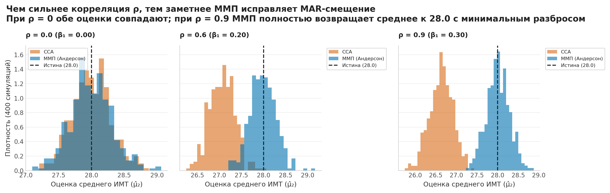</div></div>
```

::: {.notes}

```{=html}
<p>Этот график показывает три режима работы ММП-поправки при одном и том же механизме MAR (выбывании при высоком САД):</p><p>- Слева, при ρ = 0: переменные независимы. Даже если ИМТ пропадает при высоком САД, на распределении самого ИМТ это никак не сказывается. Обе гистограммы — и CCA, и ММП — лежат поверх 28.0.</p><p>- В центре, наш сквозной пример ρ = 0.60: CCA смещается влево (к 27.1), а ММП остаётся строго на 28.0.</p><p>- Справа, ρ = 0.90: при сильной корреляции CCA проваливается ещё глубже, а ММП не только полностью убирает смещение, но и становится заметно уже по разбросу, то есть выигрывает в эффективности.</p>
```

:::


## Чем выше корреляция ρ, тем сильнее САД пациентов без ИМТ помогает устранить MAR-смещение · продолжение {#p1-rho-cont-2 .course-slide .layer-core data-source="v2:33" data-layer="core"}

```{=html}
<div class="course-kicker">ЗАНЯТИЕ 1 · ОСНОВНАЯ ЛИНИЯ</div><div class="review-banner">Числа перенесены из PPTX; этот расчёт ещё не воспроизведён в R.</div><div class="course-grid"><div class="course-card " style="grid-column:span 12"><p>Три режима работы ММП-коррекции: • При ρ = 0 (β₁ = 0) САД не несёт информации об ИМТ — ММП совпадает с CCA, но MAR-смещения и нет.</p><p class="bullet">• При ρ = 0.6 и особенно ρ = 0.9 CCA уезжает далеко влево от 28.0, тогда как ММП остаётся точно центрированным и с меньшей дисперсией. В реальных когортах ρ(САД, ИМТ) ≈ 0.2–0.3: и смещение CCA, и выигрыш ММП там меньше, но логика та же.</p></div></div>
```

::: {.notes}

```{=html}
<p>Этот график показывает три режима работы ММП-поправки при одном и том же механизме MAR (выбывании при высоком САД):</p><p>- Слева, при ρ = 0: переменные независимы. Даже если ИМТ пропадает при высоком САД, на распределении самого ИМТ это никак не сказывается. Обе гистограммы — и CCA, и ММП — лежат поверх 28.0.</p><p>- В центре, наш сквозной пример ρ = 0.60: CCA смещается влево (к 27.1), а ММП остаётся строго на 28.0.</p><p>- Справа, ρ = 0.90: при сильной корреляции CCA проваливается ещё глубже, а ММП не только полностью убирает смещение, но и становится заметно уже по разбросу, то есть выигрывает в эффективности.</p>
```

:::


## Для условной регрессии ИМТ ~ САД при MAR переход на полные случаи (CCA) несмещён {#p1-cca-conditional .course-slide .layer-core data-source="v2:34" data-layer="core"}

```{=html}
<div class="course-kicker">ЗАНЯТИЕ 1 · ОСНОВНАЯ ЛИНИЯ</div><div class="course-grid"><div class="course-card " style="grid-column:1 / span 5"><h3>Цель 1: Маргинальные параметры ИМТ (μ₂, σ₂²)</h3><p class="bullet">• Оценка только по n_obs полным случаям (CCA) СИСТЕМАТИЧЕСКИ СМЕЩЕНА при MAR.</p><p class="bullet">• Причина: подвыборка из n_obs человек имеет искусственно заниженное среднее САД (ȳ₁,obs &lt; μ₁), а через корреляцию ρ = 0.60 занижается и ИМТ.</p><p class="bullet">• Требуется ММП или множественная импутация.</p></div><div class="course-card " style="grid-column:7 / span 5"><h3>Цель 2: Условная регрессия ИМТ ~ САД (β₀, β₁, σ₂|₁²)</h3><p class="bullet">• В силу факторизации Андерсона при MAR строки без ИМТ (они входят только в Блок 1) не содержат НИКАКОЙ информации о (β₀, β₁, σ₂|₁²).</p><p class="bullet">• Оценка CCA в точности совпадает с ММП (β̂₁,CCA = β̂₁,MLE)!</p><p class="bullet">• Вывод: для регрессии ИМТ ~ САД переход на полные случаи полностью несмещён и максимально эффективен.</p></div></div>
```

::: {.notes}

```{=html}
<p>Теперь ответим на второй ключевой вопрос занятия: когда допустим анализ только по полным случаям (Complete Case Analysis)?</p><p>Многие думают, что CCA плох всегда, кроме MCAR. Это не так! Посмотрите на контраст двух задач на одном и том же датасете при MAR:</p><p>Если вы хотите оценить среднее ИМТ в популяции — CCA безбожно врёт.</p><p>Но если ваша научная задача — оценить параметры регрессии ИМТ на САД (наклон β₁), то, как мы только что увидели из факторизации Андерсона, весь Блок 1, куда входят строки без ИМТ, вообще не содержит параметров (β₀, β₁, σ₂|₁²). Поэтому оценка по полным случаям не просто несмещена — она в точности совпадает с оценкой максимального правдоподобия! Отбрасывая строки без ИМТ в модели ИМТ ~ САД, мы не теряем ни грамма информации о наклоне β₁.</p>
```

:::


## Пропуски в предикторе по механизму MNAR: смещён ли наклон по полным случаям? {#p1-quiz-mnar-x .course-slide .layer-core data-source="v2:35" data-layer="core"}

```{=html}
<div class="course-kicker">ЗАНЯТИЕ 1 · ОСНОВНАЯ ЛИНИЯ</div><div class="course-grid"><div class="course-card " style="grid-column:1 / span 5"><h3>Ситуация</h3><p class="bullet">• Модель: САД ~ ИМТ, нас интересует наклон γ₁ = 1.80.</p><p class="bullet">• ИМТ пропущен у 32% пациентов по механизму MNAR: чем выше ИМТ, тем чаще пациент отказывается взвешиваться.</p><p class="bullet">• При одинаковом ИМТ вероятность пропуска от давления не зависит.</p><p class="bullet">• lm(sbp ~ bmi) молча удаляет строки без ИМТ, то есть выполняет CCA.</p></div><div class="course-card " style="grid-column:7 / span 6"><h3>Вопрос (1 минута)</h3><p>Что произойдёт с оценкой γ̂₁ по полным случаям?</p><p>A.  Смещена: MNAR — худший механизм, CCA здесь точно не работает</p><p>B.  Несмещена: отбор идёт по предиктору, а не по исходу</p><p>C.  Зависит от доли пропусков</p></div><div class="course-card " style="grid-column:1 / span 12"><p>Подсказка: что происходит с регрессионной прямой, если вырезать часть наблюдений по оси X? А если по оси Y?</p></div></div>
```

::: {.notes}

```{=html}
<p>Вопрос на интуицию перед общей теоремой. Мы только что видели, что при MAR анализ полных случаев даёт верный наклон в регрессии ИМТ на САД. Теперь перевернём модель и ухудшим механизм: исход — давление, предиктор — ИМТ, и ИМТ пропадает по механизму MNAR.</p><p>Проголосуйте. Большинство обычно выбирает A: MNAR звучит как приговор. Правильный ответ — B. Если вырезать часть точек по оси X, оставшиеся по-прежнему лежат вокруг той же прямой: распределение Y при заданном X не изменилось. Прямую сдвигает только отбор по оси Y.</p><p>Строгое обоснование — на следующем слайде.</p>
```

:::


## Оценки CCA в регрессии Y ~ X несмещены, если вероятность пропуска не зависит от исхода Y {#p1-cca-theorem .course-slide .layer-core data-source="v2:36" data-layer="core"}

```{=html}
<div class="course-kicker">ЗАНЯТИЕ 1 · ОСНОВНАЯ ЛИНИЯ</div><div class="course-grid"><div class="course-card " style="grid-column:1 / span 12"><h3>Тождество Байеса для регрессии в полных случаях (C = 1 − M = 1: строка полная)</h3><p>Pr(Y | X, C = 1)  =  [ Pr(C = 1 | Y, X) / Pr(C = 1 | X) ]  ×  Pr(Y | X)</p><p>Если Pr(C = 1 | Y, X) = Pr(C = 1 | X)  (т.е. отбор зависит только от ковариат X, а не от исхода Y),</p><p>то дробь равна 1, и условное распределение Y | X в полных случаях ТОЖДЕСТВЕННО популяционному!</p></div><div class="course-card " style="grid-column:1 / span 12"><table><thead><tr><th>Механизм пропуска</th><th>Модель ИМТ ~ САД (β₁)</th><th>Модель САД ~ ИМТ (γ₁)</th><th>Комментарий</th></tr></thead><tbody><tr><td>MCAR (случайный пропуск ИМТ)</td><td>✅ Несмещена</td><td>✅ Несмещена</td><td>Обе модели теряют мощность пропорционально доле NA</td></tr><tr><td>MAR (пропуск ИМТ зависит от САД)</td><td>✅ Несмещена и эффективна</td><td>❌ Смещена вниз</td><td>В САД ~ ИМТ пропуск зависит от исхода Y (САД)!</td></tr><tr><td>MNAR (пропуск ИМТ зависит от ИМТ)</td><td>❌ Смещена вниз</td><td>✅ Несмещена!</td><td>В САД ~ ИМТ отбор зависит от предиктора X (хоть и MNAR в X), но не от Y</td></tr></tbody></table></div></div>
```

::: {.notes}

```{=html}
<p>Обобщим этот результат на любые регрессионные модели в РКИ и когортах (Carpenter &amp; Kenward, 2023).</p><p>Посмотрите на формулу Байеса наверху. Мы хотим оценить условное распределение исхода Y при заданных ковариатах X. Когда мы запускаем lm(Y ~ X) по полным случаям, мы оцениваем Pr(Y | X, C=1). Это распределение совпадает с истинным Pr(Y | X) тогда и только тогда, когда вероятность попасть в полные случаи C=1 НЕ зависит от исхода Y при фиксированных X!</p><p>Отсюда вытекает контринтуитивное следствие — посмотрите на третью строку таблицы:</p><p>В регрессии САД ~ ИМТ, где ИМТ является предиктором X, даже если ИМТ выпадает по механизму MNAR (люди с ожирением не взвешиваются), но при одинаковом ИМТ вероятность пропуска не зависит от давления — наклон γ₁ по полным случаям остаётся НЕСМЕЩЁННЫМ! (Хотя стандартная ошибка будет больше, чем при ММП/MI, если есть вспомогательные переменные).</p><p>И одно классическое исключение для логистической регрессии: в модели с бинарным исходом Y, если отбор зависит только от Y (как в исследованиях «случай-контроль»), отношение шансов (наклоны) остаётся несмещённым, смещается лишь свободный член.</p>
```

:::


## Симуляция подтверждает зеркальный эффект CCA для двух направлений регрессии {#p1-mirror .course-slide .layer-core data-source="v2:37" data-layer="core"}

```{=html}
<div class="course-kicker">ЗАНЯТИЕ 1 · ОСНОВНАЯ ЛИНИЯ</div><div class="review-banner">Числа перенесены из PPTX; этот расчёт ещё не воспроизведён в R.</div><div class="course-grid"><div class="course-card " style="grid-column:span 12"><table><thead><tr><th>Механизм + Метод</th><th>μ̂₂ (28.0)</th><th>σ̂₂ (5.00)</th><th>ρ̂ (0.60)</th><th>β̂₁ [ИМТ~САД] (0.20)</th><th>γ̂₁ [САД~ИМТ] (1.80)</th><th>Покрытие ДИ (μ₂)</th></tr></thead><tbody><tr><td>MCAR — CCA</td><td>28.00</td><td>4.99</td><td>0.60</td><td>0.200</td><td>1.80</td><td>95.2%</td></tr><tr><td>MCAR — ММП</td><td>28.00</td><td>4.99</td><td>0.60</td><td>0.200</td><td>1.81</td><td>95.1%</td></tr><tr><td>MAR  — CCA</td><td>27.08</td><td>4.83</td><td>0.56</td><td>0.200</td><td>1.58</td><td>6.5%</td></tr><tr><td>MAR  — ММП</td><td>28.00</td><td>4.99</td><td>0.60</td><td>0.200</td><td>1.80</td><td>95.8%</td></tr><tr><td>MNAR — CCA</td><td>26.47</td><td>4.51</td><td>0.56</td><td>0.175</td><td>1.80</td><td>0.0%</td></tr><tr><td>MNAR — ММП</td><td>26.96</td><td>4.56</td><td>0.58</td><td>0.175</td><td>1.89</td><td>1.0%</td></tr></tbody></table></div></div>
```

::: {.notes}

```{=html}
<p>Посмотрите на эту сводную таблицу — ради неё мы и вводили оба направления регрессии!</p><p>Сравните строки MAR — CCA и MNAR — CCA:</p><p>При MAR, когда пропуск ИМТ зависит от САД, наклон β̂₁ (ИМТ ~ САД) равен 0.200 (идеально!), а обратный наклон γ̂₁ (САД ~ ИМТ) занижен до 1.58.</p><p>При MNAR, когда пропуск ИМТ зависит от самого ИМТ, всё зеркально меняется! Теперь β̂₁ падает до 0.175 (и ММП здесь тоже не спасает, потому что оно опирается на ложное допущение MAR!), а вот обычный CCA в модели САД ~ ИМТ даёт γ̂₁ = 1.80 — абсолютно несмещённую оценку!</p><p>Это прямое подтверждение теоремы валидности CCA: важно не просто «какой механизм у пропусков», а «связан ли пропуск с зависимой переменной Y вашей целевой модели».</p><p>И ещё одна строка, которую легко пропустить: MNAR — ММП, столбец γ̂₁. Там 1.89, а у простого CCA — 1.80. То есть более сложный метод здесь проиграл простому: ММП, построенный на допущении MAR, «исправил» оценку, которая в исправлении не нуждалась. Выбор метода определяется не его сложностью, а тем, насколько его допущения соответствуют механизму пропусков.</p>
```

:::


## Симуляция подтверждает зеркальный эффект CCA для двух направлений регрессии · продолжение {#p1-mirror-cont-2 .course-slide .layer-core data-source="v2:37" data-layer="core"}

```{=html}
<div class="course-kicker">ЗАНЯТИЕ 1 · ОСНОВНАЯ ЛИНИЯ</div><div class="review-banner">Числа перенесены из PPTX; этот расчёт ещё не воспроизведён в R.</div><div class="course-grid"><div class="course-card " style="grid-column:span 12"><h3>Главный инсайт для анализа когорт:</h3><p class="bullet">• При MAR (пропуск зависит от САД): CCA даёт несмещённое β̂₁ = 0.200 (ИМТ ~ САД), но смещённое γ̂₁ = 1.58 (САД ~ ИМТ). ММП исправляет всё.</p><p class="bullet">• При MNAR (пропуск зависит от ИМТ): всё переворачивается — β̂₁ = 0.175 смещено даже в ММП (MAR-модель нарушена!), а вот CCA для γ̂₁ (САД ~ ИМТ) остаётся НЕСМЕЩЁННЫМ (1.80)!</p><p class="bullet">• Более сложный метод не всегда лучше: при MNAR ММП даёт γ̂₁ = 1.89 — хуже, чем обычный CCA (1.80). MAR-поправка «чинит» то, что не было сломано.</p></div></div>
```

::: {.notes}

```{=html}
<p>Посмотрите на эту сводную таблицу — ради неё мы и вводили оба направления регрессии!</p><p>Сравните строки MAR — CCA и MNAR — CCA:</p><p>При MAR, когда пропуск ИМТ зависит от САД, наклон β̂₁ (ИМТ ~ САД) равен 0.200 (идеально!), а обратный наклон γ̂₁ (САД ~ ИМТ) занижен до 1.58.</p><p>При MNAR, когда пропуск ИМТ зависит от самого ИМТ, всё зеркально меняется! Теперь β̂₁ падает до 0.175 (и ММП здесь тоже не спасает, потому что оно опирается на ложное допущение MAR!), а вот обычный CCA в модели САД ~ ИМТ даёт γ̂₁ = 1.80 — абсолютно несмещённую оценку!</p><p>Это прямое подтверждение теоремы валидности CCA: важно не просто «какой механизм у пропусков», а «связан ли пропуск с зависимой переменной Y вашей целевой модели».</p><p>И ещё одна строка, которую легко пропустить: MNAR — ММП, столбец γ̂₁. Там 1.89, а у простого CCA — 1.80. То есть более сложный метод здесь проиграл простому: ММП, построенный на допущении MAR, «исправил» оценку, которая в исправлении не нуждалась. Выбор метода определяется не его сложностью, а тем, насколько его допущения соответствуют механизму пропусков.</p>
```

:::


## РКИ: анализ завершивших корректен, если выбывание зависит только от ковариат, включённых в модель {#p1-rct .course-slide .layer-core data-source="v2:38" data-layer="core"}

```{=html}
<div class="course-kicker">ЗАНЯТИЕ 1 · ОСНОВНАЯ ЛИНИЯ</div><div class="review-banner">Числа перенесены из PPTX; этот расчёт ещё не воспроизведён в R.</div><div class="course-grid"><div class="course-card " style="grid-column:span 12"><p>Модельное РКИ антигипертензивной терапии (n = 400, 1:1). Исход Y — САД через 6 месяцев, X — исходное САД, Z — группа. Истинный эффект лечения −8.0 мм рт. ст. Выбывают ~25% пациентов; в анализ попадают только завершившие исследование.</p></div><div class="course-card " style="grid-column:span 12"><table><thead><tr><th>Сценарий выбывания</th><th>t-тест (без X):
оценка</th><th>t-тест:
покрытие</th><th>ANCOVA Y ~ Z + X:
оценка</th><th>ANCOVA:
покрытие</th><th>Что говорит теорема</th></tr></thead><tbody><tr><td>Без пропусков</td><td>−8.0</td><td>96%</td><td>−8.0</td><td>95%</td><td>Ориентир</td></tr><tr><td>MCAR: случайное выбывание</td><td>−8.0</td><td>95%</td><td>−8.0</td><td>96%</td><td>Отбор ни от чего не зависит: оба анализа корректны</td></tr><tr><td>Зависит от X и Z: в контроле чаще выбывают пациенты с высоким исходным САД</td><td>−4.8</td><td>53%</td><td>−8.0</td><td>95%</td><td>При фиксированных X, Z отбор не зависит от Y: ANCOVA корректна, t-тест — нет</td></tr><tr><td>Зависит от Y: в контроле выбывают те, у кого САД на 6-м месяце остался высоким</td><td>−2.7</td><td>10%</td><td>−4.5</td><td>25%</td><td>Отбор зависит от самого исхода: смещены оба анализа</td></tr></tbody></table></div></div>
```

::: {.notes}

```{=html}
<p>Мы обещали клинический фокус на РКИ — перенесём теорему в рандомизированное исследование. Антигипертензивный препарат, исход — давление через полгода, истинный эффект минус восемь миллиметров. Четверть пациентов выбывает, и в анализ попадают только завершившие.</p><p>Сравним два привычных анализа: простое сравнение средних и ANCOVA с поправкой на исходное давление.</p><p>Если выбывание случайно, оба анализа корректны. Если в контрольной группе чаще выбывают пациенты с высоким исходным давлением — например, их переводят на другую терапию, — простой t-тест показывает минус 4.8 вместо минус 8, и его интервал накрывает истину лишь в половине случаев. А ANCOVA даёт ровно минус 8 с покрытием 95%: при фиксированном исходном давлении и группе выбывание от исхода не зависит.</p><p>Последняя строка: выбывают те, у кого давление через полгода осталось высоким. Отбор зависит от самого исхода — смещены оба анализа, и поправка на исходное давление помогает лишь частично.</p><p>Проблема в том, что по данным третью и четвёртую строки различить нельзя. Поэтому в подтверждающих РКИ первичный анализ всегда дополняют анализом чувствительности.</p><p>Симуляция: 4000 повторов, n = 400.</p>
```

:::


## РКИ: анализ завершивших корректен, если выбывание зависит только от ковариат, включённых в модель · продолжение {#p1-rct-cont-2 .course-slide .layer-core data-source="v2:38" data-layer="core"}

```{=html}
<div class="course-kicker">ЗАНЯТИЕ 1 · ОСНОВНАЯ ЛИНИЯ</div><div class="review-banner">Числа перенесены из PPTX; этот расчёт ещё не воспроизведён в R.</div><div class="course-grid"><div class="course-card " style="grid-column:span 12"><p class="bullet">• Здесь пропуски стоят в исходе, а не в предикторе, но логика та же: важно, зависит ли отбор от Y при фиксированных ковариатах модели.</p><p class="bullet">• t-тест без X — «MNAR по упущению» в чистом виде: исходное САД связано и с выбыванием, и с исходом, а в модель не включено.</p><p class="bullet">• MNAR-сценарий по данным от предыдущего не отличить: поэтому первичный анализ дополняют анализом чувствительности (Занятие 3).</p></div></div>
```

::: {.notes}

```{=html}
<p>Мы обещали клинический фокус на РКИ — перенесём теорему в рандомизированное исследование. Антигипертензивный препарат, исход — давление через полгода, истинный эффект минус восемь миллиметров. Четверть пациентов выбывает, и в анализ попадают только завершившие.</p><p>Сравним два привычных анализа: простое сравнение средних и ANCOVA с поправкой на исходное давление.</p><p>Если выбывание случайно, оба анализа корректны. Если в контрольной группе чаще выбывают пациенты с высоким исходным давлением — например, их переводят на другую терапию, — простой t-тест показывает минус 4.8 вместо минус 8, и его интервал накрывает истину лишь в половине случаев. А ANCOVA даёт ровно минус 8 с покрытием 95%: при фиксированном исходном давлении и группе выбывание от исхода не зависит.</p><p>Последняя строка: выбывают те, у кого давление через полгода осталось высоким. Отбор зависит от самого исхода — смещены оба анализа, и поправка на исходное давление помогает лишь частично.</p><p>Проблема в том, что по данным третью и четвёртую строки различить нельзя. Поэтому в подтверждающих РКИ первичный анализ всегда дополняют анализом чувствительности.</p><p>Симуляция: 4000 повторов, n = 400.</p>
```

:::


## Сравниваем смещение, разброс и покрытие на одних данных {#p1-sim .course-slide .layer-core data-source="v2:39" data-layer="core"}

```{=html}
<div class="course-kicker">ЗАНЯТИЕ 1 · ОСНОВНАЯ ЛИНИЯ</div><div class="course-grid"><div class="course-card " style="grid-column:span 12"><p>MAR · n = 500 · 2000 репликаций · seed = 202602</p></div><div class="course-card " style="grid-column:span 12"><table><thead><tr><th>Метод</th><th>μ₂</th><th>σ₂</th><th>ρ</th><th>β₁</th><th>γ₁</th><th>Эмп. SE μ₂</th><th>RMSE μ₂</th><th>Покрытие μ₂, %</th><th>Покрытие β₁, %</th></tr></thead><tbody><tr><td>Полные данные</td><td>28.00</td><td>5.00</td><td>0.60</td><td>0.200</td><td>1.80</td><td>0.221</td><td>0.221</td><td>95.7 ± 0.5</td><td>94.2 ± 0.5</td></tr><tr><td>Полные случаи</td><td>27.08</td><td>4.83</td><td>0.56</td><td>0.200</td><td>1.57</td><td>0.262</td><td>0.960</td><td>6.0 ± 0.5</td><td>94.2 ± 0.5</td></tr><tr><td>Среднее</td><td>27.08</td><td>3.97</td><td>0.42</td><td>0.111</td><td>1.57</td><td>0.262</td><td>0.960</td><td>0.9 ± 0.2</td><td>0.0 ± 0.0</td></tr><tr><td>Регрессия</td><td>27.99</td><td>4.45</td><td>0.67</td><td>0.200</td><td>2.27</td><td>0.262</td><td>0.262</td><td>86.4 ± 0.8</td><td>75.9 ± 1.0</td></tr><tr><td>Регрессия + шум</td><td>27.99</td><td>5.00</td><td>0.60</td><td>0.200</td><td>1.80</td><td>0.286</td><td>0.286</td><td>86.9 ± 0.8</td><td>80.3 ± 0.9</td></tr><tr><td>ММП</td><td>27.99</td><td>4.99</td><td>0.60</td><td>0.200</td><td>1.80</td><td>0.262</td><td>0.262</td><td>95.3 ± 0.5</td><td>94.2 ± 0.5</td></tr></tbody></table></div><div class="course-card " style="grid-column:span 12"><p>После ± указан один MCSE покрытия (процентные пункты). Интервалы в Части I используют нормальное приближение. ММП восстанавливает маргинальные параметры при принятой модели; β₁ совпадает с оценкой по полным случаям.</p></div></div>
```

::: {.notes}

```{=html}
<p><strong>Редакция HTML:</strong> основной слайд обновлён по расчётам R или проверенному API. Числа исходного сценария ниже относятся к PPTX.</p><p>Вернёмся к загадке со <a class="slide-ref" href="#/p1-riddle">связанный разбор</a>: теперь мы можем объяснить каждую строку. Перед вами реальные цифры нашего симуляционного эксперимента: 1000 повторных выборок по 500 пациентов при механизме MAR (~32% пропусков в ИМТ).</p><p>Посмотрите на таблицу и графики — они согласуются с нашими аналитическими выводами (сверка формул для MCAR и MAR — на <a class="slide-ref" href="#/p1-formula-check">связанный разбор</a>):</p><p>- CCA: μ̂₂ упало до 27.08, покрытие ДИ провалилось до 6.5%! При этом β̂₁ = 0.200 несмещено, а γ̂₁ = 1.58 смещено.</p><p>- Замена средним: σ̂₂ сжато до 3.97, ρ̂ упало до 0.42, β̂₁ сжато до 0.111, покрытие 1.8%.</p><p>- Регрессионная импутация: μ̂₂ = 28.00, β̂₁ = 0.200, но σ̂₂ = 4.45, ρ̂ раздуто до 0.67, а γ̂₁ взлетело до 2.27!</p><p>- Стохастическая регрессия: все 5 точечных оценок идеальны (28.01, 5.00, 0.60, 0.200, 1.80), но покрытие 95% ДИ — всего 87.9%!</p><p>- ММП Андерсона: все 5 оценок точны, а покрытие 95% ДИ за счёт дельта-метода составляет 95.8%!</p><p>Два новых элемента таблицы. Последний столбец — эмпирический разброс оценок среднего и RMSE: у CCA разброс тот же, что у ММП, но из-за смещения RMSE втрое больше. Последняя строка — ориентир: что было бы, если бы пропусков не было вовсе. Разница между ней и строкой ММП — честная цена пропусков: SE 0.27 против 0.22. Никакой метод не возвращает потерянную информацию полностью.</p>
```

:::


## Два способа провалить покрытие: неверный центр (CCA) и слишком узкий интервал (стохастическая регрессия) {#p1-zipper .course-slide .layer-core data-source="v2:40" data-layer="core"}

```{=html}
<div class="course-kicker">ЗАНЯТИЕ 1 · ОСНОВНАЯ ЛИНИЯ</div><div class="course-grid"><div class="course-card image" style="grid-column:span 12"><figure>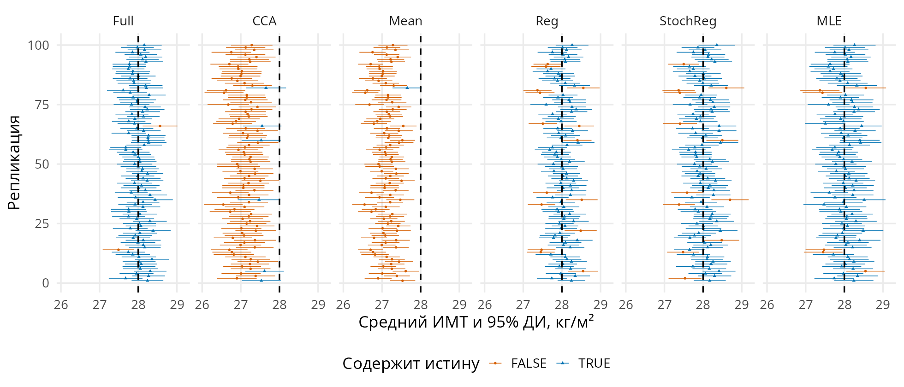<figcaption>Первые 100 репликаций общего расчёта. Синие интервалы содержат истину; оранжевые — нет.</figcaption></figure></div></div>
```

::: {.notes}

```{=html}
<p><strong>Редакция HTML:</strong> основной слайд обновлён по расчётам R или проверенному API. Числа исходного сценария ниже относятся к PPTX.</p><p>Покрытие — абстрактное число, пока его не увидишь. Здесь первые сто выборок из нашей симуляции; для каждой построен 95%-й интервал для среднего ИМТ. Синие интервалы накрывают истину 28.0, оранжевые промахиваются.</p><p>Слева — анализ полных случаев. Интервалы нормальной ширины, но почти все стоят левее истины: центр неверный.</p><p>В середине — стохастическая регрессия. Центр правильный, но интервалы заметно уже, чем справа, и промахов около пятнадцати из ста вместо пяти.</p><p>Справа — ММП: тот же центр, интервалы шире — и промахов столько, сколько положено.</p><p>Это и есть ответ на третий вопрос загадки: честный интервал — у пятого аналитика.</p>
```

:::


## Диагностика когорты с naniar и воспроизведение симуляции: модули 1–2 файла missing_data_practice.R {#p1-practice .course-slide .layer-core data-source="v2:41" data-layer="core"}

```{=html}
<div class="course-kicker">ЗАНЯТИЕ 1 · ОСНОВНАЯ ЛИНИЯ</div><div class="course-grid"><div class="course-card " style="grid-column:1 / span 5"><h3>Часть А. Разведочный анализ в naniar</h3><p>1. vis_miss(cohort) — карта пропусков и их доли по столбцам.</p><p>2. gg_miss_upset(cohort) — пересечения паттернов пропусков.</p><p>3. bind_shadow() + ggplot() — сравнение распределения САД у пациентов с измеренным и пропущенным ИМТ.</p><p>4. mcar_test() — формальный тест Литтла на однородность средних (отвергает MCAR при p &lt; 0.05).</p></div><div class="course-card " style="grid-column:7 / span 5"><h3>Часть Б. Задания по симуляции (eval_one_sample)</h3><p class="bullet">• Задание 1: Запустите run_simulation(R = 300) и проверьте «зеркальный эффект» для β̂₁ и γ̂₁ при MAR и MNAR.</p><p class="bullet">• Задание 2: Сравните покрытие 95% ДИ (cov_mu2) у стохастической регрессии и ММП при MAR. Объясните разницу.</p><p class="bullet">• Задание 3: Увеличьте истинную корреляцию RHO с 0.60 до 0.85 и оцените, как сильно уедет γ̂₁ при регрессионной импутации.</p><p class="bullet">• Задание 4* (реальные данные): в пакете NHANES возьмите BPSysAve и BMI, оцените ρ и повторите Задание 1 с этой корреляцией. Что изменилось?</p><p>Правило для всех заданий: сначала запишите прогноз, затем запускайте код и объясняйте расхождение.</p></div></div>
```

::: {.notes}

```{=html}
<p>Переходим к практической части в RStudio! Откройте файл missing_data_practice.R.</p><p>В первой части мы на синтетической когорте из 500 пациентов с возрастом, глюкозой, терапией, САД и ИМТ отрабатываем диагностику с помощью пакета naniar: строим карту пропусков, UpSet-график, теневую матрицу bind_shadow() и запускаем тест Литтла.</p><p>Во второй части — наша полная симуляция DGP для САД и ИМТ. Обратите внимание на три самостоятельных задания: вы проверите зеркальный эффект, сравните покрытие 95% ДИ у стохастической регрессии против ММП и посмотрите, что происходит при увеличении корреляции до 0.85.</p><p>Попросите студентов перед каждым запуском записать прогноз одним предложением — так симуляция превращается из демонстрации в проверку гипотезы. Задание со звёздочкой переносит пример на реальные данные NHANES, где корреляция САД и ИМТ заметно ниже 0.60; его нужно добавить в missing_data_practice.R.</p>
```

:::


## ММП решает двумерную задачу идеально, но для общих паттернов в РКИ и когортах нужна MICE {#p1-summary .course-slide .layer-core data-source="v2:42" data-layer="core"}

```{=html}
<div class="course-kicker">ЗАНЯТИЕ 1 · ОСНОВНАЯ ЛИНИЯ</div><div class="course-grid"><div class="course-card " style="grid-column:1 / span 5"><h3>Четыре главных вывода Занятия 1</h3><p>1. Пропуск определяется целью анализа; MCAR проверяем, а MAR vs MNAR — принципиально нет.</p><p>2. В регрессии Y ~ X переход на полные случаи (CCA) несмещён, если отбор не зависит от Y (даже при MNAR в X).</p><p>3. Одиночная импутация (включая стохастическую и LOCF) искажает дисперсию или занижает SE, проваливая доверительную валидность.</p><p>4. Строки с пропусками не бесполезны: через наблюдаемый САД они уточняют оценки ИМТ (ММП Андерсона). Но подставленное значение — не измерение: его неопределённость обязана попасть в SE.</p></div><div class="course-card " style="grid-column:7 / span 5"><h3>Мостик к Занятию 2: Множественная импутация (MICE)</h3><p class="bullet">• Ограничение сегодняшнего ММП: аналитическая факторизация Андерсона работает только для одномерного или монотонного паттерна.</p><p class="bullet">• Решение Рубина: сгенерировать не 1, а m ≥ 20 стохастических датасетов (аргумент m в mice), оценить модель на каждом и объединить оценки по правилам Рубина (Rubin’s rules) — с учётом межимпутационной дисперсии B и FMI.</p><p class="bullet">• В R: пакет mice, настройка predictorMatrix, PMM и включение исхода Y и группы терапии Z.</p></div></div>
```

::: {.notes}

```{=html}
<p>Подведём итог первого занятия. Сегодня мы на одном двумерном примере САД и ИМТ прошли путь от определения пропуска и генеративного процесса до аналитического вывода оценок ММП и доказательства того, почему одиночная импутация и LOCF ломают доверительные интервалы.</p><p>Почему же мы не останавливаемся на ММП Андерсона? Потому что в реальных когортах и РКИ пропуски имеют общий паттерн («швейцарский сыр») и смешанные типы данных — бинарные, категориальные, асимметричные лабораторные показатели.</p><p>На втором занятии мы разберём идею Дональда Рубина, которая решает проблему зауженных ДИ у стохастической регрессии: вместо одного заполненного датасета мы создадим m случайных копий (MICE), объединим их по правилам Рубина и научимся диагностировать сходимость. Спасибо за работу!</p>
```

:::


# II. Множественная импутация {#p2-title .course-slide .layer-core data-source="v2:43" data-layer="core" .course-title}

```{=html}
<div class="course-kicker">ЗАНЯТИЕ 2 · ОСНОВНАЯ ЛИНИЯ</div><div class="course-grid"><div class="course-card " style="grid-column:span 12"><p>Занятие 2. Множественная импутация: от ММП к MICE, PMM и правилам Рубина</p><p class="bullet">• От ММП (EM / FIML) к стохастическому сэмплированию и множественной импутации (MI)</p><p class="bullet">• Два подхода к многомерным пропускам: Joint Modeling (Amelia, jomo) vs FCS (mice, smcfcs)</p><p class="bullet">• Алгоритм MICE, связь с сэмплингом Гиббса, совместимость (compatibility) и PMM</p><p class="bullet">• Правила Рубина для одномерного и многомерного случаев + практикум на когорте САД и ИМТ</p></div></div>
```

::: {.notes}

```{=html}
<p>Добро пожаловать на второе занятие курса. В прошлый раз мы разобрали природу пропусков (MCAR, MAR, MNAR), вывели аналитические оценки ММП для нашего сквозного примера «САД и ИМТ» и увидели в симуляции, что одиночная стохастическая регрессия восстанавливает точечные оценки при MAR, но проваливает покрытие 95% ДИ.</p><p>Сегодня мы закроем этот пробел: поймём, как множественная импутация (MI) обобщает идеи ММП и EM-алгоритма на произвольные типы данных и сложные модели анализа, сравним Joint Modeling и FCS, разберём механику MICE и PMM и научимся корректно объединять результаты по правилам Рубина.</p>
```

:::


## Общий паттерн в ММП: метод FIML и структурные уравнения (SEM) {#p2-fiml .course-slide .layer-deep data-source="v2:44" data-layer="deep"}

```{=html}
<div class="course-kicker">ЗАНЯТИЕ 2 · УГЛУБЛЁННО</div><div class="course-grid"><div class="course-card " style="grid-column:1 / span 12"><h3>Full Information Maximum Likelihood (FIML) при произвольном паттерне пропусков</h3><p>Каждый пациент i вносит вклад только через вектор своих фактически наблюдённых переменных y_(0),i с подматрицами μ_(0),i и Σ_(0),i:</p><p>ℓ(μ, Σ | Y_obs) = const − ½ ∑ ln |Σ_(0),i| − ½ ∑ (y_(0),i − μ_(0),i)ᵀ Σ_(0),i⁻¹ (y_(0),i − μ_(0),i)</p></div><div class="course-card " style="grid-column:1 / span 5"><h3>Почему обычные lm() / glm() не спасают?</h3><p class="bullet">• В классической регрессии Y ~ X правдоподобие строится только для Y | X; предикторы X считаются фиксированными.</p><p class="bullet">• Если пропуск возник в предикторе X (например, в ИМТ в модели САД ~ ИМТ), строка целиком удаляется (CCA).</p><p class="bullet">• Вспомогательные переменные A (возраст, глюкоза), объясняющие MAR-механизм, нельзя добавить в регрессию без искажения смысла коэффициентов β.</p></div><div class="course-card " style="grid-column:7 / span 5"><h3>Решение через SEM (напр., lavaan, Mplus)</h3><p class="bullet">• В структурных уравнениях все переменные (Y, X) моделируются как случайные величины внутри единого многомерного нормального правдоподобия.</p><p class="bullet">• Модель насыщенных корреляций (Saturated Correlates, Graham 2003): вспомогательные переменные A связываются корреляциями со всеми переменными модели и остатками Y.</p><p class="bullet">• Результат: A защищают допущение MAR, не меняя интерпретацию структурных коэффициентов β.</p></div></div>
```

::: {.notes}

```{=html}
<p>На прошлом занятии мы видели, как красиво расщепляется правдоподобие, когда пропуск есть только в ИМТ. Но в реальных когортах и РКИ пропуски разбросаны по всей таблице — и в САД, и в ИМТ, и в возрасте, и в биомаркерах. Тогда явных формул Андерсона уже нет. Как работает современное правдоподобие, например метод FIML в структурных уравнениях?</p><p>Представьте, что у пациента не измерен ИМТ, но измерены САД и возраст. Многомерное нормальное распределение обладает замечательным свойством: любое его подмножество — тоже нормальное распределение. Поэтому алгоритм не выбрасывает такого пациента и ничего в таблицу не подставляет — он просто «сжимает» вектор средних и ковариационную матрицу до тех переменных y_(0),i, которые у этого пациента реально есть.</p><p>И главное — почему здесь так важен аппарат SEM: в классической регрессии lm() или glm() предикторы X считаются фиксированными константами, они не имеют вероятностного распределения в правдоподобии, и при пропуске в X строка исчезает. Чтобы защитить предикторы и включить вспомогательные переменные (auxiliary variables), их нужно «затащить» внутрь совместного правдоподобия, например через модель насыщенных корреляций (saturated correlates) в SEM (пакет lavaan).</p>
```

:::


## EM-алгоритм решает дилемму «курицы и яйца» в два повторяющихся шага {#p2-em .course-slide .layer-core data-source="v2:45" data-layer="core"}

```{=html}
<div class="course-kicker">ЗАНЯТИЕ 2 · ОСНОВНАЯ ЛИНИЯ</div><div class="course-grid"><div class="course-card " style="grid-column:1 / span 6"><h3>Итеративная схема (Dempster, Laird &amp; Rubin, 1977)</h3><p>1. E-шаг (Expectation):</p><p>Вычисляем условное ожидание полного лог-правдоподобия при текущих параметрах θ^(t): Q(θ | θ^(t)) = E[ℓ(θ | Y_obs, Y_mis) | Y_obs, θ^(t)].</p><p class="bullet">• Для нормальной модели подставляем ожидания достаточных статистик (∑y_i2 и ∑y_i2²): в квадраты добавляется остаточная дисперсия σ²_{2|1}, чтобы не сжать Σ!</p><p>2. M-шаг (Maximization):</p><p>Максимизируем Q(θ | θ^(t)) по θ — это обычные замкнутые формулы выборочных средних и ковариаций как для полных данных.</p><p>3. Сходимость:</p><p>Повторяем E → M, пока ||θ^(t+1) − θ^(t)|| &lt; ε. Лог-правдоподобие ℓ(θ^(t) | Y_obs) гарантированно не убывает на каждом шаге.</p></div><div class="course-card image" style="grid-column:7 / span 6">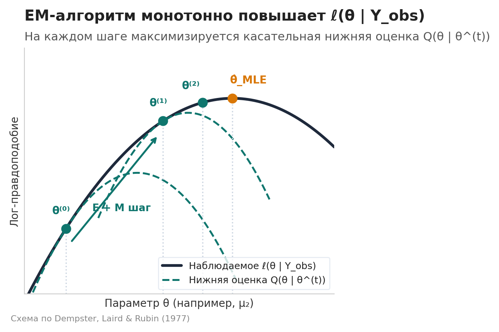</div></div>
```

::: {.notes}

```{=html}
<p>Как технически найти максимум сложной функции правдоподобия без явных формул? Один из самых элегантных инструментов — EM-алгоритм Демпстера, Лэрд и Рубина (1977). Он решает дилемму «курицы и яйца»: если бы мы знали пропущенные значения, найти параметры по полным данным было бы элементарно; а если бы знали параметры, мы бы легко предсказали пропуски.</p><p>EM разрывает этот круг в два шага. На E-шаге мы фиксируем текущие оценки параметров θ^(t) и вычисляем условное математическое ожидание полного лог-правдоподобия. Очень частая ошибка студентов — думать, что EM просто подставляет регрессионное среднее в пустую ячейку! Нет: если вы подставите только ŷ, вы сожмёте дисперсию. EM работает с ожиданиями достаточных статистик — и самого значения, и его квадрата, куда обязательно добавляется условная остаточная дисперсия σ²_{2|1}.</p><p>Затем на M-шаге мы пересчитываем средние и ковариации по обычным замкнутым формулам для полных данных. Как видно на графике справа, каждая такая итерация максимизирует касательную нижнюю оценку Q и гарантированно поднимает нас выше по склону наблюдаемого правдоподобия.</p>
```

:::


## EM на нашем примере: за десяток итераций алгоритм приходит к замкнутому ответу Андерсона {#p2-em-trace .course-slide .layer-core data-source="v2:46" data-layer="core"}

```{=html}
<div class="course-kicker">ЗАНЯТИЕ 2 · ОСНОВНАЯ ЛИНИЯ</div><div class="review-banner">Числа перенесены из PPTX; этот расчёт ещё не воспроизведён в R.</div><div class="course-grid"><div class="course-card image" style="grid-column:span 12">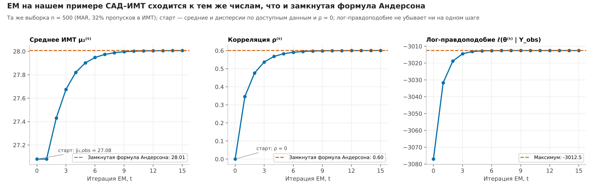</div></div>
```

::: {.notes}

```{=html}
<p>Посмотрим на EM не на схеме, а на наших данных — той самой выборке из 500 пациентов. Стартуем с наивных значений: среднее ИМТ по наблюдаемым (27.08) и нулевая корреляция.</p><p>На первом шаге среднее не меняется: при нулевой корреляции давление ничего не говорит об ИМТ, и E-шаг подставляет то же наблюдаемое среднее. Зато M-шаг уже видит ненулевую ковариацию. Со второго шага строки без ИМТ начинают работать: у них высокое давление, значит, ожидаемый ИМТ выше, и среднее ползёт вверх — 27.4, 27.7, 27.8 и так далее до 28.0.</p><p>Предел — те же числа, что даёт замкнутая формула Андерсона. EM не изобретает новую оценку, он лишь численно находит максимум того же правдоподобия. Его ценность в том, что он работает и там, где формул нет.</p><p>Деталь для любопытных: если стартовать не с нуля, а с оценок по полным случаям, EM сойдётся за одну итерацию. Скорость сходимости EM определяется долей недостающей информации.</p>
```

:::


## EM на нашем примере: за десяток итераций алгоритм приходит к замкнутому ответу Андерсона · продолжение {#p2-em-trace-cont-2 .course-slide .layer-core data-source="v2:46" data-layer="core"}

```{=html}
<div class="course-kicker">ЗАНЯТИЕ 2 · ОСНОВНАЯ ЛИНИЯ</div><div class="review-banner">Числа перенесены из PPTX; этот расчёт ещё не воспроизведён в R.</div><div class="course-grid"><div class="course-card " style="grid-column:span 12"><p class="bullet">• Первый шаг меняет только ρ: при ρ⁽⁰⁾ = 0 E-шаг подставляет ȳ₂,obs, и μ₂ остаётся 27.08. Как только ρ &gt; 0, строки без ИМТ начинают тянуть μ₂ вверх через свой высокий САД.</p><p class="bullet">• Предел совпадает с формулой Андерсона (μ̂₂ = 28.01, ρ̂ = 0.60): EM не даёт новой оценки, он находит ту же ММП численно — но работает при любом паттерне пропусков.</p><p class="bullet">• Со старта по полным случаям EM сходится за один шаг: регрессия ИМТ ~ САД по полным парам уже и есть ММП Блока 2.</p></div></div>
```

::: {.notes}

```{=html}
<p>Посмотрим на EM не на схеме, а на наших данных — той самой выборке из 500 пациентов. Стартуем с наивных значений: среднее ИМТ по наблюдаемым (27.08) и нулевая корреляция.</p><p>На первом шаге среднее не меняется: при нулевой корреляции давление ничего не говорит об ИМТ, и E-шаг подставляет то же наблюдаемое среднее. Зато M-шаг уже видит ненулевую ковариацию. Со второго шага строки без ИМТ начинают работать: у них высокое давление, значит, ожидаемый ИМТ выше, и среднее ползёт вверх — 27.4, 27.7, 27.8 и так далее до 28.0.</p><p>Предел — те же числа, что даёт замкнутая формула Андерсона. EM не изобретает новую оценку, он лишь численно находит максимум того же правдоподобия. Его ценность в том, что он работает и там, где формул нет.</p><p>Деталь для любопытных: если стартовать не с нуля, а с оценок по полным случаям, EM сойдётся за одну итерацию. Скорость сходимости EM определяется долей недостающей информации.</p>
```

:::


## Четыре ограничения общей постановки ММП: почему одного ММП недостаточно {#p2-ml-limits .course-slide .layer-core data-source="v2:47" data-layer="core"}

```{=html}
<div class="course-kicker">ЗАНЯТИЕ 2 · ОСНОВНАЯ ЛИНИЯ</div><div class="course-grid"><div class="course-card " style="grid-column:1 / span 5"><h3>1. В EM нет стандартных ошибок «из коробки»</h3><p class="bullet">• EM возвращает только точечную оценку θ̂_MLE.</p><p class="bullet">• Для SE и 95% ДИ нужны матрица Луиса, бутстрэп или наблюдаемый Гессиан.</p><p class="bullet">• Важно: ожидаемая информация Фишера в ряде пакетов невалидна при MAR (нужна наблюдаемая!).</p></div><div class="course-card " style="grid-column:7 / span 5"><h3>2. Барьер ненормальности и нелинейностей</h3><p class="bullet">• Смешанные типы данных (бинарные, порядковые, счётные, сильно скошенные маркеры) не укладываются в N_K(μ, Σ).</p><p class="bullet">• Взаимодействия X₁·X₂, квадраты X² и модели выживаемости (Кокса) требуют сложного численного интегрирования.</p></div><div class="course-card " style="grid-column:1 / span 5"><h3>3. Проклятие размерности для вспомогательных переменных</h3><p class="bullet">• Включение 15–30 вспомогательных переменных (A) в SEM резко увеличивает число параметров ковариационной матрицы.</p><p class="bullet">• На типичных клинических выборках (n = 100–300) оптимизатор часто не сходится.</p></div><div class="course-card " style="grid-column:7 / span 5"><h3>4. Одноэтапный «чёрный ящик» без диагностики</h3><p class="bullet">• ММП неявно интегрирует по Y_mis внутри одной модели анализа.</p><p class="bullet">• Нельзя отделить этап обработки пропусков от этапа анализа, переиспользовать заполненный датасет или проверить адекватность восстановленных значений.</p></div></div>
```

::: {.notes}

```{=html}
<p>Если ММП и EM так хороши теоретически, зачем вообще придумали множественную импутацию? У общей постановки ММП есть четыре серьёзных практических барьера.</p><p>Во-первых, сам EM-алгоритм возвращает только точечные оценки: стандартные ошибки и p-значения он не выдаёт. Для их получения нужно отдельно считать информационную матрицу (например, методом Луиса или SEM-гессианом) или запускать бутстрэп. Важная тонкость: при MAR корректна только наблюдаемая информационная матрица, тогда как ожидаемая может давать неверные SE.</p><p>Во-вторых, как только данные перестают быть чисто нормальными — появляются бинарные ковариаты, скошенные биомаркеры, нелинейности (X²) или взаимодействия (Treatment × Biomarker) — единое совместное правдоподобие либо нельзя выписать в стандартном пакете, либо оно требует тяжёлого численного интегрирования.</p><p>В-третьих, добавление десятков вспомогательных переменных в SEM через saturated correlates раздувает матрицу ковариаций и часто ломает сходимость оптимизатора. И в-четвёртых, ММП работает как одноэтапный «чёрный ящик»: мы не видим восстановленных значений и не можем продиагностировать их реалистичность.</p>
```

:::


## Концептуальный мост: от шагов EM к Data Augmentation и правильной MI {#p2-em-to-da .course-slide .layer-core data-source="v2:48" data-layer="core"}

```{=html}
<div class="course-kicker">ЗАНЯТИЕ 2 · ОСНОВНАЯ ЛИНИЯ</div><div class="course-grid"><div class="course-card " style="grid-column:1 / span 12"><table><thead><tr><th>EM-алгоритм (детерминированный ММП)</th><th>Data Augmentation / MICE (стохастический)</th><th>Что это даёт статистическому выводу?</th></tr></thead><tbody><tr><td>E-шаг (Expectation)
Подстановка условных ожиданий достаточных статистик E[Y_mis | Y_obs, θ^(t)]</td><td>I-шаг (Imputation step)
Случайная выборка Y_mis^(t+1) ~ f(Y_mis | Y_obs, θ^(t))</td><td>Восстанавливает разброс (σ₂) и корреляции (ρ), избегая сжатия дисперсии</td></tr><tr><td>M-шаг (Maximization)
Точечная оценка θ^(t+1) = argmax Q(θ | θ^(t))</td><td>P-шаг (Posterior step)
Случайная выборка θ^(t+1) ~ p(θ | Y_obs, Y_mis^(t+1))</td><td>Учитывает неопределённость параметров θ̂ (спасает 95% покрытие ДИ!)</td></tr><tr><td>Результат на выходе
Единственный вектор точечных оценок θ̂_MLE</td><td>Результат на выходе
m независимых заполненных таблиц → Правила Рубина</td><td>Делает импутацию «правильной» (proper MI) и доверительно валидной</td></tr></tbody></table></div><div class="course-card " style="grid-column:1 / span 12"><p>Ключевой инсайт (Tanner &amp; Wong, 1987; Schafer, 1997): почему на Занятии 1 проседало покрытие у стохастической регрессии?</p><p>Одиночная стохастическая регрессия делает только I-шаг при фиксированном θ̂_CCA (нет P-шага и нет усреднения по m наборам). Добавление P-шага (сэмплирование β и σ² из апостериора или бутстрэпа) и объединение m датасетов решают проблему покрытия 95% ДИ.</p></div></div>
```

::: {.notes}

```{=html}
<p>И вот здесь происходит самый красивый концептуальный переход во всём курсе. Множественная импутация не возникает из ниоткуда — это прямой стохастический родственник EM-алгоритма (через алгоритм Data Augmentation Таннера и Вонга, 1987, и Шафера, 1997).</p><p>Посмотрите на таблицу соответствия. На E-шаге EM вычисляет детерминированное условное ожидание пропусков. На I-шаге (Imputation step) в Data Augmentation и MICE мы вместо среднего *разыгрываем* конкретные значения из условного предсказательного распределения — это учитывает случайную остаточную изменчивость.</p><p>А на M-шаге EM находит единственную точку максимума для параметров θ. На P-шаге (Posterior step) мы не фиксируем одну точку, а *сэмплируем* сами параметры θ^(t+1) из их апостериорного распределения (или через бутстрэп). Вспомните наш вывод про порок одиночной стохастической регрессии, где 95% ДИ всё равно сужался до 80–88%! Именно P-шаг — учёт параметрической неопределённости — превращает наивную стохастическую импутацию в «правильную» (proper) множественную импутацию по Рубину.</p>
```

:::


## MI возвращает покрытие ДИ двумя шагами: несколько копий и розыгрыш параметров {#p2-why-mi .course-slide .layer-core data-source="v2:49" data-layer="core"}

```{=html}
<div class="course-kicker">ЗАНЯТИЕ 2 · ОСНОВНАЯ ЛИНИЯ</div><div class="review-banner">Числа перенесены из PPTX; этот расчёт ещё не воспроизведён в R.</div><div class="course-grid"><div class="course-card " style="grid-column:1 / span 6"><h3>Что мы установили на Занятии 1</h3><p class="bullet">• Одиночная стохастика: при MAR даёт несмещённые μ₂, σ₂, ρ, β₁, γ₁, но 95% ДИ покрывает истину лишь в ~82–88% случаев (подставленные значения считаются измеренными, а β̂ и σ̂² — известными точно).</p><p class="bullet">• Классический ММП (Андерсон / FIML / EM): честно учитывает обе компоненты и даёт ~95% покрытие, но жёстко привязан к многомерной нормальности и конкретной модели.</p><p class="bullet">• Главная идея Рубина (1977, 1987): разделить задачу обработки пропусков и финального клинического анализа, создав несколько заполненных копий таблицы (у Рубина — 3–5, сегодня m ≥ 20).</p></div><div class="course-card " style="grid-column:7 / span 6"><h3>Почему MI работает и совпадает с ММП</h3><p>1. Два источника неопределённости: в каждой копии ℓ = 1..m сначала сэмплируются параметры (β*(ℓ), σ²*(ℓ)) из апостериора (учёт ошибки оценивания), а затем — сами пропуски Y_mis^(ℓ) + шум.</p><p>2. Стохастический аналог EM: E-шаг (ожидание) → I-шаг (розыгрыш данных); M-шаг (максимум θ) → P-шаг (розыгрыш параметров θ*).</p><p>3. Связь с ММП (согласованность моделей, Meng 1994): при одинаковых переменных и допущениях оценки MI асимптотически эквивалентны ММП и байесовскому выводу.</p><p>Проверка на примере САД–ИМТ, покрытие 95% ДИ для μ₂: одна копия — 87%; 20 копий без розыгрыша параметров — 93%; 20 копий с розыгрышем — 95%.</p></div></div>
```

::: {.notes}

```{=html}
<p>Чтобы не воспринимать множественную импутацию как «чёрный ящик», свяжем её напрямую с Занятием 1. Вспомните нашу симуляцию для САД и ИМТ: одиночная стохастическая регрессия уже давала несмещённое среднее 28.0 и наклон 0.20, но её доверительные интервалы оказывались слишком узкими (покрытие 88% для μ₂ и 82% для β₁). Почему? Причин две. Первая и главная: мы обращались с подставленными значениями как с измеренными. Это лечится несколькими копиями: разброс оценок между копиями B измеряет неопределённость из-за пропусков. Вторая: мы взяли одну-единственную линию регрессии, как будто знали её без ошибки. Это лечится розыгрышем параметров — без него B занижен. В нашей симуляции покрытие для среднего растёт так: 87% при одной копии, 93% при двадцати копиях без розыгрыша параметров и 95% — с розыгрышем.</p><p>Множественная импутация — это прямой стохастический родственник EM-алгоритма: вместо одной точечной оценки параметров мы разыгрываем параметры θ* из их апостериорного распределения для каждой из m копий, а затем разыгрываем сами пропуски. Если модель импутации согласована с моделью анализа (congenial), MI даёт те же оценки, что и ММП, но позволяет использовать любую модель анализа (Кокс, логистическую, смешанную) на втором шаге.</p>
```

:::


## Трёхэтапный конвейер в R (mice → with → pool) отделяет обработку пропусков от анализа {#p2-pipeline .course-slide .layer-core data-source="v2:50" data-layer="core"}

```{=html}
<div class="course-kicker">ЗАНЯТИЕ 2 · ОСНОВНАЯ ЛИНИЯ</div><div class="course-grid"><div class="course-card " style="grid-column:1 / span 3"><h3>Шаг 1. IMPUTE</h3><p>mice(data, m = 20)</p><p>Создаём m заполненных копий таблицы.Наблюдённые ячейки (Y_obs) одинаковы во всех m копиях; пропуски (Y_mis) разыграны из предсказательного распределения.</p></div><div class="course-card " style="grid-column:5 / span 3"><h3>Шаг 2. ANALYZE</h3><p>with(imp, lm(sbp ~ bmi))</p><p>Запускаем целевую модель анализа (lm, glm, coxph, lmer) отдельно на каждой из m заполненных таблиц.Получаем m оценок θ̂_ℓ и дисперсий SE²_ℓ.</p></div><div class="course-card " style="grid-column:9 / span 3"><h3>Шаг 3. POOL</h3><p>pool(fit) %&gt;% summary()</p><p>Объединяем m результатов по правилам Рубина.Итоговая дисперсия учитывает как ошибку внутри выборки (W), так и разброс между копиями (B).</p></div><div class="course-card " style="grid-column:1 / span 12"><p>Важное правило: финальная модель анализа может использовать только те переменные (и их взаимодействия), которые уже были учтены на Шаге 1 в модели импутации; иначе оценки связей сожмутся к нулю.</p></div></div>
```

::: {.notes}

```{=html}
<p>На практике весь конвейер множественной импутации в R укладывается в три функции из пакета mice: mice(), with() и pool().</p><p>На первом шаге мы генерируем m заполненных датасетов (объект класса mids). Важно подчеркнуть студентам: мы НЕ усредняем сами импутированные значения в одну таблицу! Если усреднить m копий в одну и затем запустить регрессию, мы снова получим одиночную импутацию и потеряем межимпутационную дисперсию.</p><p>На втором шаге функция with() применяет нашу клиническую модель (например, регрессию САД на ИМТ и терапию) независимо к каждой из m копий (объект mira). На третьем шаге pool() применяет формулы Рубина (объект mipo) и выдаёт корректные точечные оценки, стандартные ошибки и 95% ДИ.</p>
```

:::


## Два пути к одной цели: согласованность ММП и MI и разделение труда {#p2-ml-vs-mi .course-slide .layer-core data-source="v2:51" data-layer="core"}

```{=html}
<div class="course-kicker">ЗАНЯТИЕ 2 · ОСНОВНАЯ ЛИНИЯ</div><div class="course-grid"><div class="course-card " style="grid-column:span 12"><p>Сравнение подходов на практике</p></div><div class="course-card " style="grid-column:span 12"><h3>Разделение труда в архитектуре MI</h3><p>Этап 1. Модель импутации (MICE / FCS):</p><p>Создаём m заполненных таблиц, подбирая гибкие условные модели для каждой неполной переменной + все вспомогательные A.</p><p>Этап 2. Модель анализа + Правила Рубина:</p><p>Запускаем целевую модель (lm, glm, coxph, lmer) на каждом из m датасетов и объединяем оценки и SE по формулам Рубина.</p></div><div class="course-card " style="grid-column:span 12"><table><thead><tr><th>Критерий</th><th>ММП (FIML / SEM)</th><th>Множественная имп. (MI)</th></tr></thead><tbody><tr><td>Архитектура</td><td>Одноэтапная (оценка внутри одной модели)</td><td>Двухэтапная (Импутация → Анализ → Pooling)</td></tr><tr><td>Типы данных</td><td>В основном непрерывные (нормальность)</td><td>Любые (MICE: PMM, логит, политомич.)</td></tr><tr><td>Вспомогат. A</td><td>Утяжеляют ковариационную матрицу SEM</td><td>Легко включаются в модель импутации</td></tr><tr><td>Воспроизвод.</td><td>Детерминирована (один запуск — один ответ)</td><td>Стохастична (нужен set.seed и достаточное m)</td></tr></tbody></table></div></div>
```

::: {.notes}

```{=html}
<p>Подведём итог этого перехода и перекинем мостик к множественной импутации. Если у вас линейная или SEM-модель и данные близки к многомерной нормальности, ММП (FIML) и множественная импутация при согласованных допущениях — свойство congeniality по Менгу (1994) — дадут вам практически одинаковые числа.</p><p>Но MI решает главную головную боль прикладного биостатистика: она разделяет задачу обработки пропусков и задачу основного клинического анализа. На этапе импутации мы можем спокойно учесть 20 вспомогательных переменных и отдельно моделировать бинарные, порядковые и скошенные признаки с помощью цепных уравнений MICE. А на этапе анализа мы просто берём полученные m заполненных таблиц, запускаем привычную регрессию Кокса, логистическую регрессию или смешанную модель — и собираем итоговые оценки и доверительные интервалы по правилам Рубина. Как настраивать этот цикл в R, разберём дальше на этом занятии.</p>
```

:::


## Два пути к одной цели: согласованность ММП и MI и разделение труда · продолжение {#p2-ml-vs-mi-cont-2 .course-slide .layer-core data-source="v2:51" data-layer="core"}

```{=html}
<div class="course-kicker">ЗАНЯТИЕ 2 · ОСНОВНАЯ ЛИНИЯ</div><div class="course-grid"><div class="course-card " style="grid-column:span 12"><h3>Согласованность моделей (congeniality, Meng 1994)</h3><p>Когда модель импутации и модель анализа согласованы (congenial) и опираются на те же допущения MAR, оценки ММП и MI асимптотически эквивалентны (при росте n и числа импутаций m).</p></div></div>
```

::: {.notes}

```{=html}
<p>Подведём итог этого перехода и перекинем мостик к множественной импутации. Если у вас линейная или SEM-модель и данные близки к многомерной нормальности, ММП (FIML) и множественная импутация при согласованных допущениях — свойство congeniality по Менгу (1994) — дадут вам практически одинаковые числа.</p><p>Но MI решает главную головную боль прикладного биостатистика: она разделяет задачу обработки пропусков и задачу основного клинического анализа. На этапе импутации мы можем спокойно учесть 20 вспомогательных переменных и отдельно моделировать бинарные, порядковые и скошенные признаки с помощью цепных уравнений MICE. А на этапе анализа мы просто берём полученные m заполненных таблиц, запускаем привычную регрессию Кокса, логистическую регрессию или смешанную модель — и собираем итоговые оценки и доверительные интервалы по правилам Рубина. Как настраивать этот цикл в R, разберём дальше на этом занятии.</p>
```

:::


## Расширенная когорта: семь переменных, общий паттерн пропусков и производный ИМТ {#p2-cohort .course-slide .layer-core data-source="v2:52" data-layer="core"}

```{=html}
<div class="course-kicker">ЗАНЯТИЕ 2 · ОСНОВНАЯ ЛИНИЯ</div><div class="course-grid"><div class="course-card " style="grid-column:span 12"><table><thead><tr><th>Переменная</th><th>Как порождается (модуль 3 практикума)</th><th>Пропуски</th><th>От чего зависит пропуск</th></tr></thead><tbody><tr><td>age</td><td>N(55, 10²), округлён</td><td>нет</td><td>—</td></tr><tr><td>treatment</td><td>Bernoulli(0.5): Control / Active</td><td>нет</td><td>—</td></tr><tr><td>sbp</td><td>135 + 1.8·(ИМТ − 28) + 0.25·(возраст − 55) + N(0, 12²)</td><td>нет</td><td>—</td></tr><tr><td>height</td><td>N(170, 9²)</td><td>≈ 13%</td><td>от возраста: logit p = −2.0 + 0.04·(возраст − 55)</td></tr><tr><td>weight</td><td>ИМТ · (рост / 100)²</td><td>≈ 25%</td><td>от САД: logit p = −1.3 + 0.06·(САД − 135)</td></tr><tr><td>glucose</td><td>exp(1.45 + 0.025·(ИМТ − 28) + N(0, 0.22²)) + 1.5 — скошена вправо</td><td>≈ 26%</td><td>от истинного ИМТ: logit p = −1.1 − 0.10·(ИМТ − 28)</td></tr><tr><td>bmi</td><td>вес / (рост / 100)² — производная переменная</td><td>≈ 34%</td><td>пропущен там, где нет роста или веса</td></tr></tbody></table></div><div class="course-card " style="grid-column:span 12"><h3>Что нового по сравнению с Частью I</h3><p class="bullet">• Пропуски сразу в нескольких переменных — общий паттерн: формулы Андерсона не работают, нужна MICE.</p><p class="bullet">• ИМТ вычисляется из роста и веса: его нельзя импутировать как обычную переменную — пассивная импутация.</p><p class="bullet">• Глюкоза скошена: линейная модель norm выходит за наблюдённый диапазон — PMM.</p></div></div>
```

::: {.notes}

```{=html}
<p>Прежде чем разбирать MICE, познакомимся с данными, на которых будем работать сегодня и в практикуме. Это расширенная версия нашей когорты: к давлению и ИМТ добавились возраст, группа терапии, рост, вес и глюкоза.</p><p>Три вещи отличают её от примера первого занятия. Первое: пропуски теперь в нескольких столбцах сразу и не вложены друг в друга — это общий паттерн, для которого замкнутых формул нет. Второе: ИМТ больше не измеряется, а вычисляется из роста и веса; если импутировать все три переменные независимо, равенство «ИМТ равен весу, делённому на квадрат роста» нарушится. Третье: глюкоза скошена вправо.</p><p>И одна оговорка. Пропуск глюкозы в этом DGP зависит от истинного ИМТ. Но ИМТ сам пропущен там, где нет роста или веса. Значит, для части пациентов пропуск глюкозы зависит от величины, которую мы не наблюдаем, — это уже не строгий MAR. Задайте аудитории вопрос: как исправить DGP? Ответ — сделать пропуск глюкозы зависящим от полностью наблюдаемых переменных, например от давления и возраста.</p>
```

:::


## Расширенная когорта: семь переменных, общий паттерн пропусков и производный ИМТ · продолжение {#p2-cohort-cont-2 .course-slide .layer-core data-source="v2:52" data-layer="core"}

```{=html}
<div class="course-kicker">ЗАНЯТИЕ 2 · ОСНОВНАЯ ЛИНИЯ</div><div class="course-grid"><div class="course-card " style="grid-column:span 12"><h3>Оговорка о механизме</h3><p>Пропуск глюкозы зависит от истинного ИМТ, а он сам не наблюдается там, где пропущен рост или вес. Строго говоря, это не MAR: для части строк пропуск зависит от ненаблюдаемой величины.</p><p>Вопрос аудитории: как изменить DGP, чтобы механизм стал строго MAR?</p></div></div>
```

::: {.notes}

```{=html}
<p>Прежде чем разбирать MICE, познакомимся с данными, на которых будем работать сегодня и в практикуме. Это расширенная версия нашей когорты: к давлению и ИМТ добавились возраст, группа терапии, рост, вес и глюкоза.</p><p>Три вещи отличают её от примера первого занятия. Первое: пропуски теперь в нескольких столбцах сразу и не вложены друг в друга — это общий паттерн, для которого замкнутых формул нет. Второе: ИМТ больше не измеряется, а вычисляется из роста и веса; если импутировать все три переменные независимо, равенство «ИМТ равен весу, делённому на квадрат роста» нарушится. Третье: глюкоза скошена вправо.</p><p>И одна оговорка. Пропуск глюкозы в этом DGP зависит от истинного ИМТ. Но ИМТ сам пропущен там, где нет роста или веса. Значит, для части пациентов пропуск глюкозы зависит от величины, которую мы не наблюдаем, — это уже не строгий MAR. Задайте аудитории вопрос: как исправить DGP? Ответ — сделать пропуск глюкозы зависящим от полностью наблюдаемых переменных, например от давления и возраста.</p>
```

:::


## Joint Modeling задаёт единую модель данных, а FCS — набор одномерных регрессий {#p2-jm-fcs .course-slide .layer-core data-source="v2:53" data-layer="core"}

```{=html}
<div class="course-kicker">ЗАНЯТИЕ 2 · ОСНОВНАЯ ЛИНИЯ</div><div class="course-grid"><div class="course-card " style="grid-column:1 / span 12"><table><thead><tr><th>Критерий сравнения</th><th>Joint Modeling (JM)</th><th>Fully Conditional Specification (FCS / MICE)</th></tr></thead><tbody><tr><td>Базовая идея</td><td>Постулируем единое совместное распределение P(Y | θ) — обычно многомерное нормальное (MVN) или латентное нормальное.</td><td>Задаём серию одномерных условных моделей P(Y_j | Y_{-j}, φ_j) отдельно для каждой переменной с пропусками.</td></tr><tr><td>Теоретическая строгость</td><td>Высокая: совместное распределение гарантированно существует, сэмплер MCMC математически корректен.</td><td>Приближённая: нет гарантии существования общего P(Y) для произвольных условных моделей (риск несовместимости).</td></tr><tr><td>Смешанные типы данных</td><td>Сложнее при росте размерности; для категорий требуются латентные нормальные переменные или log-linear модели.</td><td>Максимальная гибкость: легко комбинировать PMM (непрерывные), logreg (бинарные), polyreg/polr (категории).</td></tr><tr><td>Скорость и сходимость</td><td>Единая модель сразу для всех переменных; байесовские MCMC-цепи часто требуют длинного burn-in.</td><td>Обычно сходится за 5–20 итераций; наглядно настраиваются ограничения, skip-паттерны и трансформации.</td></tr><tr><td>Нелинейности и уровни</td><td>Естественно расширяется на многоуровневые данные (кластеры) и SMC-JM (факторизация исхода и ковариат).</td><td>Стандартный FCS даёт смещение при X² и взаимодействиях неполных предикторов (нужен smcfcs) и сложнее при случайных наклонах.</td></tr></tbody></table></div></div>
```

::: {.notes}

```{=html}
<p>Когда пропуски есть сразу в нескольких переменных разного типа — например, в ИМТ, глюкозе, возрасте и бинарном статусе гипертензии — возникает вопрос: как задать многомерное предсказательное распределение? В литературе есть два больших класса методов.</p><p>Первый — Joint Modeling (JM): мы задаём единую совместную модель для всех переменных сразу. Это теоретически безупречно, легко переносится на кластерные и продольные данные со случайными эффектами. Но как только у нас 20 разнотипных клинических переменных, задать и настроить единое совместное распределение становится трудно.</p><p>Второй — Fully Conditional Specification (FCS), реализованный в MICE: мы не строим общую плотность, а пишем отдельную регрессию для каждой неполной переменной при условии всех остальных. Это интуитивно, гибко и быстро сходится (5–20 циклов), хотя и жертвует строгой гарантией существования совместного распределения.</p>
```

:::


## Практические реализации Joint Modeling (включая Amelia) и FCS покрывают большинство клинических задач {#p2-packages .course-slide .layer-appendix data-source="v2:54" data-layer="appendix"}

```{=html}
<div class="course-kicker">ЗАНЯТИЕ 2 · СПРАВКА</div><div class="review-banner">TODO · Утверждения и ссылки этого слайда требуют подтверждения автора. Это рабочий материал.</div><div class="course-grid"><div class="course-card " style="grid-column:1 / span 6"><h3>Реализации Joint Modeling (JM)</h3><p class="bullet">• norm / norm2: классическая байесовская реализация MCMC (Data Augmentation) Шейфера для многомерных нормальных данных.</p><p class="bullet">• Amelia (Amelia II): популярная реализация JM на базе многомерного нормального распределения, использующая бутстрэп + EM-алгоритм вместо MCMC (быстрая, без burn-in, но чувствительна к ненормальности).</p><p class="bullet">• cat / mix: JM для чисто категориальных (лог-линейная модель) и смешанных данных (general location model).</p><p class="bullet">• jomo и pan: современный стандарт для многоуровневых/кластерных данных (латентная нормальность для категорий, поддержка SMC-JM).</p><p class="bullet">• JointAI: байесовское объединение импутации и анализа в единой модели (включая нелинейности и смешанные модели).</p></div><div class="course-card " style="grid-column:7 / span 6"><h3>Реализации FCS (цепные уравнения) и пуллинг</h3><p class="bullet">• mice: основной пакет курса; гибкая настройка методов (pmm, norm, logreg, polyreg), predictorMatrix, пассивной импутации и диагностики.</p><p class="bullet">• smcfcs: Substantive Model Compatible FCS — незаменим, когда в модели анализа есть X², взаимодействия неполных предикторов или модель Кокса.</p><p class="bullet">• mi: альтернативная реализация FCS в R с акцентом на байесовские регуляризованные модели и визуальный аудит.</p><p class="bullet">• micemd: расширение FCS для двухэтапной импутации многоуровневых/многоцентровых клинических данных.</p><p class="bullet">• mitml: универсальный пакет для объединения результатов по правилам Рубина (D₁, D₃) после JM-пакетов (jomo, pan, Amelia).</p></div></div>
```

::: {.notes}

```{=html}
<p>Познакомим студентов с картой реальных пакетов в R, чтобы они понимали место каждого инструмента.</p><p>В лагере Joint Modeling выделяются классический пакет norm (MCMC по Шейферу) и очень популярный среди прикладников пакет Amelia (Amelia II): это тоже реализация JM в рамках многомерного нормального распределения, только вместо MCMC она комбинирует бутстрэп и EM-алгоритм. Для кластерных и многоцентровых РКИ с категориальными переменными сегодня используют jomo (на латентных нормальных переменных) или JointAI.</p><p>В лагере FCS безусловный лидер — пакет mice. Если же ваша модель анализа содержит квадратичные эффекты, взаимодействия неполных ковариат или регрессию Кокса, стандартный mice может дать смещение — тогда используют smcfcs. Для объединения моделей после jomo или Amelia удобен пакет mitml.</p>
```

:::


## MICE заменяет пропуски итеративно: каждая переменная предсказывается по самым свежим данным {#p2-mice .course-slide .layer-core data-source="v2:55" data-layer="core"}

```{=html}
<div class="course-kicker">ЗАНЯТИЕ 2 · ОСНОВНАЯ ЛИНИЯ</div><div class="course-grid"><div class="course-card " style="grid-column:1 / span 3"><h3>0. Инициализация</h3><p>Заполняем пропуски в Y₁..Y_p случайными выборками из наблюдённых значений каждой переменной.</p></div><div class="course-card " style="grid-column:4 / span 3"><h3>1. Выбор модели j</h3><p>Берём переменную Y_j и обучаем регрессию Y_j ~ Y_{-j} только на строках, где Y_j реально наблюдено.</p></div><div class="course-card " style="grid-column:7 / span 3"><h3>2. P-шаг (θ*)</h3><p>Сэмплируем параметры модели φ̇_j^(t) из апостериора (или через бутстрэп), учитывая их неопределённость.</p></div><div class="course-card " style="grid-column:10 / span 3"><h3>3. I-шаг (Ẏ_j)</h3><p>Разыгрываем новые значения пропусков Y_j^(t) при условии самых свежих значений остальных столбцов Y_{-j}.</p></div><div class="course-card " style="grid-column:1 / span 12"><h3>Один полный проход по всем переменным (j = 1, ..., p) = 1 итерация (t)</h3><p class="bullet">• Цикл сходимости: повторяем проходы t = 1, ..., T (по умолчанию в mice: maxit = 5, на практике лучше 15–20), параллельно запуская m независимых цепочек (ℓ = 1, ..., m).</p><p class="bullet">• Фиксация результата: значения в конце итерации T становятся ℓ-м заполненным датасетом; в отличие от обычного MCMC мы сохраняем конечные состояния m отдельных цепей.</p></div></div>
```

::: {.notes}

```{=html}
<p>Посмотрим под капот алгоритма MICE (Multivariate Imputation by Chained Equations). Почему он называется алгоритмом цепных уравнений?</p><p>На шаге 0 у нас проблема: чтобы предсказать ИМТ по глюкозе и возрасту, нужно, чтобы глюкоза тоже была заполнена! Поэтому сначала пропуски во всех столбцах грубо заполняются случайными выборками из уже имеющихся наблюдений.</p><p>Затем начинается первая итерация: мы берём ИМТ, обучаем регрессию на тех строках, где ИМТ известен, сэмплируем параметры φ* (чтобы импутация была «правильной», proper) и разыгрываем новые значения для пропусков ИМТ. Сразу после этого переходим к глюкозе — и в качестве предиктора уже используем обновлённый ИМТ! Один полный круг по всем переменным — это одна итерация t. Запустив m параллельных цепей на T = 15–20 итераций, мы получаем m готовых датасетов.</p>
```

:::


## MICE — «псевдо-Гиббсов» алгоритм: траектории итераций обязаны хорошо перемешиваться {#p2-gibbs .course-slide .layer-core data-source="v2:56" data-layer="core"}

```{=html}
<div class="course-kicker">ЗАНЯТИЕ 2 · ОСНОВНАЯ ЛИНИЯ</div><div class="course-grid"><div class="course-card " style="grid-column:span 12"><h3>Цепи нужно проверять, а не только запускать</h3><p>Просматривайте траектории среднего и SD импутаций. Устойчивый тренд, отсутствие перемешивания и loggedEvents требуют разбора.</p><pre><code class="language-r">plot(imp)
mice::convergence(imp, diagnostic = "all")
imp$loggedEvents</code></pre></div><div class="course-card " style="grid-column:span 12"><p>m — число заполненных наборов; T — число итераций цепи. Это разные настройки. PSRF близко к 1 — диагностический признак, который не доказывает правильность модели или MAR.</p></div></div>
```

::: {.notes}

```{=html}
<p><strong>Редакция HTML:</strong> основной слайд обновлён по расчётам R или проверенному API. Числа исходного сценария ниже относятся к PPTX.</p><p>Теоретически MICE тесно связан с сэмплингом Гиббса (Gibbs sampling). Классический Гиббс берёт сложное многомерное распределение, расщепляет его на условные и по очереди сэмплирует из них, гарантированно сходясь к совместному распределению. MICE поступает с точностью до наоборот: он сразу задаёт условные регрессии и подгоняет каждую лишь на строках, где целевая переменная наблюдена, поэтому в литературе его называют «псевдо-Гиббсовым» алгоритмом.</p><p>На графике справа вы видите, как выглядит диагностика сходимости в R (функция plot(imp)): слева все пять цепочек свободно перемешиваются вокруг одного уровня без тренда — это здоровая сходимость. Справа цепочки расходятся и ползут в разные стороны — верный признак циклической зависимости или коллинеарности (например, если одновременно импутировать рост, вес и ИМТ без пассивной импутации).</p><p>Рисунок схематичный: он показывает, как выглядят оба случая в plot(imp), а не результат конкретного расчёта. Реальные траектории студенты увидят в практикуме.</p>
```

:::


## Совместимость гарантирует, что условные модели MICE порождают единое P(Y) {#p2-compatibility .course-slide .layer-core data-source="v2:57" data-layer="core"}

```{=html}
<div class="course-kicker">ЗАНЯТИЕ 2 · ОСНОВНАЯ ЛИНИЯ</div><div class="course-grid"><div class="course-card " style="grid-column:1 / span 12"><h3>Формальное определение (Besag, 1974; Van Buuren, 2018)</h3><p>Условные плотности P(Y₁ | Y₂) и P(Y₂ | Y₁) совместимы, если существует единое совместное распределение P(Y₁, Y₂), для которого они являются точными условными плотностями (эквивалентно: отношение P(Y₁|Y₂) / P(Y₂|Y₁) факторизуется как u(Y₁)·v(Y₂)).</p></div><div class="course-card " style="grid-column:1 / span 6"><h3>Когда совместимость ВЫПОЛНЯЕТСЯ</h3><p>1. Многомерная нормальная модель (MVN): если все переменные непрерывны и условные модели — линейные регрессии (как САД и ИМТ), FCS при слабых априорах эквивалентен сэмплеру Гиббса (Liu et al., 2013; Hughes et al., 2014).</p><p>2. Насыщенная лог-линейная модель: для чисто категориальных данных со всеми взаимодействиями.</p><p>3. Монотонный паттерн пропусков: в упорядоченной последовательности нет обратных циклов — совместное распределение строится напрямую.</p></div><div class="course-card " style="grid-column:7 / span 6"><h3>Когда она НАРУШАЕТСЯ (и что делать)</h3><p>1. Смесь непрерывных и бинарных переменных: линейная модель для САД | Гипертензия и логистическая для Гипертензия | САД формально несовместимы (возникает «эффект порядка» шагов).</p><p>2. Нелинейности и произведения (X и X²): невозможно, чтобы и X | Y, и X² | Y были нормальными (подход JAV — «just another variable», квадрат как отдельная переменная — даёт смещение при MAR).</p><p>Практический вердикт: при умеренной доле пропусков и хорошо подобранных регрессиях несовместимость почти не вредит оценкам центра, но для X² и Кокса лучше брать smcfcs (Занятие 3).</p></div></div>
```

::: {.notes}

```{=html}
<p>Самый известный теоретический вопрос к MICE — условие совместимости (compatibility). Если вы задали линейную регрессию для Y₁ | Y₂ и линейную регрессию для Y₂ | Y₁, существует ли реальное совместное распределение P(Y₁, Y₂), у которого именно такие условные плотности? Безаг показал, что совместное распределение либо существует и единственно, либо его вообще нет.</p><p>Хорошая новость: когда все переменные непрерывны и связаны линейно (как САД и ИМТ), или когда все переменные категориальны в насыщенной модели, MICE полностью совместим и математически эквивалентен сэмплеру Гиббса совместной модели.</p><p>Нарушается совместимость в двух частых ситуациях: когда мы смешиваем непрерывные и бинарные переменные (линейная + логистическая регрессии), и когда в данных есть квадратичные члены или взаимодействия. И если первая проблема на практике почти безобидна, то вторая требует специальных методов вроде smcfcs.</p>
```

:::


## Compatibility — внутренняя согласованность импутации; Congeniality — связь с моделью анализа {#p2-compat-vs-congeniality .course-slide .layer-core data-source="v2:58" data-layer="core"}

```{=html}
<div class="course-kicker">ЗАНЯТИЕ 2 · ОСНОВНАЯ ЛИНИЯ</div><div class="course-grid"><div class="course-card " style="grid-column:1 / span 12"><table><thead><tr><th>Свойство</th><th>Compatibility (Совместимость)</th><th>Congeniality (Согласованность, Meng 1994)</th></tr></thead><tbody><tr><td>К чему относится</td><td>К набору условных моделей P(Y_j | Y_{-j}) внутри Шага 1 (импутации).</td><td>К соответствию между моделью импутации (Шаг 1) и моделью анализа (Шаг 2).</td></tr><tr><td>Смысл требования</td><td>Существует единое совместное распределение P(Y) — теоретическая база сходимости Гиббса.</td><td>Модель импутации и модель анализа вкладываются в единую байесовскую модель (равны переменные и структура).</td></tr><tr><td>Практическое правило</td><td>Избегайте циклических зависимостей (рост + вес + ИМТ → используйте пассивную импутацию).</td><td>Модель импутации должна быть БОГАЧЕ модели анализа: включайте исход Y, группу терапии Z и вспомогательные переменные.</td></tr></tbody></table></div><div class="course-card " style="grid-column:1 / span 12"><h3>Практическое правило для несогласованных моделей (Meng, 1994; Xie &amp; Meng, 2017)</h3><p class="bullet">• Импутация богаче анализа (добавили вспомогательные переменные или взаимодействия): правила Рубина обычно остаются корректными или консервативными; гарантии нет — при сомнениях помогает бутстреп (Занятие 3).</p><p class="bullet">• Импутация беднее анализа (забыли исход Y или взаимодействие X·Z): оценки смещаются к нулю, а покрытие ДИ падает.</p></div></div>
```

::: {.notes}

```{=html}
<p>Студенты и даже исследователи часто путают два похожих термина: compatibility и congeniality. Разделим их чётко.</p><p>Compatibility (совместимость) — это внутреннее свойство условных уравнений внутри шага 1 (существует ли единое P(Y)).</p><p>Congeniality (согласованность, введённая Сяо-Ли Мэном (Xiao-Li Meng) в 1994 году) — это связь между шагом 1 и шагом 2: согласуется ли модель импутации с финальной моделью биостатистического анализа.</p><p>Главный практический вывод из работ Менга и Се: модель импутации всегда должна быть как минимум такой же сложной (а лучше — богаче), как модель анализа. Обязательно включайте в предикторы импутации целевой исход (например, САД и события), группу рандомизации и вспомогательные переменные. Если вы включите лишнее — правила Рубина, как правило, останутся валидными или консервативными. Если забудете переменную анализа — получите смещение.</p>
```

:::


## PMM защищает от невозможных значений и сохраняет форму распределения без трансформаций {#p2-pmm .course-slide .layer-core data-source="v2:59" data-layer="core"}

```{=html}
<div class="course-kicker">ЗАНЯТИЕ 2 · ОСНОВНАЯ ЛИНИЯ</div><div class="review-banner">Числа перенесены из PPTX; этот расчёт ещё не воспроизведён в R.</div><div class="course-grid"><div class="course-card image" style="grid-column:span 12">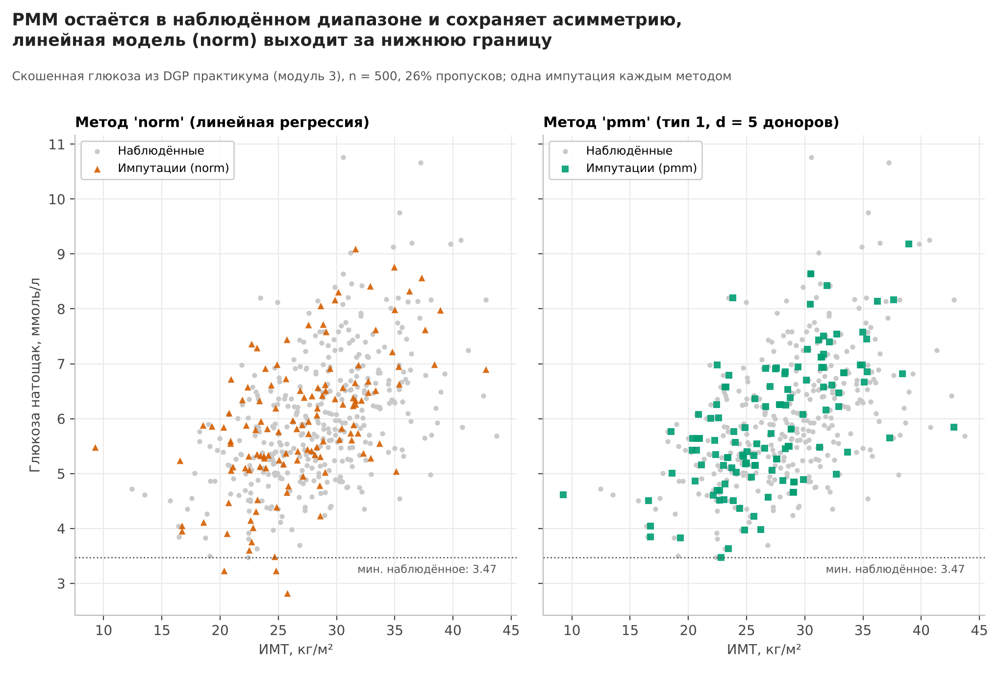</div></div>
```

::: {.notes}

```{=html}
<p>По умолчанию для любой непрерывной переменной пакет mice использует не обычную линейную регрессию (norm), а Predictive Mean Matching (PMM). Зачем?</p><p>Посмотрите на график справа: мы добавили в нашу когорту уровень глюкозы натощак, который имеет естественную правостороннюю асимметрию. Если применить линейную модель norm (левая панель, оранжевые треугольники), она накладывает симметричный нормальный шум и начинает генерировать значения ниже минимально наблюдённого порога (3.47 ммоль/л в этой выборке; около 2% импутаций norm оказываются ниже него; а для СРБ или ИМТ на хвостах — и вовсе отрицательные числа!).</p><p>PMM (правая панель, зелёные квадраты) решает эту проблему элегантно: он использует регрессию только для расчёта дистанции до похожих пациентов, а само число берёт из реальных данных донора. Поэтому все импутации гарантированно лежат в физиологических границах и повторяют форму распределения.</p>
```

:::


## PMM защищает от невозможных значений и сохраняет форму распределения без трансформаций · продолжение {#p2-pmm-cont-2 .course-slide .layer-core data-source="v2:59" data-layer="core"}

```{=html}
<div class="course-kicker">ЗАНЯТИЕ 2 · ОСНОВНАЯ ЛИНИЯ</div><div class="review-banner">Числа перенесены из PPTX; этот расчёт ещё не воспроизведён в R.</div><div class="course-grid"><div class="course-card " style="grid-column:span 12"><h3>Проблема параметрической модели (norm)</h3><p class="bullet">• Жёсткие допущения: метод norm предполагает линейность, гомоскедастичность и строгую нормальность остатков.</p><p class="bullet">• Клинический риск: на правосторонне-скошенных биомаркерах (глюкоза, СРБ, билирубин) нормальная регрессия легко выдаёт невозможные или отрицательные значения.</p><p class="bullet">• Решение — PMM (Little, 1988): полупараметрический гибрид регрессии и hot-deck (метод по умолчанию в mice для непрерывных шкал).</p><p class="bullet">• Суть: регрессия нужна лишь для поиска похожих пациентов, а импутируется реальное наблюдение донора.</p></div></div>
```

::: {.notes}

```{=html}
<p>По умолчанию для любой непрерывной переменной пакет mice использует не обычную линейную регрессию (norm), а Predictive Mean Matching (PMM). Зачем?</p><p>Посмотрите на график справа: мы добавили в нашу когорту уровень глюкозы натощак, который имеет естественную правостороннюю асимметрию. Если применить линейную модель norm (левая панель, оранжевые треугольники), она накладывает симметричный нормальный шум и начинает генерировать значения ниже минимально наблюдённого порога (3.47 ммоль/л в этой выборке; около 2% импутаций norm оказываются ниже него; а для СРБ или ИМТ на хвостах — и вовсе отрицательные числа!).</p><p>PMM (правая панель, зелёные квадраты) решает эту проблему элегантно: он использует регрессию только для расчёта дистанции до похожих пациентов, а само число берёт из реальных данных донора. Поэтому все импутации гарантированно лежат в физиологических границах и повторяют форму распределения.</p>
```

:::


## Type 1 matching и пул из d = 5 доноров в mice корректно передают оба вида неопределённости {#p2-pmm-algorithm .course-slide .layer-core data-source="v2:60" data-layer="core"}

```{=html}
<div class="course-kicker">ЗАНЯТИЕ 2 · ОСНОВНАЯ ЛИНИЯ</div><div class="course-grid"><div class="course-card " style="grid-column:span 12"><h3>Пошаговый алгоритм PMM (Van Buuren, 2018)</h3><p>1. Оценка на полных случаях: подгоняем линейную регрессию Y_obs ~ X_obs и получаем оценки β̂ и σ̂².</p><p>2. Сэмплирование параметров: разыгрываем β* и σ²* из апостериора (для учёта параметрической неопределённости).</p><p>3. Предсказанные средние: считаем P̂_io = X_io·β̂ для наблюдённых и P*_im = X_im·β* для пропусков.</p><p>4. Отбор d ближайших доноров: находим d наблюдённых пациентов с минимальной дистанцией |P̂_io − P*_im|.</p><p>5. Случайный выбор: выбираем одного донора io случайно из пула d и переносим его реальное значение Y_io (не P̂_io!).</p></div><div class="course-card " style="grid-column:span 12"><h3>Почему в mice по умолчанию Type 1?</h3><p class="bullet">• Type 0 |P̂_io − P̂_im|: нет розыгрыша β* — игнорирует ошибку параметров (занижает SE).</p><p class="bullet">• Type 1 |P̂_io − P*_im| (default): фиксирует эталон P̂_io, варьирует P*_im — лучшее покрытие ДИ (Morris et al., 2014).</p><p class="bullet">• Type 2 |P*_io − P*_im|: в Stata/SAS; случайность β* частично сокращается в разности.</p></div><div class="course-card " style="grid-column:span 12"><h3>Выбор размера пула доноров (d)</h3><p class="bullet">• d = 1 (слишком мало): почти детерминированно дублирует одного донора → занижает межимпутационную дисперсию B.</p><p class="bullet">• d = n_obs (слишком много): выбирает случайного пациента и разрушает связь Y с предикторами X.</p><p class="bullet">• Компромисс: d = 5 — умолчание mice; Morris et al. (2014) советуют пул около 10 доноров, при малых выборках — меньше.</p></div></div>
```

::: {.notes}

```{=html}
<p>Разберём алгоритм PMM по шагам — здесь есть два момента, на которых чаще всего ошибаются.</p><p>Во-первых, предсказанные значения P̂ и P* используются ТОЛЬКО для вычисления расстояния. В таблицу мы подставляем реальное наблюдённое значение Y_io выбранного донора, а не предсказание регрессии!</p><p>Во-вторых, обратите внимание на типы сопоставления. Если брать Type 0 (без сэмплирования β*), мы игнорируем неопределённость коэффициентов. В R по умолчанию используется Type 1: для наблюдённых пациентов предсказания строятся по β̂, а для пропусков — по случайному розыгрышу β*. Тим Моррис с соавторами (2014) настойчиво предостерегают от одного донора и советуют пул около десяти; в mice по умолчанию пять.</p>
```

:::


## PMM не умеет экстраполировать и даёт смещение при нехватке доноров на хвостах {#p2-pmm-limits .course-slide .layer-core data-source="v2:61" data-layer="core"}

```{=html}
<div class="course-kicker">ЗАНЯТИЕ 2 · ОСНОВНАЯ ЛИНИЯ</div><div class="review-banner">TODO · Утверждения и ссылки этого слайда требуют подтверждения автора. Это рабочий материал.</div><div class="course-grid"><div class="course-card " style="grid-column:1 / span 4"><h3>1. Нет экстраполяции</h3><p>PMM может подставить только те значения, которые уже встречались в выборке.</p><p>Клинический пример: если в выборке нет пациентов с САД &gt; 180 и измеренным ИМТ, PMM занизит ИМТ у гипертоников с кризом.</p></div><div class="course-card " style="grid-column:5 / span 4"><h3>2. Разреженные хвосты (Tail sparsity)</h3><p>Если механизм MAR выбил почти все наблюдения на краях распределения (рис. 6.2 у Carpenter &amp; Kenward), ближайшие доноры сдвигаются к центру.</p><p>Следствие: оценка наклона регрессии систематически сжимается к нулю (bias).</p></div><div class="course-card " style="grid-column:9 / span 4"><h3>3. Малые выборки и дубликаты</h3><p>При малом n и высокой доле пропусков (например, &gt;50%) один и тот же донор многократно копируется в разных строках и разных m.</p><p>Рекомендация: на малых выборках с нормальными данными эффективнее параметрический norm или norm.boot.</p></div><div class="course-card " style="grid-column:1 / span 12"><p>Практический совет (Van Buuren): проверяйте плотность импутаций через densityplot(imp) и stripplot(imp); для небольших выборок проведите анализ чувствительности при d = 3, 5, 10.</p></div></div>
```

::: {.notes}

```{=html}
<p>Хотя PMM — отличный универсальный метод по умолчанию, у него есть три чётких ограничения, о которых нужно предупредить.</p><p>Первое: он никогда не выходит за пределы наблюдённого диапазона. Если у вас экстремальный MAR на хвостах (скажем, никому с САД &gt; 180 не измерили ИМТ), PMM вынужден брать доноров из диапазона 160–175 и тем самым занизит хвост.</p><p>Второе: на малых выборках и при высокой доле пропусков в одной области может оказаться всего 1–2 донора, и они будут многократно дублироваться. Поэтому на небольших выборках, если гистограмма переменной близка к нормальной, параметрический norm или norm.boot будет статистически эффективнее.</p>
```

:::


## Полная дисперсия складывается из внутривыборочной ошибки W и разброса между копиями B {#p2-rubin-1 .course-slide .layer-core data-source="v2:62" data-layer="core"}

```{=html}
<div class="course-kicker">ЗАНЯТИЕ 2 · ОСНОВНАЯ ЛИНИЯ</div><div class="course-grid"><div class="course-card " style="grid-column:1 / span 12"><h3>Точечная оценка скалярного параметра θ (например, μ_ИМТ или наклона β₁)</h3><div class="equation"><span class="katex-display"><span class="katex"><span class="katex-mathml"><math xmlns="http://www.w3.org/1998/Math/MathML" display="block"><semantics><mrow><msub><mover accent="true"><mi>θ</mi><mo>^</mo></mover><mrow><mi mathvariant="normal">M</mi><mi mathvariant="normal">I</mi></mrow></msub><mo>=</mo><mfrac><mn>1</mn><mi>m</mi></mfrac><munderover><mo>∑</mo><mrow><mi mathvariant="normal">ℓ</mi><mo>=</mo><mn>1</mn></mrow><mi>m</mi></munderover><msub><mover accent="true"><mi>θ</mi><mo>^</mo></mover><mi mathvariant="normal">ℓ</mi></msub></mrow><annotation encoding="application/x-tex">\hat\theta_{\rm MI}=\frac1m\sum_{\ell=1}^{m}\hat\theta_\ell</annotation></semantics></math></span><span class="katex-html" aria-hidden="true"><span class="katex-base"><span class="katex-strut" style="height:1.1079em;vertical-align:-0.15em;"></span><span class="mord"><span class="mord katex-accent"><span class="vlist-t"><span class="vlist-r"><span class="vlist" style="height:0.9579em;"><span style="top:-3em;"><span class="pstrut" style="height:3em;"></span><span class="mord mathnormal" style="margin-right:0.0278em;">θ</span></span><span style="top:-3.2634em;"><span class="pstrut" style="height:3em;"></span><span class="accent-body" style="left:-0.1667em;"><span class="mord">^</span></span></span></span></span></span></span><span class="msupsub"><span class="vlist-t vlist-t2"><span class="vlist-r"><span class="vlist" style="height:0.3283em;"><span style="top:-2.55em;margin-left:-0.0278em;margin-right:0.05em;"><span class="pstrut" style="height:2.7em;"></span><span class="katex-sizing reset-size6 size3 mtight"><span class="mord mtight"><span class="mord mtight"><span class="mord mathrm mtight">MI</span></span></span></span></span></span><span class="vlist-s">​</span></span><span class="vlist-r"><span class="vlist" style="height:0.15em;"><span></span></span></span></span></span></span><span class="mspace" style="margin-right:0.2778em;"></span><span class="mrel">=</span><span class="mspace" style="margin-right:0.2778em;"></span></span><span class="katex-base"><span class="katex-strut" style="height:2.9535em;vertical-align:-1.3021em;"></span><span class="mord"><span class="mopen nulldelimiter"></span><span class="mfrac"><span class="vlist-t vlist-t2"><span class="vlist-r"><span class="vlist" style="height:1.3214em;"><span style="top:-2.314em;"><span class="pstrut" style="height:3em;"></span><span class="mord"><span class="mord mathnormal">m</span></span></span><span style="top:-3.23em;"><span class="pstrut" style="height:3em;"></span><span class="frac-line" style="border-bottom-width:0.04em;"></span></span><span style="top:-3.677em;"><span class="pstrut" style="height:3em;"></span><span class="mord"><span class="mord">1</span></span></span></span><span class="vlist-s">​</span></span><span class="vlist-r"><span class="vlist" style="height:0.686em;"><span></span></span></span></span></span><span class="mclose nulldelimiter"></span></span><span class="mspace" style="margin-right:0.1667em;"></span><span class="mop op-limits"><span class="vlist-t vlist-t2"><span class="vlist-r"><span class="vlist" style="height:1.6514em;"><span style="top:-1.8479em;margin-left:0em;"><span class="pstrut" style="height:3.05em;"></span><span class="katex-sizing reset-size6 size3 mtight"><span class="mord mtight"><span class="mord mtight">ℓ</span><span class="mrel mtight">=</span><span class="mord mtight">1</span></span></span></span><span style="top:-3.05em;"><span class="pstrut" style="height:3.05em;"></span><span><span class="mop op-symbol large-op">∑</span></span></span><span style="top:-4.3em;margin-left:0em;"><span class="pstrut" style="height:3.05em;"></span><span class="katex-sizing reset-size6 size3 mtight"><span class="mord mtight"><span class="mord mathnormal mtight">m</span></span></span></span></span><span class="vlist-s">​</span></span><span class="vlist-r"><span class="vlist" style="height:1.3021em;"><span></span></span></span></span></span><span class="mspace" style="margin-right:0.1667em;"></span><span class="mord"><span class="mord katex-accent"><span class="vlist-t"><span class="vlist-r"><span class="vlist" style="height:0.9579em;"><span style="top:-3em;"><span class="pstrut" style="height:3em;"></span><span class="mord mathnormal" style="margin-right:0.0278em;">θ</span></span><span style="top:-3.2634em;"><span class="pstrut" style="height:3em;"></span><span class="accent-body" style="left:-0.1667em;"><span class="mord">^</span></span></span></span></span></span></span><span class="msupsub"><span class="vlist-t vlist-t2"><span class="vlist-r"><span class="vlist" style="height:0.3361em;"><span style="top:-2.55em;margin-left:-0.0278em;margin-right:0.05em;"><span class="pstrut" style="height:2.7em;"></span><span class="katex-sizing reset-size6 size3 mtight"><span class="mord mtight">ℓ</span></span></span></span><span class="vlist-s">​</span></span><span class="vlist-r"><span class="vlist" style="height:0.15em;"><span></span></span></span></span></span></span></span></span></span></span></div></div><div class="course-card " style="grid-column:1 / span 4"><h3>1. Внутриимпутационная W</h3><div class="equation"><span class="katex-display"><span class="katex"><span class="katex-mathml"><math xmlns="http://www.w3.org/1998/Math/MathML" display="block"><semantics><mrow><mover accent="true"><mi>W</mi><mo>^</mo></mover><mo>=</mo><mfrac><mn>1</mn><mi>m</mi></mfrac><munderover><mo>∑</mo><mrow><mi mathvariant="normal">ℓ</mi><mo>=</mo><mn>1</mn></mrow><mi>m</mi></munderover><mover accent="true"><mi mathvariant="normal">Var</mi><mo>⁡</mo><mo stretchy="true">^</mo></mover><mo stretchy="false">(</mo><msub><mover accent="true"><mi>θ</mi><mo>^</mo></mover><mi mathvariant="normal">ℓ</mi></msub><mo stretchy="false">)</mo></mrow><annotation encoding="application/x-tex">\hat W=\frac1m\sum_{\ell=1}^{m}\widehat{\operatorname{Var}}(\hat\theta_\ell)</annotation></semantics></math></span><span class="katex-html" aria-hidden="true"><span class="katex-base"><span class="katex-strut" style="height:0.9468em;"></span><span class="mord katex-accent"><span class="vlist-t"><span class="vlist-r"><span class="vlist" style="height:0.9468em;"><span style="top:-3em;"><span class="pstrut" style="height:3em;"></span><span class="mord mathnormal" style="margin-right:0.1389em;">W</span></span><span style="top:-3.2523em;"><span class="pstrut" style="height:3em;"></span><span class="accent-body" style="left:-0.25em;"><span class="mord">^</span></span></span></span></span></span></span><span class="mspace" style="margin-right:0.2778em;"></span><span class="mrel">=</span><span class="mspace" style="margin-right:0.2778em;"></span></span><span class="katex-base"><span class="katex-strut" style="height:2.9535em;vertical-align:-1.3021em;"></span><span class="mord"><span class="mopen nulldelimiter"></span><span class="mfrac"><span class="vlist-t vlist-t2"><span class="vlist-r"><span class="vlist" style="height:1.3214em;"><span style="top:-2.314em;"><span class="pstrut" style="height:3em;"></span><span class="mord"><span class="mord mathnormal">m</span></span></span><span style="top:-3.23em;"><span class="pstrut" style="height:3em;"></span><span class="frac-line" style="border-bottom-width:0.04em;"></span></span><span style="top:-3.677em;"><span class="pstrut" style="height:3em;"></span><span class="mord"><span class="mord">1</span></span></span></span><span class="vlist-s">​</span></span><span class="vlist-r"><span class="vlist" style="height:0.686em;"><span></span></span></span></span></span><span class="mclose nulldelimiter"></span></span><span class="mspace" style="margin-right:0.1667em;"></span><span class="mop op-limits"><span class="vlist-t vlist-t2"><span class="vlist-r"><span class="vlist" style="height:1.6514em;"><span style="top:-1.8479em;margin-left:0em;"><span class="pstrut" style="height:3.05em;"></span><span class="katex-sizing reset-size6 size3 mtight"><span class="mord mtight"><span class="mord mtight">ℓ</span><span class="mrel mtight">=</span><span class="mord mtight">1</span></span></span></span><span style="top:-3.05em;"><span class="pstrut" style="height:3.05em;"></span><span><span class="mop op-symbol large-op">∑</span></span></span><span style="top:-4.3em;margin-left:0em;"><span class="pstrut" style="height:3.05em;"></span><span class="katex-sizing reset-size6 size3 mtight"><span class="mord mtight"><span class="mord mathnormal mtight">m</span></span></span></span></span><span class="vlist-s">​</span></span><span class="vlist-r"><span class="vlist" style="height:1.3021em;"><span></span></span></span></span></span><span class="mspace" style="margin-right:0.1667em;"></span><span class="mord katex-accent"><span class="vlist-t"><span class="vlist-r"><span class="vlist" style="height:0.9233em;"><span style="top:-3em;"><span class="pstrut" style="height:3em;"></span><span class="mop"><span class="mord mathrm">Var</span></span></span><span class="svg-align" style="top:-3.6833em;"><span class="pstrut" style="height:3em;"></span><span style="height:0.24em;"><svg xmlns="http://www.w3.org/2000/svg" width="100%" height="0.24em" viewBox="0 0 1062 239" preserveAspectRatio="none"><path d="M529 0h5l519 115c5 1 9 5 9 10 0 1-1 2-1 3l-4 22
c-1 5-5 9-11 9h-2L532 67 19 159h-2c-5 0-9-4-11-9l-5-22c-1-6 2-12 8-13z"/></svg></span></span></span></span></span></span><span class="mopen">(</span><span class="mord"><span class="mord katex-accent"><span class="vlist-t"><span class="vlist-r"><span class="vlist" style="height:0.9579em;"><span style="top:-3em;"><span class="pstrut" style="height:3em;"></span><span class="mord mathnormal" style="margin-right:0.0278em;">θ</span></span><span style="top:-3.2634em;"><span class="pstrut" style="height:3em;"></span><span class="accent-body" style="left:-0.1667em;"><span class="mord">^</span></span></span></span></span></span></span><span class="msupsub"><span class="vlist-t vlist-t2"><span class="vlist-r"><span class="vlist" style="height:0.3361em;"><span style="top:-2.55em;margin-left:-0.0278em;margin-right:0.05em;"><span class="pstrut" style="height:2.7em;"></span><span class="katex-sizing reset-size6 size3 mtight"><span class="mord mtight">ℓ</span></span></span></span><span class="vlist-s">​</span></span><span class="vlist-r"><span class="vlist" style="height:0.15em;"><span></span></span></span></span></span></span><span class="mclose">)</span></span></span></span></span></div><p>Средняя дисперсия оценки внутри каждого заполненного датасета.</p><p>Смысл: обычная выборочная ошибка, которую мы имели бы при полных данных размера n.</p></div><div class="course-card " style="grid-column:5 / span 4"><h3>2. Межимпутационная B</h3><div class="equation"><span class="katex-display"><span class="katex"><span class="katex-mathml"><math xmlns="http://www.w3.org/1998/Math/MathML" display="block"><semantics><mrow><mover accent="true"><mi>B</mi><mo>^</mo></mover><mo>=</mo><mfrac><mn>1</mn><mrow><mi>m</mi><mo>−</mo><mn>1</mn></mrow></mfrac><munderover><mo>∑</mo><mrow><mi mathvariant="normal">ℓ</mi><mo>=</mo><mn>1</mn></mrow><mi>m</mi></munderover><mo stretchy="false">(</mo><msub><mover accent="true"><mi>θ</mi><mo>^</mo></mover><mi mathvariant="normal">ℓ</mi></msub><mo>−</mo><msub><mover accent="true"><mi>θ</mi><mo>^</mo></mover><mrow><mi mathvariant="normal">M</mi><mi mathvariant="normal">I</mi></mrow></msub><msup><mo stretchy="false">)</mo><mn>2</mn></msup></mrow><annotation encoding="application/x-tex">\hat B=\frac1{m-1}\sum_{\ell=1}^{m}(\hat\theta_\ell-\hat\theta_{\rm MI})^2</annotation></semantics></math></span><span class="katex-html" aria-hidden="true"><span class="katex-base"><span class="katex-strut" style="height:0.9468em;"></span><span class="mord katex-accent"><span class="vlist-t"><span class="vlist-r"><span class="vlist" style="height:0.9468em;"><span style="top:-3em;"><span class="pstrut" style="height:3em;"></span><span class="mord mathnormal" style="margin-right:0.0502em;">B</span></span><span style="top:-3.2523em;"><span class="pstrut" style="height:3em;"></span><span class="accent-body" style="left:-0.1667em;"><span class="mord">^</span></span></span></span></span></span></span><span class="mspace" style="margin-right:0.2778em;"></span><span class="mrel">=</span><span class="mspace" style="margin-right:0.2778em;"></span></span><span class="katex-base"><span class="katex-strut" style="height:2.9535em;vertical-align:-1.3021em;"></span><span class="mord"><span class="mopen nulldelimiter"></span><span class="mfrac"><span class="vlist-t vlist-t2"><span class="vlist-r"><span class="vlist" style="height:1.3214em;"><span style="top:-2.314em;"><span class="pstrut" style="height:3em;"></span><span class="mord"><span class="mord mathnormal">m</span><span class="mspace" style="margin-right:0.2222em;"></span><span class="mbin">−</span><span class="mspace" style="margin-right:0.2222em;"></span><span class="mord">1</span></span></span><span style="top:-3.23em;"><span class="pstrut" style="height:3em;"></span><span class="frac-line" style="border-bottom-width:0.04em;"></span></span><span style="top:-3.677em;"><span class="pstrut" style="height:3em;"></span><span class="mord"><span class="mord">1</span></span></span></span><span class="vlist-s">​</span></span><span class="vlist-r"><span class="vlist" style="height:0.7693em;"><span></span></span></span></span></span><span class="mclose nulldelimiter"></span></span><span class="mspace" style="margin-right:0.1667em;"></span><span class="mop op-limits"><span class="vlist-t vlist-t2"><span class="vlist-r"><span class="vlist" style="height:1.6514em;"><span style="top:-1.8479em;margin-left:0em;"><span class="pstrut" style="height:3.05em;"></span><span class="katex-sizing reset-size6 size3 mtight"><span class="mord mtight"><span class="mord mtight">ℓ</span><span class="mrel mtight">=</span><span class="mord mtight">1</span></span></span></span><span style="top:-3.05em;"><span class="pstrut" style="height:3.05em;"></span><span><span class="mop op-symbol large-op">∑</span></span></span><span style="top:-4.3em;margin-left:0em;"><span class="pstrut" style="height:3.05em;"></span><span class="katex-sizing reset-size6 size3 mtight"><span class="mord mtight"><span class="mord mathnormal mtight">m</span></span></span></span></span><span class="vlist-s">​</span></span><span class="vlist-r"><span class="vlist" style="height:1.3021em;"><span></span></span></span></span></span><span class="mopen">(</span><span class="mord"><span class="mord katex-accent"><span class="vlist-t"><span class="vlist-r"><span class="vlist" style="height:0.9579em;"><span style="top:-3em;"><span class="pstrut" style="height:3em;"></span><span class="mord mathnormal" style="margin-right:0.0278em;">θ</span></span><span style="top:-3.2634em;"><span class="pstrut" style="height:3em;"></span><span class="accent-body" style="left:-0.1667em;"><span class="mord">^</span></span></span></span></span></span></span><span class="msupsub"><span class="vlist-t vlist-t2"><span class="vlist-r"><span class="vlist" style="height:0.3361em;"><span style="top:-2.55em;margin-left:-0.0278em;margin-right:0.05em;"><span class="pstrut" style="height:2.7em;"></span><span class="katex-sizing reset-size6 size3 mtight"><span class="mord mtight">ℓ</span></span></span></span><span class="vlist-s">​</span></span><span class="vlist-r"><span class="vlist" style="height:0.15em;"><span></span></span></span></span></span></span><span class="mspace" style="margin-right:0.2222em;"></span><span class="mbin">−</span><span class="mspace" style="margin-right:0.2222em;"></span></span><span class="katex-base"><span class="katex-strut" style="height:1.2079em;vertical-align:-0.25em;"></span><span class="mord"><span class="mord katex-accent"><span class="vlist-t"><span class="vlist-r"><span class="vlist" style="height:0.9579em;"><span style="top:-3em;"><span class="pstrut" style="height:3em;"></span><span class="mord mathnormal" style="margin-right:0.0278em;">θ</span></span><span style="top:-3.2634em;"><span class="pstrut" style="height:3em;"></span><span class="accent-body" style="left:-0.1667em;"><span class="mord">^</span></span></span></span></span></span></span><span class="msupsub"><span class="vlist-t vlist-t2"><span class="vlist-r"><span class="vlist" style="height:0.3283em;"><span style="top:-2.55em;margin-left:-0.0278em;margin-right:0.05em;"><span class="pstrut" style="height:2.7em;"></span><span class="katex-sizing reset-size6 size3 mtight"><span class="mord mtight"><span class="mord mtight"><span class="mord mathrm mtight">MI</span></span></span></span></span></span><span class="vlist-s">​</span></span><span class="vlist-r"><span class="vlist" style="height:0.15em;"><span></span></span></span></span></span></span><span class="mclose"><span class="mclose">)</span><span class="msupsub"><span class="vlist-t"><span class="vlist-r"><span class="vlist" style="height:0.8641em;"><span style="top:-3.113em;margin-right:0.05em;"><span class="pstrut" style="height:2.7em;"></span><span class="katex-sizing reset-size6 size3 mtight"><span class="mord mtight">2</span></span></span></span></span></span></span></span></span></span></span></span></div><p>Выборочная дисперсия точечных оценок θ̂_ℓ между m копиями.</p><p>Смысл: дополнительная неопределённость из-за пропусков. При 0% пропусков B̂ = 0.</p></div><div class="course-card " style="grid-column:9 / span 4"><h3>3. Полная дисперсия V_MI</h3><div class="equation"><span class="katex-display"><span class="katex"><span class="katex-mathml"><math xmlns="http://www.w3.org/1998/Math/MathML" display="block"><semantics><mrow><msub><mover accent="true"><mi>V</mi><mo>^</mo></mover><mrow><mi mathvariant="normal">M</mi><mi mathvariant="normal">I</mi></mrow></msub><mo>=</mo><mover accent="true"><mi>W</mi><mo>^</mo></mover><mo>+</mo><mrow><mo fence="true">(</mo><mn>1</mn><mo>+</mo><mfrac><mn>1</mn><mi>m</mi></mfrac><mo fence="true">)</mo></mrow><mover accent="true"><mi>B</mi><mo>^</mo></mover></mrow><annotation encoding="application/x-tex">\hat V_{\rm MI}=\hat W+\left(1+\frac1m\right)\hat B</annotation></semantics></math></span><span class="katex-html" aria-hidden="true"><span class="katex-base"><span class="katex-strut" style="height:1.0968em;vertical-align:-0.15em;"></span><span class="mord"><span class="mord katex-accent"><span class="vlist-t"><span class="vlist-r"><span class="vlist" style="height:0.9468em;"><span style="top:-3em;"><span class="pstrut" style="height:3em;"></span><span class="mord mathnormal" style="margin-right:0.2222em;">V</span></span><span style="top:-3.2523em;"><span class="pstrut" style="height:3em;"></span><span class="accent-body" style="left:-0.25em;"><span class="mord">^</span></span></span></span></span></span></span><span class="msupsub"><span class="vlist-t vlist-t2"><span class="vlist-r"><span class="vlist" style="height:0.3283em;"><span style="top:-2.55em;margin-left:-0.2222em;margin-right:0.05em;"><span class="pstrut" style="height:2.7em;"></span><span class="katex-sizing reset-size6 size3 mtight"><span class="mord mtight"><span class="mord mtight"><span class="mord mathrm mtight">MI</span></span></span></span></span></span><span class="vlist-s">​</span></span><span class="vlist-r"><span class="vlist" style="height:0.15em;"><span></span></span></span></span></span></span><span class="mspace" style="margin-right:0.2778em;"></span><span class="mrel">=</span><span class="mspace" style="margin-right:0.2778em;"></span></span><span class="katex-base"><span class="katex-strut" style="height:1.0301em;vertical-align:-0.0833em;"></span><span class="mord katex-accent"><span class="vlist-t"><span class="vlist-r"><span class="vlist" style="height:0.9468em;"><span style="top:-3em;"><span class="pstrut" style="height:3em;"></span><span class="mord mathnormal" style="margin-right:0.1389em;">W</span></span><span style="top:-3.2523em;"><span class="pstrut" style="height:3em;"></span><span class="accent-body" style="left:-0.25em;"><span class="mord">^</span></span></span></span></span></span></span><span class="mspace" style="margin-right:0.2222em;"></span><span class="mbin">+</span><span class="mspace" style="margin-right:0.2222em;"></span></span><span class="katex-base"><span class="katex-strut" style="height:2.4em;vertical-align:-0.95em;"></span><span class="minner"><span class="mopen delimcenter" style="top:0em;"><span class="delimsizing size3">(</span></span><span class="mord">1</span><span class="mspace" style="margin-right:0.2222em;"></span><span class="mbin">+</span><span class="mspace" style="margin-right:0.2222em;"></span><span class="mord"><span class="mopen nulldelimiter"></span><span class="mfrac"><span class="vlist-t vlist-t2"><span class="vlist-r"><span class="vlist" style="height:1.3214em;"><span style="top:-2.314em;"><span class="pstrut" style="height:3em;"></span><span class="mord"><span class="mord mathnormal">m</span></span></span><span style="top:-3.23em;"><span class="pstrut" style="height:3em;"></span><span class="frac-line" style="border-bottom-width:0.04em;"></span></span><span style="top:-3.677em;"><span class="pstrut" style="height:3em;"></span><span class="mord"><span class="mord">1</span></span></span></span><span class="vlist-s">​</span></span><span class="vlist-r"><span class="vlist" style="height:0.686em;"><span></span></span></span></span></span><span class="mclose nulldelimiter"></span></span><span class="mclose delimcenter" style="top:0em;"><span class="delimsizing size3">)</span></span></span><span class="mspace" style="margin-right:0.1667em;"></span><span class="mord katex-accent"><span class="vlist-t"><span class="vlist-r"><span class="vlist" style="height:0.9468em;"><span style="top:-3em;"><span class="pstrut" style="height:3em;"></span><span class="mord mathnormal" style="margin-right:0.0502em;">B</span></span><span style="top:-3.2523em;"><span class="pstrut" style="height:3em;"></span><span class="accent-body" style="left:-0.1667em;"><span class="mord">^</span></span></span></span></span></span></span></span></span></span></span></div><p>Стандартная ошибка: SE_MI = √V̂_MI.</p><p>Зачем (1 + 1/m)? Поправка (B̂/m) учитывает ошибку Монте-Карло от того, что число копий m конечно, а не ∞.</p></div></div>
```

::: {.notes}

```{=html}
<p>Теперь переходим к третьему этапу — объединению результатов (pooling) по правилам Дональда Рубина (1987).</p><p>Для точечной оценки всё просто: мы берём среднее арифметическое θ̂_MI по всем m моделям. Но главная магия кроется в формуле полной дисперсии V̂_MI. Она состоит из трёх частей:</p><p>1) Ŵ (Within-imputation variance) — среднее квадратов стандартных ошибок. Это обычная выборочная неопределённость, как если бы пропусков не было.</p><p>2) B̂ (Between-imputation variance) — разброс самих оценок θ̂_ℓ между разными импутированными датасетами. Чем больше доля пропусков и слабее предикторы в модели импутации, тем сильнее пляшут оценки и тем выше B̂.</p><p>3) Множитель (1 + 1/m) перед B̂ — поправка на конечное число импутаций m (разница между нашим m и гипотетическим m = ∞).</p>
```

:::


## Доверительный интервал строится по t-распределению с поправкой Барнарда–Рубина {#p2-rubin-2 .course-slide .layer-core data-source="v2:63" data-layer="core"}

```{=html}
<div class="course-kicker">ЗАНЯТИЕ 2 · ОСНОВНАЯ ЛИНИЯ</div><div class="review-banner">Числа перенесены из PPTX; этот расчёт ещё не воспроизведён в R.</div><div class="course-grid"><div class="course-card " style="grid-column:span 12"><h3>Доверительный интервал и степени свободы</h3><div class="equation"><span class="katex-display"><span class="katex"><span class="katex-mathml"><math xmlns="http://www.w3.org/1998/Math/MathML" display="block"><semantics><mrow><msub><mover accent="true"><mi>θ</mi><mo>^</mo></mover><mrow><mi mathvariant="normal">M</mi><mi mathvariant="normal">I</mi></mrow></msub><mtext> </mtext><mo>±</mo><mtext> </mtext><msub><mi>t</mi><mrow><msub><mi>ν</mi><mrow><mi mathvariant="normal">B</mi><mi mathvariant="normal">R</mi></mrow></msub><mo separator="true">,</mo><mtext> </mtext><mn>0.975</mn></mrow></msub><msqrt><msub><mover accent="true"><mi>V</mi><mo>^</mo></mover><mrow><mi mathvariant="normal">M</mi><mi mathvariant="normal">I</mi></mrow></msub></msqrt></mrow><annotation encoding="application/x-tex">\hat\theta_{\rm MI}\ \pm\ t_{\nu_{\rm BR},\,0.975}\sqrt{\hat V_{\rm MI}}</annotation></semantics></math></span><span class="katex-html" aria-hidden="true"><span class="katex-base"><span class="katex-strut" style="height:1.1079em;vertical-align:-0.15em;"></span><span class="mord"><span class="mord katex-accent"><span class="vlist-t"><span class="vlist-r"><span class="vlist" style="height:0.9579em;"><span style="top:-3em;"><span class="pstrut" style="height:3em;"></span><span class="mord mathnormal" style="margin-right:0.0278em;">θ</span></span><span style="top:-3.2634em;"><span class="pstrut" style="height:3em;"></span><span class="accent-body" style="left:-0.1667em;"><span class="mord">^</span></span></span></span></span></span></span><span class="msupsub"><span class="vlist-t vlist-t2"><span class="vlist-r"><span class="vlist" style="height:0.3283em;"><span style="top:-2.55em;margin-left:-0.0278em;margin-right:0.05em;"><span class="pstrut" style="height:2.7em;"></span><span class="katex-sizing reset-size6 size3 mtight"><span class="mord mtight"><span class="mord mtight"><span class="mord mathrm mtight">MI</span></span></span></span></span></span><span class="vlist-s">​</span></span><span class="vlist-r"><span class="vlist" style="height:0.15em;"><span></span></span></span></span></span></span><span class="mspace"> </span><span class="mspace" style="margin-right:0.2222em;"></span><span class="mbin">±</span><span class="mspace"> </span><span class="mspace" style="margin-right:0.2222em;"></span></span><span class="katex-base"><span class="katex-strut" style="height:1.84em;vertical-align:-0.4077em;"></span><span class="mord"><span class="mord mathnormal">t</span><span class="msupsub"><span class="vlist-t vlist-t2"><span class="vlist-r"><span class="vlist" style="height:0.3011em;"><span style="top:-2.55em;margin-left:0em;margin-right:0.05em;"><span class="pstrut" style="height:2.7em;"></span><span class="katex-sizing reset-size6 size3 mtight"><span class="mord mtight"><span class="mord mtight"><span class="mord mathnormal mtight" style="margin-right:0.0637em;">ν</span><span class="msupsub"><span class="vlist-t vlist-t2"><span class="vlist-r"><span class="vlist" style="height:0.3448em;"><span style="top:-2.3567em;margin-left:-0.0637em;margin-right:0.0714em;"><span class="pstrut" style="height:2.5em;"></span><span class="katex-sizing reset-size3 size1 mtight"><span class="mord mtight"><span class="mord mtight"><span class="mord mathrm mtight">BR</span></span></span></span></span></span><span class="vlist-s">​</span></span><span class="vlist-r"><span class="vlist" style="height:0.1433em;"><span></span></span></span></span></span></span><span class="mpunct mtight">,</span><span class="mspace mtight" style="margin-right:0.1952em;"></span><span class="mord mtight">0.975</span></span></span></span></span><span class="vlist-s">​</span></span><span class="vlist-r"><span class="vlist" style="height:0.2861em;"><span></span></span></span></span></span></span><span class="mord sqrt"><span class="vlist-t vlist-t2"><span class="vlist-r"><span class="vlist" style="height:1.4323em;"><span class="svg-align" style="top:-3.8em;"><span class="pstrut" style="height:3.8em;"></span><span class="mord" style="padding-left:1em;"><span class="mord"><span class="mord katex-accent"><span class="vlist-t"><span class="vlist-r"><span class="vlist" style="height:0.9468em;"><span style="top:-3em;"><span class="pstrut" style="height:3em;"></span><span class="mord mathnormal" style="margin-right:0.2222em;">V</span></span><span style="top:-3.2523em;"><span class="pstrut" style="height:3em;"></span><span class="accent-body" style="left:-0.25em;"><span class="mord">^</span></span></span></span></span></span></span><span class="msupsub"><span class="vlist-t vlist-t2"><span class="vlist-r"><span class="vlist" style="height:0.3283em;"><span style="top:-2.55em;margin-left:-0.2222em;margin-right:0.05em;"><span class="pstrut" style="height:2.7em;"></span><span class="katex-sizing reset-size6 size3 mtight"><span class="mord mtight"><span class="mord mtight"><span class="mord mathrm mtight">MI</span></span></span></span></span></span><span class="vlist-s">​</span></span><span class="vlist-r"><span class="vlist" style="height:0.15em;"><span></span></span></span></span></span></span></span></span><span style="top:-3.3923em;"><span class="pstrut" style="height:3.8em;"></span><span class="hide-tail" style="min-width:1.02em;height:1.88em;"><svg xmlns="http://www.w3.org/2000/svg" width="400em" height="1.88em" viewBox="0 0 400000 1944" preserveAspectRatio="xMinYMin slice"><path d="M983 90
l0 -0
c4,-6.7,10,-10,18,-10 H400000v40
H1013.1s-83.4,268,-264.1,840c-180.7,572,-277,876.3,-289,913c-4.7,4.7,-12.7,7,-24,7
s-12,0,-12,0c-1.3,-3.3,-3.7,-11.7,-7,-25c-35.3,-125.3,-106.7,-373.3,-214,-744
c-10,12,-21,25,-33,39s-32,39,-32,39c-6,-5.3,-15,-14,-27,-26s25,-30,25,-30
c26.7,-32.7,52,-63,76,-91s52,-60,52,-60s208,722,208,722
c56,-175.3,126.3,-397.3,211,-666c84.7,-268.7,153.8,-488.2,207.5,-658.5
c53.7,-170.3,84.5,-266.8,92.5,-289.5z
M1001 80h400000v40h-400000z"/></svg></span></span></span><span class="vlist-s">​</span></span><span class="vlist-r"><span class="vlist" style="height:0.4077em;"><span></span></span></span></span></span></span></span></span></span></div><p class="bullet">• Классические ст. свободы (Rubin, 1987): ν = (m − 1)·(1 + 1/r_m)², где r_m = (1 + 1/m)·B̂ / Ŵ (относительный рост дисперсии, RVI).</p><p class="bullet">• Проблема: при малом B̂ величина ν может превысить полное n!</p><p class="bullet">• Поправка Барнарда–Рубина (1999, в mice): ν_BR = (ν · ν_obs) / (ν + ν_obs), где ν_obs = [(ν_com+1)/(ν_com+3)]·ν_com·(1 − λ) — всегда ≤ ν_com.</p></div><div class="course-card " style="grid-column:span 12"><h3>Метрики потери информации в pool()</h3><p class="bullet">• r_m (riv / RVI): во сколько раз дисперсия выросла из-за пропусков: (1 + 1/m)·B̂ / Ŵ.</p><p class="bullet">• λ (lambda): доля полной дисперсии, вызванная пропусками: (1 + 1/m)·B̂ / V̂_MI.</p><p class="bullet">• FMI (fmi / γ): доля потерянной информации (Fraction of Missing Information): [r_m + 2/(ν_BR + 3)] / (1 + r_m). Ключевой ориентир для выбора m!</p></div></div>
```

::: {.notes}

```{=html}
<p>Поскольку мы используем конечное число импутаций m и оцениваем B̂ с некоторой погрешностью, статистика Вальда θ̂_MI / √V̂_MI следует t-распределению. Классическая формула Рубина для степеней свободы ν имела забавный дефект: при малом разбросе B̂ она могла выдать число степеней свободы больше размера всей выборки. Поэтому Барнард и Рубин в 1999 году предложили поправку ν_BR, которая привязана к числу степеней свободы полных данных ν_com и реализована в mice по умолчанию.</p><p>Также обратите внимание на вывод pool() в R: там есть колонка fmi (Fraction of Missing Information). Это более точная мера влияния пропусков, чем просто процент NA: если пропуски в ИМТ хорошо предсказываются через САД, то FMI заметно ниже доли пропусков. В нашем примере с ρ = 0.60 этого не происходит: при 32% пропусков FMI для среднего ИМТ — около 31%, для наклона β₁ — около 46%. Выигрыш появляется при более сильных предикторах.</p><p>И важное правило шкал: никогда не усредняйте отношения шансов (OR) или корреляции напрямую — объединяйте log(OR) или z Фишера, и только потом делайте обратное преобразование.</p>
```

:::


## Доверительный интервал строится по t-распределению с поправкой Барнарда–Рубина · продолжение {#p2-rubin-2-cont-2 .course-slide .layer-core data-source="v2:63" data-layer="core"}

```{=html}
<div class="course-kicker">ЗАНЯТИЕ 2 · ОСНОВНАЯ ЛИНИЯ</div><div class="review-banner">Числа перенесены из PPTX; этот расчёт ещё не воспроизведён в R.</div><div class="course-grid"><div class="course-card " style="grid-column:span 12"><h3>Обязательное требование: асимптотическая нормальность шкалы перед объединением</h3><p>Правила Рубина предполагают, что распределение оценки θ̂_ℓ примерно нормально. Несимметричные статистики нужно трансформировать до pool(), а затем пересчитать обратно:</p><p class="bullet">• Коэффициент корреляции ρ: преобразование Фишера z = atanh(ρ) → pool() → обратное tanh(z_MI).</p><p class="bullet">• Отношение шансов (OR) и рисков (HR): объединяем на шкале log(OR) / log(HR) (что lm/glm/coxph делают автоматически), и только потом берём exp() для границ ДИ.</p></div></div>
```

::: {.notes}

```{=html}
<p>Поскольку мы используем конечное число импутаций m и оцениваем B̂ с некоторой погрешностью, статистика Вальда θ̂_MI / √V̂_MI следует t-распределению. Классическая формула Рубина для степеней свободы ν имела забавный дефект: при малом разбросе B̂ она могла выдать число степеней свободы больше размера всей выборки. Поэтому Барнард и Рубин в 1999 году предложили поправку ν_BR, которая привязана к числу степеней свободы полных данных ν_com и реализована в mice по умолчанию.</p><p>Также обратите внимание на вывод pool() в R: там есть колонка fmi (Fraction of Missing Information). Это более точная мера влияния пропусков, чем просто процент NA: если пропуски в ИМТ хорошо предсказываются через САД, то FMI заметно ниже доли пропусков. В нашем примере с ρ = 0.60 этого не происходит: при 32% пропусков FMI для среднего ИМТ — около 31%, для наклона β₁ — около 46%. Выигрыш появляется при более сильных предикторах.</p><p>И важное правило шкал: никогда не усредняйте отношения шансов (OR) или корреляции напрямую — объединяйте log(OR) или z Фишера, и только потом делайте обратное преобразование.</p>
```

:::


## MI учитывает неопределённость между заполнениями {#p2-mi-coverage .course-slide .layer-core data-source="v2:64" data-layer="core"}

```{=html}
<div class="course-kicker">ЗАНЯТИЕ 2 · ОСНОВНАЯ ЛИНИЯ</div><div class="course-grid"><div class="course-card " style="grid-column:span 12"><table><thead><tr><th>Метод</th><th>Параметр</th><th>Покрытие, %</th><th>MCSE, п.п.</th><th>Средняя FMI</th></tr></thead><tbody><tr><td>MI без розыгрыша, m=20</td><td>β₁</td><td>90.6</td><td>0.7</td><td>0.290</td></tr><tr><td>ММП</td><td>β₁</td><td>94.2</td><td>0.5</td><td>—</td></tr><tr><td>Собственная MI, m=20</td><td>β₁</td><td>94.7</td><td>0.5</td><td>0.465</td></tr><tr><td>Собственная MI, m=5</td><td>β₁</td><td>94.7</td><td>0.5</td><td>0.484</td></tr><tr><td>Регрессия + шум</td><td>β₁</td><td>80.3</td><td>0.9</td><td>—</td></tr><tr><td>MI без розыгрыша, m=20</td><td>μ₂</td><td>93.7</td><td>0.5</td><td>0.181</td></tr><tr><td>ММП</td><td>μ₂</td><td>95.3</td><td>0.5</td><td>—</td></tr><tr><td>Собственная MI, m=20</td><td>μ₂</td><td>95.3</td><td>0.5</td><td>0.305</td></tr><tr><td>Собственная MI, m=5</td><td>μ₂</td><td>95.5</td><td>0.5</td><td>0.329</td></tr><tr><td>Регрессия + шум</td><td>μ₂</td><td>86.9</td><td>0.8</td><td>—</td></tr></tbody></table></div></div>
```

::: {.notes}

```{=html}
<p><strong>Редакция HTML:</strong> основной слайд обновлён по расчётам R или проверенному API. Числа исходного сценария ниже относятся к PPTX.</p><p>Вернёмся к нашей симуляции «САД и ИМТ» при механизме MAR (3000 репликаций по n = 500 пациентов, ~32% пропусков ИМТ).</p><p>На левой панели — покрытие. Одиночная стохастическая регрессия даёт 87.1% для среднего ИМТ и 81.6% для наклона β₁: она систематически слишком самоуверенна. Второй столбец — промежуточный опыт: двадцать копий, но без розыгрыша параметров. Покрытие уже 93.0% и 91.7% — то есть основную часть работы делает сама множественность копий, через дисперсию B. Розыгрыш параметров закрывает оставшиеся два-четыре процентных пункта, и покрытие выходит на номинальный уровень, сравниваясь с точным ММП Андерсона.</p><p>На правой панели — анатомия: к обычной дисперсии W добавляется межимпутационная B, а оранжевый сегмент B/m при m = 20 в четыре раза меньше, чем при m = 5, — это шум Монте-Карло от конечного числа копий.</p><p>Расчёт выполнен независимым воспроизведением DGP практикума; при прогоне модуля 5 цифры совпадут в пределах ошибки Монте-Карло.</p>
```

:::


## MI учитывает неопределённость между заполнениями · продолжение {#p2-mi-coverage-cont-2 .course-slide .layer-core data-source="v2:64" data-layer="core"}

```{=html}
<div class="course-kicker">ЗАНЯТИЕ 2 · ОСНОВНАЯ ЛИНИЯ</div><div class="course-grid"><div class="course-card image" style="grid-column:span 12"><figure>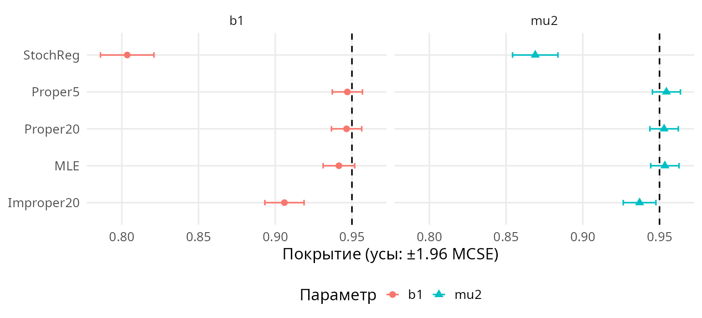<figcaption>2000 репликаций, n=500; для MI — t-интервалы Барнарда–Рубина.</figcaption></figure></div></div>
```

::: {.notes}

```{=html}
<p><strong>Редакция HTML:</strong> основной слайд обновлён по расчётам R или проверенному API. Числа исходного сценария ниже относятся к PPTX.</p><p>Вернёмся к нашей симуляции «САД и ИМТ» при механизме MAR (3000 репликаций по n = 500 пациентов, ~32% пропусков ИМТ).</p><p>На левой панели — покрытие. Одиночная стохастическая регрессия даёт 87.1% для среднего ИМТ и 81.6% для наклона β₁: она систематически слишком самоуверенна. Второй столбец — промежуточный опыт: двадцать копий, но без розыгрыша параметров. Покрытие уже 93.0% и 91.7% — то есть основную часть работы делает сама множественность копий, через дисперсию B. Розыгрыш параметров закрывает оставшиеся два-четыре процентных пункта, и покрытие выходит на номинальный уровень, сравниваясь с точным ММП Андерсона.</p><p>На правой панели — анатомия: к обычной дисперсии W добавляется межимпутационная B, а оранжевый сегмент B/m при m = 20 в четыре раза меньше, чем при m = 5, — это шум Монте-Карло от конечного числа копий.</p><p>Расчёт выполнен независимым воспроизведением DGP практикума; при прогоне модуля 5 цифры совпадут в пределах ошибки Монте-Карло.</p>
```

:::


## Для вектора параметров матрица V_MI объединяет W и B, а гипотезы проверяют тесты D₁–D₃ {#p2-rubin-multi .course-slide .layer-deep data-source="v2:65" data-layer="deep"}

```{=html}
<div class="course-kicker">ЗАНЯТИЕ 2 · УГЛУБЛЁННО</div><div class="course-grid"><div class="course-card " style="grid-column:1 / span 6"><h3>Векторные оценки и ковариационная матрица</h3><p class="bullet">• Вектор оценок (размерность p): θ̂_MI = (1 / m) · Σ_{ℓ=1..m} θ̂_ℓ (покомпонентное среднее).</p><p class="bullet">• Внутриимпутационная матрица (p × p): Ŵ = (1 / m) · Σ V̂_ℓ (среднее ковариационных матриц моделей).</p><p class="bullet">• Межимпутационная матрица (p × p): B̂ = [1 / (m − 1)] · Σ (θ̂_ℓ − θ̂_MI)(θ̂_ℓ − θ̂_MI)ᵀ.</p><p class="bullet">• Полная ковариационная матрица: V̂_MI = Ŵ + (1 + 1/m)·B̂.</p><p class="bullet">• Применение: необходимо для контрастов, категориальных предикторов с &gt;2 уровнями и совместной проверки H₀: θ₂ = 0.</p></div><div class="course-card " style="grid-column:7 / span 6"><h3>Совместная проверка гипотез (нельзя усреднять p-values!)</h3><p>1. D₁ — многомерный тест Вальда (Li et al., 1991): использует θ̂_MI и матрицу V̂_MI (с F-распределением). Доступен в R через D1(fit1, fit0) или mitml::testModels().</p><p>2. D₂ — объединение χ²-статистик (Li et al., 1991): быстрая аппроксимация, когда доступны только значения тестов из каждой модели.</p><p>3. D₃ — объединённое отношение правдоподобия (Meng &amp; Rubin, 1992): сравнивает вложенные модели (например, ANOVA / смешанные модели / SEM) через разницу лог-правдоподобий при усреднённых и раздельных оценках.</p></div></div>
```

::: {.notes}

```{=html}
<p>Часто в клинической статье нужно проверить гипотезу сразу о нескольких параметрах — например, значим ли категориальный фактор из 4 уровней (тип терапии) или вся группа взаимодействий целиком. В этом случае мы переходим к многомерным правилам Рубина.</p><p>Точечный вектор оценок усредняется покомпонентно, а полная ковариационная матрица V̂_MI строится точно так же, как в одномерном случае: матрица Ŵ плюс (1 + 1/m) на матрицу B̂.</p><p>Критически важный запрет: нельзя просто посчитать 20 p-значений и взять их среднее или медиану! Для сравнения вложенных моделей в R используются многомерные тесты: D₁ (многомерный тест Вальда — самый популярный на практике, например, через D1() в mice), D₂ (пуллинг хи-квадрат) или D₃ (тест отношения правдоподобий Менга–Рубина).</p>
```

:::


## m = 5 хватает для точечной оценки, но для стабильных SE и p-значений нужно m ≥ 20–50 {#p2-how-many .course-slide .layer-core data-source="v2:66" data-layer="core"}

```{=html}
<div class="course-kicker">ЗАНЯТИЕ 2 · ОСНОВНАЯ ЛИНИЯ</div><div class="course-grid"><div class="course-card " style="grid-column:1 / span 12"><table><thead><tr><th>Число копий m</th><th>Эффективность (при FMI = 0.30)</th><th>Стабильность SE и p-значений</th><th>Рекомендация</th></tr></thead><tbody><tr><td>m = 5 (исторический минимум)</td><td>94.3%  [1 / (1 + 0.30/5)]</td><td>Низкая: заметный разброс p-значений при смене seed</td><td>Только для быстрой отладки кода</td></tr><tr><td>m = 20</td><td>98.5%</td><td>Умеренная / приемлемая для большинства моделей</td><td>Минимальный стандарт для 20% пропусков</td></tr><tr><td>m = 30–50</td><td>99.0–99.4%</td><td>Высокая воспроизводимость границ 95% ДИ и FMI</td><td>Рабочий стандарт для публикаций и РКИ</td></tr><tr><td>m = 100</td><td>99.7%</td><td>Погрешность Монте-Карло для SE и p &lt; 0.01</td><td>Финальный расчёт (или при FMI &gt; 0.50)</td></tr></tbody></table></div><div class="course-card " style="grid-column:1 / span 12"><h3>Два простых правила выбора m на практике</h3><p>1. Правило процента неполных строк (White, Royston &amp; Wood, 2011): задавайте m не меньше процента наблюдений с хотя бы одним пропуском (например, 32% неполных строк → m ≥ 32).</p><p>2. Двухэтапный расчёт по FMI: сначала сделайте пилотный прогон (m = 5–10), посмотрите максимальный FMI в pool() и выберите m: по линейному правилу m ≈ 100 × FMI (Bodner, 2008; White et al., 2011) или по более точному квадратичному правилу von Hippel (2020; пакет howManyImputations).</p></div></div>
```

::: {.notes}

```{=html}
<p>В старых учебниках и в самом пакете mice по умолчанию стоит m = 5. Откуда взялась пятёрка? Рубин показал, что относительная эффективность точечной оценки равна (1 + γ/m)⁻¹: даже при 30% потерянной информации m = 5 даёт 94% эффективности. Но в биостатистике нас волнуют не только точечные оценки, а ещё стандартные ошибки, границы 95% ДИ и p-значения! Если вы запустите m = 5 с разными set.seed(), ваши p-значения могут прыгать от 0.03 до 0.07.</p><p>Поэтому сегодня стандарт в клинических исследованиях другой: для отладки кода берём m = 5, а для финальной статьи используем правило Уайта–Ройстона (m ≥ процент неполных случаев) или линейное правило m ≈ 100 × FMI (Боднер; Уайт с соавторами), которое фон Хиппель в 2020 году заменил более точным квадратичным — обычно это 20–50 датасетов, с обязательной фиксацией seed.</p>
```

:::


## Применяем MICE (norm vs pmm), пассивную импутацию и правила Рубина к когорте САД и ИМТ {#p2-practice .course-slide .layer-core data-source="v2:67" data-layer="core"}

```{=html}
<div class="course-kicker">ЗАНЯТИЕ 2 · ОСНОВНАЯ ЛИНИЯ</div><div class="course-grid"><div class="course-card " style="grid-column:1 / span 6"><h3>Часть А. Настройка и диагностика в mice</h3><p>1. Сухой прогон (maxit = 0): извлекаем method и predictorMatrix для когорты (age, treatment, sbp, height, weight, bmi, glucose).</p><p>2. Выбор методов: сравниваем method = &#x27;norm&#x27; и &#x27;pmm&#x27; на скошенной глюкозе — фиксируем выход norm за границы.</p><p>3. Пассивная импутация ИМТ: настраиваем meth[&#x27;bmi&#x27;] &lt;- &#x27;~ I(weight / (height/100)^2)&#x27; и обнуляем обратное влияние bmi на рост и вес в predictorMatrix.</p><p>4. Аудит сходимости и распределений: строим plot(imp), densityplot(imp) и stripplot(imp).</p></div><div class="course-card " style="grid-column:7 / span 6"><h3>Часть Б. Анализ, пуллинг и симуляция покрытия</h3><p>1. Конвейер with() → pool(): оцениваем модель lm(sbp ~ bmi + age + treatment) и проверяем FMI, λ и ν_BR.</p><p>2. Сравнение с Joint Modeling: запускаем Amelia::amelia() на тех же данных и сравниваем объединённые оценки (pool() по списку моделей).</p><p>3. Многомерный тест D₁: проверяем совместную значимость блока предикторов (D1(fit_full, fit_reduced)).</p><p>4. Мини-симуляция: убеждаемся, что mice(method = &#x27;norm&#x27;, m = 20) поднимает покрытие 95% ДИ до ~95% в отличие от одиночной стохастики.</p></div></div>
```

::: {.notes}

```{=html}
<p>В практической части (скрипт missing_data_practice.R, модули 3–5) студенты закрепят весь материал на расширенной версии нашей когорты.</p><p>Сначала мы сделаем сухой прогон mice(maxit = 0) — это золотой стандарт работы в R, который позволяет вручную проверить и подправить методы и матрицу предикторов до запуска циклов. Мы специально добавим рост и вес, чтобы настроить пассивную импутацию ИМТ и убрать циклическую зависимость в predictorMatrix.</p><p>Затем сравним mice с Amelia, проведём многомерный тест D1 и в конце запустим быструю проверку покрытия 95% ДИ, закрывая интригу с Занятия 1.</p>
```

:::


## MICE и правила Рубина дают гибкий стандарт при MAR; далее — границы применимости MI {#p2-summary .course-slide .layer-core data-source="v2:68" data-layer="core"}

```{=html}
<div class="course-kicker">ЗАНЯТИЕ 2 · ОСНОВНАЯ ЛИНИЯ</div><div class="course-grid"><div class="course-card " style="grid-column:1 / span 6"><h3>Главные выводы Занятия 2</h3><p>1. Учёт всех ошибок: MI добавляет к остаточному шуму параметрическую неопределённость (P-шаг) и межимпутационную дисперсию B.</p><p>2. Выбор стратегии: FCS (mice) гибче для разнотипных шкал, JM (jomo, Amelia) строже для кластеров; PMM страхует от выхода за границы.</p><p>3. Валидность пуллинга: включайте в импутацию модель анализа + вспомогательные переменные (congeniality) и выбирайте m ≥ 20–50.</p></div><div class="course-card " style="grid-column:7 / span 6"><h3>Что ждёт нас на Занятии 3</h3><p class="bullet">• Когда MI не нужна: ситуации, в которых анализ полных случаев или модель правдоподобия не хуже или лучше.</p><p class="bullet">• Сложные модели анализа: квадратичные эффекты, взаимодействия и модель Кокса с помощью smcfcs.</p><p class="bullet">• Особые случаи и MNAR: лонгитудинальные исходы, бутстреп, мэтчинг и взвешивание; анализ чувствительности (дельта-сдвиги, tipping point).</p></div><div class="course-card " style="grid-column:1 / span 12"><p>Источники занятия: Van Buuren (FIMD, 2018); Carpenter &amp; Kenward (2023, Ch. 2–6); Enders (2022, Ch. 6–7); Little &amp; Rubin (2019, Ch. 5, 10); лекции V. Inacio и J. Templin.</p></div></div>
```

::: {.notes}

```{=html}
<p>Подведём итог второго занятия. Мы прошли путь от формул ММП к полноценному байесовско-частотному аппарату множественной импутации, разобрались, как работает цепной алгоритм MICE и полупараметрический PMM, и вывели одномерные и многомерные правила Рубина.</p><p>На следующем, заключительном занятии мы очертим границы применимости MI: когда она не нужна, как спасать нелинейности и взаимодействия через smcfcs, как работать с выживаемостью, повторными измерениями, бутстрепом и взвешиванием и что делать, если MAR под вопросом.</p>
```

:::


# III. Границы применимости MI {#p3-title .course-slide .layer-core data-source="v2:69" data-layer="core" .course-title}

```{=html}
<div class="course-kicker">ЗАНЯТИЕ 3 · ОСНОВНАЯ ЛИНИЯ</div><div class="course-grid"><div class="course-card " style="grid-column:span 12"><p>Занятие 3. Когда MI не нужна, сложные модели анализа (smcfcs), выживаемость, повторные измерения, бутстреп, взвешивание и MNAR</p><p class="bullet">• Когда анализ полных случаев или модель правдоподобия не хуже MI</p><p class="bullet">• Совместимость с моделью анализа: SMC-FCS и пакет smcfcs</p><p class="bullet">• MI в особых случаях: выживаемость, лонгитудинальные исходы, бутстреп, мэтчинг и взвешивание</p><p class="bullet">• Когда MAR под вопросом: анализ чувствительности дельта-сдвигом</p></div></div>
```

::: {.notes}

```{=html}
<p>Третье, заключительное занятие. На первых двух мы построили рабочий инструмент: множественную импутацию при допущении MAR. Сегодня — о его границах. Сначала разберём ситуации, в которых MI не нужна или даже вредна. Затем — случаи, когда стандартная MICE даёт смещение, потому что модель анализа сложнее модели импутации, и познакомимся с пакетом smcfcs. После этого пройдём по особым случаям: выживаемость, повторные измерения, бутстреп, мэтчинг и взвешивание. И закончим тем, что делать, когда допущению MAR доверять нельзя.</p>
```

:::


## MI — не ответ по умолчанию: в ряде ситуаций анализ полных случаев не хуже или лучше {#p3-not-always .course-slide .layer-core data-source="v2:70" data-layer="core"}

```{=html}
<div class="course-kicker">ЗАНЯТИЕ 3 · ОСНОВНАЯ ЛИНИЯ</div><div class="course-grid"><div class="course-card " style="grid-column:span 12"><table><thead><tr><th>Ситуация</th><th>Анализ полных случаев</th><th>MI при допущении MAR</th><th>Что делать</th></tr></thead><tbody><tr><td>Пропуски только в исходе, вспомогательных переменных нет</td><td>Несмещён, если пропуск зависит только от ковариат модели</td><td>Та же информация плюс шум Монте-Карло</td><td>CCA или модель правдоподобия</td></tr><tr><td>Пропуск в ковариате не зависит от исхода при фиксированных ковариатах — даже MNAR по самой ковариате</td><td>Несмещён</td><td>Может быть смещена</td><td>CCA; MI — только ради эффективности и с осторожностью</td></tr><tr><td>Пропуск зависит от исхода или есть сильные вспомогательные переменные</td><td>Смещён или неэффективен</td><td>Корректна при верной модели импутации</td><td>MI или ММП</td></tr><tr><td>Правдоподобно, что пропуск исхода зависит от самого исхода (MNAR)</td><td>Смещён</td><td>Смещена</td><td>Анализ чувствительности</td></tr></tbody></table></div></div>
```

::: {.notes}

```{=html}
<p>После второго занятия легко прийти к выводу, что множественная импутация — универсальное решение. Это не так, и первый блок сегодня — о том, когда она не нужна.</p><p>Первая строка: пропуски только в исходе, и у нас нет переменных, которые предсказывают исход, но не входят в модель анализа. Тогда строки без исхода не несут информации о регрессии — мы это видели в Части I на факторизации Андерсона. MI даст тот же ответ, что и анализ полных случаев, только с добавочным шумом Монте-Карло.</p><p>Вторая строка — самая неожиданная. Если пропуск в ковариате не зависит от исхода, анализ полных случаев несмещён, даже когда пропуск зависит от самой пропущенной ковариаты, то есть при MNAR. А MI, построенная на допущении MAR, в этой ситуации может дать смещение. Это наш «зеркальный эффект» из первой части.</p><p>Третья строка — территория MI: пропуск зависит от исхода или есть сильные вспомогательные переменные. Четвёртая — MNAR по исходу: здесь не спасает ни один из двух методов, нужен анализ чувствительности.</p>
```

:::


## MI — не ответ по умолчанию: в ряде ситуаций анализ полных случаев не хуже или лучше · продолжение {#p3-not-always-cont-2 .course-slide .layer-core data-source="v2:70" data-layer="core"}

```{=html}
<div class="course-kicker">ЗАНЯТИЕ 3 · ОСНОВНАЯ ЛИНИЯ</div><div class="course-grid"><div class="course-card " style="grid-column:span 12"><p>Это прямое следствие теоремы валидности CCA из Части I (<a class="slide-ref" href="#/p1-cca-theorem">связанный разбор</a>): оценки CCA в регрессии Y ~ X несмещены, если вероятность попасть в полные случаи не зависит от исхода при фиксированных ковариатах.</p><p>Источники: Hughes, Heron, Sterne &amp; Tilling (2019), «Accounting for missing data in statistical analyses: multiple imputation is not always the answer»; White &amp; Carlin (2010); Carpenter &amp; Smuk (2021).</p></div></div>
```

::: {.notes}

```{=html}
<p>После второго занятия легко прийти к выводу, что множественная импутация — универсальное решение. Это не так, и первый блок сегодня — о том, когда она не нужна.</p><p>Первая строка: пропуски только в исходе, и у нас нет переменных, которые предсказывают исход, но не входят в модель анализа. Тогда строки без исхода не несут информации о регрессии — мы это видели в Части I на факторизации Андерсона. MI даст тот же ответ, что и анализ полных случаев, только с добавочным шумом Монте-Карло.</p><p>Вторая строка — самая неожиданная. Если пропуск в ковариате не зависит от исхода, анализ полных случаев несмещён, даже когда пропуск зависит от самой пропущенной ковариаты, то есть при MNAR. А MI, построенная на допущении MAR, в этой ситуации может дать смещение. Это наш «зеркальный эффект» из первой части.</p><p>Третья строка — территория MI: пропуск зависит от исхода или есть сильные вспомогательные переменные. Четвёртая — MNAR по исходу: здесь не спасает ни один из двух методов, нужен анализ чувствительности.</p>
```

:::


## Решение принимают по механизму и доле потерянной информации, а не по проценту пропусков {#p3-fmi-not-percent .course-slide .layer-core data-source="v2:71" data-layer="core"}

```{=html}
<div class="course-kicker">ЗАНЯТИЕ 3 · ОСНОВНАЯ ЛИНИЯ</div><div class="course-grid"><div class="course-card " style="grid-column:1 / span 6"><h3>Распространённое правило — и почему оно неверно</h3><p>«До 5% пропусков — удаляем строки, больше 40% — импутировать нельзя».</p><p class="bullet">• Малая доля пропусков не защищает от смещения, если пропуск зависит от исхода.</p><p class="bullet">• Большая доля не запрещает MI: при верной модели импутации оценки остаются несмещёнными, растёт только неопределённость.</p><p class="bullet">• Процент пропусков ничего не говорит о том, сколько информации о конкретном параметре потеряно.</p></div><div class="course-card " style="grid-column:7 / span 6"><h3>Что смотреть вместо процента</h3><p class="bullet">• Механизм: от чего зависит пропуск (таблица предыдущего слайда).</p><p class="bullet">• FMI — доля потерянной информации о параметре, колонка fmi в pool().</p><p class="bullet">• В примере САД–ИМТ при 32% пропусков: FMI для среднего ИМТ ≈ 31%, для наклона β₁ ≈ 46%.</p><p class="bullet">• Вспомогательные переменные выбирают по тому, насколько они снижают FMI.</p><p class="bullet">• Если полных случаев мало, обязателен анализ чувствительности к модели импутации.</p></div><div class="course-card " style="grid-column:1 / span 12"><p>Источник: Madley-Dowd, Hughes, Tilling &amp; Heron (2019), «The proportion of missing data should not be used to guide decisions on multiple imputation», J Clin Epidemiol.</p></div></div>
```

::: {.notes}

```{=html}
<p>В прикладных статьях до сих пор встречается правило большого пальца: мало пропусков — удаляем, много — импутировать бессмысленно. Оба утверждения неверны. Смещение определяется механизмом, а не долей: пять процентов пропусков, зависящих от исхода, смещают оценку, а пятьдесят процентов полностью случайных — нет.</p><p>Вместо процента смотрят на долю потерянной информации, FMI, которую мы разбирали на втором занятии. Она своя у каждого параметра: в нашем примере при трети пропусков теряется около трети информации о среднем и почти половина — о наклоне.</p>
```

:::


## В рандомизированных исследованиях MI — не единственный приемлемый метод {#p3-rct .course-slide .layer-core data-source="v2:72" data-layer="core"}

```{=html}
<div class="course-kicker">ЗАНЯТИЕ 3 · ОСНОВНАЯ ЛИНИЯ</div><div class="review-banner">TODO · Утверждения и ссылки этого слайда требуют подтверждения автора. Это рабочий материал.</div><div class="course-grid"><div class="course-card " style="grid-column:span 12"><h3>Пропуски в исходе</h3><p class="bullet">• Один визит: ANCOVA по завершившим исследование совпадает с ММП при MAR (мы видели это в Части I).</p><p class="bullet">• Повторные измерения: смешанная модель (MMRM) использует все наблюдённые визиты.</p><p class="bullet">• MI оправдана, если есть вспомогательные переменные вне модели анализа или нужен анализ чувствительности.</p></div><div class="course-card " style="grid-column:span 12"><h3>Если MI всё же используется</h3><p class="bullet">• Импутировать раздельно по группам рандомизации.</p><p class="bullet">• Иначе при неучтённом взаимодействии «лечение × ковариата» оценка среднего эффекта смещается.</p><p class="bullet">• В модель импутации — все переменные модели анализа и исход.</p></div><div class="course-card " style="grid-column:span 12"><h3>Пропуски в исходных ковариатах</h3><p class="bullet">• Рандомизация делает группу независимой от исходных ковариат.</p><p class="bullet">• Поэтому простые методы — замена средним, индикатор пропуска — дают корректную оценку эффекта лечения.</p><p class="bullet">• В наблюдательных исследованиях те же методы дают смещение (Часть I).</p></div></div>
```

::: {.notes}

```{=html}
<p>Отдельно о рандомизированных исследованиях — у них своя специфика.</p><p>Если пропущен только исход, анализ на основе правдоподобия уже корректен при MAR: ANCOVA при одном визите, смешанная модель при повторных. Салливан с соавторами показали, что при верной модели анализа MI несмещена, но альтернативные несмещённые подходы часто эффективнее.</p><p>Если MI всё-таки нужна, её проводят раздельно по группам рандомизации.</p><p>И правая карточка — контраст с первым занятием. Там замена средним была примером плохого метода. Но для исходных ковариат в РКИ она допустима: группа лечения рандомизирована и не зависит от ковариат, поэтому оценка эффекта лечения остаётся корректной. Это не отменяет Часть I — это показывает, что вывод зависит от дизайна.</p>
```

:::


## В рандомизированных исследованиях MI — не единственный приемлемый метод · продолжение {#p3-rct-cont-2 .course-slide .layer-core data-source="v2:72" data-layer="core"}

```{=html}
<div class="course-kicker">ЗАНЯТИЕ 3 · ОСНОВНАЯ ЛИНИЯ</div><div class="review-banner">TODO · Утверждения и ссылки этого слайда требуют подтверждения автора. Это рабочий материал.</div><div class="course-grid"><div class="course-card " style="grid-column:span 12"><p>Источники: Sullivan, White, Salter, Ryan &amp; Lee (2018), «Should multiple imputation be the method of choice for handling missing data in randomized trials?»; White &amp; Thompson (2005).</p></div></div>
```

::: {.notes}

```{=html}
<p>Отдельно о рандомизированных исследованиях — у них своя специфика.</p><p>Если пропущен только исход, анализ на основе правдоподобия уже корректен при MAR: ANCOVA при одном визите, смешанная модель при повторных. Салливан с соавторами показали, что при верной модели анализа MI несмещена, но альтернативные несмещённые подходы часто эффективнее.</p><p>Если MI всё-таки нужна, её проводят раздельно по группам рандомизации.</p><p>И правая карточка — контраст с первым занятием. Там замена средним была примером плохого метода. Но для исходных ковариат в РКИ она допустима: группа лечения рандомизирована и не зависит от ковариат, поэтому оценка эффекта лечения остаётся корректной. Это не отменяет Часть I — это показывает, что вывод зависит от дизайна.</p>
```

:::


## MI требует верной модели импутации: четыре способа её сломать и три альтернативы {#p3-when-mi-breaks .course-slide .layer-core data-source="v2:73" data-layer="core"}

```{=html}
<div class="course-kicker">ЗАНЯТИЕ 3 · ОСНОВНАЯ ЛИНИЯ</div><div class="review-banner">TODO · Утверждения и ссылки этого слайда требуют подтверждения автора. Это рабочий материал.</div><div class="course-grid"><div class="course-card " style="grid-column:1 / span 6"><h3>Четыре способа сломать MI</h3><p>1. Исход не включён в модель импутации — связи ковариат с исходом сжимаются к нулю.</p><p>2. Модель импутации беднее модели анализа — нет взаимодействия или нелинейности: решение — SMC-FCS (следующий блок).</p><p>3. Производные переменные импутированы как обычные — ИМТ, квадраты, отношения: пассивная импутация или SMC-FCS.</p><p>4. Проигнорирована структура данных — кластеры, повторные измерения, цензурирование.</p></div><div class="course-card " style="grid-column:7 / span 6"><h3>Три альтернативы MI</h3><p>Модель правдоподобия (MMRM, FIML): когда пропуски только в исходе.</p><p>Взвешивание обратной вероятностью (IPW): блочные пропуски («вся анкета не заполнена»), монотонное выбывание; модель проще, эффективность ниже.</p><p>Полностью байесовская модель: когда импутацию и анализ нельзя разделить.</p></div></div>
```

::: {.notes}

```{=html}
<p>Вторая причина осторожности: MI работает только с правильной моделью импутации, и сломать её легко. Четыре типичные ошибки — на слайде. Первые три — это нарушения согласованности из второго занятия: модель импутации должна быть не беднее модели анализа. Четвёртая — про структуру данных: если наблюдения сгруппированы в кластеры или это повторные измерения, обычная MICE по строкам занижает внутрикластерные корреляции.</p><p>Справа — альтернативы. Они не лучше и не хуже MI вообще; у каждой есть ситуации, в которых она проще и надёжнее.</p>
```

:::


## Пять вопросов перед выбором метода: от «где пропуски» до «какая модель анализа» {#p3-decision .course-slide .layer-core data-source="v2:74" data-layer="core"}

```{=html}
<div class="course-kicker">ЗАНЯТИЕ 3 · ОСНОВНАЯ ЛИНИЯ</div><div class="course-grid"><div class="course-card " style="grid-column:1 / span 12"><table><thead><tr><th>№</th><th>Вопрос</th><th>Если «да»</th><th>Если «нет»</th></tr></thead><tbody><tr><td>1</td><td>Пропуски только в исходе, и вспомогательных переменных нет?</td><td>Модель правдоподобия или CCA; при повторных измерениях — MMRM</td><td>К вопросу 2</td></tr><tr><td>2</td><td>Пропуск в ковариатах не зависит от исхода при фиксированных ковариатах модели?</td><td>CCA корректен; MI — только ради эффективности</td><td>К вопросу 3</td></tr><tr><td>3</td><td>Правдоподобно, что пропуск зависит от самой пропущенной величины (MNAR)?</td><td>Запланировать анализ чувствительности и перейти к вопросу 4</td><td>К вопросу 4</td></tr><tr><td>4</td><td>В модели анализа есть нелинейности, взаимодействия или время до события?</td><td>SMC-FCS (пакет smcfcs)</td><td>К вопросу 5</td></tr><tr><td>5</td><td>Данные кластеризованы или это повторные измерения с нерегулярными визитами?</td><td>Многоуровневая импутация (jomo, методы 2l.* в mice, micemd)</td><td>Стандартная MICE с исходом и вспомогательными переменными</td></tr></tbody></table></div><div class="course-card " style="grid-column:1 / span 12"><p>Как пользоваться. Таблица — не алгоритм, а порядок вопросов: на каждый нужен содержательный, а не статистический ответ (механизм по данным не проверить — Часть I). Ответы и выбранный путь фиксируют в плане статистического анализа до получения данных.</p></div></div>
```

::: {.notes}

```{=html}
<p>Соберём первый блок в один порядок вопросов. Важно: ни на один из них нельзя ответить тестом. Зависит ли пропуск от исхода — это вопрос о том, как собирались данные; его обсуждают с клиницистами и фиксируют в плане анализа заранее.</p>
```

:::


## Стандартная MICE искажает нелинейные эффекты: пассивная импутация сжимает квадрат, JAV смещает наклон {#p3-compat-problem .course-slide .layer-core data-source="v2:75" data-layer="core"}

```{=html}
<div class="course-kicker">ЗАНЯТИЕ 3 · ОСНОВНАЯ ЛИНИЯ</div><div class="review-banner">Числа перенесены из PPTX; этот расчёт ещё не воспроизведён в R.</div><div class="course-grid"><div class="course-card image" style="grid-column:span 12">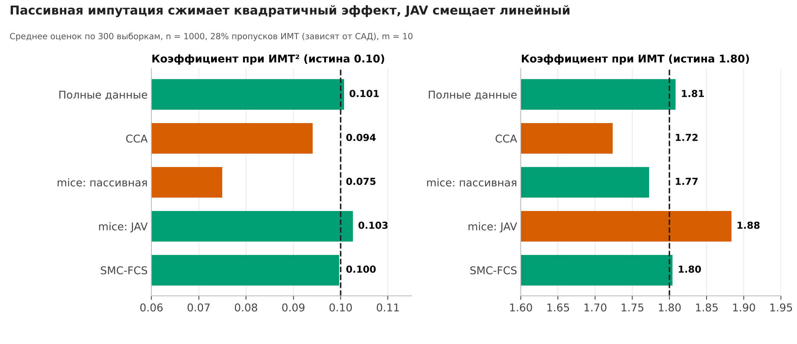</div></div>
```

::: {.notes}

```{=html}
<p>На втором занятии мы сказали, что стандартная MICE даёт смещение при квадратичных эффектах и взаимодействиях. Теперь посмотрим на это в числах — на нашей же когорте, но с квадратичной зависимостью давления от ИМТ.</p><p>Пассивная импутация: импутируем ИМТ обычной линейной регрессией на давление и возраст, а квадрат вычисляем. Коэффициент при квадрате получается 0.075 вместо 0.10, а покрытие интервала — 63%. Причина: если давление зависит от ИМТ квадратично, то условное распределение ИМТ при заданном давлении не линейно и не нормально.</p><p>Подход JAV — импутировать ИМТ и его квадрат как две отдельные переменные — возвращает квадратичный коэффициент, но смещает линейный: 1.88 вместо 1.80.</p><p>SMC-FCS даёт 1.80 и 0.100 с номинальным покрытием. Как он устроен — на следующем слайде.</p><p>Это иллюстративная симуляция: алгоритмы написаны независимо от пакетов R. В практикуме, в модуле 6, студенты воспроизведут сравнение на реальных mice и smcfcs.</p>
```

:::


## Стандартная MICE искажает нелинейные эффекты: пассивная импутация сжимает квадрат, JAV смещает наклон · продолжение {#p3-compat-problem-cont-2 .course-slide .layer-core data-source="v2:75" data-layer="core"}

```{=html}
<div class="course-kicker">ЗАНЯТИЕ 3 · ОСНОВНАЯ ЛИНИЯ</div><div class="review-banner">Числа перенесены из PPTX; этот расчёт ещё не воспроизведён в R.</div><div class="course-grid"><div class="course-card " style="grid-column:span 12"><table><thead><tr><th>Метод</th><th>ИМТ (1.80)</th><th>ИМТ² (0.10)</th><th>Покрытие ИМТ / ИМТ²</th></tr></thead><tbody><tr><td>Полные данные</td><td>1.81</td><td>0.101</td><td>96 / 96%</td></tr><tr><td>CCA</td><td>1.72</td><td>0.094</td><td>88 / 93%</td></tr><tr><td>mice: пассивная</td><td>1.77</td><td>0.075</td><td>95 / 63%</td></tr><tr><td>mice: JAV</td><td>1.88</td><td>0.103</td><td>83 / 95%</td></tr><tr><td>SMC-FCS</td><td>1.80</td><td>0.100</td><td>96 / 97%</td></tr></tbody></table></div><div class="course-card " style="grid-column:span 12"><p>Модель анализа: САД = β₀ + β₁·ИМТ + β₂·ИМТ² + β₃·возраст + ε; истинные β₁ = 1.80, β₂ = 0.10. ИМТ пропущен у 28% пациентов, пропуск зависит от САД.</p><p>Пассивная импутация (импутируем ИМТ линейной моделью, квадрат пересчитываем) предполагает, что ИМТ линейно зависит от САД, — а при квадратичной модели анализа это неверно.</p><p>JAV (квадрат как отдельная переменная) сохраняет связи с исходом, но нарушает равенство ИМТ² = (ИМТ)² и смещена при MAR.</p><p>Иллюстративная симуляция: 300 выборок, n = 1000, 10 импутаций; алгоритмы реализованы независимо от пакетов R — воспроизведите в модуле 6 практикума.</p></div></div>
```

::: {.notes}

```{=html}
<p>На втором занятии мы сказали, что стандартная MICE даёт смещение при квадратичных эффектах и взаимодействиях. Теперь посмотрим на это в числах — на нашей же когорте, но с квадратичной зависимостью давления от ИМТ.</p><p>Пассивная импутация: импутируем ИМТ обычной линейной регрессией на давление и возраст, а квадрат вычисляем. Коэффициент при квадрате получается 0.075 вместо 0.10, а покрытие интервала — 63%. Причина: если давление зависит от ИМТ квадратично, то условное распределение ИМТ при заданном давлении не линейно и не нормально.</p><p>Подход JAV — импутировать ИМТ и его квадрат как две отдельные переменные — возвращает квадратичный коэффициент, но смещает линейный: 1.88 вместо 1.80.</p><p>SMC-FCS даёт 1.80 и 0.100 с номинальным покрытием. Как он устроен — на следующем слайде.</p><p>Это иллюстративная симуляция: алгоритмы написаны независимо от пакетов R. В практикуме, в модуле 6, студенты воспроизведут сравнение на реальных mice и smcfcs.</p>
```

:::


## SMC-FCS импутирует ковариату из распределения, совместимого с моделью анализа {#p3-smcfcs-idea .course-slide .layer-core data-source="v2:76" data-layer="core"}

```{=html}
<div class="course-kicker">ЗАНЯТИЕ 3 · ОСНОВНАЯ ЛИНИЯ</div><div class="course-grid"><div class="course-card " style="grid-column:1 / span 6"><h3>Идея (Bartlett, Seaman, White &amp; Carpenter, 2015)</h3><p>Обычная FCS задаёт модель f(X | Y, Z) напрямую — и может противоречить модели анализа.</p><p>SMC-FCS строит её из двух частей:</p><div class="equation"><span class="katex-display"><span class="katex"><span class="katex-mathml"><math xmlns="http://www.w3.org/1998/Math/MathML" display="block"><semantics><mrow><mi>f</mi><mo stretchy="false">(</mo><mi>X</mi><mo>∣</mo><mi>Y</mi><mo separator="true">,</mo><mi>Z</mi><mo stretchy="false">)</mo><mo>∝</mo><mi>f</mi><mo stretchy="false">(</mo><mi>Y</mi><mo>∣</mo><mi>X</mi><mo separator="true">,</mo><mi>Z</mi><mo separator="true">;</mo><mi>β</mi><mo stretchy="false">)</mo><mtext> </mtext><mi>f</mi><mo stretchy="false">(</mo><mi>X</mi><mo>∣</mo><mi>Z</mi><mo separator="true">;</mo><msub><mi>ϕ</mi><mi>X</mi></msub><mo stretchy="false">)</mo></mrow><annotation encoding="application/x-tex">f(X\mid Y,Z)\propto f(Y\mid X,Z;\beta)\,f(X\mid Z;\phi_X)</annotation></semantics></math></span><span class="katex-html" aria-hidden="true"><span class="katex-base"><span class="katex-strut" style="height:1em;vertical-align:-0.25em;"></span><span class="mord mathnormal" style="margin-right:0.1076em;">f</span><span class="mopen">(</span><span class="mord mathnormal" style="margin-right:0.0785em;">X</span><span class="mspace" style="margin-right:0.2778em;"></span><span class="mrel">∣</span><span class="mspace" style="margin-right:0.2778em;"></span></span><span class="katex-base"><span class="katex-strut" style="height:1em;vertical-align:-0.25em;"></span><span class="mord mathnormal" style="margin-right:0.2222em;">Y</span><span class="mpunct">,</span><span class="mspace" style="margin-right:0.1667em;"></span><span class="mord mathnormal" style="margin-right:0.0715em;">Z</span><span class="mclose">)</span><span class="mspace" style="margin-right:0.2778em;"></span><span class="mrel">∝</span><span class="mspace" style="margin-right:0.2778em;"></span></span><span class="katex-base"><span class="katex-strut" style="height:1em;vertical-align:-0.25em;"></span><span class="mord mathnormal" style="margin-right:0.1076em;">f</span><span class="mopen">(</span><span class="mord mathnormal" style="margin-right:0.2222em;">Y</span><span class="mspace" style="margin-right:0.2778em;"></span><span class="mrel">∣</span><span class="mspace" style="margin-right:0.2778em;"></span></span><span class="katex-base"><span class="katex-strut" style="height:1em;vertical-align:-0.25em;"></span><span class="mord mathnormal" style="margin-right:0.0785em;">X</span><span class="mpunct">,</span><span class="mspace" style="margin-right:0.1667em;"></span><span class="mord mathnormal" style="margin-right:0.0715em;">Z</span><span class="mpunct">;</span><span class="mspace" style="margin-right:0.1667em;"></span><span class="mord mathnormal" style="margin-right:0.0528em;">β</span><span class="mclose">)</span><span class="mspace" style="margin-right:0.1667em;"></span><span class="mord mathnormal" style="margin-right:0.1076em;">f</span><span class="mopen">(</span><span class="mord mathnormal" style="margin-right:0.0785em;">X</span><span class="mspace" style="margin-right:0.2778em;"></span><span class="mrel">∣</span><span class="mspace" style="margin-right:0.2778em;"></span></span><span class="katex-base"><span class="katex-strut" style="height:1em;vertical-align:-0.25em;"></span><span class="mord mathnormal" style="margin-right:0.0715em;">Z</span><span class="mpunct">;</span><span class="mspace" style="margin-right:0.1667em;"></span><span class="mord"><span class="mord mathnormal">ϕ</span><span class="msupsub"><span class="vlist-t vlist-t2"><span class="vlist-r"><span class="vlist" style="height:0.3283em;"><span style="top:-2.55em;margin-left:0em;margin-right:0.05em;"><span class="pstrut" style="height:2.7em;"></span><span class="katex-sizing reset-size6 size3 mtight"><span class="mord mathnormal mtight" style="margin-right:0.0785em;">X</span></span></span></span><span class="vlist-s">​</span></span><span class="vlist-r"><span class="vlist" style="height:0.15em;"><span></span></span></span></span></span></span><span class="mclose">)</span></span></span></span></span></div><p class="bullet">• f(Y | X, Z; β) — сама модель анализа (substantive model), со всеми квадратами и взаимодействиями.</p><p class="bullet">• f(X | Z; φ_X) — обычная модель для ковариаты: нормальная, логистическая и т. д.</p><p>Совместимость обеспечена по построению.</p></div><div class="course-card " style="grid-column:7 / span 6"><h3>Как из этого сэмплировать: rejection sampling</h3><p>1. Разыграть параметры β и φ_X из апостериора по текущим заполненным данным.</p><p>2. Для пациента с пропуском предложить кандидата X* из f(X | Z; φ_X).</p><p>3. Принять кандидата с вероятностью, пропорциональной f(Y | X*, Z; β): чем лучше кандидат согласуется с наблюдённым исходом, тем выше шанс.</p><p>4. Повторять до принятия; затем — следующая неполная ковариата, следующая итерация.</p><p>Цена: расчёт заметно медленнее обычной MICE.</p></div></div>
```

::: {.notes}

```{=html}
<p>Идея SMC-FCS — substantive model compatible fully conditional specification — простая. В обычной MICE мы сами пишем модель для ковариаты при заданных исходе и остальных переменных. И легко написать модель, несовместимую с моделью анализа.</p><p>SMC-FCS поступает иначе: модель анализа объявляется главной. Распределение пропущенной ковариаты при заданном исходе получается по формуле Байеса как произведение модели анализа и простой модели для ковариаты без исхода. Совместимость получается автоматически.</p><p>Из такого произведения нельзя сэмплировать напрямую, поэтому используется выборка с отклонением: предлагаем кандидата из простой модели и принимаем его тем охотнее, чем лучше он объясняет наблюдённый исход.</p>
```

:::


## Вызов smcfcs отличается от mice тремя вещами: модель анализа, вектор method и формат результата {#p3-smcfcs-r .course-slide .layer-core data-source="v2:77" data-layer="core"}

```{=html}
<div class="course-kicker">ЗАНЯТИЕ 3 · ОСНОВНАЯ ЛИНИЯ</div><div class="review-banner">TODO · Утверждения и ссылки этого слайда требуют подтверждения автора. Это рабочий материал.</div><div class="course-grid"><div class="course-card " style="grid-column:span 12"><h3>Квадратичный эффект ИМТ (модуль 6 практикума)</h3><pre><code class="language-r">library(smcfcs); library(mitools)
# столбцы d6: sbp, age, bmi_c, bmi_c2
imp &lt;- smcfcs_checked(  # проверка отказов из R-практикума
  d6,
  smtype    = "lm",
  smformula = "sbp ~ bmi_c + bmi_c2 + age",
  method    = c("", "", "norm", "bmi_c^2"),
  m = 20, numit = 20, rjlimit = 100000)
fits &lt;- with(imputationList(imp$impDatasets),
             lm(sbp ~ bmi_c + bmi_c2 + age))
if (imp$rejection_ok) summary(MIcombine(fits))
# сходимость: траектории коэффициентов
dim(imp$smCoefIter)</code></pre></div></div>
```

::: {.notes}

```{=html}
<p>Код короткий, но в нём три отличия от привычного mice. Первое: модель анализа — её тип и формула — передаётся прямо в функцию импутации. Второе: аргумент method — это вектор по столбцам таблицы: пустая строка для полностью наблюдаемых переменных, название метода для неполных и выражение для производных, как здесь для квадрата. Третье: результат — обычный список таблиц, поэтому объединять оценки удобнее через пакет mitools.</p><p>Сходимость проверяют по траекториям коэффициентов модели анализа, которые хранятся в элементе smCoefIter.</p>
```

:::


## Вызов smcfcs отличается от mice тремя вещами: модель анализа, вектор method и формат результата · продолжение {#p3-smcfcs-r-cont-2 .course-slide .layer-core data-source="v2:77" data-layer="core"}

```{=html}
<div class="course-kicker">ЗАНЯТИЕ 3 · ОСНОВНАЯ ЛИНИЯ</div><div class="review-banner">TODO · Утверждения и ссылки этого слайда требуют подтверждения автора. Это рабочий материал.</div><div class="course-grid"><div class="course-card " style="grid-column:span 12"><h3>Три отличия от mice</h3><p>1. Модель анализа задаётся при импутации: smtype и smformula.</p><p>2. method — вектор по столбцам: "" для полных; "norm", "logreg", "mlogit", "podds", "poisson" для неполных; выражение ("bmi_c^2") для производных.</p><p>3. Результат — список impDatasets, а не объект mids: объединять через mitools::MIcombine() или передать список моделей в mice::pool().</p><p>Типы модели анализа (smtype)</p><p>"lm", "logistic", "brlogistic", "poisson", "weibull", "coxph", "compet"; отдельные функции — для case-cohort, nested case-control, дискретного времени.</p><p>Пакет импутирует ковариаты; версия на CRAN — 2.0.2 (май 2026).</p></div></div>
```

::: {.notes}

```{=html}
<p>Код короткий, но в нём три отличия от привычного mice. Первое: модель анализа — её тип и формула — передаётся прямо в функцию импутации. Второе: аргумент method — это вектор по столбцам таблицы: пустая строка для полностью наблюдаемых переменных, название метода для неполных и выражение для производных, как здесь для квадрата. Третье: результат — обычный список таблиц, поэтому объединять оценки удобнее через пакет mitools.</p><p>Сходимость проверяют по траекториям коэффициентов модели анализа, которые хранятся в элементе smCoefIter.</p>
```

:::


## Цена совместимости: модель анализа фиксируется при импутации и обязана быть верной {#p3-smcfcs-limits .course-slide .layer-core data-source="v2:78" data-layer="core"}

```{=html}
<div class="course-kicker">ЗАНЯТИЕ 3 · ОСНОВНАЯ ЛИНИЯ</div><div class="course-grid"><div class="course-card " style="grid-column:1 / span 3"><h3>Что теряется</h3><p class="bullet">• Принцип «импутировал один раз — анализируй как угодно»: новый анализ требует новой импутации.</p><p class="bullet">• Если модель анализа неверна, неверны и импутации.</p><p class="bullet">• Скорость: выборка с отклонением на каждой итерации.</p></div><div class="course-card " style="grid-column:5 / span 3"><h3>На что смотреть</h3><p class="bullet">• Предупреждения о rjlimit: выборка с отклонением не уложилась в лимит попыток — импутации для этих строк ненадёжны.</p><p class="bullet">• Траектории smCoefIter: коэффициенты модели анализа должны стабилизироваться.</p><p class="bullet">• Вспомогательные переменные добавляют через predictorMatrix; в модель анализа они не входят.</p></div><div class="course-card " style="grid-column:9 / span 3"><h3>Когда выбирать smcfcs</h3><p class="bullet">• Квадраты и другие нелинейные функции неполных ковариат.</p><p class="bullet">• Взаимодействия с участием неполных ковариат.</p><p class="bullet">• Модель Кокса, конкурирующие риски.</p><p>В остальных случаях стандартная MICE проще и гибче.</p></div></div>
```

::: {.notes}

```{=html}
<p>Совместимость не бесплатна. Главное: SMC-FCS привязывает импутацию к одной конкретной модели анализа. Если завтра вы захотите добавить взаимодействие или сменить исход, импутацию придётся повторить. А если сама модель анализа выбрана неверно, импутации унаследуют эту ошибку.</p><p>Поэтому smcfcs — не замена mice, а инструмент для трёх ситуаций, перечисленных справа.</p>
```

:::


## В модель импутации ковариаты входят индикатор события и кумулятивный риск, а не логарифм времени {#p3-surv-covariates .course-slide .layer-core data-source="v2:79" data-layer="core"}

```{=html}
<div class="course-kicker">ЗАНЯТИЕ 3 · ОСНОВНАЯ ЛИНИЯ</div><div class="course-grid"><div class="course-card " style="grid-column:1 / span 3"><h3>Цензурирование — не пропуск</h3><p class="bullet">• Время до события у цензурированного пациента обрабатывает сама модель выживаемости.</p><p class="bullet">• Импутировать его для обычного анализа не нужно.</p><p class="bullet">• Пропуски, о которых речь, — в ковариатах модели Кокса.</p></div><div class="course-card " style="grid-column:5 / span 3"><h3>Как включить исход (White &amp; Royston, 2009)</h3><p class="bullet">• Исход здесь — пара: время T и индикатор события D.</p><p class="bullet">• Подходящая модель для нормальной или бинарной ковариаты — регрессия на D, кумулятивный базовый риск H₀(T) и остальные ковариаты.</p><p class="bullet">• H₀(T) приближают оценкой Нельсона–Аалена: mice::nelsonaalen().</p><p class="bullet">• Включение log T вместо H(T) смещает связь к нулю.</p></div><div class="course-card " style="grid-column:9 / span 3"><h3>Границы приближения</h3><p class="bullet">• Результат точен для одной бинарной ковариаты.</p><p class="bullet">• В остальных случаях приближённо верен при малых эффектах или малой кумулятивной частоте событий.</p><p class="bullet">• Сильные эффекты, нелинейности, эффекты, зависящие от времени, — область smcfcs.</p></div></div>
```

::: {.notes}

```{=html}
<p>Переходим к особым случаям. Первый — выживаемость.</p><p>Сначала о терминах: цензурирование — это не пропуск в смысле нашего курса. Модель Кокса и оценка Каплана–Мейера уже умеют работать с цензурированными временами. Проблема возникает, когда пропущены ковариаты.</p><p>Мы знаем, что исход обязан входить в модель импутации. Но исход здесь — пара: время и индикатор события. Как их включить? Уайт и Ройстон показали, что правильные предикторы — индикатор события и кумулятивный базовый риск, который на практике заменяют оценкой Нельсона–Аалена. Популярная альтернатива — логарифм времени — смещает оценки к нулю.</p><p>И оговорка: это приближение. Оно точно для одной бинарной ковариаты и хорошо работает при небольших эффектах.</p>
```

:::


## При сильных эффектах, нелинейностях и конкурирующих рисках модель Кокса задают прямо в smcfcs {#p3-surv-smcfcs .course-slide .layer-core data-source="v2:80" data-layer="core"}

```{=html}
<div class="course-kicker">ЗАНЯТИЕ 3 · ОСНОВНАЯ ЛИНИЯ</div><div class="review-banner">TODO · Утверждения и ссылки этого слайда требуют подтверждения автора. Это рабочий материал.</div><div class="course-grid"><div class="course-card " style="grid-column:span 12"><h3>mice + приближение White–Royston</h3><pre><code class="language-r">d7m &lt;- d7  # time, status, age, trt, bmi
d7m$H &lt;- mice::nelsonaalen(d7m, time, status)
pred &lt;- mice::make.predictorMatrix(d7m); pred[,] &lt;- 0
pred["bmi", c("status", "H", "age", "trt")] &lt;- 1
meth &lt;- mice::make.method(d7m); meth["bmi"] &lt;- "norm"
imp &lt;- mice::mice(d7m, m = 20, maxit = 20, method = meth,
  predictorMatrix = pred, seed = 71, printFlag = FALSE)
mice::pool(with(imp, survival::coxph(
  survival::Surv(time, status) ~ bmi + age + trt)))</code></pre></div></div>
```

::: {.notes}

```{=html}
<p><strong>Редакция HTML:</strong> основной слайд обновлён по расчётам R или проверенному API. Числа исходного сценария ниже относятся к PPTX.</p><p>Два способа в коде. Первый — привычный mice: добавляем в таблицу оценку Нельсона–Аалена, исключаем само время из предикторов и импутируем как обычно. Второй — smcfcs с моделью Кокса в роли модели анализа.</p><p>В модуле 7 практикума студенты сравнят оба подхода с анализом полных случаев и с истинными значениями, а затем усилят эффект ковариаты и добавят квадрат — и увидят, где приближение перестаёт работать.</p>
```

:::


## При сильных эффектах, нелинейностях и конкурирующих рисках модель Кокса задают прямо в smcfcs · продолжение {#p3-surv-smcfcs-cont-2 .course-slide .layer-core data-source="v2:80" data-layer="core"}

```{=html}
<div class="course-kicker">ЗАНЯТИЕ 3 · ОСНОВНАЯ ЛИНИЯ</div><div class="review-banner">TODO · Утверждения и ссылки этого слайда требуют подтверждения автора. Это рабочий материал.</div><div class="course-grid"><div class="course-card " style="grid-column:span 12"><h3>SMC-FCS с моделью Кокса</h3><pre><code class="language-r"># Исходный d7, без дополнительного столбца H
set.seed(72)
imp &lt;- smcfcs_checked(d7, smtype = "coxph",
  smformula = "Surv(time, status) ~ bmi + age + trt",
  method = c("", "", "", "", "norm"),
  m = 20, numit = 20, rjlimit = 100000)
fits &lt;- with(mitools::imputationList(imp$impDatasets),
  survival::coxph(survival::Surv(time, status) ~ bmi + age + trt))
if (imp$rejection_ok) mitools::MIcombine(fits)</code></pre></div></div>
```

::: {.notes}

```{=html}
<p><strong>Редакция HTML:</strong> основной слайд обновлён по расчётам R или проверенному API. Числа исходного сценария ниже относятся к PPTX.</p><p>Два способа в коде. Первый — привычный mice: добавляем в таблицу оценку Нельсона–Аалена, исключаем само время из предикторов и импутируем как обычно. Второй — smcfcs с моделью Кокса в роли модели анализа.</p><p>В модуле 7 практикума студенты сравнят оба подхода с анализом полных случаев и с истинными значениями, а затем усилят эффект ковариаты и добавят квадрат — и увидят, где приближение перестаёт работать.</p>
```

:::


## Если пропущены только исходы, смешанная модель уже корректна при MAR; MI нужна в трёх случаях {#p3-long-mmrm .course-slide .layer-core data-source="v2:81" data-layer="core"}

```{=html}
<div class="course-kicker">ЗАНЯТИЕ 3 · ОСНОВНАЯ ЛИНИЯ</div><div class="course-grid"><div class="course-card " style="grid-column:1 / span 3"><h3>Смешанная модель (MMRM)</h3><p class="bullet">• Использует все наблюдённые визиты каждого пациента.</p><p class="bullet">• При MAR и верной модели даёт корректные оценки без импутации.</p><p class="bullet">• Это тот же принцип, что у ММП Андерсона: неполные строки участвуют через наблюдённую часть.</p></div><div class="course-card " style="grid-column:5 / span 3"><h3>Когда нужна MI</h3><p>1. Есть вспомогательные переменные, которых нет в модели анализа.</p><p>2. Пропуски не только в исходах, но и в ковариатах.</p><p>3. MI служит носителем анализа чувствительности (следующий слайд).</p></div><div class="course-card " style="grid-column:9 / span 3"><h3>Формат данных и метод</h3><p>Широкий формат (визит = столбец): фиксированные визиты; обычная mice, импутация по группам лечения.</p><p>Длинный формат: нерегулярные визиты; нужна многоуровневая импутация — jomo, методы 2l.* в mice, micemd, mitml.</p><p>Импутация длинных данных без учёта кластеров занижает внутрипациентные корреляции.</p></div></div>
```

::: {.notes}

```{=html}
<p>Второй особый случай — повторные измерения.</p><p>Главная мысль: если пропущены только исходы, MI не обязательна. Смешанная модель для повторных измерений использует все наблюдённые визиты и при MAR даёт корректный ответ. Это прямой аналог того, что мы видели на первом занятии: пациент с неполными данными участвует в правдоподобии своей наблюдённой частью.</p><p>MI становится нужна в трёх случаях, перечисленных в центре.</p><p>И практическое правило справа. Если визиты фиксированы, данные разворачивают в широкий формат — каждый визит становится столбцом — и импутируют обычной mice. Если визиты нерегулярны и данные в длинном формате, обычная MICE по строкам игнорирует то, что измерения принадлежат одному пациенту. Тогда нужна многоуровневая импутация.</p>
```

:::


## Данные после прекращения лечения — не обязательно пропуск: сначала эстиманд, потом импутация {#p3-long-estimand .course-slide .layer-core data-source="v2:82" data-layer="core"}

```{=html}
<div class="course-kicker">ЗАНЯТИЕ 3 · ОСНОВНАЯ ЛИНИЯ</div><div class="review-banner">TODO · Утверждения и ссылки этого слайда требуют подтверждения автора. Это рабочий материал.</div><div class="course-grid"><div class="course-card " style="grid-column:1 / span 6"><h3>Что считать пропуском</h3><p class="bullet">• Определение из Части I (<a class="slide-ref" href="#/p1-definition">связанный разбор</a>): пропуск — значение, которое имело бы смысл для анализа.</p><p class="bullet">• Пациент прекратил лечение, но наблюдается дальше: его данные существуют и относятся к стратегии «политика лечения».</p><p class="bullet">• Если нас интересует эффект «при условии приёма препарата», те же данные не подходят — и появляются пропуски.</p><p>Выбор диктует эстиманд (ICH E9(R1)).</p></div><div class="course-card " style="grid-column:7 / span 6"><h3>Импутация под эталонную группу</h3><p class="bullet">• Reference-based MI: значения после прекращения лечения импутируют по траектории группы сравнения.</p><p class="bullet">• Варианты: jump to reference (J2R), copy reference (CR), copy increments in reference (CIR) — Carpenter, Roger &amp; Kenward (2013).</p><p class="bullet">• Это уже допущение MNAR, заданное явно и понятное клиницистам.</p><p class="bullet">• Оговорка: для таких импутаций оценка дисперсии по Рубину не совпадает с выборочной дисперсией оценки — обычно она консервативна.</p></div></div>
```

::: {.notes}

```{=html}
<p>Третий сюжет возвращает нас к самому первому слайду курса: что считать пропуском.</p><p>Пациент перестал принимать препарат на третьем месяце, но продолжает приходить на визиты. Пропущены ли его данные? Зависит от вопроса. Если мы оцениваем эффект назначения препарата — стратегию «политика лечения», — данные есть и их надо использовать. Если нас интересует гипотетический эффект при полном соблюдении режима, наблюдения после отмены не подходят, и возникает задача о пропусках.</p><p>Для второго случая в клинических исследованиях широко используют импутацию под эталонную группу: траекторию выбывшего пациента достраивают по группе сравнения. Это мост к последней теме занятия — анализу чувствительности.</p>
```

:::


## Сначала бутстреп, потом импутация — не наоборот {#p3-boot .course-slide .layer-core data-source="v2:83" data-layer="core"}

```{=html}
<div class="course-kicker">ЗАНЯТИЕ 3 · ОСНОВНАЯ ЛИНИЯ</div><div class="review-banner">TODO · Утверждения и ссылки этого слайда требуют подтверждения автора. Это рабочий материал.</div><div class="course-grid"><div class="course-card " style="grid-column:span 12"><h3>Когда правил Рубина недостаточно</h3><p class="bullet">• Для оценки нет аналитической стандартной ошибки при полных данных.</p><p class="bullet">• Распределение оценки заметно ненормально.</p><p class="bullet">• Модели импутации и анализа несогласованы или неверно специфицированы: оценка дисперсии по Рубину может быть и завышена, и занижена.</p></div><div class="course-card " style="grid-column:span 12"><h3>Два порядка — разный результат</h3><p>MI → бутстреп: ресэмплирование уже заполненных данных в общем случае не даёт валидной оценки дисперсии при несогласованности.</p><p>Бутстреп → MI: каждую бутстреп-выборку импутируют заново; оценка дисперсии валидна и при несогласованности.</p><p>Bartlett &amp; Hughes (2020) рекомендуют экономный вариант: много бутстреп-выборок, по две импутации в каждой.</p></div></div>
```

::: {.notes}

```{=html}
<p>На втором занятии мы оговорились: при несогласованных моделях правила Рубина не гарантируют покрытия. Что делать, если есть сомнения? Ответ — бутстреп. Но порядок действий важен.</p><p>Интуитивно хочется сначала импутировать, а потом ресэмплировать заполненные данные. Бартлетт и Хьюз показали, что этот порядок в общем случае не даёт валидной оценки дисперсии при несогласованности или неверной модели. Правильный порядок обратный: сначала бутстреп исходных неполных данных, затем импутация каждой бутстреп-выборки.</p><p>Чтобы это не было слишком дорого, они рекомендуют много бутстреп-выборок и всего две импутации в каждой.</p>
```

:::


## Сначала бутстреп, потом импутация — не наоборот · продолжение {#p3-boot-cont-2 .course-slide .layer-core data-source="v2:83" data-layer="core"}

```{=html}
<div class="course-kicker">ЗАНЯТИЕ 3 · ОСНОВНАЯ ЛИНИЯ</div><div class="review-banner">TODO · Утверждения и ссылки этого слайда требуют подтверждения автора. Это рабочий материал.</div><div class="course-grid"><div class="course-card " style="grid-column:span 12"><h3>Практика</h3><p class="bullet">• Цена: число запусков модели импутации = число бутстреп-выборок × 2.</p><p class="bullet">• Реализация: пакет bootImpute (функции для mice и smcfcs).</p><p class="bullet">• Модуль 8 практикума: сравнение бутстреп-интервала с интервалом по Рубину.</p></div><div class="course-card " style="grid-column:span 12"><p>Источники: Bartlett &amp; Hughes (2020), «Bootstrap inference for multiple imputation under uncongeniality and misspecification»; Schomaker &amp; Heumann (2018).</p></div></div>
```

::: {.notes}

```{=html}
<p>На втором занятии мы оговорились: при несогласованных моделях правила Рубина не гарантируют покрытия. Что делать, если есть сомнения? Ответ — бутстреп. Но порядок действий важен.</p><p>Интуитивно хочется сначала импутировать, а потом ресэмплировать заполненные данные. Бартлетт и Хьюз показали, что этот порядок в общем случае не даёт валидной оценки дисперсии при несогласованности или неверной модели. Правильный порядок обратный: сначала бутстреп исходных неполных данных, затем импутация каждой бутстреп-выборки.</p><p>Чтобы это не было слишком дорого, они рекомендуют много бутстреп-выборок и всего две импутации в каждой.</p>
```

:::


## Propensity score после MI: эффект оценивают в каждом заполненном датасете и объединяют оценки эффекта {#p3-ps-within .course-slide .layer-core data-source="v2:84" data-layer="core"}

```{=html}
<div class="course-kicker">ЗАНЯТИЕ 3 · ОСНОВНАЯ ЛИНИЯ</div><div class="review-banner">TODO · Утверждения и ссылки этого слайда требуют подтверждения автора. Это рабочий материал.</div><div class="course-grid"><div class="course-card " style="grid-column:span 12"><h3>Два подхода (Mitra &amp; Reiter, 2016)</h3><p>Within: в каждом заполненном датасете — своя модель propensity score, свой мэтчинг или веса, своя оценка эффекта; затем правила Рубина для оценок эффекта.</p><p>Across: propensity score усредняют по датасетам и только потом оценивают эффект.</p><p>Leyrat et al. (2019) для взвешивания (IPTW) рекомендуют первый подход.</p></div><div class="course-card " style="grid-column:span 12"><h3>Исход — в модель импутации</h3><p class="bullet">• Привычное правило: исход нельзя использовать при построении propensity score.</p><p class="bullet">• К модели импутации оно не относится: без исхода связь конфаундеров с исходом сжимается, и поправка на конфаундинг становится неполной.</p><p class="bullet">• Рекомендация Leyrat et al.: объединять оценки эффекта и включать исход в модель импутации.</p></div></div>
```

::: {.notes}

```{=html}
<p>Четвёртый особый случай — наблюдательные исследования с поправкой на конфаундинг через propensity score. Что делать, если в конфаундерах есть пропуски?</p><p>Есть два способа соединить MI с propensity score. Первый: в каждом заполненном датасете проделать весь анализ — оценить propensity score, построить веса или пары, оценить эффект — и объединить оценки эффекта по Рубину. Второй: усреднить сами propensity score и оценить эффект один раз. Лейра с соавторами для взвешивания рекомендуют первый.</p><p>И тонкий момент в центре. В причинном анализе есть правило: исход не участвует в построении propensity score. Его часто переносят на модель импутации — и это ошибка. В модель импутации исход включать нужно, иначе импутированные конфаундеры будут слабее связаны с исходом, чем настоящие.</p>
```

:::


## Propensity score после MI: эффект оценивают в каждом заполненном датасете и объединяют оценки эффекта · продолжение {#p3-ps-within-cont-2 .course-slide .layer-core data-source="v2:84" data-layer="core"}

```{=html}
<div class="course-kicker">ЗАНЯТИЕ 3 · ОСНОВНАЯ ЛИНИЯ</div><div class="review-banner">TODO · Утверждения и ссылки этого слайда требуют подтверждения автора. Это рабочий материал.</div><div class="course-grid"><div class="course-card " style="grid-column:span 12"><h3>Инструменты в R</h3><p class="bullet">• MatchThem: matchthem() и weightthem() принимают объект mids; далее with() и pool().</p><p class="bullet">• Баланс ковариат проверяют в каждом заполненном датасете (cobalt).</p><p class="bullet">• Стандартные ошибки после мэтчинга и взвешивания — робастные, в каждом датасете.</p><p class="bullet">• Модуль 9 практикума.</p></div><div class="course-card " style="grid-column:span 12"><p>Источники: Leyrat et al. (2019), «Propensity score analysis with partially observed covariates: how should multiple imputation be used?»; Nguyen &amp; Stuart (2023).</p></div></div>
```

::: {.notes}

```{=html}
<p>Четвёртый особый случай — наблюдательные исследования с поправкой на конфаундинг через propensity score. Что делать, если в конфаундерах есть пропуски?</p><p>Есть два способа соединить MI с propensity score. Первый: в каждом заполненном датасете проделать весь анализ — оценить propensity score, построить веса или пары, оценить эффект — и объединить оценки эффекта по Рубину. Второй: усреднить сами propensity score и оценить эффект один раз. Лейра с соавторами для взвешивания рекомендуют первый.</p><p>И тонкий момент в центре. В причинном анализе есть правило: исход не участвует в построении propensity score. Его часто переносят на модель импутации — и это ошибка. В модель импутации исход включать нужно, иначе импутированные конфаундеры будут слабее связаны с исходом, чем настоящие.</p>
```

:::


## Взвешивание может обрабатывать и сами пропуски: IPW как альтернатива и дополнение MI {#p3-ipw-vs-mi .course-slide .layer-core data-source="v2:85" data-layer="core"}

```{=html}
<div class="course-kicker">ЗАНЯТИЕ 3 · ОСНОВНАЯ ЛИНИЯ</div><div class="review-banner">TODO · Утверждения и ссылки этого слайда требуют подтверждения автора. Это рабочий материал.</div><div class="course-grid"><div class="course-card " style="grid-column:1 / span 6"><h3>IPW для полных случаев</h3><p class="bullet">• Оцениваем вероятность быть полным случаем: Pr(C = 1 | наблюдаемые переменные).</p><p class="bullet">• Анализируем только полные случаи с весами 1 / Pr(C = 1 | ·).</p><p class="bullet">• Корректно при MAR, если модель для Pr(C = 1) верна.</p><p class="bullet">• Не нужна модель для самих пропущенных значений.</p></div><div class="course-card " style="grid-column:7 / span 6"><h3>IPW или MI</h3><p>IPW проще, когда пропущен целый блок переменных (не заполнена анкета, нет визита) и пришлось бы строить много моделей импутации.</p><p>MI эффективнее, когда у неполных строк много наблюдённых значений: IPW их выбрасывает.</p><p>Комбинация: веса — для блочных пропусков, MI — для единичных пропусков внутри оставшихся строк.</p></div><div class="course-card " style="grid-column:1 / span 12"><p>Связь с Частью I: теорема валидности CCA (<a class="slide-ref" href="#/p1-cca-theorem">связанный разбор</a>) говорит, когда веса не нужны, — если отбор в полные случаи не зависит от исхода при фиксированных ковариатах.</p></div></div>
```

::: {.notes}

```{=html}
<p>Слово «взвешивание» в контексте пропусков имеет и второй смысл: веса можно применить к самим пропускам. Идея та же, что в выборочных обследованиях: если пациенты с высоким давлением реже попадают в полные случаи, дадим оставшимся больший вес.</p><p>У взвешивания одна модель — для вероятности быть полным случаем — вместо модели для каждой неполной переменной. Поэтому оно удобно при блочных пропусках. Но оно выбрасывает частично заполненные строки и потому менее эффективно.</p>
```

:::


## Анализ чувствительности: насколько пропущенные значения должны отличаться от прогноза MAR, чтобы вывод изменился {#p3-mnar-delta .course-slide .layer-core data-source="v2:86" data-layer="core"}

```{=html}
<div class="course-kicker">ЗАНЯТИЕ 3 · ОСНОВНАЯ ЛИНИЯ</div><div class="review-banner">Числа перенесены из PPTX; этот расчёт ещё не воспроизведён в R.</div><div class="course-grid"><div class="course-card " style="grid-column:1 / span 6"><h3>Дельта-сдвиг (pattern-mixture, Часть I)</h3><p>1. Импутировать при MAR, как обычно.</p><p>2. Сдвинуть импутированные значения на δ: Y_mis* = Y_mis(MAR) + δ.</p><p>3. Провести анализ и объединить по правилам Рубина.</p><p>4. Повторить для сетки значений δ и найти точку перелома (tipping point) — δ, при котором вывод меняется.</p><p>Клинический вопрос: правдоподобен ли такой δ?</p></div><div class="course-card " style="grid-column:7 / span 6"><table><thead><tr><th>δ, кг/м²</th><th>Оценка среднего ИМТ</th><th>Отличие от истины 28.0</th></tr></thead><tbody><tr><td>0 (MAR)</td><td>26.96</td><td>−1.04</td></tr><tr><td>1</td><td>27.28</td><td>−0.72</td></tr><tr><td>2</td><td>27.60</td><td>−0.40</td></tr><tr><td>3</td><td>27.92</td><td>−0.08</td></tr><tr><td>3.25</td><td>28.00</td><td>0</td></tr><tr><td>4</td><td>28.24</td><td>+0.24</td></tr></tbody></table></div><div class="course-card " style="grid-column:1 / span 12"><p>Пример на сценарии MNAR из Части I (<a class="slide-ref" href="#/p1-mirror">связанный разбор</a>): пациенты с высоким ИМТ отказываются взвешиваться; ММП и MI при MAR дают 26.96 вместо 28.0. Доля пропусков π = 0.32, поэтому среднее после сдвига равно 26.96 + 0.32·δ.</p><p>Вывод: чтобы вернуть истину, пропущенные ИМТ должны быть в среднем на 3.25 кг/м² выше, чем предсказывает MAR. Данные не скажут, так ли это, — но такой вопрос уже можно обсуждать с клиницистами.</p><p>В mice сдвиг задаётся через аргумент post; для РКИ — импутация под эталонную группу (предыдущий блок).</p></div></div>
```

::: {.notes}

```{=html}
<p>Последняя тема курса — что делать, когда допущению MAR нельзя доверять. Напомню вывод первого занятия: MAR и MNAR по данным неразличимы. Поэтому вопрос ставится иначе: не «верно ли MAR», а «насколько сильно оно должно быть нарушено, чтобы наш вывод изменился».</p><p>Самый простой инструмент — дельта-сдвиг. Импутируем при MAR, затем сдвигаем импутированные значения на δ и смотрим, как меняется результат.</p><p>Вернёмся к сценарию MNAR из первого занятия: пациенты с высоким ИМТ отказываются взвешиваться. И ММП, и MI при MAR дают 26.96 вместо 28. Пропущена треть значений, поэтому каждый килограмм на квадратный метр сдвига поднимает среднее на 0.32. Чтобы попасть в истину, нужен сдвиг 3.25.</p><p>В реальном исследовании истины мы не знаем. Но таблица позволяет сказать содержательную вещь: вывод изменится, только если пациенты без измерения в среднем на столько-то тяжелее, чем предсказывает их давление. Правдоподобно ли это — вопрос к клиницистам.</p><p>Числа в таблице получены арифметически из результатов симуляции Части I, без дополнительного расчёта.</p>
```

:::


## Практикум Части III: четыре модуля в файле part3_special_cases.R {#p3-practice .course-slide .layer-core data-source="v2:87" data-layer="core"}

```{=html}
<div class="course-kicker">ЗАНЯТИЕ 3 · ОСНОВНАЯ ЛИНИЯ</div><div class="review-banner">TODO · Утверждения и ссылки этого слайда требуют подтверждения автора. Это рабочий материал.</div><div class="course-grid"><div class="course-card " style="grid-column:1 / span 6"><h3>Модули</h3><p>Модуль 6. Квадратичный эффект: CCA, пассивная импутация, JAV и smcfcs.</p><p>Модуль 7. Модель Кокса: CCA, mice с оценкой Нельсона–Аалена, smcfcs.</p><p>Модуль 8. Бутстреп, затем импутация (bootImpute).</p><p>Модуль 9. Взвешивание по propensity score после MI (MatchThem), подходы within и across.</p></div><div class="course-card " style="grid-column:7 / span 6"><h3>Задания</h3><p class="bullet">• Какой способ ближе к истинному коэффициенту при квадрате? Объясните через совместимость.</p><p class="bullet">• Сделайте пропуск зависящим только от возраста: что стало с CCA и почему?</p><p class="bullet">• Усильте эффект ИМТ в модели Кокса и добавьте квадрат: где расходятся приближение Уайта–Ройстона и smcfcs?</p><p class="bullet">• Уберите исход из модели импутации перед взвешиванием: как изменилась оценка эффекта?</p><p>Правило: сначала прогноз, затем запуск.</p></div></div>
```

::: {.notes}

```{=html}
<p>В практикуме четыре модуля, по одному на каждый блок занятия. Как и раньше, перед каждым запуском попросите студентов записать прогноз.</p>
```

:::


## MI — мощный инструмент с границами: выбор метода начинается с механизма и модели анализа {#p3-summary .course-slide .layer-core data-source="v2:88" data-layer="core"}

```{=html}
<div class="course-kicker">ЗАНЯТИЕ 3 · ОСНОВНАЯ ЛИНИЯ</div><div class="course-grid"><div class="course-card " style="grid-column:1 / span 6"><h3>Четыре вывода Занятия 3</h3><p>1. MI не всегда нужна: при пропусках только в исходе или при отборе, не зависящем от исхода, анализ полных случаев и модели правдоподобия не хуже.</p><p>2. Модель импутации обязана вмещать модель анализа: для нелинейностей, взаимодействий и модели Кокса — SMC-FCS.</p><p>3. У каждого особого случая свой рецепт: риск Нельсона–Аалена в выживаемости, многоуровневая импутация для повторных измерений, «бутстреп → MI», объединение оценок эффекта после взвешивания.</p><p>4. MAR — допущение, а не факт: анализ чувствительности показывает, насколько вывод от него зависит.</p></div><div class="course-card " style="grid-column:7 / span 6"><h3>Итог курса</h3><p>Часть I: пропуск определяется целью анализа; судим о методах по смещению, эффективности и покрытию; наивные методы проваливают хотя бы один критерий.</p><p>Часть II: MI = несколько копий + розыгрыш параметров + правила Рубина; MICE и PMM — рабочий стандарт при MAR.</p><p>Часть III: границы применимости и особые случаи.</p><p>Порядок работы: механизм → модель анализа → метод → диагностика → анализ чувствительности.</p></div><div class="course-card " style="grid-column:1 / span 12"><p>Источники занятия: Hughes et al. (2019); Sullivan et al. (2018); Bartlett et al. (2015); White &amp; Royston (2009); Bartlett &amp; Hughes (2020); Leyrat et al. (2019); Carpenter &amp; Kenward (2023); Van Buuren (FIMD, 2018).</p></div></div>
```

::: {.notes}

```{=html}
<p>Подведём итог занятия и курса.</p><p>Главный вывод третьего занятия: у множественной импутации есть границы. Она не нужна там, где неполные строки не несут информации, и недостаточна там, где нарушено MAR. Между этими границами она работает — при условии, что модель импутации не беднее модели анализа.</p><p>И общий порядок работы, который стоит унести с курса: сначала механизм пропусков, затем модель анализа, затем метод, затем диагностика и в конце — анализ чувствительности.</p>
```

:::


## Литература курса: учебники, ключевые статьи и регуляторные документы {#p3-literature .course-slide .layer-appendix data-source="v2:89" data-layer="appendix"}

```{=html}
<div class="course-kicker">ЗАНЯТИЕ 3 · СПРАВКА</div><div class="course-grid"><div class="course-card " style="grid-column:1 / span 5"><h3>Учебники</h3><p class="bullet">• Little R., Rubin D. Statistical Analysis with Missing Data, 3rd ed. (2019).</p><p class="bullet">• Van Buuren S. Flexible Imputation of Missing Data, 2nd ed. (2018).</p><p class="bullet">• Carpenter J., Kenward M. et al. Multiple Imputation and its Application, 2nd ed. (2023).</p><p class="bullet">• Enders C. Applied Missing Data Analysis, 2nd ed. (2022).</p><p>Регуляторные документы</p><p class="bullet">• NRC (2010). The Prevention and Treatment of Missing Data in Clinical Trials.</p><p class="bullet">• EMA (2010). Guideline on Missing Data in Confirmatory Clinical Trials.</p><p class="bullet">• ICH E9(R1) (2019). Addendum on Estimands and Sensitivity Analysis.</p></div><div class="course-card " style="grid-column:7 / span 6"><h3>Ключевые статьи по частям</h3><p>I. Rubin (1976); Anderson (1957); Dempster, Laird &amp; Rubin (1977); Molenberghs et al. (2008).</p><p>II. Meng (1994); Barnard &amp; Rubin (1999); Morris, White &amp; Royston (2014); White, Royston &amp; Wood (2011); von Hippel (2020); Xie &amp; Meng (2017).</p><p>III. Hughes et al. (2019); Madley-Dowd et al. (2019); Sullivan et al. (2018); Bartlett et al. (2015); White &amp; Royston (2009); Carpenter, Roger &amp; Kenward (2013); Bartlett &amp; Hughes (2020); Leyrat et al. (2019).</p><p>Пакеты R</p><p>naniar, mice, Amelia, jomo, mitml, smcfcs, bootImpute, MatchThem, howManyImputations.</p></div></div>
```

::: {.notes}

```{=html}
<p>Справочный слайд. Четыре учебника покрывают весь курс; для практики в R достаточно книги ван Бюрена, она есть в открытом доступе.</p>
```

:::
